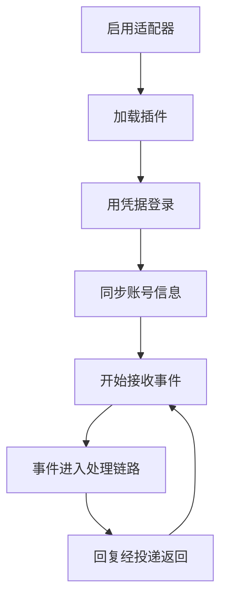

# 适配器

::: tip
适配器是 ChatLuna 与外部聊天平台之间的「翻译官」。它的主要职责是将平台的原生事件统一转换为内部标准格式，再将生成的回复消息翻译回对应平台支持的数据结构。
:::

没有适配器，ChatLuna 就只是一套纯粹的对话逻辑与模型编排引擎。

而一旦接入了适配器，同一套业务逻辑便能无缝运行在 QQ、Discord、Telegram、飞书、Slack 等各个平台上，且上层业务配置几乎无需改动。

## 统一协议

在架构底层，ChatLuna 采用 Satori 协议作为统一通讯标准。

适配器负责处理账号登录认证、长连接维持、平台事件监听与消息协议转换。上层逻辑完全感知不到底层具体平台的数据包结构，只需要面对标准化的会话对象：哪个平台、哪个机器人实例、来自哪个群组或频道、当前用户是谁，以及具体的交互内容。

这套抽象设计的核心权衡在于「主动抹平平台差异」——虽然隐藏了部分平台的专有特性，但换来的是上层插件与业务逻辑完全解耦，再也不用为每个平台单独重写一套。

### 会话

当外部平台推入一条入站消息时，适配器会将其包装为一个标准的会话对象，其中至少包含以下信息：

- **平台与账号**：所属平台标识以及接收该消息的机器人账号。
- **环境信息**：所属群组、频道以及触发事件的发送者用户。
- **消息实体**：消息唯一标识 id 与结构化的消息元素列表。
- **原生事件**：平台推送的原始事件载荷（用于特定平台的唤醒判定与扩展上下文）。

上层系统便能直接基于这些结构化字段，完成精准的会话路由、权限鉴权与关键词唤醒判定。

## 适配器的生命周期

在 ChatLuna 中，每一个适配器实例严格对应一个具体的机器人账号：

当适配器被停用时，系统会主动断开与平台的网络连接并停止事件接收，但该账号的配置数据仍会被完整保留在配置中心。

### 多账号

同一个平台可以同时接入并运行多个机器人账号。

每个账号实例都拥有独立的鉴权凭据、独立的运行状态机以及互不干扰的收发通道。

系统的会话路由支持根据「平台 + 机器人账号」进行复合区分。细心的小伙伴可能已经想到了：通过这种方式，我们可以轻松实现在「同一个群聊中，让不同的机器人账号各司其职」的多 Agent 协作场景。

## 事件如何进入处理链路

从平台原生数据包到达，到最终送出回复消息，整个流转过程清晰明了：

1. 适配器解析平台原生网络事件。
2. 将原生事件转换为标准会话对象，并分发至全局事件总线。
3. ChatLuna 内部的去重过滤器、中间件以及唤醒判定依次处理该会话。
4. 判定命中后，会话被分发至对应的执行引擎与模型进行推理。
5. 模型生成的回复内容经过渲染管道与投递层，交回给目标适配器。
6. 适配器将标准消息格式序列化为平台协议并调用 API 发送。

::: tip
在日常排查「机器人不说话」的问题时，建议先验证第 2 步是否顺利触发。

若事件根本没有进入事件总线，问题通常出在适配器的连接或协议解析层；如果总线已接收到事件却始终没有回复，则应当顺着链路检查唤醒规则与模型引擎。
:::

## 平台能力

不同聊天平台在消息富媒体支持与交互能力上存在客观差异：

| 能力 | 影响 |
| --- | --- |
| 编辑消息 | 流式输出、修正已发内容 |
| 撤回消息 | 清理误发内容 |
| 消息元素 | 图片、语音、表情、@、按钮 |
| 引用 | 回复时引用原消息 |
| 长度限制 | 是否需要分条 |
| 频率限制 | 是否需要退避 |

ChatLuna 会在运行时主动读取适配器声明的平台能力元数据，并进行优雅降级处理：

- 平台不支持编辑消息，则自动降级为等待全量生成完毕后一次性发送，不做流式修改。
- 平台不支持消息引用，则降级为直接发送普通回复消息。
- 平台不支持特定富媒体元素，则将元素内容转义为纯文本回退展示。

::: warning
遇到「在 A 平台运行完美，但换到 B 平台就表现异常」的情况时，绝大多数原因在于两个平台的能力支持度不同，而非插件配置本身有误。

遇到类似情况，请先查阅目标平台的能力清单，再排查业务配置。
:::

## 消息元素

在统一协议规范中，一条消息本质上是由若干个消息元素组成：

- 基础文本与 Markdown 排版。
- 多媒体内容：图片、音频、视频与文件。
- 交互元素：@ 提及、表情符号以及交互按钮。
- 结构元素：引用回复等。

适配器负责将这些标准元素忠实地转换并映射为平台所接受的数据格式。

如果某些特定元素在目标平台上缺乏原生支持，适配器并不会直接抛出异常中断发送，而是会尽最大可能实施内容降级：例如将图片降级为图床链接，将动态表情降级为对应的字符描述。

## WebUI 内置渠道

在控制台中，ChatLuna 还提供了一个开箱即用且无需任何额外凭据的内置适配器：网页渠道。

这个内置渠道具有一些专为测试与调试而设计的特点：

- 消息源直接来自于控制台的内置聊天交互页面。
- 发送接口仅返回一个占位的虚拟消息 id——真实的渲染与展现完全由控制台读取会话日志完成。
- 对编辑和撤回能力虽然声明为支持，但实际底层执行的是空操作（No-op），因为视觉状态完全由日志流所驱动。

这一设计让开发者在真正接入第三方平台之前，可以直接在浏览器内以零成本快速验证 Agent 逻辑、模型配置与预设效果。

## Koishi 兼容层

为了兼容广大的生态资产，ChatLuna 在底层封装了一层完善的 Koishi 兼容架构：

- 会话对象与消息构造器。
- 指令解析器系统与中间件处理链。
- 过滤器机制与国际化（i18n）多语言本地化。
- 数据库接口桥接。

这意味着社区中海量的现有 Koishi 适配器与插件，在 ChatLuna 体系中大多可以直接无缝复用。

需要注意的是，兼容层仅在根作用域桥接了必需的核心能力（例如模型服务、定时器和 Satori 总线），其余服务依旧严格遵循 Cordis 容器的依赖注入与作用域生命周期规范。

## 配置与凭据

每一个适配器的具体配置项均由其对应的插件模块进行声明，控制台界面则根据声明元数据自动渲染出结构化的配置表单。

在安全性方面，敏感的鉴权凭据在落盘存储时会进行加密处理，配置中仅保留其安全引用；而在实例启动阶段，系统会前置校验所有的必填字段，一旦发现凭据缺失将直接拒绝启用，避免在启动之后因鉴权失败产生无意义的网络重试与报错。

关于适配器的具体安装、启用与卸载等动手操作流程，请参考[接入聊天平台](/manual/usage/adapters)。

## 故障隔离

在多账号、多平台并行的运行环境中，单个适配器出现故障绝不会蔓延至其他适配器：

- 某个账号网络连接失败或掉线，影响范围仅局限于该账号本身。
- 单条事件解析异常时，系统仅丢弃有问题的单条事件，不会阻塞后续消息队列。
- 消息发送失败会被清晰地记入错误日志并回调通知模型运行时。

系统整体的稳定性始终受到隔离机制的保护，其他平台的机器人账号依旧能够照常收发事件。

## 与路由的关系

适配器在接收事件时解析出的身份标识，是后续整个消息路由判定的关键输入依据：

- 消息来源平台。
- 接收消息的机器人自身账号。
- 事件发生的群组或频道。
- 发送者用户身份。
- 发送者在当前平台的组织角色（群主、管理员、普通成员等）。

除了用于分发决策外，这些元数据同样无缝对接了权限系统：平台固有的群主和管理员等角色，可以直接映射为 ChatLuna 的内部权限等级。

## 排查

**消息进来了但机器人完全没有反应**

首先检查当前的路由规则是否涵盖了该平台与账号；其次核对是否满足关键词唤醒条件；最后排查用户权限等级与工具使用策略（判断是否因权限不足导致回复被拦截）。

**回复内容无法发送出去**

重点查看消息投递失败日志中的具体原因：常见诱因包括平台权限不足被拒、网络请求超时、触发平台频控（Rate Limit）限制，或者消息文本触发了平台敏感词审查。

**两个机器人账号在同一个群内互相触发**

当两个机器人处于同一个群聊环境中时，建议关闭其中一个账号的无前缀自动回复功能，或者在路由规则中将对方机器人的账号加入忽略黑名单。

**收到重复的事件并进行了多次处理**

检查配置中的事件去重机制是否开启；同时确认外部平台在网络波动时是否发起了重复推送。

**配置了平台能力却没有生效**

首先确认所安装的适配器插件版本是否在元数据中明确声明了该项能力；其次查阅官方文档确认该功能在目标平台底层是否支持。

## 下一步

- [消息处理链路](./chat-pipeline) — 事件进入之后发生了什么。
- [渲染与投递](./render-deliver) — 平台能力如何被使用。
- [接入聊天平台](/manual/usage/adapters) — 面向使用者的配置。
- [权限与审批](./permissions) — 平台角色的映射。
