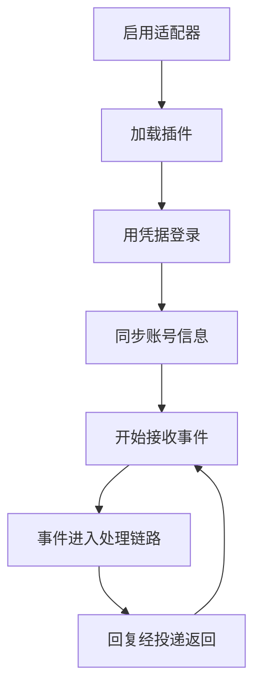

# 适配器

::: tip
适配器是 ChatLuna 与聊天平台之间的翻译层。它把平台的原生事件转成统一格式，再把它生成的回复转回平台消息。
:::

没有适配器，ChatLuna 只是一套对话逻辑。

有了适配器，同一套逻辑可以同时跑在 QQ、Discord、Telegram、飞书、Slack 上，配置几乎不用改。

<!-- 架构页，可以使用代码与配置示意 -->

## 统一协议

底层用的是 Satori 协议。

适配器负责登录账号、接收事件、转换消息。上层只看到一套统一的会话对象：哪个平台、哪个机器人、哪个群、哪个用户、什么内容。

这套统一的代价是「平台差异会被抹平」——好处是上层逻辑不用为每个平台写一遍。

### 会话

一条入站消息会变成一个会话对象，至少包含：

- 平台与机器人账号。
- 群、频道、用户。
- 消息 id 与内容元素。
- 原始事件（用于唤醒判定与上下文）。

上层用这些字段做路由、权限、唤醒判定。

## 适配器的生命周期

一个适配器实例对应一个账号：

停用则断开连接、停止接收，但保留配置。

### 多账号

同一个平台可以接多个账号。

每个账号有独立的凭据、独立的机器人状态、独立的收发通道。

路由可以按「平台 + 机器人账号」区分，从而实现「同一个群，不同的号负责不同的事」。

## 事件如何进入处理链路

平台事件到达后，大致经过：

1. 适配器解析平台原生事件。
2. 转成统一会话，分发到事件总线。
3. ChatLuna 的去重、过滤、唤醒判定依次处理。
4. 命中后交给对应的引擎与模型。
5. 生成的回复经渲染与投递回到适配器。
6. 适配器按平台格式发送。

::: tip
排查「机器人不说话」时，先确认第 2 步有没有发生。

如果事件根本没进总线，问题在适配器；如果进来了但没回复，问题在后面的判定与引擎。
:::

## 平台能力

不同平台支持的东西不一样：

| 能力 | 影响 |
| --- | --- |
| 编辑消息 | 流式输出、修正已发内容 |
| 撤回消息 | 清理误发内容 |
| 消息元素 | 图片、语音、表情、@、按钮 |
| 引用 | 回复时引用原消息 |
| 长度限制 | 是否需要分条 |
| 频率限制 | 是否需要退避 |

系统会读取平台声明的能力，并据此降级：

- 不支持编辑，就不做流式更新。
- 不支持引用，就发普通消息。
- 不支持某类元素，就当作文字处理。

::: warning
「在 A 平台好用、在 B 平台异常」绝大多数是能力差异，而不是配置错误。

先确认这个平台支不支持，再怀疑配置。
:::

## 消息元素

统一协议里，一条消息由若干元素组成：

- 文本。
- 图片、音频、视频、文件。
- @、表情。
- 引用。

适配器负责把元素翻译成平台能理解的形式。

翻译不了的元素不是错误，而是会被尽量降级：图片降级成链接、表情降级成文字。

## WebUI 内置渠道

控制台里有一个不需要配置的适配器：网页渠道。

它的特殊之处在于：

- 消息来自控制台的聊天页。
- 发送只返回一个占位消息 id——真正的显示由控制台读取会话日志完成。
- 编辑与撤回声明为支持，但实际操作是空实现，因为渲染由日志驱动。

这让「在浏览器里先试一下」成为零成本操作，特别适合在接真实平台之前验证配置。

## Koishi 兼容层

ChatLuna 提供了一层 Koishi 兼容：

- 会话对象与消息构造器。
- 指令解析器与中间件。
- 过滤器与国际化。
- 数据库接口桥接。

这让大量现成的 Koishi 适配器与插件可以直接使用。

兼容层只桥接必要的根能力（模型、定时器、Satori），其余仍按 Cordis 的依赖注入规则工作。

## 配置与凭据

适配器配置由对应插件声明，界面根据声明生成表单。

凭据字段加密保存，配置里只留引用；启用前校验必填项，缺失时拒绝启用，而不是启动后连接失败。

安装、启用、卸载的完整操作步骤见[接入聊天平台](/manual/usage/adapters)。

## 故障隔离

一个适配器挂了，不影响其他适配器。

- 连接失败只影响这个账号。
- 事件解析失败只丢弃这一条事件。
- 发送失败会记录并通知模型。

机器人整体仍然可用，其他平台照常收发。

## 与路由的关系

适配器提供的身份信息，是路由判定的输入之一：

- 平台。
- 机器人账号。
- 群 / 频道。
- 用户。
- 平台身份（群主、管理员、成员）。

这些信息也用于权限：平台角色可以映射成权限等级。

## 排查

**消息进来了但没反应。**

检查路由是否覆盖这个平台与账号；检查唤醒判定；检查权限与工具策略（如果它试图回复但被拦）。

**回复发不出去。**

看投递失败日志：平台拒绝、超时、频率限制、内容不合规。

**两个账号互相触发。**

两个机器人同群时，关掉其中一个的自动回复，或者在规则里排除对方账号。

**事件重复处理。**

检查去重设置；确认平台是否重复推送同一事件。

**平台能力没生效。**

确认适配器版本是否声明了该能力；确认平台本身支持。

## 下一步

- [消息处理链路](./chat-pipeline) — 事件进入之后发生了什么。
- [渲染与投递](./render-deliver) — 平台能力如何被使用。
- [接入聊天平台](/manual/usage/adapters) — 面向使用者的配置。
- [权限与审批](./permissions) — 平台角色的映射。
