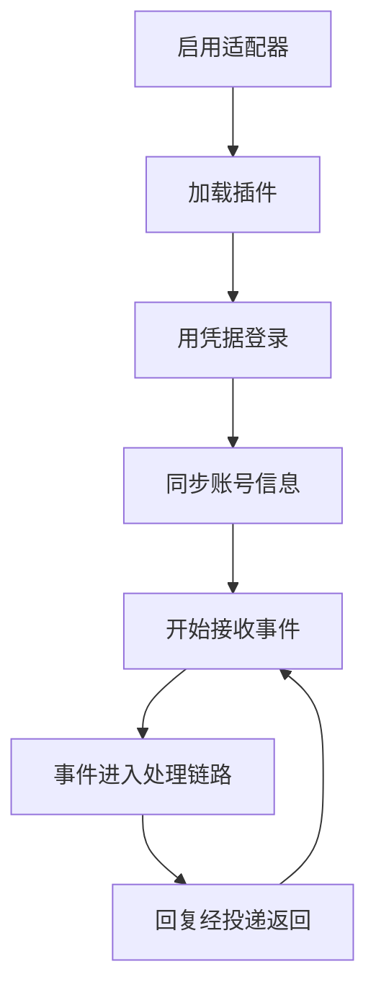

# 适配器

::: tip
适配器是 ChatLuna 与外部聊天平台之间的「翻译官」。它的主要职责是将平台的原生事件统一转换为内部标准格式，再将生成的回复消息转换为对应平台支持的数据结构。
:::

没有适配器时，ChatLuna 仅是一套对话逻辑与模型编排引擎。

接入适配器后，同一套业务逻辑便能在 QQ、Discord、Telegram、飞书、Slack 等各个平台上运行，上层业务配置也基本无需改动。

## 统一协议

在底层架构中，ChatLuna 采用 Satori 协议作为统一通信标准。

适配器负责处理账号登录认证、维持长连接、监听平台事件以及转换消息协议。上层逻辑无需关心底层平台的数据包格式，只需面向标准化的会话对象：来自哪个平台、哪个机器人实例、哪个群组或频道、当前用户是谁，以及具体的交互内容。

这种抽象抹平了平台间的差异。虽然隐藏了部分平台的专有特性，但让上层插件和业务逻辑得以完全解耦，无需再为每个平台单独编写一套逻辑。

### 会话

当外部平台收到一条消息并推送到 ChatLuna 时，适配器会将其包装为标准的会话对象，包含以下核心信息：

- **平台与账号**：所属平台标识，以及接收该消息的机器人账号。
- **环境信息**：所属群组、频道，以及触发事件的发送者。
- **消息实体**：消息唯一标识 `id` 与结构化的消息元素列表。
- **原生事件**：平台推送的原始事件负载（用于特定平台的唤醒判定与扩展上下文）。

上层系统可以直接基于这些结构化字段，完成会话路由、权限鉴权与关键词唤醒判定。

## 适配器的生命周期

在 ChatLuna 中，每个适配器实例对应一个具体的机器人账号：

停用适配器时，系统会主动断开与平台的网络连接并停止接收事件，该账号的配置数据仍会保留在配置中心。

### 多账号

同一个平台可以同时接入并运行多个机器人账号。

每个账号实例都拥有独立的鉴权凭据、运行状态机与收发通道，彼此互不干扰。

系统的会话路由支持根据「平台 + 机器人账号」进行复合区分。这样一来，你可以在同一个群聊中让不同的机器人账号各司其职，实现多 Agent 协同工作。

## 事件如何进入处理链路

从平台收到原生数据包，到最终发出回复消息，整个流转过程如下：

1. 适配器解析平台的原生网络事件。
2. 将原生事件转换为标准会话对象，并分发至全局事件总线。
3. ChatLuna 内部的去重过滤器、中间件与唤醒判定依次处理该会话。
4. 判定命中后，会话被分发给对应的执行引擎与模型进行推理。
5. 模型生成的回复内容经过渲染管道与投递层，交回目标适配器。
6. 适配器将标准消息格式序列化为平台协议，并调用 API 发送。

::: tip
排查「机器人没有回复」的问题时，建议先检查第 2 步是否顺利触发。

如果事件没有进入事件总线，问题通常出在适配器的连接或协议解析层；如果总线已收到事件却始终没有回复，则应顺着链路检查唤醒规则与模型引擎。
:::

## 平台能力

不同聊天平台对富媒体和交互特性的支持程度各不相同：

| 能力 | 影响 |
| --- | --- |
| 编辑消息 | 流式输出、修正已发内容 |
| 撤回消息 | 清理误发内容 |
| 消息元素 | 图片、语音、表情、@、按钮 |
| 引用 | 回复时引用原消息 |
| 长度限制 | 是否需要分条发送 |
| 频率限制 | 是否需要退避重试 |

ChatLuna 会在运行时读取适配器声明的平台能力元数据，并自动降级处理：

- 平台不支持编辑消息：自动降级为等待全部生成完毕后一次性发送，不做流式修改。
- 平台不支持消息引用：降级为直接发送普通回复消息。
- 平台不支持特定富媒体元素：将元素内容转义为纯文本展示。

::: warning
如果遇到「在 A 平台运行正常，换到 B 平台却表现异常」的情况，通常是因为两个平台支持的能力不同，而非配置本身有误。

遇到此类情况时，建议先查阅目标平台的能力清单，再排查业务配置。
:::

## 消息元素

在统一协议规范中，一条消息由若干个消息元素组合而成：

- 基础文本与 Markdown 排版
- 多媒体内容：图片、音频、视频与文件
- 交互元素：@ 提及、表情符号与交互按钮
- 结构元素：引用回复等

适配器负责将这些标准元素转换并映射为平台支持的数据格式。

如果目标平台不支持某些元素，适配器不会直接报错中断发送，而是会尽可能进行内容降级：例如将图片降级为图床链接，或将动态表情降级为文字描述。

## WebUI 内置渠道

在控制台中，ChatLuna 提供了一个开箱即用、无需任何凭据的内置适配器：网页渠道。

这个内置渠道专为测试和调试设计，具有以下特点：

- 消息直接来自控制台内置的聊天页面。
- 发送接口仅返回一个虚拟的占位消息 `id`，实际渲染与展示由控制台读取会话日志完成。
- 编辑与撤回能力虽然声明为支持，但底层实际执行的是空操作（No-op），视觉状态完全由日志流驱动。

借助该渠道，你无需接入第三方平台，即可在浏览器中快速验证 Agent 逻辑、模型配置与预设效果。

## Koishi 兼容层

为了复用社区既有生态，ChatLuna 在底层封装了一层 Koishi 兼容架构：

- 会话对象与消息构造器
- 指令解析器与中间件处理链
- 过滤器机制与国际化（i18n）支持
- 数据库接口桥接

得益于此，社区中大量的现有 Koishi 适配器与插件，大多可以在 ChatLuna 中直接复用。

需要注意的是，兼容层仅在根作用域中桥接了核心能力（如模型服务、定时器与 Satori 总线），其余服务仍遵循 Cordis 容器的依赖注入与作用域生命周期规范。

## 配置与凭据

每个适配器的配置项由对应的插件模块声明，控制台会根据元数据自动渲染出结构化的配置表单。

在安全性方面，敏感的鉴权凭据在保存到磁盘时会进行加密，配置中仅保留安全引用。在实例启动时，系统会提前校验所有必填字段；一旦发现凭据缺失将直接拒绝启用，避免启动后因鉴权失败产生无效的网络重试和报错。

关于适配器的安装、启用与卸载等操作流程，请参考 [接入聊天平台](/manual/usage/adapters)。

## 故障隔离

在多账号、多平台并行的环境中，单个适配器的故障不会影响其他适配器：

- 某个账号连接失败或掉线时，影响仅局限于该账号本身。
- 单条事件解析异常时，系统仅丢弃该条异常事件，不会阻塞后续消息队列。
- 消息发送失败会记录在错误日志中，并回调通知模型运行时。

即使某个适配器出现问题，其他平台的机器人账号仍可正常收发消息。

## 与路由的关系

适配器在接收事件时解析出的身份标识，是后续消息路由判定的关键依据：

- 消息来源平台
- 接收消息的机器人账号
- 事件发生的群组或频道
- 发送者用户身份
- 发送者在当前平台的角色（群主、管理员、普通成员等）

除了用于路由分发外，这些元数据还可以无缝对接权限系统：平台的群主、管理员等角色，可以直接映射为 ChatLuna 的内部权限等级。

## 排查

**消息进来了但机器人完全没有反应**

先检查当前路由规则是否包含该平台与账号；其次确认是否满足关键词唤醒条件；最后检查用户权限等级与工具使用策略，排查是否因权限不足导致回复被拦截。

**回复内容无法发送出去**

查看消息投递失败的日志排查具体原因。常见原因包括：平台权限不足、网络请求超时、触发平台频率限制（Rate Limit），或消息内容触发了平台的敏感词审核。

**两个机器人账号在同一个群内互相触发**

当两个机器人位于同一群聊中时，建议关闭其中一个账号的无前缀自动回复，或在路由规则中将对方的账号加入忽略名单。

**收到重复的事件并进行了多次处理**

检查配置中的事件去重机制是否开启；同时确认外部平台在网络波动时是否发起了重复推送。

**配置了平台能力却没有生效**

先确认所安装的适配器插件是否在元数据中声明了该能力；再查阅目标平台文档，确认该平台底层是否支持此特性。

## 下一步

- [消息处理链路](./chat-pipeline) — 事件进入之后发生了什么。
- [渲染与投递](./render-deliver) — 平台能力如何被使用。
- [接入聊天平台](/manual/usage/adapters) — 面向使用者的配置。
- [权限与审批](./permissions) — 平台角色的映射。
