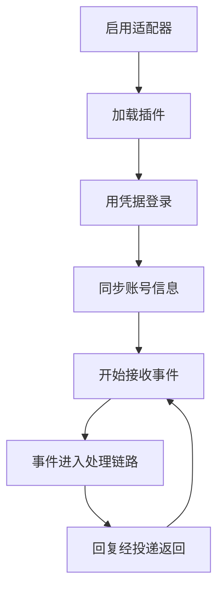

# 适配器

::: tip
适配器把平台的原生事件转换为内部标准格式，再把回复转换为平台支持的数据结构。没有适配器，ChatLuna 只是一套对话逻辑与模型编排引擎；接入适配器后，同一套业务逻辑可以运行在 QQ、Discord、Telegram、飞书、Slack 等平台上，上层配置基本无需改动。
:::

## 统一协议

ChatLuna 以 Satori 协议作为统一通信标准。适配器负责登录认证、维持长连接、监听事件和转换消息协议，上层只面向标准化的会话对象：

- **平台与账号**：平台标识与接收消息的机器人账号。
- **环境信息**：群组、频道与发送者。
- **消息实体**：消息 `id` 与结构化的消息元素列表。
- **原生事件**：平台推送的原始负载，用于特定平台的唤醒判定与扩展上下文。

路由、鉴权与唤醒判定都基于这些字段。这层抽象会隐藏部分平台专有特性，换来的是上层插件不必为每个平台单独写逻辑。

## 生命周期

每个适配器实例对应一个机器人账号：

停用时断开连接并停止接收事件，账号配置仍然保留。

同一平台可以同时运行多个账号，各自拥有独立的凭据、状态与收发通道。路由支持按「平台 + 机器人账号」区分，可以让同一群里的不同账号各司其职。

## 事件处理链路

1. 适配器解析平台的原生事件。
2. 转换为标准会话对象，分发到全局事件总线。
3. 去重过滤器、中间件与唤醒判定依次处理。
4. 命中后交给对应的引擎与模型推理。
5. 回复经渲染与投递交回目标适配器。
6. 适配器序列化为平台协议并调用 API 发送。

::: tip
排查「机器人没有回复」时先看第 2 步：事件没进总线，问题在适配器的连接或协议解析；总线收到了却没回复，就顺着链路查唤醒规则与引擎。
:::

## 平台能力

| 能力 | 影响 |
| --- | --- |
| 编辑消息 | 流式输出、修正已发内容 |
| 撤回消息 | 清理误发内容 |
| 消息元素 | 图片、语音、表情、@、按钮 |
| 引用 | 回复时引用原消息 |
| 长度限制 | 是否需要分条发送 |
| 频率限制 | 是否需要退避重试 |

运行时读取适配器声明的能力并自动降级：

- 不支持编辑：生成完毕后一次性发送。
- 不支持引用：发送普通回复。
- 不支持某种元素：尽量降级，例如图片转为链接、动态表情转为文字描述，不会中断发送。

消息元素包括文本与 Markdown、图片/音频/视频/文件、@/表情/按钮，以及引用回复。

::: warning
「A 平台正常，B 平台异常」通常是两个平台能力不同，而不是配置有误。先查目标平台的能力清单，再排查配置。
:::

## WebUI 内置渠道

控制台自带一个无需凭据的网页渠道，用于测试和调试：

- 消息来自控制台的聊天页面。
- 发送接口只返回占位消息 `id`，展示由控制台读取会话日志完成。
- 编辑与撤回声明为支持，实际是空操作，视觉状态由日志流驱动。

不接第三方平台，就能在浏览器里验证 Agent 逻辑、模型配置与预设效果。

## Koishi 兼容层

为复用社区生态，ChatLuna 提供 Koishi 兼容层：会话对象与消息构造器、指令解析与中间件、过滤器与 i18n，以及数据库接口桥接。大部分现有 Koishi 适配器与插件可以直接复用。

兼容层只在根作用域桥接核心能力（模型服务、定时器与 Satori 总线），其余服务仍遵循 Cordis 的依赖注入与作用域生命周期。

## 配置与故障隔离

适配器的配置项由插件声明，控制台据此渲染表单。凭据单独保存，配置中只保留引用；启动时校验必填字段，缺凭据直接拒绝启用，避免无效的重试与报错。安装、启用与卸载见 [接入聊天平台](/manual/usage/adapters)。

单个适配器的故障不影响其他适配器：

- 账号连接失败或掉线只影响该账号。
- 单条事件解析异常时只丢弃该事件，不阻塞后续消息。
- 发送失败记录到错误日志，并回调通知模型运行时。

## 与路由和权限的关系

适配器解析出的平台、机器人账号、群组或频道、发送者及其平台角色（群主、管理员、普通成员）是路由判定的依据。平台角色也可以映射为 ChatLuna 的权限等级。

## 常见问题

**消息进来了但没有反应**：依次检查路由规则是否包含该平台与账号、是否满足唤醒条件、用户权限与工具策略是否拦截了回复。

**回复发不出去**：看投递失败日志。常见原因是平台权限不足、网络超时、触发频率限制或平台敏感词审核。

**两个机器人在同一群里互相触发**：关闭其中一个的无前缀自动回复，或在路由规则中把对方账号加入忽略名单。

**同一事件被处理多次**：确认事件去重已开启，以及平台是否在网络波动时重复推送。

**平台能力没有生效**：确认适配器插件声明了该能力，再查平台文档确认底层是否支持。

## 下一步

- [消息处理链路](./chat-pipeline) — 事件进入之后发生了什么。
- [渲染与投递](./render-deliver) — 平台能力如何被使用。
- [接入聊天平台](/manual/usage/adapters) — 面向使用者的配置。
- [权限与审批](./permissions) — 平台角色的映射。
