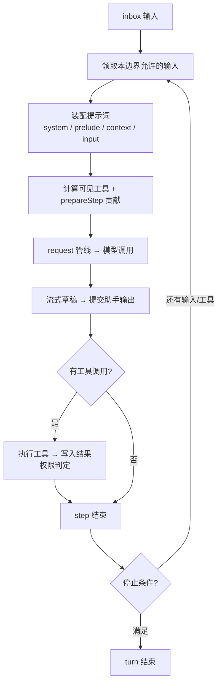

# Agent 与执行循环

智能体（Agent）是驱动对话与自动化流程的核心。它负责将接收到的输入转化为一轮或多轮模型调用，并在模型请求调用工具（Tool）时持续推进执行循环。

需要明确的是，Agent 并不是底层模型 SDK 的简单别名，也不是持久化数据库，而是一个负责会话调度与执行状态流转的在线执行器。

::: warning
平台入口、WebUI 和扩展插件应当统一向同一个在线 Agent 实例投递输入。切勿分别打开会话快照后直接向底层写入数据，否则会导致执行状态脱节。
:::

## 核心概念：轮次、单步与单次调用

在深入执行细节之前，我们先来厘清三个不同粒度的执行单位：

- **轮次 (Turn)**：运行时接纳一批输入并完整执行的过程。引擎或中间件可以根据业务逻辑跳过特定 Turn。
- **单步 (Step)**：单个轮次中的最小迭代单元，包含一次模型请求以及由该请求触发的工具执行。一个 Turn 内可以包含多个 Step。
- **单次调用 (`ctx.chatluna.chat()`)**：仅发起单次模型调用并返回 `Run` 对象，它**不会**代替 Agent 驱动多步工具循环。

为了更直观地理解整个循环的流转过程，可以参考下方的流程图：



默认的执行循环由 `@chatluna/agent` 内部驱动，无需额外引入独立的循环控制包。如果你有定制需求，也可以通过 `ctx.agents.runtime(name, runtime)` 注册自定义运行时。但请注意，自定义运行时必须完整实现创建、启动、关闭等生命周期契约，而不能仅替换单个请求函数。

## 投递输入与接纳时机

向 Agent 发送消息可以使用 `agent.receive(message, { when })`。该方法同步返回 `void`，**不返回**对应回答的 Promise。

那么，投递的消息会在什么时候进入模型上下文呢？这取决于参数 `when` 的设置：

| `when` 选项 | Agent 空闲时 | Agent 正在执行时 |
| --- | --- | --- |
| `next`（默认） | 立即唤醒循环 | 暂存并等待后续 Turn，不合入当前 Turn 的后续 Step |
| `now` | 立即唤醒循环 | 在当前 Turn 的后续 Step 边界插队合入，但不中止已发出的请求 |
| `quiet` | 仅推入队列，不主动唤醒循环 | 不主动唤醒；若循环已在运行，可在后续 Step 边界合入 |

::: tip
关于 `when` 选项的几点补充：
- `now` 并非硬性中断信号，已经发往模型的请求仍会继续完成。
- `quiet` 并非丢弃或隐藏消息，被接纳的静默输入后续仍会正常转化为模型上下文。
- 若队列或当前处理流程中已存在相同的 `messageId`，消息不会被重复入队。
:::

当新 Turn 启动时，系统会优先取出 `now` 与 `quiet` 分组的输入，再处理常规输入。因此，运行时并不保证跨优先级的严格全局 FIFO（先进先出）。

让我们来看一个具体的调用示例：

```ts
import { ChatMessage } from '@chatluna/message'

// 投递常规用户消息并唤醒循环
agent.receive(ChatMessage.user('请比较这两种部署方式'))

// 插入补充信息，在当前轮次的下一个 step 边界合入
agent.receive(ChatMessage.notice('documentation', '补充：目标机器没有 Docker。'), {
  when: 'now',
})

// 等待 Agent 处理完毕
await agent.idle()
```

上述代码中的 `agent` 为当前持有的在线实例。`agent.idle()` 用于等待当前实例的所有排队与执行任务完全收敛，并会持续跟踪执行期间产生的新任务。

::: warning
使用 `idle()` 时需要注意以下几点：
- `agent.idle()` 不会仅仅因为队列中残留未唤醒的 `quiet` 消息而无限等待。
- 若执行过程中发生未捕获的错误，`idle()` 返回的 Promise 可能会直接被拒绝 (reject)。
- 请勿将「下一个接收到的助手回复」默认当成某条特定输入的对应结果。关联输入与输出必须基于消息身份标识、上下文条目或运行时事件。
:::

## 单步执行生命周期

默认执行循环在每个 Step 边界通常会按顺序经历以下流程（具体的输入提交节点由具体实现与加载的中间件决定）：

1. **获取输入**：领取当前执行边界允许接纳的消息批次。
2. **装配上下文**：构建提示词环境，渲染 system、prelude、context 和 input 分段。
3. **计算可见性**：计算可见工具列表，合并 `prepareStep` 注入的上下文与模型参数。
4. **模型请求**：经 `ingest` 等中间件处理并记录请求快照后，通过 `request` 管线发起调用。
5. **处理输出**：消费流式输出草稿，提交助手消息正文及 usage、finish 等元数据。
6. **执行工具**：依据权限配置执行模型申请调用的工具，并将执行结果写回上下文。
7. **评估停止条件**：检查是否触发步数或状态停止条件；未满足且需继续时进入下一 Step。

模型切换、上下文压缩、动态工具发现和自定义流程引擎均可挂载在上述边界中。最终发往模型的实际内容以快照和中间件处理后的结果为准。

## 注册中间件扩展

为了便于干预执行逻辑，Agent 运行时在不同粒度上暴露了扩展点。你可以通过中间件来拦截或重组流程：

| 扩展点 | 职责说明 |
| --- | --- |
| `ingest` | 拦截和重整输入的接纳，控制批次变换 |
| `turn` | 控制整个 Turn 流程，常用于定制引擎逻辑 |
| `step` | 单步前后切面控制，例如在执行单步前触发上下文压缩 |
| `request` | 负责实际模型请求派发、失败重试及错误恢复 |
| `commit` | 在助手结果最终持久化或写回前进行数据整形 |
| `prepareStep` | 调整目标模型、system 提示词、可见工具及调用参数，贡献额外消息 |

中间件通过调用方的 `Context` 进行注册，生命周期受所属 Fiber 管辖并自动释放。全局贡献与当前 Agent 的局部贡献均会生效，但父 Agent 的局部贡献**不会**自动下发给子代理。

::: danger
在 `prepareStep` 扩展点中，请格外注意以下两点约束：
- 严禁直接覆盖整个 `messages` 数组。新增临时输入或上下文必须使用 `contribute` API；若要修改历史，必须使用明确的压缩操作。
- 绝不允许伪造 `source.kind === 'model'` 的消息。该字段用于底层安全检查消息来源，而非普通的 `role: 'model'` 属性。
:::

## 创建与恢复 Agent 实例

在实际开发中，Agent 实例通常有以下创建与管理路径：

### 1. 标准生命周期管理

- `ctx.agents.create(sessionId, options, at)`：创建新的 Agent 实例。`options.config` 中声明具体的 `provider` 和 `model`。局部能力注册在 `at.apply(ctx, agent)` 回调中声明。
- `ctx.agents.open(sessionId)`：恢复或复用同 ID 的在线活跃实例。

对于常规业务会话，推荐优先调用 `ctx.conversations.open()`，它会自动处理业务会话游标（Head）与在线实例的生命周期协同。

### 2. 临时派生快速实例

如果需要快速派生单次执行的轻量 Agent，可使用 `ctx.agents.spawn()`：

```ts
import type { Context } from 'cordis'

export function apply(ctx: Context) {
  const runner = ctx.agents.spawn({
    model: 'openai:gpt-4o', // 必须使用 provider:model 格式
    prompt: '你是一个代码审查助手。',
    tools: ['git_diff', 'linter'], // 筛选可见工具，仍受权限管辖
    inherit: false,
    setup(fiberCtx, agent) {
      // 在此配置局部监听器或单次生命周期逻辑
    },
  })
}
```

::: tip
若需要执行具有复杂从属关系的子任务，应使用 `ctx.subagents` 服务。它提供了任务句柄、委派深度管理、独立权限上限控制与后端分配能力。通过手工递归调用 `spawn` 不会自动获得这些管控能力。
:::

### 依赖服务清单

启动默认 Agent 运行时前，必须确保宿主环境中已加载以下服务：

- `agents`
- `chatluna`
- `ai`
- `tools`
- `prompt`
- `sessions`
- `trace`
- `presets`
- `tool_search`

::: warning
虽然 `trace`、`presets` 和 `tool_search` 在架构职责上相对独立，但在当前版本中它们均为默认 Agent 启动的硬性依赖。移除其中任意一项都会抛出 `missing required services` 错误，系统目前不会自动降级运行。
:::

## 停止与资源释放

### 循环停止参数

默认运行时的循环控制参数如下：

| 配置字段 | 默认值 | 说明 |
| --- | --- | --- |
| `maxStepsPerTurn` | `60` | 单个 Turn 允许执行的最大步数停止上限 |
| `maxParallelToolCalls` | `10` | 工具并行调度上限，同时受工具自身的 `parallel` 特性约束 |
| `staleLimit` | `8` | 冻结工具头允许保留的已失效工具名称数量上限。超过该阈值或引入新工具时强制刷新，**不是**重试次数 |

### 实例控制与清理方法

你可以通过以下实例方法干预排队任务或销毁实例：

- `agent.drop()`：清空丢弃所有仍在队列中等待处理的输入。
- `agent.discard(messageId, reason)`：从待处理队列中移除指定的单条消息。参数必须为 `MessageId` 类型；返回 `boolean` 表示是否成功移除。
- `agent.abort(reason, { keepPending })`：中断当前正在执行的活动。默认丢弃所有待处理输入；若 `keepPending` 设为 `true`，则保留队列。
- `agent.exclusive(task)`：排在当前实例的所有既有工作之后独占执行 `task(signal)`。**注意它不是数据库事务**。
- `agent.close()`：关闭 Agent 实例并释放内部绑定的 Fiber 上下文。关闭中与关闭后的 Agent 均会拒绝接纳任何新输入。

::: danger
调用 `abort()` 仅向底层传递 `AbortSignal` 并依赖下游逻辑主动响应取消。它**不会**回滚工具已经完成的文件修改、已发送的聊天消息或已生效的远程 RPC 调用。编写带副作用的重试逻辑前，务必核对工具操作的幂等性。
:::

## 引擎的作用边界

引擎（Engine）本质上是挂载到 Agent Fiber 上下文中的标准 Cordis 插件，主要通过覆写 `assemble` 和 `flow` 等逻辑来重构行为。

框架内置的常规 Agent、代码编写（Coding）以及独立的代号角色（Character）引擎具备不同的流程编排与提示词策略，但底层统一遵守会话提交、工具管线及 Fiber 生命周期规范。预设（Preset）具有 `kind` 限制与对应的引擎接纳规则，并非所有预设都能无缝混用于任意类型的引擎。

## 常见排错与检查清单

在开发与调试过程中遇到异常时，可以对照下表快速排查：

| 故障现象 | 排查方向 |
| --- | --- |
| 调用 `receive()` 后完全不输出回复 | 检查投递时是否指定了 `when: 'quiet'`；检查当前引擎或中间件是否跳过了该轮次；检查会话入口是否处于激活状态或被鉴权策略拦截。 |
| 使用 `when: 'now'` 后，模型没有立即按新输入回复 | `now` 在当前单步（Step）执行结束后的边界处合入，不会中止并回滚已经发送给模型的实时请求。 |
| `agent.idle()` 的等待耗时远超单次问答交互 | `idle()` 跟踪的是整个 Agent 实例的全局工作收敛状态，不与某条特定消息绑定。检查是否有持续产出事件的任务仍在执行。 |
| 调用接口报错提示 Agent 实例已关闭 | 说明业务端缓存了失效的旧 Agent 实例句柄。请重新走 `ctx.conversations.open()` 或 `ctx.agents.open()` 获取在线实例。 |
| 启动时报错 `missing required services` | 对照文中的服务清单排查依赖，不可随意卸载 `trace`、`presets` 或 `tool_search` 插件。 |
| 操作重试后产生重复数据或脏数据 | 中断和取消操作不会自动回滚外部副作用，请检查相关工具实现是否支持幂等操作。 |

## 下一步

到这里，你已经了解了 Agent 的核心循环与生命周期管理机制。接下来可以继续阅读：

- 深入了解上下文存储与游标管理：[会话与分支](/architecture/sessions)
- 了解历史消息控制与修剪机制：[上下文与压缩](/architecture/context-cache)
- 学习如何开发与注册自定义能力：[插件开发](/guide/develop/first-plugin)
