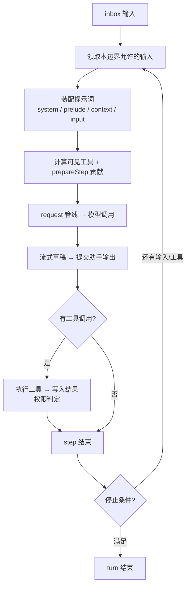

# Agent 与执行循环

::: tip
Agent 把收到的输入转化为一轮或多轮模型调用，模型请求工具时持续推进执行循环。它不是模型 SDK 的别名，也不是数据库，而是负责会话调度和执行状态流转的在线执行器。
:::

::: warning
平台入口、WebUI 和扩展插件应向同一个在线 Agent 投递输入。不要各自打开会话快照直接写入，否则执行状态会脱节。
:::

## 轮次、单步与单次调用

- **轮次（Turn）**：接纳一批输入并完整执行的过程。引擎或中间件可以跳过特定 Turn。
- **单步（Step）**：Turn 中的最小迭代单元，包含一次模型请求及它触发的工具执行。
- **单次调用（`ctx.chatluna.chat()`）**：只发起一次模型调用并返回 `Run`，**不会**驱动多步工具循环。



默认循环由 `@chatluna/agent` 内部驱动。也可以用 `ctx.agents.runtime(name, runtime)` 注册自定义运行时，但必须完整实现创建、启动、关闭等生命周期契约，不能只替换单个请求函数。

## 投递输入

`agent.receive(message, { when })` 同步返回 `void`，**不返回**回答的 Promise。

| `when` 选项 | Agent 空闲时 | Agent 正在执行时 |
| --- | --- | --- |
| `next`（默认） | 立即唤醒循环 | 暂存并等待后续 Turn，不合入当前 Turn 的后续 Step |
| `now` | 立即唤醒循环 | 在当前 Turn 的后续 Step 边界插队合入，但不中止已发出的请求 |
| `quiet` | 仅推入队列，不主动唤醒循环 | 不主动唤醒；若循环已在运行，可在后续 Step 边界合入 |

- `now` 不是硬中断，已发出的请求会继续完成。
- `quiet` 不是丢弃，被接纳后照常进入上下文。
- 相同 `messageId` 不会重复入队。
- 新 Turn 先取 `now` 和 `quiet` 的输入，再处理常规输入，所以不保证跨优先级的严格 FIFO。

```ts
import { ChatMessage } from '@chatluna/message'

// 投递常规用户消息并唤醒循环
agent.receive(ChatMessage.user('请比较这两种部署方式'))

// 插入补充信息，在当前轮次的下一个 step 边界合入
agent.receive(ChatMessage.notice('documentation', '补充：目标机器没有 Docker。'), {
  when: 'now',
})

// 等待 Agent 处理完毕
await agent.idle()
```

`agent.idle()` 等待实例的所有排队与执行任务收敛，并持续跟踪期间产生的新任务。

::: warning
- 队列中只剩未唤醒的 `quiet` 消息时，`idle()` 不会无限等待。
- 执行中出现未捕获的错误时，`idle()` 可能直接 reject。
- 不要把「下一条助手回复」当作某条输入的结果。关联输入和输出要靠消息身份、上下文条目或运行时事件。
:::

## 单步生命周期

每个 Step 边界通常依次经过（具体提交节点由实现和中间件决定）：

1. **获取输入**：领取当前边界允许接纳的消息。
2. **装配上下文**：渲染 system、prelude、context 和 input。
3. **计算可见性**：计算可见工具，合并 `prepareStep` 贡献的上下文和模型参数。
4. **模型请求**：经 `ingest` 等中间件处理并记录快照后，通过 `request` 管线调用。
5. **处理输出**：消费流式草稿，提交助手消息及 usage、finish 等元数据。
6. **执行工具**：按权限执行工具并写回结果。
7. **评估停止条件**：未满足且需要继续时进入下一 Step。

模型切换、上下文压缩、动态工具发现和自定义流程引擎都挂在这些边界上。实际发给模型的内容以快照和中间件处理后的结果为准。

## 中间件

| 扩展点 | 职责说明 |
| --- | --- |
| `ingest` | 拦截和重整输入的接纳，控制批次变换 |
| `turn` | 控制整个 Turn 流程，常用于定制引擎逻辑 |
| `step` | 单步前后切面控制，例如在执行单步前触发上下文压缩 |
| `request` | 负责实际模型请求派发、失败重试及错误恢复 |
| `commit` | 在助手结果最终持久化或写回前进行数据整形 |
| `prepareStep` | 调整目标模型、system 提示词、可见工具及调用参数，贡献额外消息 |

中间件通过调用方的 `Context` 注册，随 Fiber 自动释放。全局贡献和当前 Agent 的局部贡献都会生效，但父 Agent 的局部贡献**不会**下发给子代理。

::: danger
`prepareStep` 中：
- 不要直接覆盖整个 `messages` 数组。新增临时输入用 `contribute`，修改历史用明确的压缩操作。
- 不要伪造 `source.kind === 'model'` 的消息。这个字段用于底层的来源安全检查，不是普通的 `role: 'model'`。
:::

## 创建与恢复

- `ctx.agents.create(sessionId, options, at)`：创建实例。`options.config` 中声明 `provider` 和 `model`，局部能力在 `at.apply(ctx, agent)` 中注册。
- `ctx.agents.open(sessionId)`：恢复或复用同 ID 的在线实例。

常规业务会话优先用 `ctx.conversations.open()`，它会协调会话头（Head）与在线实例的生命周期。

快速派生单次执行的轻量 Agent 用 `ctx.agents.spawn()`：

```ts
import type { Context } from 'cordis'

export function apply(ctx: Context) {
  const runner = ctx.agents.spawn({
    model: 'openai:gpt-4o', // 必须使用 provider:model 格式
    prompt: '你是一个代码审查助手。',
    tools: ['git_diff', 'linter'], // 筛选可见工具，仍受权限管辖
    inherit: false,
    setup(fiberCtx, agent) {
      // 在此配置局部监听器或单次生命周期逻辑
    },
  })
}
```

::: tip
有从属关系的子任务应使用 `ctx.subagents`，它提供任务句柄、委派深度、独立权限上限和后端分配。手工递归调用 `spawn` 不会获得这些管控。
:::

默认运行时依赖以下服务：`agents`、`chatluna`、`ai`、`tools`、`prompt`、`sessions`、`trace`、`presets`、`tool_search`。

::: warning
`trace`、`presets` 和 `tool_search` 虽然职责独立，但当前都是硬性依赖。缺少任一项会抛出 `missing required services`，不会降级运行。
:::

## 停止与释放

| 配置字段 | 默认值 | 说明 |
| --- | --- | --- |
| `maxStepsPerTurn` | `60` | 单个 Turn 允许执行的最大步数上限 |
| `maxParallelToolCalls` | `10` | 工具并行调度上限，同时受工具自身的 `parallel` 特性约束 |
| `staleLimit` | `8` | 冻结工具头允许保留的已失效工具名称数量上限。超过该阈值或引入新工具时强制刷新，**不是**重试次数 |

- `agent.drop()`：丢弃所有排队中的输入。
- `agent.discard(messageId, reason)`：移除指定的一条待处理消息，参数为 `MessageId`，返回 `boolean` 表示是否移除。
- `agent.abort(reason, { keepPending })`：中断当前活动，默认丢弃待处理输入；`keepPending: true` 时保留。
- `agent.exclusive(task)`：排在所有既有任务之后独占执行 `task(signal)`。**它不是数据库事务**。
- `agent.close()`：关闭实例并释放 Fiber，关闭中和关闭后都拒绝新输入。

::: danger
`abort()` 只是传递 `AbortSignal`，依赖下游主动响应。它**不会**回滚已完成的文件修改、已发出的消息或已生效的远程调用。编写带副作用的重试逻辑前，先确认工具是幂等的。
:::

## 引擎的作用边界

引擎是挂载到 Agent Fiber 上的 Cordis 插件，主要通过覆写 `assemble` 和 `flow` 改变行为。内置的对话、编码和伪装引擎流程和提示词策略不同，但都遵守相同的会话提交、工具管线和 Fiber 生命周期规范。预设有 `kind` 限制，不是所有预设都能用在任意引擎上。

## 常见问题

| 故障现象 | 排查方向 |
| --- | --- |
| 调用 `receive()` 后完全不输出回复 | 检查投递时是否指定了 `when: 'quiet'`；检查当前引擎或中间件是否跳过了该轮次；检查会话入口是否处于激活状态或被鉴权策略拦截。 |
| 使用 `when: 'now'` 后，模型没有立即按新输入回复 | `now` 在当前单步（Step）执行结束后的边界处合入，不会中止并回滚已经发送给模型的实时请求。 |
| `agent.idle()` 的等待耗时远超单次问答交互 | `idle()` 跟踪的是整个 Agent 实例的全局工作收敛状态，不与某条特定消息绑定。检查是否有持续产出事件的任务仍在执行。 |
| 调用接口报错提示 Agent 实例已关闭 | 说明业务端缓存了失效的旧 Agent 实例句柄。请重新调用 `ctx.conversations.open()` 或 `ctx.agents.open()` 获取在线实例。 |
| 启动时报错 `missing required services` | 对照文中的服务清单排查依赖，不可随意卸载 `trace`、`presets` 或 `tool_search` 插件。 |
| 操作重试后产生重复数据或脏数据 | 中断和取消操作不会自动回滚外部副作用，请检查相关工具实现是否支持幂等操作。 |

## 下一步

- [会话与分支](/architecture/sessions) — 上下文存储与游标管理。
- [上下文与压缩](/architecture/context-cache) — 历史消息控制与修剪。
- [插件开发](/guide/develop/first-plugin) — 开发与注册自定义能力。
