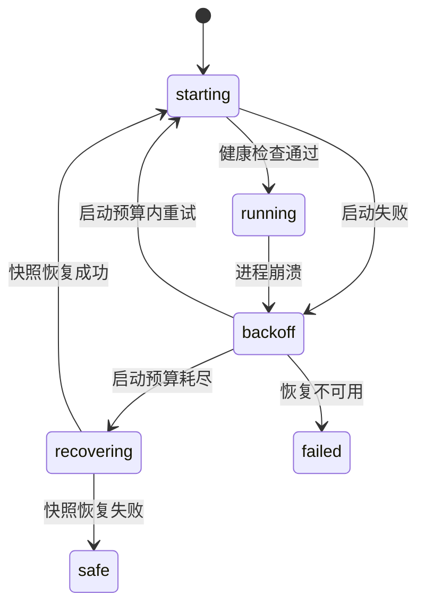

# 启动与插件树

::: tip
ChatLuna 的启动过程由两层结构驱动：宿主进程先读取轻量的引导配置，由引导配置拉起加载器并解析完整的插件树，具体的业务能力则全部挂载在插件树中。理解这套装配机制，是掌握配置热重载与实例生命周期的关键。
:::

启动一个 ChatLuna 实例时，后台实际经历的步骤远不止运行一个进程：加载环境变量、解析清单与插件树、划分服务隔离域、启动核心服务、等待健康检查探测，并在遇到异常时自动回滚。

本节将为你拆解从命令行唤起直至整个实例完全就绪的完整启动流程。

<!-- 架构页，可以使用代码与配置示意 -->

## 两份清单

ChatLuna 将启动逻辑与业务配置拆分成了两份职责明确的清单文件。

### 引导文件

位于根目录下的 `cordis.yml` 是引导加载器的配置文件。它的职责只有一项：启动加载器，并告诉加载器去哪里寻找插件树：

```yaml
- id: cli
  name: '@cordisjs/plugin-cli'
  config:
    name: chatluna
- id: cli-cordis
  name: '@cordisjs/plugin-cli-cordis'
  config:
    path: ./chatluna.yml
    daemon:
      enabled: false
    prelude:
      - name: '@cordisjs/plugin-env'
      - name: '@chatluna/koishi-loader'
```

这份引导文件中有几个值得注意的设计：

- **加载器不承载业务逻辑**：它仅指定业务清单的路径为 `./chatluna.yml`，自身不解析具体的业务配置项。
- **关闭内部 daemon 守护**：外层通常由统一的 supervisor 管理进程，在此关闭 `daemon` 可以避免双层重启策略相互冲突。
- **通过 prelude 优先加载环境与兼容层**：`@cordisjs/plugin-env` 会在装配其他插件前预先注入，确保配置文件中的环境变量表达式能正确读取 `.env`；`@chatluna/koishi-loader` 则准备好 Koishi 兼容层，让平台适配器等 Koishi 插件可以直接在清单中声明。

::: warning
请不要直接修改 `cordis.yml` 来添加业务插件。

该文件仅作为引导入口。所有的业务插件都应记录在 `chatluna.yml` 中，或直接在控制台中安装。
:::

### 插件树

真正的业务功能定义在 `chatluna.yml` 中。它以树状分组的形式组织所有插件：

```yaml
- id: runtime
  name: '@cordisjs/plugin-group'
  group: true
  isolate:
    server: chatluna
  config:
    - id: chatluna-http-server
      name: '@cordisjs/plugin-server'
      config:
        host: 127.0.0.1
        port: 5028
    - id: chatluna-server
      name: '@chatluna/server'
```

在插件树中，每个分组都代表一个独立的命名空间。位于同一个分组内的插件会共享同一套服务实例，这使得模块之间的协同更加清晰可控。

## 分组

为了保证系统的结构清晰，默认的插件清单被划分为多个职责不同的分组：

| 分组 | 放什么 |
| --- | --- |
| 基础 | 定时器、HTTP、数据库、文件监控、执行机器 |
| 运行时 | WebUI 服务、配置、凭据、插件市场、动态加载 |
| 模型 | 模型运行时、提供商、模型目录 |
| 对话与路由 | 会话、对话、引擎、预设、提示词 |
| 智能体与工具 | Agent、工具、技能、MCP、子代理、权限 |
| 记忆与存储 | 文件存储、向量、记忆、会话日志 |
| 聊天平台 | 适配器与平台相关插件 |
| WebUI | HTTP 接口与各控制台页面插件 |
| 观测 | 日志、链路追踪、用量与遥测 |
| 扩展 | 运行时安装的第三方插件挂载点 |
| 开发 | HMR 热重载（仅 `chatluna dev` 开启） |

分组不仅用于在界面上折叠显示，更重要的是，它划定了服务的可见作用域，并决定了后续配置变更时的生效与重载边界。

## 隔离

在上面的 `runtime` 分组中声明了 `isolate` 属性：

```yaml
isolate:
  server: chatluna
```

这里的含义是：该分组内的插件所注入和访问的 `server` 服务，是一个名为 `chatluna` 的独立实例，而不是 Cordis 根上下文中默认的全局 `server`。

通过服务隔离，ChatLuna 的全部业务插件共享名为 `chatluna` 的独立 `server` 实例（默认 `127.0.0.1:5028`），与 Cordis 根上下文中的全局 `server` 互不干扰。

官方 Cordis 控制台前端也托管在同一个 WebUI 端口上：`@chatluna/ui-cordis` 把它挂载在 `/cordis` 路径下，并复用 ChatLuna 的登录会话进行访问控制。两套界面共存于同一进程与端口，各自维护独立的页面体系。

::: tip
隔离机制也解答了「为什么某个插件找不到预期服务」的疑问。

服务在 Cordis 中并不是默认全局可见的。只有在同一个隔离域内注册与声明的服务，才对该作用域内的子插件可见。
:::

## 运行时插件

在「运行时」分组中，ChatLuna 搭载了一组基础支撑插件：

- **HTTP 服务**：`chatluna-http-server`（`@cordisjs/plugin-server`）监听 ChatLuna 端口，承载 WebUI 与 API。
- **凭据服务**：提供密钥的安全加密存储，配置文件中仅保存引用标记。
- **Schema 注册表**：为控制台的图形化配置表单提供结构定义。
- **配置服务**：负责读取、校验并持久化应用层的所有配置变更。
- **插件市场**：支持在线搜索与获取官方及社区扩展。
- **包管理**：负责底层 npm 包的安装、更新与卸载。
- **动态加载**：在无需重启进程的前提下动态加载或卸载插件。
- **守护**：监控插件运行状态，处理异常崩溃与自动重载。
- **WebUI 服务**：`@chatluna/server` 提供认证与路由保护，`@chatluna/core` 挂载核心服务，`koishi` 插件桥接 Koishi 运行时。

这组插件紧密协作，让你可以在控制台中自由调整配置或安装插件，而无需频繁重启进程。

### 动态加载的边界

尽管动态加载非常便利，但并不是所有改动都能在运行时无缝热生效：

- 插件的启用与停用：绝大多数情况下都可以直接热生效。
- 插件配置的修改：取决于插件自身是否支持热更新。
- 清单树结构的调整：通常需要重启整个上下文以重建依赖关系。

当热重载因错误中断时，文件监控机制会捕获并记录该异常，受影响的插件会保持未就绪状态，等待进一步修复。

## Supervisor

当你在终端中启动 ChatLuna 时，底层实际上由外层的 Supervisor 进程统一托管：



### 健康检查

子进程启动后，Supervisor 会主动探测 WebUI 对应的 HTTP 端口。

这项检查用于确认 WebUI 服务是否处于可用响应状态，避免出现「子进程虽然存活，但界面实际上卡死或未就绪」的假死情况。探测一旦超时或未通过，就会被判定为启动失败。

### 崩溃重启

当运行中的实例意外退出时，Supervisor 会启动指数退避重试机制。

退避基数默认为 1 秒并随连续失败次数翻倍，单次等待上限为 30 秒。崩溃重启默认最多重试 3 次；如果重试达到上限仍无法恢复，进程将转入配置恢复流程，或直接标记为启动失败。

### 恢复

当重试次数（默认 3 次）耗尽时，Supervisor 不会无休止地重试，而是会尝试从最近一次成功的配置快照中恢复插件状态。

这项机制专门用于应对「误装了损坏的插件或填错了配置导致无法开机」的故障。

### 安全模式

如果快照恢复依然无法启动，系统最终会降级进入安全模式。

在安全模式下，系统仅加载保障控制台运行的最小插件集（`runtime-inspect`、守护插件与平台适配器），并将最小清单写入数据目录下的 `safe-mode.yml` 后重新启动。此时你可以正常登录 WebUI 或通过私聊指令排查，禁用引发崩溃的问题插件，随后重新切回正常模式。

::: warning
处于开发模式时，系统会自动关闭快照恢复与安全模式。

这样设计的目的是将原始错误和调用栈直接暴露给你，避免自动回滚掩盖了真实的代码缺陷。
:::

## 启动日志

Supervisor 会完整捕获每次启动尝试的标准输出与错误流。

当你使用修复命令诊断系统时，工具会自动提取最近一次失败启动的末尾日志（默认最后 300 行），并据此整理出一份问题诊断草稿。相比在海量历史日志中翻找线索，这份聚焦故障现场的摘录能大幅缩短排查耗时。

## 环境变量

除了本地清单文件，以下环境变量也会参与启动流程：

- **`CHATLUNA_HOST`**：覆盖 HTTP 服务绑定的 Host 地址，常用于容器部署或暴露局域网访问。
- **`CHATLUNA_ALLOW_REMOTE`**：设为 `1` 或 `true` 时，允许来自非本机的网络请求。
- **`CHATLUNA_TOKEN`**：预先指定 WebUI 的登录凭据令牌。

这些环境变量在加载阶段以打补丁的方式动态合入插件树，不会修改磁盘上的配置文件。环境变量的优先级高于本地文件，且不会对原始配置造成持久化影响。

## 数据目录

实例在运行期间产生的数据统一保存在数据目录中，结构如下：

- `data/chatluna.db`：应用核心主数据库。
- `data/chatluna/`：存放凭据、配置快照、内置技能与工作区等运行时资产。
- 日志文件：记录系统的运行日志与崩溃记录。

在对实例进行备份或迁移时，请务必完整归档整个数据目录，切勿仅导出单一的数据库文件。

## 与 WebUI 的关系

在 Web 控制台中所做的操作，最终都会对应到插件树的修改上：

- 修改配置项 → 写入本地清单文件并触发对应插件的重载。
- 安装新扩展 → 执行 npm 包安装，在清单中追加节点，并动态加载插件。
- 调整路由规则 → 更新运行时配置，并向相关订阅者广播通知。

换句话说，通过 WebUI 操作与手工编辑底层文件修改的是同一套数据结构，区别仅在于 WebUI 提供了图形化界面与表单校验。

::: tip
手动编辑 `chatluna.yml` 后，需要等待文件监控感知变化或手动触发重启；而通过 WebUI 修改时系统会立刻触发重载，生效通常更迅速。
:::

## 排查

遇到启动异常时，你可以依照以下指引快速定位根因：

**启动后立刻退出**

优先检查日志末尾的报错信息。最常见的原因包括端口被其他进程占用、配置文件存在 YAML 语法错误、缺少必需的依赖包，或是凭据文件损坏。

**启动成功但界面打不开**

健康检查通常在本地回环地址进行探测。请确认服务绑定的端口、系统防火墙规则，以及反向代理或宿主端口映射是否正确转发。

**装完插件起不来**

此时可以尝试以安全模式启动实例。系统仅会载入核心管理界面，方便你直接卸载或停用刚刚添加的问题插件，随后恢复常规启动。

**改动没生效**

请核实你编辑的是 `chatluna.yml` 业务清单而非 `cordis.yml` 引导文件；同时检查文件监控插件是否处于正常运行状态，必要时可手动重启。

**反复重启**

观察退避重试日志中的进程退出码。如果实例陷入持续崩溃，通常指向静态配置或依赖冲突等固定问题，而非偶发的网络抖动。

## 下一步

- [插件、服务与数据](./extensions) — 深入了解插件系统与依赖注入体系。
- [存储](./storage) — 掌握数据库表结构与持久化文件约定。
- [WebUI](./webui) — 探索控制台的服务端架构与前后端通信。
- [命令行](/manual/starter/cli) — 学习实例启动、管理与运维命令。
