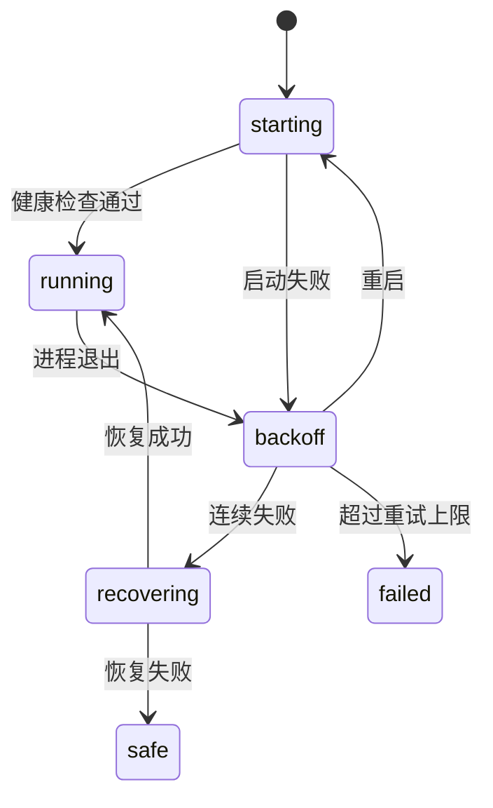

# 启动与插件树

::: tip
ChatLuna 的启动过程由两层结构驱动：宿主进程首先读取轻量的引导配置，由引导配置拉起加载器并解析完整的插件树，真正的业务能力则全部挂载在插件树中。理解这套装配机制，是掌握配置热重载与实例生命周期的关键。
:::

当我们启动一个 ChatLuna 实例时，后台实际经历的步骤远比单纯运行一个进程更丰富：加载环境变量、解析清单与插件树、划分服务隔离域、启动核心服务、等待健康检查探测，并在遭遇异常时自动回滚。

本节将为你拆解从命令行唤起直至整个实例完全就绪的完整启动链路。

<!-- 架构页，可以使用代码与配置示意 -->

## 两份清单

ChatLuna 将启动逻辑与业务配置解耦为两份职责分明的清单文件。

### 引导文件

位于根目录下的 `cordis.yml` 扮演着引导加载器的角色，它的唯一职责就是启动加载器，并指引加载器去哪里寻找插件树：

```yaml
- id: cli
  name: '@cordisjs/plugin-cli'
- id: cli-cordis
  name: '@cordisjs/plugin-cli-cordis'
  config:
    path: ./chatluna.yml
    daemon:
      enabled: false
    prelude:
      - name: '@cordisjs/plugin-env'
```

这份引导文件有几个值得注意的设计：

- **加载器不承载业务逻辑**：它仅指定业务清单的路径为 `./chatluna.yml`，自身不解析具体业务选项。
- **关闭内部 daemon 守护**：外层通常由统一的 supervisor 管理进程，在此关闭 `daemon` 可以防止双层重启策略相互冲突。
- **通过 prelude 优先加载环境配置**：`@cordisjs/plugin-env` 会在装配其他插件前预先注入，确保配置文件中的环境变量表达式能正确读取 `.env`。

::: warning
请不要直接修改 `cordis.yml` 来添加业务插件。

该文件仅作为引导入口存在。所有功能性扩展都应当记录在 `chatluna.yml` 中，或者直接通过控制台完成安装。
:::

### 插件树

真正的业务功能定义在 `chatluna.yml` 中。它以树状分组的形式组织所有插件：

```yaml
- id: runtime
  name: '@cordisjs/plugin-group'
  group: true
  isolate:
    server: chatluna
  config:
    - id: chatluna-http-server
      name: '@cordisjs/plugin-server'
      config: { port: 5028 }
    - id: chatluna-server
      name: '@chatluna/server'
```

在插件树中，每一个分组都代表一个独立的命名空间。位于同一个分组内的插件会共享同一套服务实例，这使得功能模块之间的协同更加清晰可控。

## 分组

为了保证庞大系统的结构清晰，默认的插件清单被划分为多个不同职责的分组：

| 分组 | 放什么 |
| --- | --- |
| 基础 | 定时器、HTTP、数据库、文件监控、执行机器 |
| 控制台 | Cordis 自带的服务与管理界面 |
| 运行时 | WebUI 服务、配置、凭据、插件市场、动态加载 |
| 模型 | 模型运行时、提供商、模型目录 |
| 会话与聊天 | 会话、对话、引擎、工具、记忆 |
| 平台 | 适配器与平台相关插件 |

分组并不仅用于在界面上折叠显示。更重要的是，它划定了服务的可见作用域，并决定了后续各项配置变更时的生效与重载边界。

## 隔离

细心的小伙伴可能会发现，在上面的 `runtime` 分组中声明了一个 `isolate` 属性：

```yaml
isolate:
  server: chatluna
```

这里的含义是：该分组内部的插件所注入与访问的 `server` 服务，是一个名为 `chatluna` 的独立实例，而非 Cordis 根上下文中默认的全局 `server`。

通过服务隔离，不同模块可以在各自的端口与路由下互不干扰地运行：

- Cordis 自带的管理界面监听一个端口。
- ChatLuna 专属的 WebUI 监听另一个端口。

这两个 HTTP 服务并存于同一个进程内，各自维护独立的路由体系与中间件链路。

::: tip
隔离机制也解答了「为什么某个插件检索不到预期服务」的疑问。

服务在 Cordis 中并非天然全局可见。只有在同一个隔离域内注册与声明的服务，才对该作用域内的子插件可见。
:::

## 运行时插件

在「运行时」分组中，ChatLuna 搭载了一组不可或缺的底层支撑插件：

- **配置服务**：负责读取、校验并持久化应用层的所有配置变更。
- **凭据服务**：提供密钥的安全加密存储，配置文件中仅保存引用标记。
- **Schema 注册表**：为控制台的图形化配置表单提供结构定义。
- **插件市场**：支持在线搜索与获取官方及社区扩展。
- **包管理**：负责底层 npm 包的安装、更新与卸载。
- **动态加载**：在无需重启进程的前提下动态加载或卸载插件。
- **文件监控**：持续监听清单文件的变动并触发协同。
- **守护**：监控插件运行状态，处理异常崩溃与自动重载。

这组插件紧密协作，让开发者与使用者能够在控制台内自由调整配置、安装插件，而无需频繁手动重启进程。

### 动态加载的边界

尽管动态加载非常便利，但并不是所有改动都能在运行时无缝热生效：

- 插件的启用与停用：绝大多数情况下均可直接热生效。
- 插件配置的修改：取决于插件自身是否实现了对应的热更新逻辑。
- 清单树状结构的调整：往往需要重启整个上下文以重建依赖关系。

当热重载因错误中断时，文件监控机制会捕捉并记录该异常，受影响的插件将保持在不可用状态，等待进一步修复。

## Supervisor

当你在终端中启动 ChatLuna 时，底层实际由外层 Supervisor 进程统一托管：



### 健康检查

子进程启动后，Supervisor 会主动探测 WebUI 对应的 HTTP 端口。

这项检查确认的是 WebUI 服务确实处于可用响应状态，有效避免了「子进程虽然存活，但界面实际上卡死或未就绪」的假死情况。探测一旦超时或未通过，即判定为启动失败。

### 崩溃重启

当运行中的实例意外退出时，Supervisor 会启动指数退避重试机制。

退避基数默认为 1 秒，随着连续失败次数的增加，重试等待时间会逐步延长。如果连续重试达到上限仍无法恢复，进程将转为最终失败状态，不再盲目拉起。

### 恢复

在遭遇连续多次启动失败时，Supervisor 不会继续无休止地尝试，而是会尝试从最近一次成功的配置快照中恢复插件状态。

这项机制专门用于应对「误装了损坏的插件或写入了错误配置导致无法开机」的经典故障。

### 安全模式

假如快照恢复依然未能挽救启动，系统最终会降级进入安全模式。

在安全模式下，系统仅加载保障控制台运行的最小插件集合。你可以顺利登录 WebUI，排查并禁用引发崩溃的问题插件，随后重新引导正常环境。

::: warning
处于开发模式时，系统会自动关闭快照恢复与安全模式。

这样设计的目的是将原始错误和调用栈毫无保留地暴露给开发者，避免自动回滚掩盖了真实的代码缺陷。
:::

## 启动日志

Supervisor 会完整捕获每次启动尝试的标准输出与错误流。

当你使用修复命令诊断系统时，工具会自动抽取最近一次失败启动的尾部日志（默认提取最后 300 行），并据此整理出一份问题诊断草稿。相较于在成千上万行的完整历史中翻找线索，这份聚焦故障现场的摘录能大幅缩短排查耗时。

## 环境变量

除了本地清单文件，以下环境变量也会深度参与启动流程：

- **主机地址**：覆盖 HTTP 服务绑定的 Host 地址，常用于容器部署或暴露局域网访问。
- **允许远程**：指定服务是否接纳来自非本机的网络请求。
- **访问令牌**：预先固定 WebUI 的登录凭据令牌。
- **时区**：统一定时任务调度与日志时间戳的基准时区。

这些环境变量在加载阶段以运行时打补丁的方式动态合入插件树，并不直接覆写物理文件。因此，环境变量的优先级高于本地文件，且不会对原始配置造成持久化污染。

## 数据目录

实例在运行期间产生的数据统一归档在数据目录中，其标准结构如下：

- `data/chatluna.db`：应用核心主数据库。
- `data/chatluna/`：存放凭据、配置快照、内置技能与工作区等运行时资产。
- 日志文件：记录系统的运转流水与历史崩溃轨迹。

在对实例进行备份或迁移时，务必对整个数据目录进行整体归档，切勿仅导出单一的数据库文件。

## 与 WebUI 的关系

细心的小伙伴可能会好奇：在 Web 控制台中所做的交互，与底层的配置文件到底是如何映射的？

无论通过何种入口发起变更，最终都统一收敛到插件树的操作上：

- 修改配置项 → 写入本地清单文件 + 触发受影响插件的重载。
- 安装新扩展 → 执行 npm 包安装 + 追加清单节点 + 动态装载。
- 调整路由规则 → 更新运行时配置 + 向相关订阅者广播通知。

换句话说，WebUI 与手工编辑底层文件操作的是同一套数据结构，区别仅在于交互体验与安全校验流程的不同。

::: tip
手动编辑 `chatluna.yml` 后，需要等待文件监控感知变化或手动触发重启；而通过 WebUI 修改时系统会立刻下发重载信号，生效通常更加迅速。
:::

## 排查

遇到启动异常时，你可以依照以下指引快速定位根因：

**启动后立刻退出。**

优先检查日志尾部的错误信息。最常见的原因包括端口被其他进程占用、配置文件存在 YAML 语法错误、缺少必需的依赖包，或是凭据文件受损。

**启动成功但界面打不开。**

健康检查通常在本地回环地址进行探测。请进一步确认服务绑定的端口、系统防火墙规则，以及反向代理或宿主端口映射是否正确转发。

**装完插件起不来。**

此时可以通过安全模式启动实例。系统仅会载入核心管理界面，方便你直接卸载或停用刚刚添加的问题插件，随后恢复常规启动。

**改动没生效。**

请核实你编辑的是 `chatluna.yml` 业务清单而非 `cordis.yml` 引导文件；同时检查文件监控插件是否处于正常运行状态，必要时可执行手动重启。

**反复重启。**

观察退避重试日志中的进程退出码。如果实例陷入持续崩溃，通常指向静态配置或依赖冲突等确定性问题，而非偶发的网络抖动。

## 下一步

- [插件、服务与数据](./extensions) — 深入了解插件系统与依赖注入体系。
- [存储](./storage) — 掌握数据库表结构与持久化文件约定。
- [WebUI](./webui) — 探索控制台的服务端架构与前后端通信。
- [命令行](/manual/starter/cli) — 学习实例启动、管理与运维命令。
