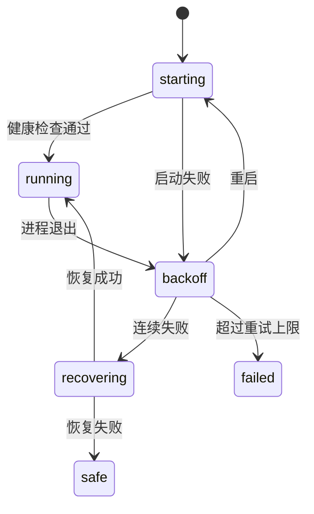

# 启动与插件树

::: tip
ChatLuna 的启动分两步：宿主读取一份很小的引导文件，引导文件加载插件树，插件树里才是真正的功能。理解这个结构，才能理解「为什么改了配置要这样重启」。
:::

启动一个实例时，实际发生的事比「跑一个程序」复杂：加载环境变量、解析插件、建立隔离域、启动服务、等待健康检查、失败时回滚。

这一页把这条链路拆开讲。

<!-- 架构页，可以使用代码与配置示意 -->

## 两份清单

### 引导文件

根目录下的 `cordis.yml` 只做一件事：启动加载器，告诉它插件树在哪。

```yaml
- id: cli
  name: '@cordisjs/plugin-cli'
- id: cli-cordis
  name: '@cordisjs/plugin-cli-cordis'
  config:
    path: ./chatluna.yml
    daemon:
      enabled: false
    prelude:
      - name: '@cordisjs/plugin-env'
```

几个关键点：

- **加载器不读业务配置**。业务配置在 `chatluna.yml` 里。
- **daemon 关闭**。进程守护由外层 supervisor 负责，避免两层重启策略打架。
- **prelude 先加载环境变量插件**。这样配置文件里的表达式引用可以读到 `.env`。

::: warning
不要直接改 `cordis.yml` 来加功能。

它只负责引导。功能应该加在 `chatluna.yml` 里，或者在控制台里安装。
:::

### 插件树

`chatluna.yml` 是一棵分组树：

```yaml
- id: runtime
  name: '@cordisjs/plugin-group'
  group: true
  isolate:
    server: chatluna
  config:
    - id: chatluna-http-server
      name: '@cordisjs/plugin-server'
      config: { port: 5028 }
    - id: chatluna-server
      name: '@chatluna/server'
```

每一组是一层命名空间，组内的插件共享同一套服务。

## 分组

默认分组大致是：

| 分组 | 放什么 |
| --- | --- |
| 基础 | 定时器、HTTP、数据库、文件监控、执行机器 |
| 控制台 | Cordis 自带的服务与管理界面 |
| 运行时 | WebUI 服务、配置、凭据、插件市场、动态加载 |
| 模型 | 模型运行时、提供商、模型目录 |
| 会话与聊天 | 会话、对话、引擎、工具、记忆 |
| 平台 | 适配器与平台相关插件 |

分组不是装饰。它决定了服务在哪个作用域可见，也决定了配置改动的生效范围。

## 隔离

`isolate` 是分组上的一个声明：

```yaml
isolate:
  server: chatluna
```

意思是：这个组里的插件看到的 `server` 服务，是另一个叫 `chatluna` 的实例，而不是根上的那个。

效果是端口与服务互不干扰：

- Cordis 自带管理界面用一个端口。
- ChatLuna 的 WebUI 用另一个端口。

两个服务可以同时存在，各自管理自己的路由。

::: tip
隔离也解释了「为什么某些插件看不到某个服务」。

服务不是全局的，它在哪个隔离域里注册，就只对同一域可见。
:::

## 运行时插件

运行时分组里有一组支撑性插件：

- **配置服务**：负责读取、校验、持久化配置变更。
- **凭据服务**：加密保存密钥，配置里只放引用。
- **Schema 注册表**：界面表单的来源。
- **插件市场**：搜索与安装插件。
- **包管理**：实际的安装/卸载。
- **动态加载**：在运行时加载、卸载插件。
- **文件监控**：监听清单变化。
- **守护**：处理插件崩溃与重载。

它们共同实现了「在控制台里装插件、改配置，不用手动重启」的能力。

### 动态加载的边界

不是所有改动都能热生效。

- 插件启用/停用：通常可以。
- 配置修改：看插件是否声明支持热更新。
- 清单结构变化：可能需要重启。

热重载失败时，watch 机制会记录错误，插件停留在不可用状态。

## Supervisor

用命令行启动时，真正的进程由 supervisor 管：



### 健康检查

启动后会探测 WebUI 端口，确认服务真的可用，而不是「进程活着但界面打不开」。

探测失败即视为启动失败。

### 崩溃重启

进程意外退出时，按指数退避重启。退避基数默认 1 秒，连续失败会越来越慢。

超过重试上限后进入失败状态，不再自动拉起。

### 恢复

连续失败后，supervisor 会尝试从快照恢复——回到一个已知可用的插件状态。

这解决的是「装了个坏插件导致起不来」的经典问题。

### 安全模式

恢复也失败时，进入安全模式：只加载最小集合，让你能进控制台把问题插件关掉。

::: warning
开发模式会关闭快照恢复与安全模式。

这是有意的：开发时你希望看到真实的失败，而不是被自动回滚掩盖。
:::

## 启动日志

每次启动的日志会被捕获。

修复命令生成的报告会带上最近一次失败启动的尾部日志（默认最后 300 行），并给出一份问题草稿。

排查「起不来」时，这份报告比翻完整日志高效得多。

## 环境变量

除了配置文件，几个环境变量会参与启动：

- **主机地址**：覆盖 HTTP 服务绑定的地址，容器部署常用。
- **允许远程**：覆盖服务是否接受非本机请求。
- **访问令牌**：固定 WebUI 的登录令牌。
- **时区**：影响日志与定时任务。

它们的实现方式是在加载时对插件树打补丁，而不是改文件。

所以环境变量优先级高于文件，且不会污染配置。

## 数据目录

实例的数据目录通常在同一位置：

- `data/chatluna.db`：主数据库。
- `data/chatluna/`：凭据、配置快照、技能、工作区等。
- 日志文件。

备份时应该整体备份，而不是只拷数据库。

## 与 WebUI 的关系

控制台里的修改，最终都会落到插件树上：

- 改配置 → 写清单 + 触发重载。
- 装插件 → 装包 + 写清单 + 重载。
- 改路由 → 写配置 + 通知订阅者。

所以「控制台改的」和「手改文件」是同一份数据，只是入口不同。

::: tip
手改文件后，要等文件监控发现变化，或者手动重启。

控制台修改会立刻触发重载，所以一般更快。
:::

## 排查

**启动后立刻退出。**

看日志尾部。常见原因：端口占用、配置语法错误、依赖缺失、凭据损坏。

**启动成功但界面打不开。**

健康检查用的是本机地址；确认端口、防火墙、以及是否被反向代理拦截。

**装完插件起不来。**

用安全模式启动，关掉问题插件，再正常启动。

**改动没生效。**

确认改的是 `chatluna.yml` 而不是 `cordis.yml`；确认文件监控在运行；必要时手动重启。

**反复重启。**

看退避日志里的退出码。持续崩溃通常是配置问题，而不是偶发故障。

## 下一步

- [插件、服务与数据](./extensions) — 插件模型与依赖注入。
- [存储](./storage) — 数据表与文件。
- [WebUI](./webui) — 控制台的服务端结构。
- [命令行](/manual/starter/cli) — 启动与维护命令。
