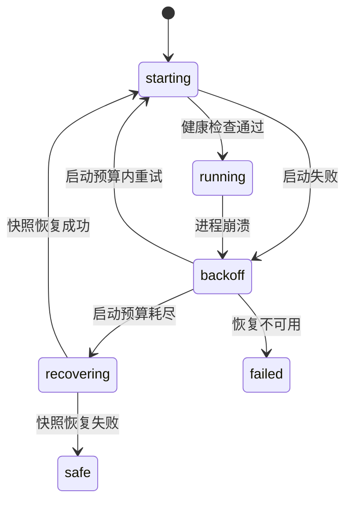

# 启动与插件树

::: tip
启动分两层：宿主进程先读取轻量的引导配置，由它拉起加载器并解析完整的插件树，业务能力全部挂在插件树中。期间还要加载环境变量、划分服务隔离域、等待健康检查，出错时自动回滚。
:::

<!-- 架构页，可以使用代码与配置示意 -->

## 两份清单

### 引导文件

根目录的 `cordis.yml` 只负责启动加载器，并告诉它插件树在哪里：

```yaml
- id: cli
  name: '@cordisjs/plugin-cli'
  config:
    name: chatluna
- id: cli-cordis
  name: '@cordisjs/plugin-cli-cordis'
  config:
    path: ./chatluna.yml
    daemon:
      enabled: false
    prelude:
      - name: '@cordisjs/plugin-env'
      - name: '@chatluna/koishi-loader'
```

- 加载器只指定业务清单路径 `./chatluna.yml`，不解析业务配置。
- 关闭内部 `daemon`：外层由 supervisor 管理进程，避免两层重启策略冲突。
- `prelude` 先加载 `@cordisjs/plugin-env`，保证配置中的环境变量表达式能读到 `.env`；`@chatluna/koishi-loader` 准备 Koishi 兼容层，让适配器等 Koishi 插件可以直接写进清单。

::: warning
不要在 `cordis.yml` 中添加业务插件。业务插件写进 `chatluna.yml`，或在控制台中安装。
:::

### 插件树

业务功能定义在 `chatluna.yml` 中，按分组组织：

```yaml
- id: runtime
  name: '@cordisjs/plugin-group'
  group: true
  isolate:
    server: chatluna
  config:
    - id: chatluna-http-server
      name: '@cordisjs/plugin-server'
      config:
        host: 127.0.0.1
        port: 5028
    - id: chatluna-server
      name: '@chatluna/server'
```

## 分组

| 分组 | 放什么 |
| --- | --- |
| 基础 | 定时器、HTTP、数据库、文件监控、执行机器 |
| 运行时 | WebUI 服务、配置、凭据、插件市场、动态加载 |
| 模型 | 模型运行时、提供商、模型目录 |
| 对话与路由 | 会话、对话、引擎、预设、提示词 |
| 智能体与工具 | Agent、工具、技能、MCP、子代理、权限 |
| 记忆与存储 | 文件存储、向量、记忆、会话日志 |
| 聊天平台 | 适配器与平台相关插件 |
| WebUI | HTTP 接口与各控制台页面插件 |
| 观测 | 日志、链路追踪、用量与遥测 |
| 扩展 | 运行时安装的第三方插件挂载点 |
| 开发 | HMR 热重载（仅 `chatluna dev` 开启） |

分组不只是界面上的折叠，它划定了服务的可见范围和配置变更时的重载边界。

## 隔离

`runtime` 分组声明了：

```yaml
isolate:
  server: chatluna
```

分组内插件访问的 `server` 是名为 `chatluna` 的独立实例（默认 `127.0.0.1:5028`），与 Cordis 根上下文的全局 `server` 互不干扰。

官方 Cordis 控制台前端也托管在这个端口：`@chatluna/ui-cordis` 把它挂载在 `/cordis`，复用 ChatLuna 的登录会话。两套界面在同一进程和端口共存，各自维护页面。

::: tip
插件找不到预期服务时，多半是隔离导致的：服务只对同一隔离域内的插件可见。
:::

## 运行时插件

- **HTTP 服务**：`chatluna-http-server`（`@cordisjs/plugin-server`）监听 ChatLuna 端口，承载 WebUI 与 API。
- **凭据服务**：加密存储密钥，配置文件只保存引用。
- **Schema 注册表**：为控制台表单提供结构定义。
- **配置服务**：读取、校验并持久化配置变更。
- **插件市场**：搜索官方与社区扩展。
- **包管理**：安装、更新和卸载 npm 包。
- **动态加载**：不重启进程加载或卸载插件。
- **守护**：监控插件状态，处理崩溃与自动重载。
- **WebUI 服务**：`@chatluna/server` 提供认证与路由保护，`@chatluna/core` 挂载核心服务，`koishi` 插件桥接 Koishi 运行时。

**动态加载的边界**：插件启停大多能热生效；配置修改取决于插件是否支持热更新；清单树结构调整通常需要重建上下文。热重载出错时，文件监控记录异常，受影响的插件保持未就绪。

## Supervisor

终端启动的 ChatLuna 由外层 Supervisor 托管：



- **健康检查**：子进程启动后探测 WebUI 的 HTTP 端口，避免「进程活着但界面卡死」。超时或未通过即判定启动失败。
- **崩溃重启**：指数退避，基数 1 秒、连续失败翻倍、单次上限 30 秒，默认最多重试 3 次。
- **恢复**：重试耗尽后，从最近一次成功的配置快照恢复，应对「装了坏插件或填错配置导致起不来」。
- **安全模式**：快照恢复仍失败时，只加载最小插件集（`runtime-inspect`、守护插件和平台适配器），把最小清单写入数据目录的 `safe-mode.yml` 后重启。此时可以登录 WebUI 或用私聊指令禁用问题插件，再切回正常模式。

::: warning
开发模式下关闭快照恢复和安全模式，直接暴露原始错误和调用栈。
:::

**启动日志**：Supervisor 捕获每次启动的标准输出和错误流。修复命令会提取最近一次失败启动的末尾日志（默认 300 行）并整理成诊断草稿。

## 环境变量

- **`CHATLUNA_HOST`**：覆盖 HTTP 服务绑定的 Host，常用于容器或局域网访问。
- **`CHATLUNA_ALLOW_REMOTE`**：设为 `1` 或 `true` 时允许非本机请求。
- **`CHATLUNA_TOKEN`**：预设 WebUI 登录令牌。

它们在加载阶段以补丁形式合入插件树，优先级高于文件，但不会写回磁盘。

## 数据目录

- `data/chatluna.db`：主数据库。
- `data/chatluna/`：凭据、配置快照、内置技能、工作区等运行时资产。
- 日志文件：运行日志与崩溃记录。

备份或迁移时归档整个数据目录，不要只导出数据库文件。

## 与 WebUI 的关系

控制台操作最终都是对插件树的修改：

- 修改配置 → 写入清单并重载对应插件。
- 安装扩展 → 安装 npm 包，在清单中追加节点并动态加载。
- 调整路由规则 → 更新运行时配置并广播通知。

WebUI 和手工编辑改的是同一份数据，WebUI 多了表单校验。

::: tip
手动编辑 `chatluna.yml` 后要等文件监控感知或手动重启；WebUI 修改会立即触发重载。
:::

## 常见问题

**启动后立刻退出**：看日志末尾，常见原因是端口被占用、YAML 语法错误、缺少依赖或凭据文件损坏。

**启动成功但界面打不开**：健康检查在本地回环地址探测。检查绑定端口、防火墙、反向代理或容器端口映射。

**装完插件起不来**：用安全模式启动，卸载或停用刚加的插件后恢复正常启动。

**改动没生效**：确认改的是 `chatluna.yml` 而不是 `cordis.yml`，文件监控是否正常，必要时手动重启。

**反复重启**：看退避日志中的退出码。持续崩溃通常是配置或依赖冲突，而不是偶发的网络问题。

## 下一步

- [插件、服务与数据](./extensions) — 插件系统与依赖注入。
- [存储](./storage) — 数据表与持久化文件约定。
- [WebUI](./webui) — 控制台的服务端架构与通信。
- [命令行](/manual/starter/cli) — 实例启动、管理与运维命令。
