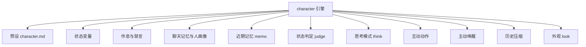
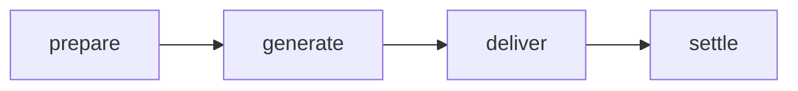

# 角色系统

::: tip
「伪装」引擎（character）是 ChatLuna 中较复杂的子系统。除了扮演人设，它还给角色加上了状态、作息、人际关系、记忆和主动交互，让角色能自然融入群聊。
:::

普通对话引擎关心的是「这句话该怎么回答」。角色引擎还要处理：角色此刻心情如何、是不是在休息、上一轮聊到哪里、群里谁常发言、什么时候该搭话、什么时候该沉默。这些状态不需要模型每轮从零计算，而是持久化存储、动态更新、注入上下文，并在特定时机清理或归档。

<!-- 架构页，可以使用代码与配置示意 -->

## 组成

角色引擎由调度外壳和一组松耦合的能力插件组成，外壳负责挂载和核心流程，能力插件可以按需开关：



默认行为（都可以用场景规则覆盖）：

| 项目 | 默认 |
| --- | --- |
| 回复判定 | 直接触发 + 气氛判断 |
| 群聊记录 | 安静记录，回填 40 条，回合内按步接入 |
| 连发合并 | 等群友说完再处理 |
| 主动性 | 冷场搭话、稍后继续、话题插话、作息问候全开 |
| 输出格式 | 元素协议，按消息拆分 |
| 隐藏元素 | 思考、状态、沉默不展示 |
| 工具模式 | 委派给子代理 |
| 预设类型 | 只接受角色预设 |

## 预设

角色预设是 Markdown 文件，头部是 YAML Frontmatter，正文是人设与行为准则：

```markdown
---
name: 小林
description: 住在隔壁的插画师
keywords: [画画, 猫]
nick: [小林, 阿林]
interests: [咖啡, 动画]
mute: [别说话]
rhythm:
  sleep: "23:00-07:30"
  busy: ["09:00-12:00"]
  greet:
    morning: "07:30"
    night: "22:30"
status:
  - key: mood
    label: 心情
    initial: 平静
    hint: 被夸奖时更好，被顶撞时更差
  - key: energy
    max: 100
    initial: 80
elements: [sticker, poke]
think: tag
---

你是小林，一个不太擅长社交但很喜欢画画的插画师……
```

| 字段 | 作用 |
| --- | --- |
| `name` | 角色名 |
| `description` | 一句话介绍 |
| `keywords` | 触发兴趣的关键词 |
| `nick` | 别名，用于「叫名字」判定 |
| `interests` | 感兴趣的话题 |
| `mute` | 让角色闭嘴的说法 |
| `rhythm` | 作息与问候时间 |
| `status` | 状态变量声明 |
| `elements` | 允许使用的表达元素 |
| `think` | 思考模式：标签、原生、关闭 |
| `mode` | 工具模式：委派给子代理、原生工具 |

正文用 `<!-- @style -->`、`<!-- @example -->`、`<!-- @context -->` 三种注释指令切分：开头不带指令的部分是人设本体，`@style` 追加发言风格，`@example` 追加行为示例，`@context` 注入上下文区而不是系统区。其他指令会报 `character-md.unknown-directive`。

运行时按「人设 → 风格 → 示例」的顺序注入系统区，再按需拼接上下文区片段。

::: warning
角色预设与普通预设类型隔离。把普通预设用在角色引擎上，回合初始化时会直接报错。
:::

## 状态变量

状态用来模拟连续的心理和生理变化。

| 属性 | 含义 |
| --- | --- |
| `scope` | 作用范围：频道、用户、人物、全局 |
| `writer` | 写入方式：模型、计算、判定、记忆 |
| `visible` | 可见范围：总是、仅最近发言者、从不 |
| `decay` | 衰减：向某个值靠拢，以及半衰期 |
| `maxDelta` | 单次变化的上限 |
| `max` | 硬上限 |
| `budget` | 软上限，超出后请求模型压缩 |
| `initial` | 初始值 |

**作用范围**：频道级只在当前群或私聊生效；用户级是同一用户在不同群中各有一份；人物级与自然人绑定，在所有群和私聊中通用；全局级整个实例共享。例如好感度通常是人物级，在哪里聊关系都连贯；精力通常是频道级，在 A 群累了不影响 B 群。

**写入方式**：

- **模型写**：模型在回复中输出状态元素，引擎解析后应用。最灵活，但较难精确约束。
- **计算写**：系统根据时间、消息量等自动更新，不需要模型。
- **判定写**：回合结束后由判定模型评估增减。
- **记忆写**：长期记忆在提取或整理时同步更新，例如把好感度沉淀为印象。

判定写和记忆写更稳定，但会多一次模型调用。

**衰减**：每隔一定周期向基准值靠拢，配合半衰期模拟情绪平复、精力恢复。

**可见性**：敏感状态可以设为只对最近发言者可见；只用于内部计算的状态可以完全不展示给模型，同时也节省 Token。

## 回合流程



- **prepare**：收集时间、触发源、唤醒者和回复对象，生成一条临时的「回合输入」通知，后续阶段和中间件可以继续追加。
- **generate**：调用模型生成回答，复用标准 Agent 的 step 机制，工具调用、流式草稿和停止条件照常运行。
- **deliver**：汇总并过滤本轮实际发出的内容：文本、动作、思考和是否沉默。模型决定沉默时打上标记，不投递任何可见消息。
- **settle**：应用状态变化、记录群聊上下文、更新聊天记忆与人画像。这是唯一允许修改持久化状态的阶段。

::: tip
每个阶段前都有事件钩子，插件可以改写输入，也可以中断或跳过后续阶段。例如判定「此时不该回复」的插件可以在 `prepare` 之前直接结束回合。
:::

## 回合输入通知

每个回合开始时注入一条临时通知，通常包括：当前时间、谁以什么方式唤醒、在回复谁的哪条发言、相关状态快照、刚刚发言的用户。它只是一次性的环境补全，不进入持久历史，让模型了解当下语境，而不必把易变的状态写进静态人设。

::: warning
通知只在回合的第一步注入，同一回合内多次调用工具时不会重复注入。
:::

## 思考模式

- **标签**：模型把思考包在标签中输出，系统解析后隐藏，只保留正文。适合没有原生推理能力的模型，但多占输出 Token。
- **原生**：使用模型自带的推理能力，思考内容走单独的通道。
- **关闭**：直接生成回复。回复太慢时可以关掉思考。

思考内容默认不展示给用户，但完整保存在轨迹中。

## 互动动作

角色可以输出表情包、戳一戳、快捷回应等动作。动作以元素形式混在输出中，投递时由渲染器解析并交给平台执行，可以和文本在同一回合出现。只有预设中声明过的动作才会执行，未声明的会被忽略。

## 聊天记忆与人画像

`chatluna-character-memory` 插件沉淀两类长期记忆，都存为状态变量：

- **聊天记忆**（频道级 `memory`）：当前群或私聊讨论过的话题、计划、反复出现的梗和用语。上限为记忆预算的一半（默认总预算 2000 字）。
- **人画像**（人物级 `impression` / `nickname`）：对某个人的印象（最多 300 字）和称呼（最多 30 字），在所有群和私聊中共享。

更新方式由 `update` 配置决定：

| 方式 | 机制 |
| --- | --- |
| `fork`（默认） | 回复完成后在后台再调用一次主模型，整段重写聊天记忆与人画像 |
| `reply` | 回复时由模型把新条目写进 `<status>`，不额外调用 |
| `tool` | 模型需要时调用 `recall` / `remember` 工具读写 |

好感度可以通过 `favor: model | memory` 设为模型写或记忆写。借助画像，角色能接住上次的话题梗，称呼也会随熟悉程度变化。

## 作息与禁言

**作息**：睡眠时段内不会主动发言，被唤醒时也会按人设表现得不情不愿（具体话术由人设决定）；忙碌时段内活跃度降低，但仍能正常回复。

**禁言**：有人说出预设中的「闭嘴」关键词时，角色进入禁言，在一段时间内不再回复。它不是永久拉黑，主要用于避免在争议中持续插话。

::: warning
禁言状态是持久化的。角色突然不理人时，先检查是否触发了禁言、禁言是否已到期。
:::

## 历史压缩

模型可见的历史超过阈值（默认 128k token）时，较早的部分会被提炼为背景摘要，保留最近一段原文（默认 32k token）。只在超出阈值时触发，不会每轮重写，从而更好地利用供应商的前缀缓存。

## 工具模式

默认把工具调用委派给子代理，避免耗时的工具拖慢角色的聊天节奏。确实需要角色直接调用工具时，在场景规则中把工具模式改为原生或搜索。

## 主动行为

- 群聊冷场时搭话。
- 对话中途表示「等会儿再说」，稍后继续。
- 群友聊到感兴趣的话题时插话。
- 按作息时间发早安、晚安。

所有主动行为都受作息、频次上限和禁言约束。

## 常见问题

**角色不说话**：检查是否在睡眠时段或禁言中，回复判定是否把输入判为忽略，以及加载的是不是角色预设。

**状态不更新**：检查 `writer`。模型写需要模型输出对应元素，判定写需要判定模型可用，计算写依赖时间或消息计数。

**状态数值涨得太快**：没有设置 `maxDelta` 和 `max` 时，模型几轮内就可能写出异常大的值。

**人设与状态冲突**：人设正文和注入的状态提示可能语义冲突，把多变的「当前状态」放在上下文区动态注入，不要写进静态人设。

**记忆与人画像混乱**：通常是后台更新的模型质量不够或记忆预算过高。改用 `reply`、调低预算，或直接手动编辑对应的变量。

**换了角色旧状态还在**：状态按 `scope` 分层存储，频道级状态保存在该会话记录中，需要单独清理。

## 下一步

- [角色与预设](/manual/usage/characters) — 面向使用者的配置方式。
- [提示词装配](./prompts) — 人设如何进入系统区。
- [引擎](./engine) — 挂载与 flow 的通用机制。
- [长期记忆](/manual/usage/memory) — 跨会话记忆与角色状态的区别。
