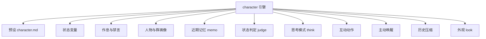
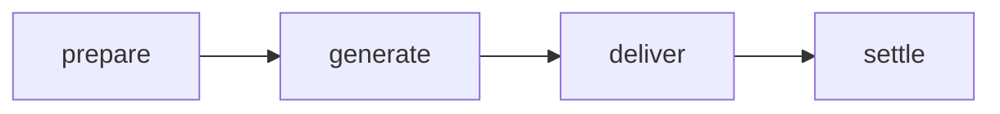

# 角色系统

::: tip
「伪装」引擎是 ChatLuna 里最复杂的一套子系统。它不满足于「扮演一个角色」，而是给角色加上了状态、作息、关系、记忆和主动行为——让它更像一个长期待在群里的人。
:::

普通对话引擎解决的问题是「这句话怎么答」。

角色引擎要解决的是：这个人今天心情如何、现在是不是在睡觉、上次和你聊到哪儿了、这个群里谁是谁、什么时候该主动开口、什么时候该装没看见。

这些问题的答案不能每轮都问一次模型。它们需要被存下来、被更新、被注入，还要在合适的时机被清理。

<!-- 架构页，可以使用代码与配置示意 -->

## 组成

角色引擎由一层外壳和一组能力插件组成：



外壳负责挂载与流程，能力插件各自独立、可以单独开关。

### 默认行为

| 项目 | 默认 |
| --- | --- |
| 唤醒判定 | 直接触发 + 气氛判断 |
| 群聊记录 | 安静记录，回填 40 条，回合内按步接入 |
| 连发合并 | 等群友说完再处理 |
| 主动性 | 冷场搭话、稍后继续、话题插话、作息问候全开 |
| 输出格式 | 元素协议，按消息拆分 |
| 隐藏元素 | 思考、状态、沉默不展示 |
| 工具模式 | 默认委派给子代理 |
| 预设类型 | 只接受角色预设 |

这些默认值都可以在路由规则里覆盖。

## 预设：角色的设定集

角色预设是一份 Markdown 文件，头部是元数据，正文是人设。

```markdown
---
name: 小林
description: 住在隔壁的插画师
keywords: [画画, 猫]
nick: [小林, 阿林]
interests: [咖啡, 动画]
mute: [别说话]
rhythm:
  sleep: "23:00-07:30"
  busy: ["09:00-12:00"]
  greet:
    morning: "07:30"
    night: "22:30"
status:
  - key: mood
    label: 心情
    initial: 平静
    hint: 被夸奖时更好，被顶撞时更差
  - key: energy
    max: 100
    initial: 80
elements: [sticker, poke]
think: tag
---

你是小林，一个不太擅长社交但很喜欢画画的插画师……
```

### 元数据字段

| 字段 | 作用 |
| --- | --- |
| `name` | 角色名 |
| `description` | 一句话介绍 |
| `keywords` | 触发兴趣的关键词 |
| `nick` | 别名，用于「叫名字」判定 |
| `interests` | 感兴趣的话题 |
| `mute` | 让角色闭嘴的说法 |
| `rhythm` | 作息与问候时间 |
| `status` | 状态变量声明 |
| `elements` | 允许使用的表达元素 |
| `think` | 思考模式：标签、原生、关闭 |
| `persona` / `style` / `example` / `context` | 人设正文与示例 |

预设会被解析成提示词块，按固定顺序进入系统区：人设、设定、示例。

::: warning
角色预设和普通预设不是同一个类型。

角色引擎只接受角色预设；把普通预设塞进去会在回合开始时被拒绝，并给出明确原因。
:::

## 状态变量

状态是角色引擎的核心抽象。

一个状态变量不是简单的数字，它带有一整套元数据：

| 属性 | 含义 |
| --- | --- |
| `scope` | 作用范围：频道、用户、人物、全局 |
| `writer` | 谁来写：模型、计算、判定 |
| `visible` | 谁看得见：总是、仅最近发言者、从不 |
| `decay` | 衰减：向某个值靠拢，以及半衰期 |
| `maxDelta` | 单次变化的上限 |
| `max` | 硬上限 |
| `budget` | 软上限，超出后请求模型压缩 |
| `initial` | 初始值 |

### 作用范围

这是最容易混淆的地方：

- **频道**：只在这个群/这个会话里有效。
- **用户**：同一个人在不同群里有不同值。
- **人物**：跟着这个人走，所有群和私聊通用。
- **全局**：整个实例共享。

「好感度」通常是人物级——不管在哪遇到，关系是连续的。

「精力」通常是频道级——在 A 群聊累了，不影响 B 群。

### 谁来写

- **模型写**：模型在回复里输出状态元素，系统解析后应用。
- **计算写**：根据时间、消息量等自动计算。
- **判定写**：由判定模型在回合结束后决定变化。

模型写最灵活，但也最不可控；判定写更稳定，代价是多一次模型调用。

### 衰减

状态可以设置衰减：每隔一段时间，自动向目标值靠拢。

配合半衰期使用，可以表达「情绪会慢慢平复」「精力会慢慢恢复」这类自然变化。

### 可见性

不是所有状态都该给模型看。

有些状态只在特定情况下注入，比如「仅对最近发言的人可见」；有些状态完全不给模型看，只用于内部计算。

这既是隐私考虑，也是上下文成本考虑。

## 回合流程

角色引擎不用默认的 Agent 循环，而是自己实现了一条四阶段流程：



### prepare

整理这一轮的基础信息：时间、触发方式、谁叫的、在回复谁。

它会生成一条「回合输入」通知，后面的阶段可以往上补充内容。

### generate

真正调用模型生成回复。

这一步走的是标准 Agent 的 step，所以工具、流式输出、停止条件都照常工作。

### deliver

从渲染器那里收集这一轮实际发出去的内容：消息、动作、思考、是否沉默。

如果模型选择沉默，这里会标记出来，后续不投递任何消息。

### settle

落地这一轮的结果：应用状态变化、记录写入、更新人物与群画像。

这是唯一允许修改持久状态的地方。

::: tip
每个阶段之前都有一个可拦截的事件。

插件可以改写阶段输入，也可以直接跳过整个阶段——比如某个插件判定「这个回合不该说话」，在 prepare 之前就结束掉。
:::

## 回合输入通知

角色引擎会在每一轮往上下文里注入一条「回合通知」，内容大致是：

- 现在几点。
- 这一轮是被谁、以什么方式唤醒的。
- 在回复谁的哪条消息。
- 当前状态值。
- 刚刚发言的人是谁。

这条通知不是历史消息，而是一次性的上下文补充。它让模型知道「现在是什么情况」，而不用把这些信息塞进人设里。

::: warning
回合通知只在第一轮注入。

如果一轮里有多步工具调用，后面的步骤不会重复注入，避免同一份信息占满上下文。
:::

## 思考模式

角色可以在回复前先「想一想」。三种模式：

- **标签**：模型输出思考标签，系统解析并隐藏，只保留正文。
- **原生**：使用模型自身的推理能力，思考内容走单独的通道。
- **关闭**：不思考，直接回复。

思考内容默认不展示给用户，但会记录在轨迹里。

::: tip
标签模式对不支持原生推理的模型更友好，但会占用输出 token。

如果角色经常「想太多导致回复变慢」，把思考关掉往往立竿见影。
:::

## 互动动作

除了文字，角色还能做动作：发表情、戳一戳、回应某个消息。

动作以元素的形式出现在模型输出里，由渲染器解析并执行。

每个角色可以声明自己允许哪些动作。没声明的动作，模型就算输出了也会被忽略。

动作和文字可以同时发生：先说一句，再戳一下。

## 群画像

群画像记录「这个群是什么样」：

- 群成员：谁常说话、什么身份、有什么特点。
- 术语表：群里常出现的黑话与含义。
- 梗：这个群特有的玩笑。
- 表情包：常用表情及含义。

这些信息帮助角色融入群聊，而不是每次都像新来的。

群画像由判定模型在后台慢慢积累，也可以手动编辑。

## 作息与禁言

### 作息

角色可以设置睡眠时段与忙碌时段。

在睡眠时段里，角色不会主动发言，被叫到时也可能表现得不情不愿——具体行为由人设与提示词决定，但「不主动」是硬约束。

忙碌时段的活跃度会降低，但不是完全沉默。

### 禁言

当群友说出预设的「闭嘴」说法时，角色会进入禁言状态，一段时间内不再回复。

禁言不是永久拉黑，只是让气氛缓和一下。

::: warning
禁言状态是持久化的。

如果角色「突然不理人」了，先检查是不是之前被哪句话触发了禁言，以及禁言是否已经到期。
:::

## 历史压缩

角色对话通常很长，所以引擎内置了历史压缩：

- 当模型可见的历史超过阈值（默认 128k token），把较早的部分整理成摘要。
- 整理后保留最近一段原文（默认 32k token）。

压缩只在跨过阈值时做一次，而不是每轮都做——这样前缀缓存可以保持。

## 工具模式

角色引擎默认把复杂工具调用委派给子代理。

原因是角色对话的节奏很轻，如果模型一边聊天一边跑命令，体验会很割裂。

如果确实需要角色直接使用工具，在路由里把工具模式改成原生或搜索，引擎就会直接挂载工具。

## 主动行为

角色可以主动开口，这在普通对话引擎里是靠路由设置实现的，在角色引擎里则由能力插件驱动：

- 冷场时搭话。
- 对话中途说「等会儿再说」。
- 聊到感兴趣的话题时插话。
- 按作息问候早晚安。

这些行为都受作息、发言上限和禁言状态约束。

## 排查

**角色不说话。**

先看是不是在睡眠时段或被禁言；再看唤醒判定是否把它判成了忽略；最后确认预设是否被拒绝。

**状态不更新。**

检查变量的写入者。模型写需要模型输出对应元素；判定写需要判定模型可用；计算写需要时间触发。

**状态涨得太快。**

检查单次变化上限与硬上限。没有上限的数值变量很容易被模型写成天文数字。

**角色人设和设定打架。**

预设正文与状态提示可能冲突。把「当前状态」放在上下文区，不要写进人设。

**群画像乱七八糟。**

判定模型质量与积累频率导致的。可以手动清理错误条目，或者降低自动积累的频率。

**切换角色后旧状态还在。**

状态按作用范围存储。频道级的状态会留在会话里；想彻底重置，需要清理对应的状态数据。

## 下一步

- [角色与预设](/manual/usage/characters) — 面向使用者的配置方式。
- [提示词装配](./prompts) — 人设如何进入系统区。
- [引擎](./engine) — 挂载与 flow 的通用机制。
- [长期记忆](/manual/usage/memory) — 跨会话的记忆与角色状态的区别。
