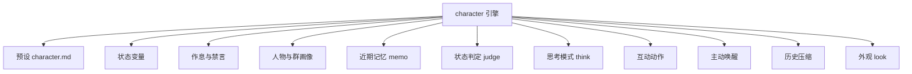
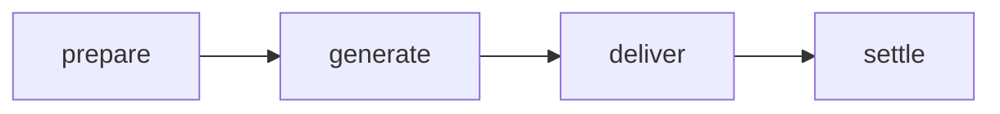

# 角色系统

::: tip
「伪装」引擎是 ChatLuna 体系中最复杂的一套子系统。它不单单满足于「扮演特定的人设」，而是为角色赋予了状态、作息、人际关系、记忆以及自主交互能力——让它真正像一个长期活跃在群聊中的真实成员。
:::

普通的对话引擎，核心解决的问题通常是「这句话该怎么回答」。

而在群聊生态中，角色引擎需要解决更复杂的拟人化问题：角色此刻心情如何、现在是否处于休息时间、上一轮话题聊到了哪里、群里活跃的成员分别是谁、何时应当主动搭话、何时又该保持沉默装作没看见。

这些上下文与状态信息显然不能在每一轮对话中都完全交由大模型从零计算。它们必须经历持久化存储、动态更新与上下文注入，并在恰当的生命周期节点被清理或归档。

<!-- 架构页，可以使用代码与配置示意 -->

## 组成

角色引擎的底层架构由一层调度外壳（Engine Shell）与一组松耦合的能力插件共同构成：



调度外壳负责生命周期挂载与核心执行流程，而外围的能力插件各自保持独立，开发者可以根据具体业务场景按需开启或关闭。

### 默认行为

在未做额外定制的情况下，角色引擎开箱即用的默认行为如下：

| 项目 | 默认 |
| --- | --- |
| 唤醒判定 | 直接触发 + 气氛判断 |
| 群聊记录 | 安静记录，回填 40 条，回合内按步接入 |
| 连发合并 | 等群友说完再处理 |
| 主动性 | 冷场搭话、稍后继续、话题插话、作息问候全开 |
| 输出格式 | 元素协议，按消息拆分 |
| 隐藏元素 | 思考、状态、沉默不展示 |
| 工具模式 | 默认委派给子代理 |
| 预设类型 | 只接受角色预设 |

上述所有默认行为并非不可变更，你都可以通过配置路由规则进行针对性覆盖。

## 预设：角色的设定集

角色预设是塑造拟人特征的数据载体。它采用标准的 Markdown 文件格式，文件头部由 YAML 格式的元数据 Frontmatter 构成，正文部分则是具体的人设与行为准则描述：

```markdown
---
name: 小林
description: 住在隔壁的插画师
keywords: [画画, 猫]
nick: [小林, 阿林]
interests: [咖啡, 动画]
mute: [别说话]
rhythm:
  sleep: "23:00-07:30"
  busy: ["09:00-12:00"]
  greet:
    morning: "07:30"
    night: "22:30"
status:
  - key: mood
    label: 心情
    initial: 平静
    hint: 被夸奖时更好，被顶撞时更差
  - key: energy
    max: 100
    initial: 80
elements: [sticker, poke]
think: tag
---

你是小林，一个不太擅长社交但很喜欢画画的插画师……
```

### 元数据字段

预设头部的 Frontmatter 支持声明以下配置项：

| 字段 | 作用 |
| --- | --- |
| `name` | 角色名 |
| `description` | 一句话介绍 |
| `keywords` | 触发兴趣的关键词 |
| `nick` | 别名，用于「叫名字」判定 |
| `interests` | 感兴趣的话话题 |
| `mute` | 让角色闭嘴的说法 |
| `rhythm` | 作息与问候时间 |
| `status` | 状态变量声明 |
| `elements` | 允许使用的表达元素 |
| `think` | 思考模式：标签、原生、关闭 |
| `persona` / `style` / `example` / `context` | 人设正文与示例 |

在运行时，预设文件会被解析为结构化的提示词片段，并遵循固定的装配次序依次注入系统区（System Prompt）：基础人设、设定规则，最后拼接行为示例。

::: warning
角色预设与普通对话预设在类型定义上是严格隔离的。

角色引擎只接受角色类型的预设；如果尝试将普通预设加载进角色引擎，系统会在回合初始化阶段直接拒绝并抛出明确的错误原因。
:::

## 状态变量

状态是角色引擎中用于模拟连续心理和生理机制的核心抽象。

每个状态变量并非仅是一个孤立的数值，它具备完整的属性定义与生命周期元数据：

| 属性 | 含义 |
| --- | --- |
| `scope` | 作用范围：频道、用户、人物、全局 |
| `writer` | 谁来写：模型、计算、判定 |
| `visible` | 谁看得见：总是、仅最近发言者、从不 |
| `decay` | 衰减：向某个值靠拢，以及半衰期 |
| `maxDelta` | 单次变化的上限 |
| `max` | 硬上限 |
| `budget` | 软上限，超出后请求模型压缩 |
| `initial` | 初始值 |

### 作用范围

`scope` 决定了状态在多会话环境下的共享边界，也是开发中最容易混淆的概念：

- **频道**：状态仅在当前的单一子频道或群聊会话中有效。
- **用户**：同一个人在不同群聊中拥有各自独立的状态副本。
- **人物**：与自然人个体跨场景绑定，在所有群聊和私聊中通用。
- **全局**：在整个机器人实例层面全局共享。

例如，「好感度」通常设定为人物级——无论用户在哪个群聊或私聊中与角色互动，彼此的关系都应当是连贯的；而「精力」通常设定为频道级——角色的精力消耗仅受当前群聊影响，在 A 群聊累了并不妨碍在 B 群正常回复。

### 谁来写

状态的更新来源由 `writer` 明确划分：

- **模型写**：模型在回复内容中直接输出特定的状态协议元素，引擎解析后应用变更。
- **计算写**：无需经过模型介入，由系统依据时间推移、消息量等客观指标自动计算更新。
- **判定写**：在对话回合结束后，由专门的判定模型根据本轮交互质量评判状态增减。

通常来说，模型写具备最高的灵活性，但也最难精确约束；判定写的更新表现更加稳定受控，但代价是会产生额外的模型调用开销。

### 衰减

状态变量支持配置自动衰减（`decay`）机制：每隔特定周期，变量会自动向设定的平衡基准值靠拢。

配合半衰期参数，你可以非常自然地模拟「情绪随时间逐渐平复」或「精力随时间慢慢恢复」等生理与心理波动。

### 可见性

出于安全性与 Token 成本考量，并非所有状态都需要无条件暴露给模型。

通过 `visible` 配置，某些敏感状态可以指定为「仅对最近发言的人可见」；而部分纯用于内部逻辑决策的状态变量，则可以配置为完全不对模型展示，仅供系统插件计算读取。

## 回合流程

与默认的 Agent 单步循环不同，角色引擎实现了一套专用的四阶段生命周期：



### prepare

准备阶段。系统在此收集并整理本轮对话所需的基础元信息，包括当前时间戳、触发源、唤醒者身份以及正在回复的上下文引用。

这一阶段会组装出一份临时的「回合输入」通知，后续阶段与中间件均可在其基础上继续追加上下文。

### generate

生成阶段。驱动底层语言模型生成本轮的回答内容。

该阶段复用了标准 Agent 的执行步（Step）机制，因此工具调用、流式草稿渲染与循环停止条件均能按标准管线正常运转。

### deliver

投递阶段。从渲染器汇总并过滤本轮拟实际发出的产物，包括文本消息、互动动作、思考内容以及是否触发主动沉默。

若模型最终决策保持沉默，引擎将在此处打上标记，后续链路将不会向平台投递任何可见消息。

### settle

结算阶段。对本轮交互产生的所有状态变更进行最终落地与持久化，包括应用状态数值、记录群聊上下文并更新人物与群画像。

这是整条执行管线中唯一允许修改持久化状态的收尾节点。

::: tip
在上述四个阶段的执行前夕，引擎均提供了可被拦截的事件钩子。

插件不仅可以改写各个阶段的输入数据，还能直接短路或跳过后续阶段——例如拦截插件若判定「当前情境下角色不应当开口」，便可在进入 `prepare` 阶段前直接终止整个回合。
:::

## 回合输入通知

在每个交互轮次启动时，角色引擎都会向当前上下文动态注入一条临时的「回合通知」，其内容通常涵盖：

- 当前系统时间。
- 这一轮对话是被谁、通过何种方式唤醒的。
- 角色正在针对谁的哪条发言进行回应。
- 角色当前关联的状态变量快照。
- 刚刚在群内发言的用户身份。

这条通知属于纯粹的一次性环境补全，而不是持久的历史记录。它的核心价值在于向模型实时阐明「当前处于何种语境」，从而避免将易变的运行时状态硬编码进静态人设中。

::: warning
回合通知仅在交互的第一轮（第一步）进行注入。

当单轮对话内触发多步工具调用时，后续步骤不会重复合入该通知，以此避免重复的环境摘要冗余侵占宝贵的上下文窗口。
:::

## 思考模式

角色在正式输出文本前，支持先执行前置的「想一想」。引擎提供了三种可选模式：

- **标签**：模型将思考过程包裹在自定义标签内输出，系统在前端解析并隐藏，仅保留最终正文。
- **原生**：依托底层模型自带的推理能力，思考内容走单独的通道传输。
- **关闭**：跳过思考环节，模型不思考直接生成回复。

无论是哪种模式，角色的思考内容默认都不会展示给普通用户，但会被完整保存在后台轨迹中供审计与复盘。

::: tip
对于不具备原生推理能力的模型，标签模式更加友好，但它会占用额外的输出 Token。

如果在实际使用中遇到角色「思考过多导致回复显著变慢」的情况，将思考模式直接切换为关闭往往立竿见影。
:::

## 互动动作

除了单纯的文本沟通，角色还可以输出多元化的互动动作，例如发送表情包、戳一戳群成员或针对特定消息做出快捷回应。

所有动作均以元素的形式混入模型的输出流，并在投递阶段由渲染器解析后交由平台执行。

角色必须在预设中明确声明允许使用的动作类型。对于未声明的动作，即便模型在生成时给出了对应元素，渲染器也会予以安全忽略。

值得注意的是，动作与文字消息允许在同一个回合内并行发生：角色可以先说一句文字，再紧接着触发一个戳一戳交互。

## 群画像

群画像用于刻画和沉淀「这个群究竟是什么样」：

- **群成员**：谁经常在群内发言、各自具备什么身份与性格特征。
- **术语表**：该群日常交流中频繁出现的黑话及其确切含义。
- **梗**：群聊长期沉淀下来的特有玩笑与社群梗。
- **表情包**：群内常用的特色表情符号及其语境含义。

群画像能够帮助角色更自然地融入群聊语境，避免每一次发言都表现得像初来乍到的新成员。

在技术实现上，群画像通常由专用的判定模型在后台异步分析并慢慢积累，开发者也可以根据需要直接进行手动修改与纠偏。

## 作息与禁言

### 作息

角色支持配置明确的生活作息节律，包括睡眠时段与忙碌时段。

当处于睡眠时段时，角色将彻底禁用所有主动发言逻辑；即便在群内被其他成员显式唤醒，角色的应答态度也可能受人设与提示词影响表现得不情不愿——具体话术虽然由人设决定，但「不主动开口」是底层的硬性约束。

而在忙碌时段内，角色的活跃度会被调低，但并不会完全进入沉默脱机状态。

### 禁言

当群内成员说出预设中声明的「闭嘴」说法时，角色会立即转入禁言保护状态，并在设定的时间段内不再做出任何回复。

禁言机制并非永久拉黑，其核心目的是避免在群聊产生争议时机器人反复插话，让群内气氛得到缓冲与平复。

::: warning
角色的禁言状态是具备持久化特性的。

如果角色在运行过程中「突然不理人」了，请首先排查是否此前被某句话意外触发了禁言规则，以及对应的禁言是否已经到期。
:::

## 历史压缩

长周期的角色对话通常会迅速积累出海量的历史消息，因此角色引擎内置了自动化的历史压缩机制：

- 当模型可见的历史上下文突破设定阈值（默认 128k token）时，引擎会自动提取较早的历史记录并提炼为背景摘要。
- 在摘要整理完毕后，系统将稳定保留最近一段原始上下文（默认 32k token）以维系对话连贯性。

该压缩流程只会在上下文跨过阈值时触发单次执行，而不是在每个回合频繁重写——这种策略能够最大化保持大模型服务商的前缀缓存（Prefix Cache）命中率。

## 工具模式

在处理复杂的工具调用时，角色引擎默认会将调用任务委派给独立的子代理（Subagent）。

这样设计的核心原因在于拟人角色的交流节奏非常轻快自然，如果让模型一边聊天一边在主干中跑沉重的命令与工具，交互体验会产生显著的卡顿与割裂。

如果业务场景确实要求当前角色直接使用工具，可以在路由配置中将工具模式调整为原生或搜索模式，届时引擎将直接为当前上下文挂载工具。

## 主动行为

与普通对话引擎完全依赖外部触发不同，角色引擎内置了一系列由能力插件驱动的自主行为：

- 在群聊陷入冷场时主动搭话。
- 在对话中途根据语境主动声明「等会儿再说」。
- 当群友讨论到角色预设感兴趣的话题时适时插话。
- 依照预设的生活作息，按时向群成员问候早安和晚安。

所有自主行为均严格服从作息时段、发言频次上限以及禁言状态的约束。

## 排查

在接入与调试角色引擎的过程中，如果遇到异常表现，可以参考以下方向进行排查：

**角色不说话**

首先检查当前时间是否正处于预设的睡眠时段，或者角色是否处于尚未过期的禁言状态中；其次排查唤醒判定中间件是否将当前输入判定为可忽略；最后确认所加载的预设是否为合法的角色预设。

**状态不更新**

检查对应状态变量配置的写入者（`writer`）属性。模型写需要模型在输出中给出对应的元素协议；判定写需要专门的判定模型可用；计算写则依赖系统的时间推移或计数触发。

**状态涨得太快**

检查该状态变量是否合理配置了单次变化上限（`maxDelta`）与硬上限（`max`）。没有设置数值边界的变量极易在几轮对话内被大模型直接写成异常的天文数字。

**角色人设和设定打架**

通常是预设的正文描述与注入的状态提示词产生了语义冲突。建议将多变的「当前状态」统一放在上下文区域动态注入，避免直接写死在静态的人设正文中。

**群画像乱七八糟**

这类现象多由于后台判定模型的推理质量不足或画像积累频率过高所致。你可以通过手动清理画像库中的无效条目进行纠偏，或者适当调低自动分析与积累的频率。

**切换角色后旧状态还在**

状态数据是依据声明的 `scope` 分层存储的。属于频道级别的状态会长期保存在该会话记录中；如需彻底重置，需要显式调用清理逻辑清除该频道对应的状态数据。

## 下一步

到这里，你已经全面了解了角色系统的内部运转机制。接下来可以继续阅读：

- [角色与预设](/manual/usage/characters) — 面向使用者的配置方式。
- [提示词装配](./prompts) — 人设如何进入系统区。
- [引擎](./engine) — 挂载与 flow 的通用机制。
- [长期记忆](/manual/usage/memory) — 跨会话的记忆与角色状态的区别。
