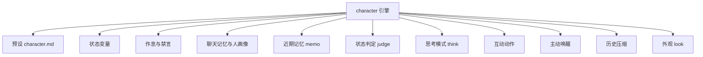
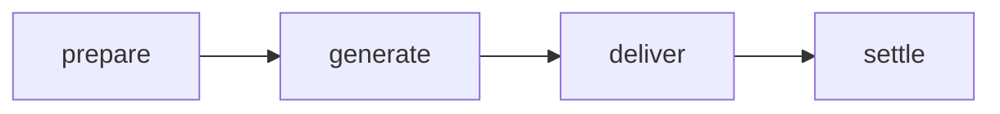

# 角色系统

::: tip
「伪装」引擎是 ChatLuna 中较复杂的子系统。它不仅能「扮演特定的人设」，还为角色赋予了状态、作息、人际关系、记忆与自主交互能力，使其能够自然地融入群聊环境。
:::

普通的对话引擎，核心解决的问题通常是「这句话该怎么回答」。

而在群聊场景中，角色引擎还需要处理更复杂的拟人化交互：角色此刻心情如何、现在是否在休息、上一轮话题聊到了哪里、群里常活跃的成员是谁、何时应当主动搭话、何时又该保持沉默。

这些上下文与状态信息不需要在每轮对话中都交给大模型从零计算，而是通过持久化存储、动态更新与上下文注入来维护，并在特定的生命周期节点进行清理或归档。

<!-- 架构页，可以使用代码与配置示意 -->

## 组成

角色引擎的底层架构由调度外壳（Engine Shell）与一组松耦合的能力插件共同构成：



调度外壳负责生命周期挂载与核心执行流程，外围能力插件彼此独立，你可以根据具体业务场景按需开启或关闭。

### 默认行为

在未做额外配置时，角色引擎的默认行为如下：

| 项目 | 默认行为 |
| --- | --- |
| 唤醒判定 | 直接触发 + 气氛判断 |
| 群聊记录 | 安静记录，回填 40 条，回合内按步接入 |
| 连发合并 | 等群友说完再处理 |
| 主动性 | 冷场搭话、稍后继续、话题插话、作息问候全开 |
| 输出格式 | 元素协议，按消息拆分 |
| 隐藏元素 | 思考、状态、沉默不展示 |
| 工具模式 | 默认委派给子代理 |
| 预设类型 | 只接受角色预设 |

上述默认行为均可通过配置路由规则进行覆盖。

## 预设：角色的设定集

角色预设是角色的数据载体。它采用 Markdown 文件格式，文件头部由 YAML 格式的 Frontmatter 元数据构成，正文则是具体的人设与行为准则描述：

```markdown
---
name: 小林
description: 住在隔壁的插画师
keywords: [画画, 猫]
nick: [小林, 阿林]
interests: [咖啡, 动画]
mute: [别说话]
rhythm:
  sleep: "23:00-07:30"
  busy: ["09:00-12:00"]
  greet:
    morning: "07:30"
    night: "22:30"
status:
  - key: mood
    label: 心情
    initial: 平静
    hint: 被夸奖时更好，被顶撞时更差
  - key: energy
    max: 100
    initial: 80
elements: [sticker, poke]
think: tag
---

你是小林，一个不太擅长社交但很喜欢画画的插画师……
```

### 元数据字段

预设头部的 Frontmatter 支持以下配置项：

| 字段 | 作用 |
| --- | --- |
| `name` | 角色名 |
| `description` | 一句话介绍 |
| `keywords` | 触发兴趣的关键词 |
| `nick` | 别名，用于「叫名字」判定 |
| `interests` | 感兴趣的话题 |
| `mute` | 让角色闭嘴的说法 |
| `rhythm` | 作息与问候时间 |
| `status` | 状态变量声明 |
| `elements` | 允许使用的表达元素 |
| `think` | 思考模式：标签、原生、关闭 |
| `mode` | 工具模式：委派给子代理、原生工具 |

正文部分使用 `<!-- @style -->`、`<!-- @example -->`、`<!-- @context -->` 三段注释指令切分：

- 未带指令的开头正文为人设本体。
- `@style` 段追加发言风格。
- `@example` 段追加行为示例。
- `@context` 段注入上下文区（context zone）而非系统区。

如果使用了其他指令，系统会抛出 `character-md.unknown-directive` 错误。

运行时，预设文件会被解析为结构化的提示词片段，并按固定次序依次注入系统区（System Prompt）：基础人设、发言风格、行为示例，最后按需拼接上下文区片段。

::: warning
角色预设与普通对话预设在类型定义上是严格隔离的。

角色引擎只接受角色类型的预设。如果将普通预设加载进角色引擎，系统会在回合初始化阶段直接拒绝并报错。
:::

## 状态变量

状态是角色引擎中用于模拟连续心理和生理机制的核心抽象。

每个状态变量都具备完整的属性定义与生命周期元数据：

| 属性 | 含义 |
| --- | --- |
| `scope` | 作用范围：频道、用户、人物、全局 |
| `writer` | 写入方式：模型、计算、判定、记忆 |
| `visible` | 可见范围：总是、仅最近发言者、从不 |
| `decay` | 衰减：向某个值靠拢，以及半衰期 |
| `maxDelta` | 单次变化的上限 |
| `max` | 硬上限 |
| `budget` | 软上限，超出后请求模型压缩 |
| `initial` | 初始值 |

### 作用范围

`scope` 决定了状态在多会话环境下的共享边界：

- **频道**：状态仅在当前的单一子频道或群聊会话中生效。
- **用户**：同一用户在不同群聊中拥有独立的状态副本。
- **人物**：与自然人个体绑定，在所有群聊和私聊中通用。
- **全局**：在整个机器人实例层面全局共享。

例如，「好感度」通常配置为人物级——无论用户在哪个群聊或私聊中与角色互动，彼此的关系都是连贯的；而「精力」通常配置为频道级——角色的精力消耗仅受当前群聊影响，在 A 群聊疲惫了并不影响在 B 群正常回复。

### 谁来写

状态的更新来源由 `writer` 划分：

- **模型写**：模型在回复中直接输出状态协议元素，引擎解析后应用变更。
- **计算写**：无需模型介入，由系统根据时间推移、消息量等指标自动更新。
- **判定写**：对话回合结束后，由专门的判定模型根据本轮交互评判状态增减。
- **记忆写**：由长期记忆系统在提取或整理时同步更新（例如把好感度沉淀为对某人的印象）。

通常情况下，模型写最灵活，但较难精确约束；判定写与记忆写的更新表现更稳定，但会产生额外的模型调用开销。

### 衰减

状态变量支持配置自动衰减（`decay`）：每隔指定周期，变量会自动向设定的平衡基准值靠拢。

配合半衰期参数，你可以用来模拟「情绪随时间平复」或「精力随时间恢复」等心理与生理变化。

### 可见性

出于安全性和 Token 成本考虑，并非所有状态都需要暴露给模型。

通过配置 `visible`，敏感状态可以设置为「仅对最近发言的人可见」；用于内部逻辑决策的状态变量，也可以设置为完全不对模型展示，仅供系统插件读取和计算。

## 回合流程

与默认的 Agent 单步循环不同，角色引擎包含四个执行阶段：



### prepare

准备阶段。系统收集并整理本轮对话所需的基础信息，包括当前时间戳、触发源、唤醒者身份以及正在回复的上下文引用。

该阶段会生成一份临时的「回合输入」通知，后续阶段与中间件均可在其基础上继续追加上下文。

### generate

生成阶段。调用底层语言模型生成本轮的回答内容。

该阶段复用了标准 Agent 的执行步（Step）机制，工具调用、流式草稿渲染与循环停止条件均按标准管线运行。

### deliver

投递阶段。从渲染器汇总并过滤本轮实际发出的内容，包括文本消息、互动动作、思考内容以及是否触发主动沉默。

如果模型决定保持沉默，引擎会在此处打上标记，后续链路不会向平台投递任何可见消息。

### settle

结算阶段。对本轮交互产生的所有状态变更进行落地和持久化，包括应用状态数值、记录群聊上下文，并更新聊天记忆与人画像。

这是整条执行流程中唯一允许修改持久化状态的环节。

::: tip
在上述四个阶段执行前，引擎均提供了事件钩子。

插件不仅能改写各阶段的输入数据，还可以直接中断或跳过后续阶段。例如拦截插件若判定「当前情境下角色不应当回复」，可以在进入 `prepare` 阶段前直接终止整个回合。
:::

## 回合输入通知

每个交互回合开始时，角色引擎都会向当前上下文注入一条临时的「回合通知」，内容通常包括：

- 当前系统时间。
- 这一轮对话由谁、通过何种方式唤醒。
- 角色正在回复谁的哪条发言。
- 角色当前关联的状态变量快照。
- 刚刚在群内发言的用户身份。

这条通知是一次性的环境补全，不属于持久历史记录。它的作用是让模型实时了解当前语境，避免将易变的运行时状态直接写在静态人设中。

::: warning
回合通知仅在交互的第一轮（第一步）注入。

当单轮对话内触发多次工具调用时，后续步骤不会重复注入该通知，以避免冗余的环境信息占用上下文窗口。
:::

## 思考模式

角色在正式输出文本前，支持先执行前置思考。引擎提供了三种模式：

- **标签**：模型将思考过程包裹在自定义标签内输出，系统在前端解析并隐藏，仅保留最终正文。
- **原生**：使用底层模型自带的推理能力，思考内容通过单独通道传输。
- **关闭**：跳过思考环节，模型直接生成回复。

无论使用哪种模式，角色的思考内容默认都不会展示给普通用户，但会完整保存在后台轨迹中供复盘查阅。

::: tip
对于不具备原生推理能力的大模型，标签模式更加友好，但会占用额外的输出 Token。

如果角色因思考过多导致回复变慢，可以将思考模式切换为「关闭」。
:::

## 互动动作

除文本消息外，角色还可以输出互动动作，例如发送表情包、戳一戳群成员或快捷回应特定消息。

动作以元素的形式混入模型的输出流，并在投递阶段由渲染器解析后交由平台执行。

角色必须在预设中明确声明允许使用的动作类型。对于未声明的动作，即便模型生成了对应元素，渲染器也会自动忽略。

动作与文本消息可以在同一个回合内同时触发，例如角色在发出一段文本后紧接着触发一次戳一戳。

## 聊天记忆与人画像

角色引擎通过 `chatluna-character-memory` 插件沉淀「这个群聊过什么」与「这个人是谁」两类长期记忆，均通过状态变量进行持久化：

- **聊天记忆**（频道级变量 `memory`）：当前群聊或私聊中讨论过的话题、计划、反复出现的梗与用语。上限为记忆字数预算的一半（默认总预算 2000 字）。
- **人画像**（人物级变量 `impression` / `nickname`）：角色对某个自然人的印象（至多 300 字）以及对他的称呼（至多 30 字）。人物级作用域意味着同一用户在不同群聊和私聊中共享该画像。

记忆的更新方式由记忆插件的 `update` 配置决定：

| 更新方式 | 机制 |
| --- | --- |
| `fork`（默认） | 回复完成后在后台再次调用主模型，整段重写聊天记忆与人画像 |
| `reply` | 回复时由模型将新条目写入 `<status>`，不再额外发起调用 |
| `tool` | 模型需要时调用 `recall` / `remember` 工具读写 |

好感度也可以通过 `favor: model | memory` 配置为随「模型写」或「记忆写」更新，同样走记忆通道沉淀。

借助画像机制，角色可以接住上次聊天的话题梗，称呼也会随熟悉程度自然变化。

## 作息与禁言

### 作息

角色支持配置作息节律，包括睡眠时段与忙碌时段。

在睡眠时段内，角色会禁用所有主动发言逻辑；即使在群内被其他成员显式唤醒，角色的应答态度也会受人设与提示词影响表现得不情不愿。具体回复话术由人设决定，但不主动开口属于底层规则。

在忙碌时段内，角色的活跃度会有所降低，但仍能正常回复。

### 禁言

当群内成员触发预设中声明的「闭嘴」关键词时，角色会立即进入禁言状态，并在指定时间内不再回复任何消息。

禁言机制不是永久拉黑，主要用于在群聊出现争议时避免机器人持续插话。

::: warning
角色的禁言状态是持久化的。

如果角色突然不再理人，请先检查是否触发了禁言规则，以及当前禁言是否已到期。
:::

## 历史压缩

长周期的角色对话会积累大量历史消息，角色引擎内置了自动历史压缩机制：

- 当模型可见的历史上下文超过设定阈值（默认 128k token）时，引擎会自动提取较早的历史记录并提炼为背景摘要。
- 摘要提取完成后，系统会保留最近一段原始上下文（默认 32k token）以维系对话连贯性。

该压缩流程仅在上下文超出阈值时触发一次，不会在每个回合频繁重写，从而更好地利用大模型服务商的前缀缓存（Prefix Cache）。

## 工具模式

在处理复杂的工具调用时，角色引擎默认会将调用任务委派给独立的子代理（Subagent）。

这样可以保持拟人角色的交流节奏，避免模型在主聊天流程中执行耗时较长的工具命令导致回复延迟。

如果业务场景确实需要当前角色直接调用工具，可以在路由配置中将工具模式调整为原生或搜索模式，引擎将直接在当前上下文挂载工具。

## 主动行为

与普通对话引擎完全依赖外部触发不同，角色引擎内置了一系列主动行为：

- 群聊冷场时主动搭话。
- 在对话中途根据语境主动表示「等会儿再说」。
- 群友讨论到角色感兴趣的话题时适时插话。
- 根据预设的作息时间，向群成员发送早安和晚安问候。

所有主动行为均受作息时段、发言频次上限以及禁言状态的约束。

## 排查

调试角色引擎时若遇到异常表现，可以按以下方面排查：

**角色不说话**

- 检查当前时间是否处于预设的睡眠时段，或角色是否处于未到期的禁言状态。
- 检查唤醒判定中间件是否将当前输入判定为忽略。
- 确认加载的预设是否为合法的角色预设。

**状态不更新**

- 检查对应状态变量配置的写入者（`writer`）属性。
- 模型写需要模型在输出中给出对应的元素协议；判定写需要判定模型可用；计算写依赖时间推移或消息计数触发。

**状态数值增长过快**

- 检查该状态变量是否配置了单次变化上限（`maxDelta`）与硬上限（`max`）。未设置数值边界时，大模型容易在几轮对话内写出异常的超大数值。

**角色人设与设定冲突**

- 预设正文描述与注入的状态提示词可能产生了语义冲突。建议将多变的「当前状态」统一放在上下文区域动态注入，避免直接写在静态人设正文中。

**记忆与人画像混乱**

- 通常由于后台记忆更新的模型推理质量不足，或记忆字数预算过高所致。可以将记忆更新方式从 `fork` 改为 `reply`，或调低记忆字数上限；也可以直接手动编辑对应频道与人画像变量。

**切换角色后旧状态仍在**

- 状态数据根据声明的 `scope` 分层存储。频道级别的状态会保存在该会话记录中；如需重置，需要调用清理逻辑清除该频道对应的状态数据。

## 下一步

到这里，你已经了解了角色系统的内部运转机制。接下来可以继续阅读：

- [角色与预设](/manual/usage/characters) — 面向使用者的配置方式。
- [提示词装配](./prompts) — 人设如何进入系统区。
- [引擎](./engine) — 挂载与 flow 的通用机制。
- [长期记忆](/manual/usage/memory) — 跨会话的记忆与角色状态的区别。
