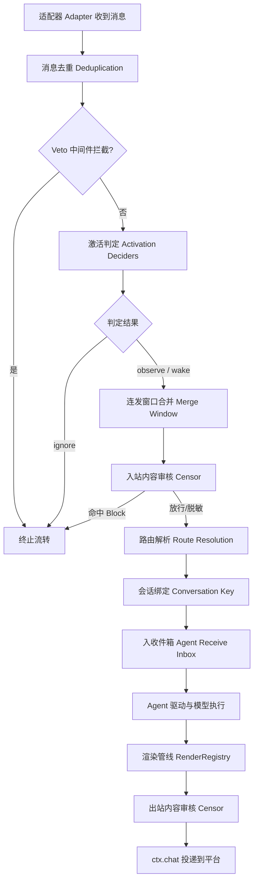
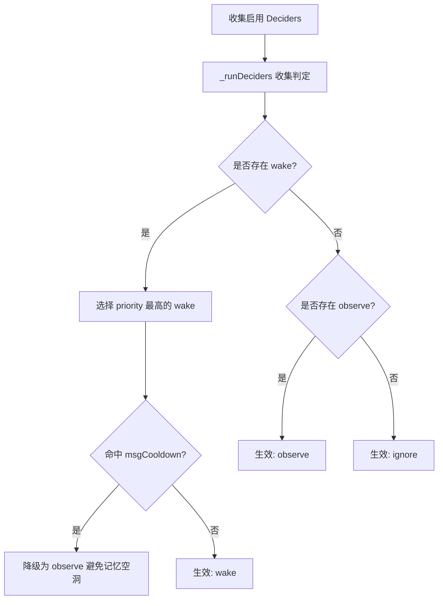
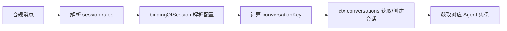

# 消息管线（Chat Pipeline）

::: tip
消息管线负责消息进入系统后的流转：接收、判定是否响应、合并连发、审核、解析路由，最后交给 Agent。它不参与模型推理（由 Agent 运行时负责），也不直接向平台发送富文本（由渲染与投递负责）。
:::



## 去重与 veto

1. **eventKey**：优先用 `session.messageId`，没有时用 `sha256(routeKey + content)`。
2. **去重缓存**：LRU，最多 `4096` 条，有效期 `dedupeTtlMs`，默认 `86400000`（24 小时）。去重在激活判定之前，**重复消息不会推进冷却计时器**。
3. **veto**：串行触发 `chat/before-receive`（`this: Session`）。返回 `true` 丢弃消息，返回字符串改写文本后继续，返回 falsy 放行。连发合并的 settle 窗口就是用这个钩子暂缓投递的。
4. **引擎关闭**：匹配规则的 `chat.engine` 为 `off` 时直接判为 `ignore`。

## 激活判定

收到消息不一定要调用模型。每条消息的决策用 `Decision` 描述：

| 字段 | 类型 | 说明 |
| :--- | :--- | :--- |
| `effect` | `wake` \| `observe` \| `ignore` | `wake` 唤醒回复；`observe` 仅记录不回复；`ignore` 完全忽略 |
| `priority` | `number` | 决策优先级，数值越大优先级越高 |
| `reason` | `string` | 做出该判定的原因标识（如 `at`、`quote`、`nickname` 等） |
| `by` | `string` | 产出该判定的 decider 名称（`rule` / `activity` / `judge`） |
| `delay` | `number` \| `settle` | 可选延迟处理时间，或等待连发静默（`settle`） |
| `busy` | `step` \| `turn` | 机器人忙碌时的合并策略（合入当前 turn 的 step 或留待下个 turn） |

`_runDeciders` 收集 `chat.activation.use` 中启用的 decider 的结果：有 `wake` 时取 priority 最高的那个；没有 `wake` 才看 `observe`；都没有则 `ignore`。



### rule

按顺序匹配：

1. **自己发送**：`session.userId === selfId` 且 `ignoreSelf` → `ignore`。
2. **私聊限制**：私聊且 `allowPrivate=false` → `ignore`。
3. **指令**：消息是 Koishi 指令调用 → `ignore`。
4. **私聊放行**：私聊且 `privateChatWithoutCommand` → `wake`。
5. **At**：真实 at 了机器人且 `allowAtReply=true` → `wake`。
6. **引用**：回复了机器人的消息且 `allowQuoteReply=true` → `wake`。
7. **昵称**：匹配 `stripped.appel`，或 `isNickNameWithContent` 命中昵称 → `wake`。
8. **随机**：按 `randomReplyFrequency` 抽中 → `wake`（`priority: 0`）。
9. **兜底** → `ignore`。

::: tip 冷却降级
`rule` 命中 `wake` 但机器人在发言冷却（`msgCooldown`）内时，**降级为 `observe`**：不刷屏，但上下文照常写入，避免记忆空洞。
:::

### activity

面向群聊插话。综合最近消息频率、参与人数熵、线索词（引用、机器人别名、兴趣词）、动量和发言疲劳度，计算冲动值 `urge` 与动态阈值。两次主动发言至少间隔 30 秒；被随机抽样拒绝同样消耗这个间隔，所以调低频率会按比例降低实际发言率。

只返回 `wake`（带 `settle` 延迟）或不产生决策（记一次 skip），不会返回 `observe`；是否记录由 `chat.observe` 决定。

### judge

用小模型判定是否插话：

- 默认模型 `@decide`。
- `minUrge = 0.55`、`minInterval = 60000` 毫秒、`window = 12`。
- `dailyBudget = 200`、`concurrency = 2`。

结论按消息缓存；需要观望时可用 `wait`（毫秒）延迟回复。已有更高优先级的 `wake` 时不会调用。

### 静默观察

判定为 `observe` 时由 `chat.observe` 决定如何记录：

- `mode`：`off`（默认）或 `quiet`。`quiet` 只记录不回复；`off` 下不唤醒的消息不进聊天记录。
- `self`：默认 `true`，机器人自己的消息也纳入。
- `backfill.limit`：回填上限，默认 `30`（伪装引擎 `40`）。
- `midTurn`：执行中插入粒度，默认 `step`。
- `store`：持久化单位，默认 `message`。
- `media`：`perMessage` 默认 `9`，`attach` 默认 `4`（`0` 关闭）。

## 连发合并

```
chat.merge 配置：
- mode: "immediate" | "settle" (默认: "immediate")
- quiet: 2500ms (静默等待时长)
- max: 15000ms (最大聚合窗口)
- interrupt: false (是否允许打断当前生成)
- directMode: 可选特定私聊覆盖
```

- **immediate**（默认）：首条唤醒消息立即触发 Agent。生成期间到达的消息不丢弃，按 `chat.observe.midTurn` 进入当前 turn 的后续步骤或合并到下一次回复。
- **settle**：`MergeWindows` 监听 `chat/before-receive`，首条消息到达时开始计时并暂缓投递；`quiet`（2500 ms）内有新消息就重置，直到静默或累计达到 `max`（15000 ms）后合并放行。

## 内容审核

`chatluna-censor` 在入站和出站两个方向执行：

| 配置项 | 类型 | 默认值 | 说明 |
| :--- | :--- | :--- | :--- |
| `blockWords` | `string[]` | `[]` | 命中即阻断的违规词列表 |
| `flagWords` | `string[]` | `[]` | 命中仅标记并记录警告的词列表 |
| `replaceRules` | `Array<{pattern, replacement}>` | `[]` | 命中后执行正则替换脱敏的规则 |

- 匹配不区分大小写。
- 可以在特定会话或频道用规则覆盖 `censor`。
- 命中 `blockWords` 或自定义阻断时返回 `CENSOR_BLOCKED` 并终止投递。
- 插件可以用 `ctx.chat.censor(matcher)` 注册 `CensorMatcher`，在配置规则之后运行，命中记为 trace span `censor:<action>`。

## 路由解析与会话绑定



1. **提取配置**：`bindingOfSession` 从 `session.rules` 取出 `engine`、`model`、`preset`、`tools`、`session` 等，未覆盖的用 Schema 的 `parse({})` 默认值：`chat.engine` 为 `agent`，`chat.model` 为 `openai:gpt-4o-mini`，`chat.session.ownership` 为 `shared`，`chat.session.lane` 为 `default`。
2. **校验模型**：无法解析模型或 Provider 不存在时记录 warning 并拒绝 dispatch。
3. **conversationKey**：`shared` 为 `routeId`，`personal` 为 `routeId:user:<userId>`，`custom` 为 `custom:<sha256(展开后的 customKey)>`；`lane` 不为 `default` 时追加 `:lane:<lane>`。
4. **获取 Agent**：通过 `ctx.conversations` 打开或创建会话。
5. **背压**：每个 Route 的收件箱上限为 `maxPendingPerRoute`（默认 `64`），满了之后的消息丢弃并记录 warning。

## 收件箱

消息通过 `agent.receive(message, { when })` 投入收件箱。这个方法只负责接收，**不返回模型回答**。

| 参数值 | 默认 | 调度语义 |
| :--- | :---: | :--- |
| `next` | 是 | 机器人空闲时立即唤醒；若当前处于运行中，则保留到下个 turn 处理，不并入当前 turn 的后续 step |
| `now` | 否 | 机器人空闲时立即唤醒；若当前处于运行中，在当前 turn 的后续 step 边界插队合入；不中止已向模型发出的请求 |
| `quiet` | 否 | 只入队并记录，不主动唤醒模型；若模型恰好在运行，可在后续 step 边界合入 |

- 按 `messageId` 去重。
- 不是严格 FIFO：新 turn 先拉取 `now` 和 `quiet` 的消息，再消费常规消息。
- 运行期间到达的消息按 `busy`（`step` 或 `turn`）决定合入时机。

## 渲染与投递

**渲染**由 `ctx.chat` 内部的 `RenderRegistry` 负责：

- `ctx.chat.element(ctx, name, input)` 注册元素渲染器（`quote`、`at`、富媒体、工具展示等），`ctx.chat.action(ctx, name, input)` 注册互动动作。
- 通过 `chat/before-send` waterfall 完成：先展开元素（`expand`），再做文本解析、富元素提取、隐藏项剔除和分段。
- 路由的 `render` 命名空间决定排版策略。

**投递**由 `ctx.chat` 负责：

- `bind/inbound` 绑定路由，`send/edit/recall` 投递消息。
- `edit` 要求适配器 `features` 包含 `message.update`，`recall` 要求包含 `message.delete`。
- 出站消息同样经过审核；投递时执行 `markOwn` 签名，防止自己的消息被当作入站消息再收回来，造成回环。

## 撤回与编辑

`chatluna-chat-recall` 监听 Koishi 的 `message-deleted` 与 `message-updated`：

1. **不重写历史**：撤回作为静默事件追加，不改已有记录。
2. **不唤醒 Agent**。
3. **清理收件箱**：被撤回的消息仍在收件箱中时，在投影到模型上下文前移除。
4. **不新建会话**：会话已关闭或不存在时，不会为了处理撤回而创建。

## 事件与扩展点

| 事件名 | 触发时机与机制 | 参数 / 上下文 |
| :--- | :--- | :--- |
| `chat/before-receive` | 激活判定前串行执行（`serial`）；返回 `true` 丢弃消息（veto），返回字符串改写文本后继续 | `this: Session`，参数 `(session: Session)` |
| `chat/receive` | 判定完成、消息已交给 Agent 后触发的广播通知 | `this: Session`，参数 `(session: Session, result: { sessionId: string; decision: Decision })` |
| `chat/deciders` | 注册或注销一个唤醒判定器时触发 | 无载荷 |
| `chat/before-send` | 出站消息发送前执行（`waterfall`），监听器可改写待发内容 | `(payload: SendFragment)` |
| `chatluna/rules-change` | 路由规则树更新重载后触发 | `({ revision: number })` |
| `chatluna/agent-status` | Agent 执行状态变化时广播 | `({ agent, status })` |
| `chatluna/engine-action` | 渲染层产出互动动作时触发 | `({ action, ... })` |

## 下一步

- [路由与场景规则](./routing) — 规则如何匹配与合并。
- [Agent 运行时](./agents) — 模型思考与循环执行。
- [会话索引](./conversations) — 会话键与活跃 Agent。
- [会话存储](./sessions) — Session 日志与历史。
