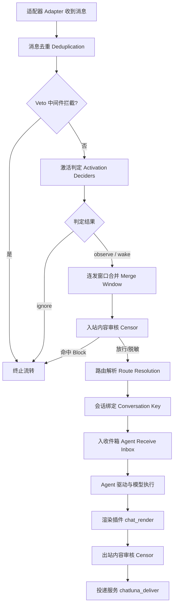
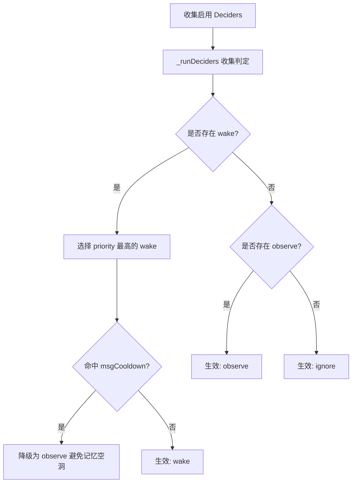
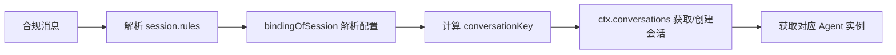

# 消息管线（Chat Pipeline）

消息管线负责聊天消息进入系统后的完整流转：从「接住平台消息、判断要不要理、合并连发、审核内容、解析路由」，直到最终「交给 Agent」。

管线只专注消息流转的生命周期与管控判定。它既不参与模型内部的推理循环（交由 Agent 运行时负责），也不直接向聊天平台推送原始富文本（由渲染与投递插件负责）。通过清晰解耦的阶段划分，ChatLuna 能确保进入大语言模型之前的每一条私聊或群聊消息，都经过确定性的过滤、去重、唤醒决策与并发排队。

## 管线全景

一条消息从 Koishi 适配器接收，到最终生成回复并投递回聊天平台，其完整生命周期如下所示：



## 去重与 veto

为防止网络抖动、协议重发或多适配器重复投递，消息进入管线的第一步就是内存去重与前置拦截：

1. **唯一性标识（eventKey）**：
   优先取平台的 `session.messageId`；若平台未提供 `messageId`，则退化使用 `sha256(routeKey + content)` 作为消息指纹。
2. **去重缓存与 TTL**：
   去重表基于 LRU 维护，内存中最多保留 `4096` 条，随时间过期自动清理。缓存有效期由 `dedupeTtlMs` 控制，默认值为 `86400000`（24 小时）。
   细心的小伙伴可能会注意到：去重检查严格位于激活判定之前，因此**重复消息绝对不会推进冷却计时器**。
3. **前置 veto 机制**：
   触发 `chatluna/before-chat-dispatch` 事件（上下文绑定 `this: Session`）。该事件采用 Waterfall 机制，若任意监听器返回 truthy 值（例如连发合并中的窗口聚合），则跳过本次 dispatch，但后续中间件仍会正常运行。
4. **引擎状态检测**：
   若当前匹配规则配置的引擎（`chat.engine`）为 `off`，管线将直接跳过处理，并让 dispatch 返回 `false`。

## 激活判定

平台收到消息并不意味着必须调用模型。ChatLuna 通过 `Decision` 结构描述每条消息的唤醒决策：

| 字段 | 类型 | 说明 |
| :--- | :--- | :--- |
| `effect` | `wake` \| `observe` \| `ignore` | `wake` 唤醒回复；`observe` 仅记录不回复；`ignore` 完全忽略 |
| `priority` | `number` | 决策优先级，数值越大优先级越高 |
| `reason` | `string` | 做出该判定的原因标识（如 `at`、`quote`、`nickname` 等） |
| `by` | `string` | 产出该判定的 decider 名称（`rule` / `activity` / `judge`） |
| `delay` | `number` \| `settle` | 可选延迟处理时间，或等待连发静默（`settle`） |
| `busy` | `step` \| `turn` | 机器人忙碌时的合并策略（合入当前 turn 的 step 或留待下个 turn） |

### 决策机制

管线通过执行 `_runDeciders` 收集所有启用判定器的决策结果。启用的 decider 集合由配置项 `chat.activation.use` 决定。

整个裁决流程遵循以下准则：
- 优先在所有返回 `wake` 的决策中，选取 **最高 priority** 的决策胜出。
- 仅当没有任何 decider 返回 `wake` 时，才会检查是否包含 `observe`。
- 若既无 `wake` 也无 `observe`，则最终判定为 `ignore`。



### 内置 Decider

#### 1. rule 规则判定

按固定顺序从前到后依次匹配：

1. **自己发送**：若 `session.userId === selfId` 且 `ignoreSelf` 为 true → `ignore`。
2. **私聊限制**：私聊环境且 `allowPrivate=false` → `ignore`。
3. **指令拦截**：消息内容为 Koishi 指令前缀调用 → `ignore`。
4. **私聊放行**：私聊环境且启用 `privateChatWithoutCommand` → `wake`。
5. **At 提及**：消息包含真实 at 机器人的元素且 `allowAtReply=true` → `wake`。
6. **引用回复**：回复了机器人先前发送的消息且 `allowQuoteReply=true` → `wake`。
7. **昵称唤醒**：匹配 `stripped.appel` 或 `isNickNameWithContent` 包含匹配机器人预设昵称 → `wake`。
8. **随机回复**：按 `randomReplyFrequency` 概率抽样命中 → `wake`（`priority: 0`）。
9. **兜底**：上述均未命中 → `ignore`。

::: tip 冷却降级保护
当 `rule` 判定命中 `wake` 时，若机器人处于发言冷却（`msgCooldown`）内，该决策将**降级为 `observe`**。这既阻止了机器人刷屏，又确保上下文能正常写入聊天记录，避免多轮对话产生记忆空洞。
:::

#### 2. activity 活跃度与兴趣判定

面向群聊插话场景：

- 综合统计最近消息频率、参与人数熵值、线索词（引用、包含机器人别名、兴趣词）、动量（momentum）及发言疲劳度。
- 动态计算冲动值 `urge` 与动态阈值，两次主动发言之间至少间隔 30 秒；被随机抽样拒绝的那一次同样消耗间隔，所以调低频率会按比例降低实际发言率。
- 判定结果只有两种：`wake`（附带 `settle` 延迟）或不产生决策（记录一次 skip）。它不会主动返回 `observe`——是否记录由监听者按 `chat.observe` 配置决定。

#### 3. judge 小模型智能裁决

使用轻量级语言模型（LLM）进行智能插话判定：

- **默认模型**：`@decide`。
- **触发参数**：最低插话把握 `minUrge = 0.55`、最小调用间隔 `minInterval = 60000` 毫秒、滑窗上下文 `window = 12`。
- **预算控制**：每日调用上限 `dailyBudget = 200`，并发上限 `concurrency = 2`。
- 判定结论按消息缓存；若判定需要观望后续话题，可通过 `wait`（毫秒）延迟回复。当已经存在更高优先级的 `wake` 时，管线不会再调用该模型。

### 静默观察机制（Observer）

当判定结果为 `observe` 时，由 `chat.observe` 选项接管存储行为：

- `mode`：`off`（默认）或 `quiet`。`quiet` 模式只记录不回复；`off` 模式下判定为不唤醒的消息不会进入聊天记录。
- `self`：默认 `true`，机器人自身发送的消息同样纳入观察。
- `backfill.limit`：回填消息上限，默认 `30` 条（伪装引擎默认 `40`）。
- `midTurn`：执行中插入粒度，默认 `step`。
- `store`：持久化单位，默认按 `message`。
- `media`：富媒体保留配置，`perMessage` 默认 `9`，`attach` 默认 `4`（设为 `0` 关闭）。

## 连发合并

用户在即时聊天中经常将一句话拆成多条连续发送。ChatLuna 提供了 `chat.merge` 连发合并缓冲能力：

```
chat.merge 配置：
- mode: "immediate" | "settle" (默认: "immediate")
- quiet: 2500ms (静默等待时长)
- max: 15000ms (最大聚合窗口)
- interrupt: false (是否允许打断当前生成)
- directMode: 可选特定私聊覆盖
```

- **immediate 模式（默认）**：
  首条唤醒消息立即触发 Agent 执行。在模型回复生成期间到达的新消息不会被打断丢弃，而是根据 `chat.observe.midTurn` 规则进入当前 turn 的后续步骤或合并到下一次回复中。
- **settle 模式**：
  由 `MergeWindows` 注册监听 `chatluna/before-chat-dispatch`。首条消息到达时开启定时器并 veto 阻止本次立即投递；若在 `quiet`（2500ms）内有新消息到达则重置定时器，直至发言静默或累计时长达到 `max`（15000ms）后统一放行合并投递。

## 内容审核

内容安全由 `chatluna-censor` 插件提供，支持在**入站（Inbound）**与**出站（Outbound）**阶段双向执行。

| 配置项 | 类型 | 默认值 | 说明 |
| :--- | :--- | :--- | :--- |
| `blockWords` | `string[]` | `[]` | 命中即阻断的违规词列表 |
| `flagWords` | `string[]` | `[]` | 命中仅标记并记录警告的词列表 |
| `replaceRules` | `Array<{pattern, replacement}>` | `[]` | 命中后执行正则替换脱敏的规则 |

- 规则匹配均采用大小写不敏感（case-insensitive）正则表达式。
- 命名空间支持层级继承与局部覆盖，可以在特定会话或频道重写 `censor` 配置。
- **阻断行为**：一旦入站或出站消息命中 `blockWords` 或自定义阻断规则，系统直接返回 `CENSOR_BLOCKED` 状态码并终止投递。
- **扩展性**：第三方插件可通过 API 注册自定义 `matcher`，审核触发后广播 `chatluna/after-censor` 事件。

## 路由解析与会话绑定

通过审核的消息进入 `ctx.chat.dispatch`，在此解析所属会话与配置空间：



1. **命名空间提取**：
   调用 `bindingOfSession` 从解析链（`session.rules`）提取 `engine`、`model`、`preset`、`tools`、`session` 等配置。若局部未覆盖，则使用对应 schema 的 `parse({})` 默认值填充：
   - `chat.engine`：默认 `agent`。
   - `chat.model`：默认 `openai:gpt-4o-mini`。
   - `chat.session.ownership`：默认 `shared`。
   - `chat.session.lane`：默认 `default`。
2. **模型有效性校验**：
   尝试解析所选模型的 Provider 与标识。若模型地址无法解析或 Provider 不存在，记录 warning 日志并拒绝 dispatch。
3. **conversationKey 计算**：
   会话标识由所有权规则与泳道划分派生：
   - `shared` 模式：`routeId`
   - `personal` 模式：`routeId:user:<userId>`
   - `custom` 模式：`custom:<sha256(展开后的 customKey)>`
   - 当 `lane` 不为 `default` 时，末尾追加 `:lane:<lane>`。
4. **会话与 Agent 获取**：
   通过 `ctx.conversations` 打开或创建目标会话，并获取绑定的 Agent 实例。
5. **并发背压控制**：
   每个 Route 维持有限的收件箱队列，上限由 `maxPendingPerRoute` 控制（默认 `64` 条）。当积压达到上限时，后续消息将被丢弃并记录 warning 日志。

## 投递收件箱

消息最终通过 `agent.receive(message, { when })` 投递进 Agent 的收件箱。需要注意的是，该方法仅负责接收消息，**不直接返回模型回答的 Promise**。

### when 参数语义

| 参数值 | 默认 | 调度语义 |
| :--- | :---: | :--- |
| `next` | 是 | 机器人空闲时立即唤醒；若当前处于运行中，则保留到下个 turn 处理，不并入当前 turn 的后续 step |
| `now` | 否 | 机器人空闲时立即唤醒；若当前处于运行中，在当前 turn 的后续 step 边界插队合入；不中止已向模型发出的请求 |
| `quiet` | 否 | 只入队并记录，不主动唤醒模型；若模型恰好在运行，可在后续 step 边界合入 |

### 收件箱调度准则

- **消息幂等**：基于 `messageId` 严格去重，相同 ID 无法重复入队。
- **非严格 FIFO**：新 turn 开启消费时，优先拉取 `now` 与 `quiet` 优先级的消息，然后再消费常规消息。
- **运行时合入**：模型运行期间到达的消息，会根据其配置的 `busy`（`step` 或 `turn`）决策具体的合入时机。

## 渲染与投递

当 Agent 完成推理并产出结构化块（Chunks）后，便进入后置渲染与对外投递流程：

### 渲染插件（chat_render）

负责把抽象的模型输出转换并组装为适配器所需的结构：

- **默认配置**：
  - `format`: `text`
  - `split`: `message`
  - `hidden`: `[]`
  - `toolTalk`: `never`
  - `reply`: `text`
  - `interim.deliver`: `send`
  - `interim.history`: `keep`
  - `quote`: `false`
  - `maxChunkLength`: `1500`
  - `maxSegments`: `6`
- **处理管线**：文本解析、富元素提取、敏感隐藏项剔除、中间过程消息（interim）流式投递与历史记录裁剪。

### 投递服务（chatluna_deliver）

- **双向感知**：提供 `bind/inbound` 与 `send/edit/recall`。
- **平台能力协商**：
  - `edit` 依赖机器人适配器的 `features` 包含 `message.update`。
  - `recall` 依赖适配器的 `features` 包含 `message.delete`。
- **出站审核与回环拦截**：
  - 出站消息同样经过 `chatluna-censor` 过滤。
  - 投递前执行 `markOwn` 签名，防止机器人自身发出的消息被适配器重新作为入站消息接收，杜绝无限回环。
- **事件广播**：发送成功后触发 `chatluna/deliver-sent` 事件，支持保留 quote 引用节点。

## 撤回与编辑

ChatLuna 通过 `chatluna-chat-recall` 插件监听底层适配器的消息变动事件：

- **事件源**：监听 Koishi 的 `message-deleted` 与 `message-updated` 事件。
- **撤回处理哲学**：
  1. **无重写历史**：撤回操作仅作为一条静默事件追加至历史上下文，绝对不物理重写或篡改已有历史记录。
  2. **不唤醒 Agent**：追加撤回事件属于静默通知，不会唤醒休眠的 Agent。
  3. **投影清洗**：若被撤回的消息仍在待处理输入队列（Inbox）中，会在投影至模型上下文之前被物理移除。
  4. **资源保护**：处理撤回通知时，绝不为已关闭或不存在的会话盲目创建新会话实例。

## 事件与扩展点

消息管线在关键节点提供了生命周期钩子，供扩展插件深度介入：

| 事件名 | 触发时机与机制 | 参数 / 上下文 |
| :--- | :--- | :--- |
| `chatluna/before-message` | 入站文本进入上下文前触发；`bail` 型，返回字符串可改写文本，返回阻断标记则丢弃 | `(session: Session, text: string)` |
| `chatluna/before-chat-dispatch` | 串行 waterfall；返回 truthy 时本次判定直接记为 `ignore`（veto） | `this: Session`，参数 `(session: Session)` |
| `chatluna/chat-dispatch` | 判定完成、准备交给 Agent 时触发；只是通知，返回内容不被使用 | `(session: Session, result: { sessionId: string; decision: Decision })` |
| `chatluna/chat-activation-change` | 注册或注销一个唤醒判定器时触发 | `({ id: string })` |
| `chatluna/rules-change` | 路由规则树更新重载后触发 | `({ revision: number })` |
| `chatluna/deliver-sent` | 回复成功发送到平台后触发 | `({ routeId, messageIds, content, own })` |
| `chatluna/after-censor` | 入站或出站内容完成审核后触发 | `(session: Session, hit: CensorHit)` |

## 下一步

- 理解规则空间的分发策略，请参考 [路由与规则引擎](./routing)。
- 深入探索模型思考与循环执行机制，请参考 [Agent 运行时](./agents)。
- 了解会话存储、分段投影与历史持久化，请参考 [会话管理](./conversations)。
- 深入会话运行时抽象，请参考 [Session 生命周期](./sessions)。
