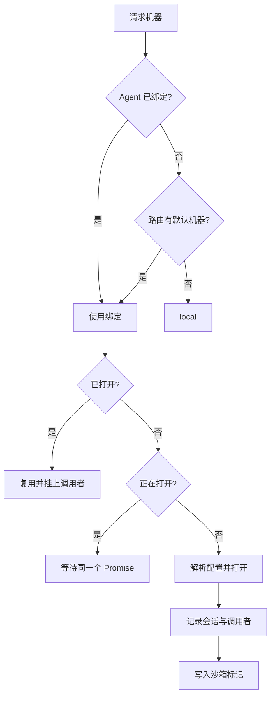

# 执行机器

::: tip
「机器」是工具执行代码和系统调用的载体：宿主机、SSH 远程主机、容器或云沙箱。「工作区」是模型在这台机器上默认的根目录。模型执行 `ls` 时，机器（Computer）子系统决定命令在哪里运行，为工具屏蔽环境差异，并管理资源生命周期，让不同会话和用户的工作区相互隔离。
:::

## 抽象

```ts
interface Machine {
  readonly name: string
  readonly kind: string
  readonly isolated: boolean
  readonly os: 'linux' | 'darwin' | 'windows'
  readonly root: string
  exec(request, signal?): Promise<ExecResult>
  spawn(request): ExecProcess
  read(path, options?): Promise<Uint8Array>
  write(path, data): Promise<void>
  list(path, options?): Promise<FileEntry[]>
  stat(path): Promise<FileStat | undefined>
  remove(path, options?): Promise<void>
  watch?(path, listener): () => void
}
```

文件读写、命令执行、代码运行等工具只调用这些方法，不关心底层是本地进程、SSH 还是 Docker。从本地切换到容器或远程主机只需改配置。

## 机器类型

类型由扩展插件注册，各自声明配置项与初始化行为：

| 类型 | 范围 | 特点 |
| --- | --- | --- |
| 本机 | 共享 | 直接使用宿主环境 |
| SSH | 共享 | 连接远程主机，一次连接可供多个会话复用 |
| Docker | 按会话 | 为每个会话单独创建独立的容器实例 |
| E2B | 按会话 | 为每个会话创建独立的云端安全沙箱 |

- **共享**：同一机器名全局只有一个实例。
- **按会话**：每个会话独立打开实例，以「机器名 + 会话 ID」标识。空闲一段时间后自动挂起以节省资源；沙箱标识保存在会话标记中，重启后也能连回原沙箱。

::: warning
按会话隔离不等于永久保留。沙箱可能因超时或资源策略被回收，删除会话时机器也会销毁。需要持久保存的文件，写入宿主机的持久化目录或使用共享机器。
:::

## 打开流程

`ctx.computer.of(agent)` 解析目标机器并按需打开：



- **并发安全**：同时请求同一台机器只执行一次打开，其余请求等待同一个 Promise。
- **空闲恢复**：挂起的机器收到请求时自动恢复。
- **权限校验**：分发前检查用户是否有该机器的权限。
- **环境注入**：上下文中注册了环境变量提供者时，执行命令自动合并这些变量。

**会话标记**：按会话的机器打开后，在会话日志中追加一条标记，记录机器名、类型和沙箱标识。用于重启或热重载后重连；机器关闭时清空标记，避免误连已失效的沙箱。标记是追加写入的，以最新一条为准。

## 工作区

`root` 是默认工作区根目录：

- 相对路径基于 `root` 解析，绝对路径直接访问。
- 写入超出 `root` 时需要额外授权：文件类工具检测到越界写入时不直接报错，而是发起权限询问。
- 读取默认不受限制，可以读工作区外的文件，但不能写回。

::: tip
这种不对称是有意的：读的风险远低于写，限制读取会让很多代码检索和环境分析任务无法进行。
:::

## 配置

- **基础定义**：唯一标识、类型和该类型的运行参数。
- **敏感字段**：密码、访问密钥等，加密存储。管理后台加载时解密，普通查询接口不返回明文。

机器名同时映射为权限动作 `machine:<名字>`：本机（`local`）默认需要 2 级，其他机器默认需要 4 级。

**路由**：

- **默认机器**：Agent 未绑定机器时使用。
- **允许委派**：模型可以自主选择的机器白名单。用户有某台机器的权限，但它不在白名单中时，模型也选不到它。模型可用的机器必须同时通过白名单和用户权限。

## 与提示词的关系

系统提示词中会注入一行环境信息：

```text
Machine: local (local, darwin), workspace /path/to/workspace
```

它固定在系统提示词中，不随轮次变化，让模型知道操作系统和工作目录，避免在 Windows 上生成只支持 Linux 的 Bash 脚本这类错误。

## 生命周期

- **打开**：首次收到请求时初始化。
- **挂起**：按会话的机器空闲超过阈值（默认 10 分钟）后暂停。
- **恢复**：下次调用时自动唤醒。
- **关闭**：显式注销、关联的 Agent 关闭或插件卸载时。

插件卸载或热重载时，共享机器直接关闭；按会话的机器保留在内存中，之后通过会话标记恢复，避免热重载丢失用户进行中的沙箱。

## 安全

执行机器是权限体系中最核心的安全边界：

- 本机直接继承宿主机权限，不要提供给不受信任的用户。
- 容器和云沙箱能限制操作范围，但配置不当（如挂载宿主机敏感目录）仍会让隔离失效。
- SSH 机器的范围取决于登录账号的权限。

::: warning
Docker 机器通常依赖宿主机的 Docker Daemon。向容器暴露 Docker 套接字或赋予特权，相当于交出很高的系统权限，只在信任镜像来源并清楚风险时开启。
:::

## 常见问题

**找不到机器**：检查机器配置是否存在、提供者插件是否启用、路由白名单是否包含它、用户权限等级是否足够。

**打开失败**：
- 本机：路径是否存在，进程是否有读写权限。
- SSH：网络、端口和凭据。
- 容器：容器运行时是否正常，镜像是否已拉取。
- 云沙箱：API 密钥、沙箱模板和账户额度。

**会话中的文件丢失**：机器已关闭或沙箱被回收。需要持久化就换共享机器，或把工作目录挂载到持久化路径。

**写入总被拦截**：路径超出了 `root`。把文件移到工作区内，或在询问中批准。

**空闲后首次调用很慢**：机器挂起后需要重新恢复，属于正常现象，可以调大挂起阈值。

## 下一步

- [工具系统](./tools) — 工具如何调用机器接口。
- [权限与审批](./permissions) — 机器的权限等级与审批。
- [机器与工作区](/manual/usage/machines) — 面向使用者的机器管理。
- [子代理](./subagent) — 为子代理指定独立的执行机器。
