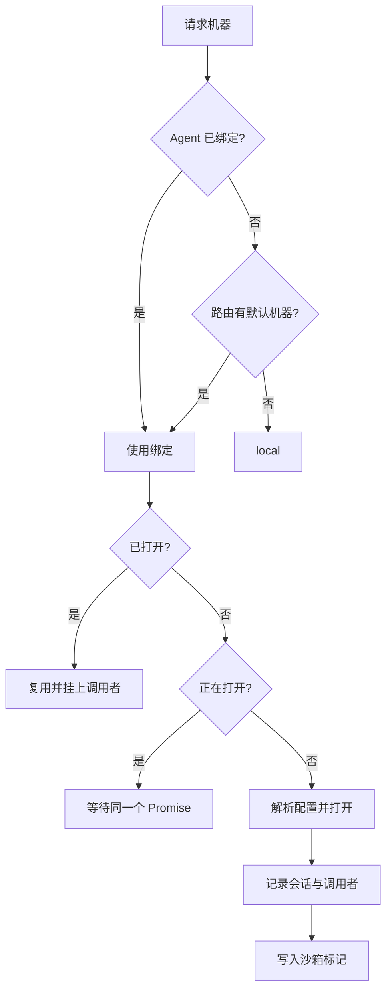

# 执行机器

::: tip
「机器」是工具的执行环境：一台主机、一个容器、一个云沙箱。工作区是这台机器上模型默认的活动范围。
:::

模型说「执行 ls」，系统得知道这句话在哪执行。

可能是运行 ChatLuna 的那台机器，可能是通过 SSH 连过去的服务器，也可能是为这个会话临时开出来的容器。

机器子系统负责回答这个问题，并且保证不同的会话、不同的用户不会互相踩到对方的工作区。

<!-- 架构页，可以使用代码与配置示意 -->

## 抽象

一个机器需要实现一组基本操作：

```ts
interface Machine {
  readonly name: string
  readonly kind: string
  readonly isolated: boolean
  readonly os: 'linux' | 'darwin' | 'windows'
  readonly root: string
  exec(request, signal?): Promise<ExecResult>
  spawn(request): ExecProcess
  read(path, options?): Promise<Uint8Array>
  write(path, data): Promise<void>
  list(path, options?): Promise<FileEntry[]>
  stat(path): Promise<FileStat | undefined>
  remove(path, options?): Promise<void>
  watch?(path, listener): () => void
}
```

工具不需要知道底层是本地进程、SSH 还是容器，只调用这些方法。

这样「文件读写」「命令执行」「代码运行」这几类工具可以完全复用，换机器只需要换配置。

## 机器类型

机器类型由插件注册，每个类型声明自己的配置结构与打开方式：

| 类型 | 范围 | 特点 |
| --- | --- | --- |
| 本机 | 共享 | 直接用宿主环境 |
| SSH | 共享 | 远程主机，一次连接多个会话共用 |
| Docker | 按会话 | 每个会话一个容器 |
| E2B | 按会话 | 每个会话一个云沙箱 |

### 共享与按会话

- **共享类型**：同一个名字下只有一台实例，所有会话共用。
- **按会话类型**：每个会话单独打开一个实例，键是「机器名 + 会话 id」。

按会话类型支持两个额外能力：

- **空闲挂起**：一段时间不用就暂停，节省资源。
- **会话恢复**：把沙箱标识写进会话标记，进程重启后能接回原来的沙箱。

::: warning
「按会话」不等于「永久隔离」。

沙箱会被回收，会话被删除时机器也会关闭。需要长期保留的文件应该放在持久目录或共享机器上。
:::

## 打开流程

`ctx.computer.of(agent)` 决定用哪台机器，并按需打开：



几个细节：

- **并发安全**：同一台机器同时被多个调用打开时，只会真正打开一次，其余等待同一个结果。
- **空闲恢复**：被暂停的机器在再次使用时自动恢复。
- **权限校验**：每次取用都会确认这台机器在当前用户的可用范围内。
- **环境注入**：如果注册了环境提供者，执行时会合并它们提供的环境变量。

## 会话标记

按会话的机器打开成功后，系统会往会话日志里写一条机器标记：机器名、类型、沙箱标识。

这条标记有两个用途：

1. 重启后重新连接原来的沙箱。
2. 关闭机器时把标记清空，避免下次误连一个已经不存在的沙箱。

标记是追加写入的，查找时取最近一条。

## 工作区

`root` 是工作区根目录。

- 相对路径按 `root` 解析。
- 绝对路径原样使用。
- 写入越出工作区时，需要额外授权。

这条规则由文件工具在执行前检查：越界写入会触发一次权限询问，而不是直接拒绝。

读取不受这个限制。读一个工作区外的文件是允许的，只是写回不去。

::: tip
这是刻意的不对称。

读操作的风险远低于写操作，限制读会让很多正常的分析任务变得寸步难行。
:::

## 配置

机器配置由两部分组成：

- **定义**：名字、类型、类型自己的配置。
- **敏感字段**：密码、密钥这类字段在保存时会被加密。

管理页读取配置时会解密；普通接口不会返回明文。

机器名同时也是一个权限动作名（`machine:<名字>`）：

- 本机默认 2 级。
- 其他机器默认 4 级。

## 路由

机器相关的路由设置有两项：

- **默认机器**：没有绑定时用哪台。
- **允许委派**：模型可以选择哪些机器。

「允许委派」是白名单：不在名单里的机器，即使用户有权限，模型也选不到。

可用机器列表 = 白名单过滤 + 权限判定。

## 与提示词的关系

系统会往提示词里放一行机器信息：

```text
Machine: local (local, darwin), workspace /path/to/workspace
```

这一行属于系统区，内容稳定，不会每轮变化。

它告诉模型当前环境是什么，避免它写出只能在 Linux 上跑的命令。

## 生命周期

- 打开：第一次使用时。
- 挂起：按会话且空闲超过阈值（默认十分钟）。
- 恢复：下次使用时。
- 关闭：显式关闭、Agent 关闭、插件卸载。

插件卸载时的处理有区别：

- 共享机器直接关闭。
- 按会话的机器保留，靠会话标记恢复——否则一次热重载就会丢掉所有沙箱。

## 安全

机器是权限体系里最重要的一道边界。

- 本机拥有宿主权限，不应该对不可信用户开放。
- 容器与沙箱能限制影响范围，但配置错误会让隔离失效。
- SSH 机器的权限取决于远端账号。

::: warning
Docker 类型通常需要访问宿主机的 Docker 服务。

这在本机上等价于很高的系统权限。只在你信任镜像来源、并且清楚后果时启用。
:::

## 排查

**找不到机器。**

检查机器定义是否存在、插件是否启用、路由白名单是否包含它、用户权限等级是否足够。

**打开失败。**

本机看路径与写权限；SSH 看网络与凭据；容器看运行时与镜像；云沙箱看密钥与模板。

**会话里文件丢了。**

按会话的机器被关闭或沙箱过期。需要持久化就换共享机器，或者把目录挂到持久位置。

**写入总被拦。**

路径越出了工作区。把目录挪进去，或者批准这一次。

**空闲后第一次调用很慢。**

机器在被恢复。这是预期行为；想避免就调大空闲时间。

## 下一步

- [工具系统](./tools) — 工具如何调用机器。
- [权限与审批](./permissions) — 机器权限等级。
- [机器与工作区](/manual/usage/machines) — 面向使用者的配置。
- [子代理](./subagent) — 指定子代理的执行机器。
