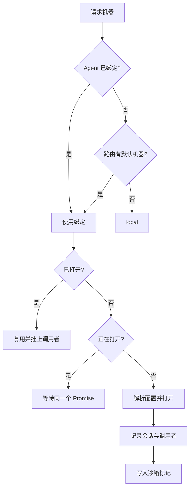

# 执行机器

::: tip
「机器」是工具执行代码与系统调用的物理或虚拟载体，可以是一台宿主机、一个容器或一个云沙箱。而「工作区」则是模型在这台机器上默认的活动根目录。
:::

当模型需要执行类似 `ls` 的命令时，系统首先需要确定：这个命令应该在哪个环境中运行？

这个环境可以是运行 ChatLuna 服务的宿主机本身，可以是通过 SSH 连接的远程服务器，也可以是为当前会话单独创建的容器或沙箱。

机器（Computer）子系统正是为了解决这个问题而设计的。它为上层工具屏蔽了不同底层环境的差异，同时也负责管理资源生命周期，确保不同会话与用户的工作区相互隔离。

## 抽象

无论底层是什么环境，在机器子系统中，一台机器都只需要实现一组标准接口：

```ts
interface Machine {
  readonly name: string
  readonly kind: string
  readonly isolated: boolean
  readonly os: 'linux' | 'darwin' | 'windows'
  readonly root: string
  exec(request, signal?): Promise<ExecResult>
  spawn(request): ExecProcess
  read(path, options?): Promise<Uint8Array>
  write(path, data): Promise<void>
  list(path, options?): Promise<FileEntry[]>
  stat(path): Promise<FileStat | undefined>
  remove(path, options?): Promise<void>
  watch?(path, listener): () => void
}
```

上层工具（例如文件读写、命令执行或代码运行）无需关心底层是本地进程、远程 SSH 还是 Docker 容器，直接调用这些通用方法即可。

得益于这种抽象，工具实现可以高度复用。当你需要将执行环境从本地切换到容器或远程主机时，只需要修改配置即可完成迁移。

## 机器类型

执行机器的类型由扩展插件注册。每个插件负责声明自己的配置项，并定义实例的初始化与连接行为：

| 类型 | 范围 | 特点 |
| --- | --- | --- |
| 本机 | 共享 | 直接使用宿主环境 |
| SSH | 共享 | 连接远程主机，一次连接可供多个会话复用 |
| Docker | 按会话 | 为每个会话单独创建独立的容器实例 |
| E2B | 按会话 | 为每个会话创建独立的云端安全沙箱 |

### 共享与按会话

按照实例的作用域，机器类型主要分为两类：

- **共享类型**：同一机器名在全局只保持一个实例，所有会话和调用者共享使用。
- **按会话类型**：每个会话都会独立打开一个新实例，以「机器名 + 会话 ID」作为唯一标识。

对于按会话隔离的机器，系统还提供了两项资源调度能力：

- **空闲挂起**：当会话在一段时间内没有新操作时，系统会自动暂停该机器实例以节省资源。
- **会话恢复**：系统会将沙箱的唯一标识保存到会话标记中。即使服务重启，也能通过该标记重新连回原来的沙箱。

::: warning
注意：「按会话隔离」并不等于「数据永久保留」。

沙箱实例可能会因超时或资源策略被回收；删除会话时，关联的机器也会一并销毁。如果有需要持久保存的文件，请务必写入宿主机的持久化目录，或使用共享机器。
:::

## 打开流程

在实际调度中，框架通过 `ctx.computer.of(agent)` 动态解析目标机器，并在需要时按需打开实例：



在打开和获取机器时，框架处理了以下细节：

- **并发安全**：当多个调用同时请求打开同一台机器时，底层只会执行一次打开逻辑，后续请求会复用同一个 Promise 并等待相同的结果。
- **空闲恢复**：处于暂停状态的机器收到新请求时，会自动被唤醒并恢复运行状态。
- **权限校验**：分发机器前，系统会检查当前用户是否拥有该机器的操作权限。
- **环境注入**：如果当前上下文中注册了环境变量提供者，执行命令时系统会自动合并这些环境变量。

## 会话标记

按会话隔离的机器成功打开后，系统会在会话日志中追加一条机器标记，记录机器名、类型以及具体的沙箱标识。

这条标记主要用于：

1. **跨生命周期重连**：服务重启或热重载后，系统可以根据标记重新连回之前的沙箱环境。
2. **状态同步清理**：机器主动关闭时会清空该标记，避免后续调用误连到已失效或不存在的沙箱。

标记数据采用追加写入的方式记录。系统在读取和恢复状态时，始终以最新追加的一条记录为准。

## 工作区

在 `Machine` 接口中，`root` 属性定义了当前机器的默认工作区根目录。路径解析与权限规则如下：

- 传入相对路径时，系统会基于 `root` 路径进行解析。
- 传入绝对路径时，系统会直接按原路径访问。
- 若写入操作超出 `root` 限定的工作区范围，则需要经过额外的授权确认。

这一安全边界由上层文件类工具在执行前校验。检测到越界写入时，系统不会直接抛出错误，而是会触发交互式权限询问，由调用者或策略决定是否放行。

读取操作默认不受该边界限制。模型可以直接读取工作区外的文件，但不能直接写回。

::: tip
这是框架有意设计的不对称策略。

通常情况下，读操作的安全风险远低于写操作。如果对文件读取也施加过于严格的限制，很多常规的代码检索与环境分析任务将无法正常进行。
:::

## 配置

机器的配置项包含两部分：

- **基础定义**：包含机器的全局唯一标识、所属类型以及该类型的运行参数。
- **敏感字段**：包含密码、访问密钥等敏感信息，在持久化存储时会加密保存。

管理后台在加载配置详情时会自动解密，面向普通调用的查询接口则绝不会返回明文字段。

此外，机器名会同时映射为一个标准的权限动作标识（`machine:<名字>`）：

- 本机（`local`）机器默认需要 2 级权限。
- 其他外部或沙箱机器默认需要 4 级权限。

## 路由

在机器子系统的路由层中，你可以配置以下两个选项：

- **默认机器**：当 Agent 没有显式绑定执行环境时默认使用的机器。
- **允许委派**：限定模型能够自主切换使用的机器列表。

其中，「允许委派」是一个安全白名单。即使用户拥有某台机器的调用权限，只要该机器未列入委派白名单，模型在规划工具调用时也无法选择它。

换句话说，模型最终可用的机器列表，必须同时通过白名单过滤与用户操作权限两道检查。

## 与提示词的关系

为了让模型准确感知当前的执行环境，系统会在组装上下文时向提示词中注入一行环境元数据：

```text
Machine: local (local, darwin), workspace /path/to/workspace
```

这行信息固定在系统提示词（System Prompt）中，内容保持稳定，不会在每轮对话中反复变化。

它的作用是向模型明确声明当前的操作系统类型和工作目录，避免模型误判环境并生成不兼容的命令（例如在 Windows 机器上生成仅支持 Linux 的 Bash 脚本）。

## 生命周期

机器实例的生命周期主要包含以下几个阶段：

- **打开**：首次收到执行或访问请求时按需初始化。
- **挂起**：按会话隔离的机器在持续空闲超过指定阈值（默认 10 分钟）后自动暂停。
- **恢复**：已挂起的实例在下次被调用时自动唤醒并恢复状态。
- **关闭**：在被显式注销、关联的 Agent 实例关闭或所属插件卸载时关闭。

在插件卸载或热重载时，不同作用域的机器处理策略有所不同：

- **共享机器**：随插件卸载直接关闭。
- **按会话机器**：实例保留在内存中，后续通过会话标记恢复。这样可以避免插件热重载导致用户所有进行中的沙箱状态丢失。

## 安全

在整个系统的权限体系中，执行机器是最核心的安全边界：

- 本机类型直接继承宿主机的运行权限，切勿直接提供给不受信任的用户。
- 容器与云沙箱可以有效限制操作范围，但如果配置不当（例如挂载宿主机的敏感目录），仍可能造成隔离失效。
- SSH 机器的操作范围严格受限于登录远程服务器的系统账号权限。

::: warning
Docker 类型的执行机器通常依赖宿主机的 Docker Daemon 服务。

如果在宿主机上向容器暴露 Docker 套接字或赋予特权，实际上相当于交出了很高的系统权限。请务必在充分信任镜像来源并清楚潜在风险的前提下开启。
:::

## 排查

遇到机器配置与调用问题时，可以参考以下常见场景进行排查：

**找不到机器**

检查机器配置是否存在、对应的提供者插件是否已启用、路由中的委派白名单是否包含该机器，以及当前用户的权限等级是否达到访问要求。

**打开失败**

- 本机类型：检查指定的路径是否存在，以及当前进程是否有读写权限。
- SSH 类型：检查网络连通性、端口是否开放，以及密钥或密码等凭据是否正确。
- 容器类型：检查宿主机的容器运行时是否正常，以及目标镜像是否已成功拉取。
- 云沙箱类型：检查对应云平台的 API 密钥是否有效、沙箱模板是否存在，以及账户额度是否充足。

**会话中的文件丢失**

该会话关联的机器已被彻底关闭，或云端沙箱因到期被自动回收。如果需要持久保存文件，建议切换为共享机器，或将工作目录挂载到持久化存储路径。

**写入操作总被拦截**

说明写入的文件路径超出了 `root` 所定义的工作区范围。你可以将目标文件移动到工作区内，或在权限询问弹窗中批准本次操作。

**空闲后首次调用耗时很长**

机器闲置超时后进入了挂起状态，首次调用时系统需要重新拉起并恢复沙箱。这是预期内的正常表现；如果希望减少恢复等待，可以根据需要适当调大空闲挂起的时间阈值。

## 下一步

- [工具系统](./tools) — 了解上层工具如何调用机器接口执行任务。
- [权限与审批](./permissions) — 了解机器的权限等级划分与交互审批机制。
- [机器与工作区](/manual/usage/machines) — 查看面向使用者的机器管理与配置指引。
- [子代理](./subagent) — 了解如何为派生的子代理指定独立的执行机器。
