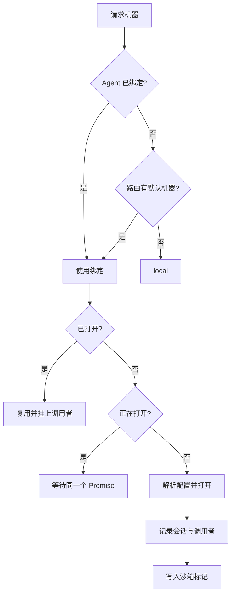

# 执行机器

::: tip
「机器」是工具执行代码与系统调用的物理或虚拟载体，可以是一台宿主机、一个容器或一个云沙箱。而「工作区」则是模型在这台机器上默认的活动根目录。
:::

当模型发出类似「执行 `ls`」的指令时，系统首先要明确一个核心问题：这句话究竟应该在哪个环境中执行？

这个执行环境可能就是运行 ChatLuna 服务的宿主机本身，可能是通过 SSH 远程连接的云服务器，也可能是专门为当前会话按需拉起的独立容器或沙箱环境。

机器子系统（Computer）正是为了统一解决这一问题而设计的。它不仅为上层工具屏蔽了异构底层的操作差异，还负责严格把控资源生命周期，确保不同会话与用户之间的工作区互不干扰、安全隔离。

## 抽象

无论底层是何种环境，在机器子系统的抽象中，一台机器只需要实现一组标准的操作接口：

```ts
interface Machine {
  readonly name: string
  readonly kind: string
  readonly isolated: boolean
  readonly os: 'linux' | 'darwin' | 'windows'
  readonly root: string
  exec(request, signal?): Promise<ExecResult>
  spawn(request): ExecProcess
  read(path, options?): Promise<Uint8Array>
  write(path, data): Promise<void>
  list(path, options?): Promise<FileEntry[]>
  stat(path): Promise<FileStat | undefined>
  remove(path, options?): Promise<void>
  watch?(path, listener): () => void
}
```

在上层开发中，各类工具（例如「文件读写」、「命令执行」或「代码运行」）完全不需要关心底层究竟是本地子进程、远程 SSH 连接还是 Docker 容器，它们只需统一调用上述通用方法。

得益于这种抽象，工具实现得以高度复用。当你需要将执行环境从本地切换到容器或远程集群时，只需修改配置即可完成无缝迁移。

## 机器类型

执行机器的具体类型由扩展插件注册。每个类型插件负责声明自己的配置项结构，并定义实例的初始化与连接行为：

| 类型 | 范围 | 特点 |
| --- | --- | --- |
| 本机 | 共享 | 直接使用宿主环境 |
| SSH | 共享 | 连接远程主机，一次连接可供多个会话复用 |
| Docker | 按会话 | 为每个会话单独创建独立的容器实例 |
| E2B | 按会话 | 为每个会话创建独立的云端安全沙箱 |

### 共享与按会话

在实例的作用域管理上，机器类型主要划分为以下两类：

- **共享类型**：同一机器名称在全局仅维护一台单例，所有会话与调用者共同使用该实例。
- **按会话类型**：每个会话都会独立打开一台新实例，以「机器名 + 会话 ID」作为唯一定位键。

对于按会话隔离的机器，系统额外提供了两项重要的资源调度能力：

- **空闲挂起**：当会话在一段时间内没有新的操作时，系统会自动暂停该机器实例以节约宿主资源。
- **会话恢复**：系统会将沙箱的唯一标识持久化到会话标记中。即使服务进程重启，也能依据该标记重新连接到原来的沙箱。

::: warning
需要注意的是，「按会话隔离」并不等同于「数据永久保留」。

沙箱实例可能会因超时或资源策略被回收，会话被删除时关联的机器也会同步销毁。若有需要持久保存的文件，务必写入宿主持久化目录或使用共享机器。
:::

## 打开流程

在实际调度中，框架通过 `ctx.computer.of(agent)` 动态解析目标机器，并在必要时按需打开实例：



在机器的开启与取用过程中，框架处理了以下几处关键细节：

- **并发安全**：当同一台机器被多个调用并发请求打开时，底层只会触发一次真正的打开逻辑，后续请求将直接复用同一个 Promise 并等待相同的结果。
- **空闲恢复**：处于暂停状态的机器在接收到新的调用请求时，会被透明唤醒并自动恢复运行状态。
- **权限校验**：在每次分发机器前，系统均会严格验证当前用户是否具备该机器的操作权限。
- **环境注入**：如果当前上下文中注册了环境变量提供者，执行命令时系统会自动合并它们贡献的环境变量。

## 会话标记

当按会话隔离的机器成功打开后，系统会主动向会话日志中追加一条机器标记，记录机器名、类型以及具体的沙箱标识。

细心的小伙伴可能会发现，这条看似简单的标记在运行时起到了承前启后的关键作用：

1. **跨生命周期重连**：当服务重启或热重载后，系统可依据标记重新连回原先的沙箱环境。
2. **状态同步清理**：在机器主动关闭时清空该标记，防止后续调用误连到一个已经失效或不存在的沙箱。

标记数据采用追加写入的方式进行记录，系统在读取和恢复状态时，始终以最新追加的一条记录为准。

## 工作区

在 `Machine` 接口中，`root` 属性定义了当前机器的默认工作区根目录。路径解析与权限约束遵循以下规则：

- 传入相对路径时，系统会统一基于 `root` 路径进行解析。
- 传入绝对路径时，系统会按原路径直接访问。
- 若写入操作试图越出 `root` 所限定的工作区范围，则必须经过额外的授权确认。

这一安全边界由上层文件类工具在执行前主动校验。当检测到越界写入时，系统并不会简单粗暴地直接抛错，而是会触发交互式权限询问，由调用者或策略决定是否放行。

需要说明的是，读取操作默认不受该边界限制。模型读取工作区外的文件是完全被允许的，只是无法直接写回。

::: tip
这是框架有意设计的不对称策略。

通常情况下，读操作的安全风险远低于写操作。如果对文件读取也施加过于严苛的限制，很多常规的代码检索与环境分析任务都将变得寸步难行。
:::

## 配置

机器的配置项结构由两部分构成：

- **基础定义**：包含机器的全局唯一标识、所属类型以及该类型特有的运行参数。
- **敏感字段**：包含密码、访问密钥等敏感信息，这些内容在持久化存储时会被加密保护。

管理后台在加载配置详情时会自动完成解密，而面向普通调用的查询接口绝不会返回明文字段。

此外，机器名同时也会映射为一个标准的权限动作标识（`machine:<名字>`）：

- 本机（local）机器默认需要 2 级权限。
- 其他外部或沙箱机器默认需要 4 级权限。

## 路由

在机器子系统的路由层中，你可以灵活配置以下两个核心选项：

- **默认机器**：当智能体（Agent）自身没有显式绑定执行环境时所兜底使用的机器。
- **允许委派**：限定模型能够自主决策并切换使用的候选机器列表。

其中，「允许委派」本质上是一个严格的安全白名单。即使用户自身拥有某台机器的调用权限，只要该机器未列入委派白名单，模型在规划工具调用时也无法选中它。

换句话说，最终生成的可用机器列表，必须同时满足白名单过滤与用户操作权限这两道检查。

## 与提示词的关系

为了让模型准确感知当前的执行边界，系统会在组装上下文时向提示词中注入一行环境元数据：

```text
Machine: local (local, darwin), workspace /path/to/workspace
```

这行信息固定放置在系统提示词区域（System Prompt），其内容保持静态稳定，不会在每轮对话中反复变化。

它的核心作用是向模型明确声明当前的操作系统类型与工作目录，避免模型臆测环境并写出平台不兼容的命令（例如在 Windows 机器上生成仅支持 Linux 的 Bash 脚本）。

## 生命周期

机器实例的生命周期主要经历以下几个阶段：

- **打开**：在首次接收到执行或访问请求时按需初始化。
- **挂起**：按会话隔离的机器在持续空闲超过指定阈值（默认十分钟）后自动暂停。
- **恢复**：已挂起的实例在下次被调用时自动被唤醒并恢复状态。
- **关闭**：当被显式注销、关联的 Agent 实例关闭或所属插件卸载时触发关闭。

在插件卸载或热重载时，不同作用域的机器在处理策略上存在重要区别：

- **共享机器**：随插件卸载而直接执行关闭操作。
- **按会话机器**：实例在内存中保留，后续通过会话标记进行恢复。这样设计能够避免一次常规的插件热重载导致用户所有进行中的沙箱状态全数丢失。

## 安全

在整个系统的权限体系中，执行机器是最核心也是最敏感的一道安全屏障：

- 本机类型直接继承了宿主机的运行权限，切勿直接暴露给不受信任的终端用户。
- 容器与云沙箱能够有效收敛操作影响范围，但若配置不当（例如挂载敏感宿主目录）仍可能导致隔离击穿。
- SSH 机器的操作边界严格受限于远程服务器所登录的系统账号权限。

::: warning
Docker 类型的执行机器通常需要依赖宿主机的 Docker Daemon 服务。

在宿主机上向容器暴露 Docker 套接字或赋予特权，在实际效果上等同于交出了很高的系统权限。请务必在充分信任镜像来源并清楚潜在风险的前提下开启。
:::

## 排查

在机器配置与调用的日常排查中，可以重点关注以下典型场景：

**找不到机器。**

检查机器配置定义是否存在、对应的提供者插件是否已启用、路由中的委派白名单是否包含该机器，以及当前用户的权限等级是否达到访问要求。

**打开失败。**

- 本机类型：重点检查指定的路径是否存在以及当前进程是否具备读写权限。
- SSH 类型：重点检查远程网络连通性、端口可达性以及凭据（密钥/密码）是否正确。
- 容器类型：检查宿主机容器运行时状态是否正常、目标镜像是否已成功拉取。
- 云沙箱类型：检查对应云平台的 API 密钥是否有效、沙箱模板是否存在或是否有额度限制。

**会话里的文件丢失。**

该会话关联的机器已被彻底关闭，或云端沙箱因生命周期到期被自动回收。若需长期持久化文件，建议切换为共享机器，或将工作目录挂载至持久化存储路径。

**写入操作总被拦截。**

说明当前写入的文件路径超出了 `root` 所定义的工作区范围。可以将目标文件移动到工作区内部，或者在权限询问弹窗中主动批准本次操作。

**空闲后第一次调用耗时很长。**

机器在长时间闲置后触发了空闲挂起，首次调用时系统正在重新拉起并恢复沙箱。这属于预期内的正常表现；若希望减少恢复等待，可以根据业务需求适当调大空闲挂起的时间阈值。

## 下一步

- [工具系统](./tools) — 了解上层工具如何调用机器接口执行任务。
- [权限与审批](./permissions) — 了解机器的权限等级划分与交互审批机制。
- [机器与工作区](/manual/usage/machines) — 查看面向使用者的机器管理与配置指引。
- [子代理](./subagent) — 了解如何为派生的子代理指定独立的执行机器。
