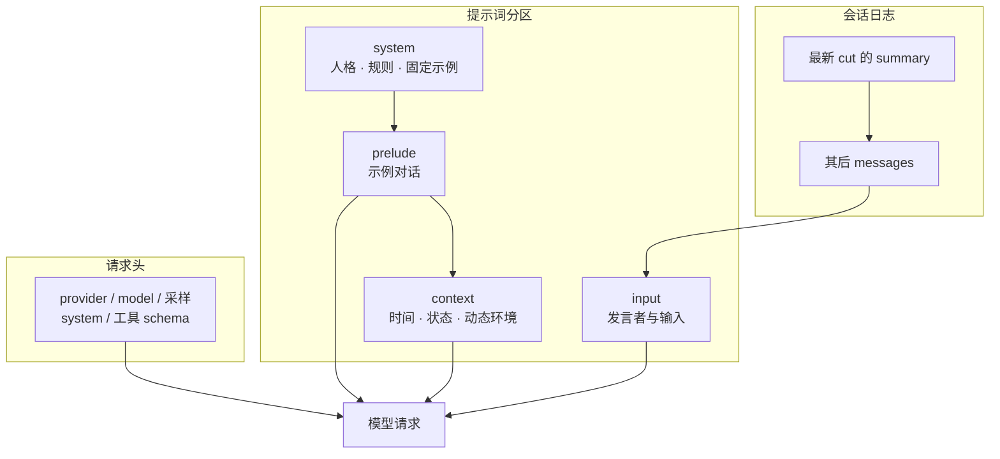

# 上下文、缓存与压缩

当会话轮次增加时，ChatLuna 发送给大语言模型的请求并不只是简单地将新消息追加在末尾。预设配置、工具调用、模型定义、记忆组件以及历史压缩都会直接改变模型实际接收到的内容。

本章将详细说明 ChatLuna 的提示词分区模型、前缀稳定性保障机制以及上下文压缩与溢出恢复流程。

## 认识一次模型请求的组成

在了解上下文管理前，你需要先理解发送给模型提供方 (Provider) 的底层请求是如何拼装的。默认 Agent 会将以下四个部分组合成单次模型请求：



1. **请求头**：Provider、Model、采样与输出配置、System 设定以及工具定义 (Tool Schema)。
2. **Prelude（序章消息）**：位于历史会话之前的固定示例对话（如固定设定的 `user` / `assistant` 交互示例）。
3. **会话消息视图**：由原始消息条目 (`message`) 和最新的截断点 (`cut`) 动态派生。
4. **当前上下文与输入**：实时变化的动态上下文快照、工具状态通知以及本次接纳的用户输入。

::: warning
调用 `session.messages()` 获取的列表并不是发送给模型的完整请求内容。仅查看消息列表会遗漏 System 提示词、工具定义和 Prelude。此外，会话消息已提交并不等同于已持久化到磁盘，具体存储行为取决于系统当前启用的 `SessionStore` 实现。
:::

ChatLuna 通过 `prompt mark` 保存可用于精确重建请求前缀的状态标识。

---

## 规划提示词分区

ChatLuna 将提示词模板划分为三个核心分区 (Zone)。每个分区具备明确的注入位置和使用规则：

| 分区 (`zone`) | 注入位置 | 适用内容 |
| :--- | :--- | :--- |
| `system` | 请求的 System 字段；若指定了 `user` 或 `assistant` 角色则降级转入 `prelude` | 助手人格设定、基础规则、固定少样本 (Few-shot) 示例 |
| `context` | 位于当前输入之前，只有发生变化时才会发送快照 | 动态时间、环境状态、上下文注入 |
| `input` | 包裹用户实际输入的模板，必须显式包含 `{prompt}` 占位符 | 发言者身份标识与用户输入格式化 |

### 编写提示词模板

在编写提示词模板时，系统会严格校验变量的可变性。`system` 分区**仅允许使用不可变变量**。

```md
你是一个帮助用户分析项目的助手。说明事实与推断的区别。

<!-- @context name=clock -->
当前时间：{time}

<!-- @input -->
[{sender}] {prompt}
```

::: danger 变量可变性限制
如果你将 `{time}` 或随机变量直接放入 `system` 分区，模板在渲染时将产生 `variable.mutable` 诊断警告并直接抛出错误。这一机制用于强制维护请求前缀的静态稳定性以利用缓存，**不能作为防御提示词注入 (Prompt Injection) 的安全隔离屏障**。
:::

### 在插件中声明变量与提示词块

你可以在插件生命周期中通过 `ctx.prompt` API 注册供模板使用的变量与代码块：

```ts
import type { Context } from '@chatluna/cordis'

export function apply(ctx: Context) {
  // 1. 声明一个不可变变量（可用于 system 分区）
  ctx.prompt.variable({ name: 'agent_version', mutable: false }, () => 'v2.1.0')

  // 2. 声明一个动态变量（仅允许用于 context/input 分区）
  ctx.prompt.variable({ name: 'clock', mutable: true }, () => new Date().toISOString())

  // 3. 注册提示词块
  ctx.prompt.block({ id: 'env-status', zone: 'context', content: '当前工作区网络状态正常。' })
}
```

上述注册跟随执行纤程 (Fiber)。单次模型请求只会合并全局层与当前 Agent 层的注册定义，其他 Agent 的局部块不会被自动继承。

---

## 管理稳定前缀与 Epoch 缓存

为了提高大语言模型提供方的前缀缓存 (Prefix Caching) 命中率并降低开销，ChatLuna 会使用前缀摘要来跟踪结构变更。

### Epoch 机制与缓存层次

当模型配置、System 提示词、Prelude 示例或工具定义发生变化时，系统可能会生成新的 **`epoch`**；而在同一配置下单纯追加对话消息通常不会改变 epoch。

::: tip
`epoch` 属于 ChatLuna 本地的诊断概念，系统**不承诺模型提供方一定会命中缓存**。远端缓存是否命中还受厂商实现、请求长度、窗口有效期及适配器协议的影响。另外，框架中的 `ctx.ai.generation` 专门用于隔离 Provider 的注册代次，与前缀 `epoch` 是不同的概念。
:::

ChatLuna 系统中的三个主要缓存层级如下：

| 缓存类别 | 缓存对象 | 机制与限制 |
| :--- | :--- | :--- |
| **远端前缀缓存** | 模型厂商服务端的前缀计算状态 | **不保证**每次都命中、**不保证**固定折扣比例、**不保证**无期限保留。 |
| **本地能力缓存** | Provider 状态、模型能力列表与工具 Schema 等 | **不保证**凭据持续有效，**不保证**工具执行必定成功。 |
| **会话视图缓存** | 由会话条目推导派生出的实际消息数组 | **不保证**自动写入磁盘，修改快照**不保证**自动向其他状态实例同步。 |

::: warning
Token 费用核算必须以实际调用返回的 `usage` 统计和模型提供方的账单为准，不要根据本地缓存标签推算抵扣金额。
:::

### 避免破坏前缀稳定性

以下操作会导致请求前缀失效并频繁产生新的 epoch：
- 在每一轮请求中把动态数据写入 `system` 分区。
- 动态调整工具列表，或打乱工具 Schema 的注册顺序。
- 在 `assemble` 请求中间件中动态修改前缀内容。
- 在对话中途切换模型或预设配置。
- 上下文压缩重写了前序历史。

默认执行循环会尝试复用已计算的提示词前缀并冻结工具头。仅当检测到新增工具或废弃工具累积过多时才会触发刷新。使用延迟工具发现机制可以减少 Schema 的初始体积，但这不意味着工具 Schema 永远不占用上下文窗口。

---

## 理解历史压缩机制

当会话长度超出模型限制时，压缩模块会对上下文进行缩减与截断。

### 核心压缩包分工

ChatLuna 将压缩能力拆分为多个功能包：

- **`@chatluna/compaction`**：定义压缩抽象契约、事件接口与基础纯函数。
- **`@chatluna/compaction-default`**：在上下文中提供核心压缩服务 `ctx.compaction`，实现多级降级策略。
- **`@chatluna/compaction-auto`**：负责在请求发起前监控上下文用量并提前触发压缩。

::: tip
关闭 `@chatluna/compaction-auto` 只会停用提前自动压缩功能，**不会关闭**默认压缩器在请求遇到超限错误时的溢出恢复逻辑。
:::

### 默认压缩策略链

默认压缩执行链严格按以下步骤依次执行：

```text
裁剪长工具结果 → 图片/文件媒体转换为占位文本 → 总结历史消息 → 写入截断点 (cut)
```

系统默认配置为 `keep=32000`。此数值代表保留在尾部的**估算 Token 预算**，而不是保留的消息条数。最终实际保留的消息范围还会受到工具调用配对完整性边界、当前输入体积以及当前压缩级别的影响。

在生成历史摘要时，系统优先携带可复用前缀调用摘要模型。如果会话历史过大超出摘要模型的上下文，或者模型调用直接失败，系统会自动降级为**分块滚动摘要**。如果所有的模型摘要尝试均告失败，默认实现会使用一条本地生成的占位说明来替代被截断的历史消息。

::: danger
由本地说明替代历史属于有损降级，不属于无损压缩。如果你在后续调试中需要确认精确的上下文细节，必须查阅原始会话日志。
:::

---

## 压缩触发与故障恢复流程

压缩的执行分为主动的「提前触发」和被动的「溢出恢复」两种机制。

### 1. 提前触发 (Auto Compaction)

由 `@chatluna/compaction-auto` 驱动，默认处于启用状态。满足以下任一条件即触发：

- **上下文阈值**：当前估算的上下文消耗达到目标模型最大窗口的 **80% (0.8)**。如果当前模型的最大窗口未知，系统将按照 **32000** 的备用窗口进行估算并记录警告日志（此估算基于启发式规则，非模型厂商官方 Tokenizer 精确值）。
- **媒体引用上限**：当前可见历史中 `meta.attach` 包含的不重复资源引用数超过 **32 个**。你可以将配置参数设为 `maxImages=0` 来关闭此数量触发规则。

如果压缩流程在同一个 Agent 上**连续两次出现错误**，系统将暂时跳过提前压缩，防止请求被死循环阻塞。当 Agent 实例重新回到空闲 (`idle`) 状态时，该错误计数器会被自动清零。跳过提前压缩后，随后的请求仍可能因实际超限而触发底层错误。

### 2. 溢出恢复 (Overflow Recovery)

当模型调用返回失败且错误码为 `CONTEXT_WINDOW_EXCEEDED` 时，`@chatluna/compaction-default` 会介入接管，逐级执行压缩并重新运行处理步骤 (Step)，请求将重新经过所有中间件。

默认压缩器最多依次尝试 4 个压缩级别（0 到 3 级）：

- **第 0 级**：保留尾部预算范围内的消息，对之前的所有历史执行常规摘要。
- **第 1 级**：将尾部保留范围内的媒体附件（图片/文件）一并剥离替换，将更早历史纳入截断点 (`cut`)。
- **第 2 级**：将尾部 Token 预算进一步缩减至原值的四分之一 (1/4)，并强制截断剩余长文本。
- **第 3 级**：仅保留最新一条输入消息，对其余所有上下文消息进行分块摘要合并。

如果某个级别执行后未能成功输出截断点 (`cut`)，系统**不会将相同的请求原样重新发送**，而是立即自动递增级别继续尝试。

::: warning 恢复机制限制
在执行过至少一次压缩之前，常规的网关超时（如 HTTP 504 / 524 错误）不会被视为溢出恢复信号；只有在系统已经尝试过压缩之后，若再次出现此类网关超时，系统才会将其视为可能由体积过大引起的超时，并尝试继续升级压缩。

当尝试次数耗尽、压缩阶段发生不可逆异常或会话被主动取消时，恢复流程将退出并抛出异常。该机制**无法保证能够修复单条超出模型窗口极限的超长输入**。
:::

---

## 模型提供方原生压缩

部分先进模型支持直接在服务端维持状态并返回原生压缩条目 (Native Compaction Entries)。原生压缩条目由提供方内部格式存储，而非通用文本摘要。

- **跨提供方兼容性**：原生条目**无法在不同的模型厂商之间直接重放**。当你在会话中途切换到另一个厂商的模型时，ChatLuna 会读取原始记录重新生成标准的文本摘要进行迁移。
- **条目失效处理**：若服务端报告原生条目已失效，系统会将其标记为不可用，并自动降级为使用文本摘要重试。
- **路由控制**：你可以通过路由命名空间 `compaction` 下的 `remote` 开关控制是否启用该能力。

::: tip
兼容第三方协议的端点（如反向代理或第三方网关）可能未实现提供方的原生压缩协议。在配置中关闭原生压缩并不等于停用 ChatLuna 本地的历史压缩流程。

写入 `cut` 截断点仅表示改变了发往模型的消息视图范围，**不会从数据库中物理删除原始条目 (Entries)**。如果需要彻底擦除用户敏感数据，必须调用专门的隐私清理流程。
:::

---

## 常见问题排查

| 异常现象 | 排查方向与定位方法 |
| :--- | :--- |
| **Token 消耗每轮持续非预期增长** | 检查当前 `prompt mark` 中的配置项、`system` 分区、`prelude` 示例以及工具 Schema 是否在频繁变更打破前缀缓存；同时确认是否仅仅是会话历史未达阈值前的自然增长。 |
| **上下文摘要后模型遗漏了关键细节** | 检查最新截断点 (`cut`) 的覆盖范围与摘要内容。如果该轮次降级为了本地简单说明，需查阅原始会话日志或引入外置记忆机制补充细节。 |
| **请求直接报错超限，无法自动恢复** | 检查单条输入是否已经超过目标模型的上下文上限。此情况需分批输入文本、改用文件检索组件处理，或切换到更大上下文窗口的模型。 |
| **图文会话频繁触发上下文压缩** | 检查历史消息中图片与文件附件 (`meta.attach`) 的累计数量是否已超过 32 个。可调整阈值或设置 `maxImages=0` 停用媒体数量监控。 |
| **关闭 auto 插件后仍然发生压缩** | 确认被触发的是否为被动「溢出恢复 (CONTEXT_WINDOW_EXCEEDED)」、管理命令触发的手动压缩，或是 Provider 侧的「原生压缩」。三者受不同配置项独立控制。 |

---

## 下一步

- 了解多端存储与状态持久化机制：[会话与分支](/architecture/sessions)
- 学习如何规范配置提示词分区与角色：[预设与角色](/manual/usage/characters)
- 探索模型底层的请求生命周期与中间件：[模型运行时](/architecture/models)
