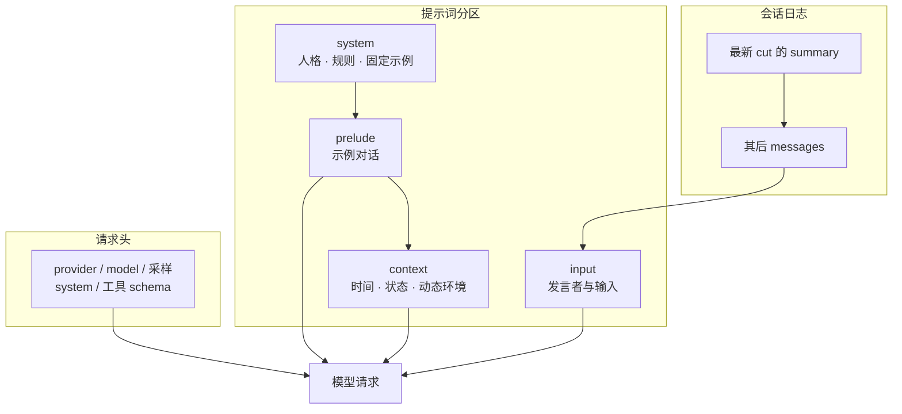

# 上下文、缓存与压缩

::: tip
多轮对话中，发给模型的请求不只是把新消息追加到末尾。预设、工具、模型、记忆和历史压缩都会影响模型最终看到的上下文。本页介绍提示词分区、前缀稳定性，以及上下文压缩与溢出恢复。
:::

## 一次请求的组成



1. **请求头**：Provider、Model、采样与输出配置、System 设定和工具定义（Tool Schema）。
2. **Prelude**：历史之前的固定示例对话。
3. **会话消息视图**：由 `message` 条目和最新的截断点 `cut` 派生。
4. **当前上下文与输入**：动态上下文快照、工具状态通知和本次输入。

::: warning
`session.messages()` 返回的不是完整请求，不含 System、工具定义和 Prelude。消息已提交也不等于已写入磁盘，持久化取决于 `SessionStore` 的实现。
:::

ChatLuna 还用 `prompt mark` 记录状态标识，以便精确重建请求前缀。

## 提示词分区

| 分区 (`zone`) | 注入位置 | 适用内容 |
| :--- | :--- | :--- |
| `system` | 请求的 System 字段；若指定了 `user` 或 `assistant` 角色则降级转入 `prelude` | 助手人格设定、基础规则、固定少样本 (Few-shot) 示例 |
| `context` | 位于当前输入之前，只有发生变化时才会发送快照 | 动态时间、环境状态、上下文注入 |
| `input` | 包裹用户实际输入的模板，必须显式包含 `{prompt}` 占位符 | 发言者身份标识与用户输入格式化 |

`system` 分区**只允许不可变变量**：

```md
你是一个帮助用户分析项目的助手。说明事实与推断的区别。

<!-- @context name=clock -->
当前时间：{time}

<!-- @input -->
[{sender}] {prompt}
```

::: danger 变量可变性限制
把 `{time}` 或随机变量放进 `system`，渲染时会产生 `variable.mutable` 诊断并抛出错误。这个机制用于保持前缀稳定以利用缓存，**不是防御提示词注入的安全屏障**。
:::

插件通过 `ctx.prompt` 注册变量和块：

```ts
import type { Context } from 'cordis'

export function apply(ctx: Context) {
  // 1. 声明一个不可变变量（可用于 system 分区）
  ctx.prompt.variable({ name: 'agent_version', mutable: false }, () => 'v2.1.0')

  // 2. 声明一个动态变量（仅允许用于 context/input 分区）
  ctx.prompt.variable({ name: 'clock', mutable: true }, () => new Date().toISOString())

  // 3. 注册提示词块
  ctx.prompt.block({ id: 'env-status', zone: 'context', content: '当前工作区网络状态正常。' })
}
```

注册跟随纤程（Fiber）。单次请求只合并全局层和当前 Agent 层的注册，不会继承其他 Agent 的局部块。

## 稳定前缀与 Epoch

ChatLuna 用前缀摘要跟踪结构变化，以提高厂商前缀缓存（Prefix Caching）的命中率。模型配置、System、Prelude 或工具定义变化时可能生成新的 **`epoch`**；同一配置下只追加消息通常不会。

::: tip
`epoch` 是本地诊断概念，**不保证远端一定命中缓存**，命中还取决于厂商实现、请求长度、缓存有效期和适配器协议。`ctx.ai.generation` 用于隔离 Provider 的注册代次，与 `epoch` 无关。
:::

| 缓存类别 | 缓存对象 | 机制与限制 |
| :--- | :--- | :--- |
| **远端前缀缓存** | 模型厂商服务端的前缀计算状态 | **不保证**每次都命中、**不保证**固定折扣比例、**不保证**无期限保留。 |
| **本地能力缓存** | Provider 状态、模型能力列表与工具 Schema 等 | **不保证**凭据持续有效，**不保证**工具执行必定成功。 |
| **会话视图缓存** | 由会话条目推导派生出的实际消息数组 | **不保证**自动写入磁盘，修改快照**不保证**自动向其他状态实例同步。 |

::: warning
费用以调用返回的 `usage` 和厂商账单为准，不要根据本地缓存标签推算折扣。
:::

以下操作会破坏前缀稳定性：

- 每轮把动态数据写进 `system`
- 动态调整工具列表或打乱工具 Schema 顺序
- 在 `assemble` 中间件中动态修改前缀
- 对话中途切换模型或预设
- 压缩重写了前序历史

默认执行循环会复用已计算的前缀并冻结工具头，只在新增或废弃的工具积累较多时才刷新。延迟工具发现能减小初始 Schema 体积，但 Schema 仍然占用上下文。

## 历史压缩

压缩能力分在三个包中：

- **`@chatluna/compaction`**：压缩契约、事件接口和基础纯函数。
- **`@chatluna/compaction-default`**：提供 `ctx.compaction`，实现多级降级策略。
- **`@chatluna/compaction-auto`**：请求前监控用量并提前触发压缩。

::: tip
停用 `@chatluna/compaction-auto` 只关闭提前压缩，**不影响**请求超限时的溢出恢复。
:::

默认压缩链：

```text
裁剪长工具结果 → 图片/文件媒体转换为占位文本 → 总结历史消息 → 写入截断点 (cut)
```

默认 `keep=32000`，是尾部保留的**估算 Token 预算**，不是消息条数。实际保留范围还受工具调用配对完整性、当前输入体积和压缩级别影响。

摘要时优先带上可复用前缀调用摘要模型；历史超出摘要模型窗口或调用失败时，降级为**分块滚动摘要**；全部失败时，用一条本地生成的占位说明替代被截断的历史。

::: danger
本地说明替代历史是有损的。需要确认精确上下文时，查阅原始会话日志。
:::

## 触发与恢复

### 提前触发

由 `@chatluna/compaction-auto` 驱动，默认启用。请求前满足任一条件即压缩：

- **上下文阈值**：估算用量达到模型最大窗口的 **80%（0.8）**。窗口未知时按 **32000** 估算并记录警告（启发式估算，不是官方 Tokenizer）。
- **媒体引用上限**：可见历史中 `meta.attach` 的不重复资源超过 **32 个**。设 `maxImages=0` 关闭。

同一 Agent 上压缩**连续出错两次**时，暂时跳过提前压缩，避免请求被卡死；Agent 回到 `idle` 时计数清零。跳过后，请求仍可能因实际超限而报错。

### 溢出恢复

模型调用返回 `CONTEXT_WINDOW_EXCEEDED` 时，`@chatluna/compaction-default` 逐级压缩并重试当前步骤（Step），请求重新经过所有中间件。最多尝试 4 级：

- **第 0 级**：保留尾部预算内的消息，摘要之前的全部历史。
- **第 1 级**：替换尾部范围内的媒体附件，把更早的历史纳入 `cut`。
- **第 2 级**：尾部预算缩减到 1/4，并截断剩余长文本。
- **第 3 级**：只保留最新一条输入，其余全部分块摘要。

某一级没有产出 `cut` 时，**不会原样重发**，而是直接升到下一级。

::: warning 恢复机制限制
压缩之前，HTTP 504 / 524 等网关超时不算溢出信号；压缩过一次后再出现，才视为可能由体积过大导致并继续升级。

尝试耗尽、压缩阶段出现不可逆异常或会话被取消时，恢复流程退出并抛出异常。它**无法修复单条就超出模型窗口的输入**。
:::

## 厂商原生压缩

部分模型支持在服务端维持状态并返回原生压缩条目（Native Compaction Entries），格式是厂商内部的，不是通用文本摘要。

- **不能跨厂商复用**：中途切换到其他厂商的模型时，读取原始记录重新生成文本摘要。
- **失效处理**：服务端报告条目失效时，标记为不可用并降级为文本摘要重试。
- **开关**：路由命名空间 `compaction` 的 `remote`。

::: tip
反向代理或第三方网关可能没有实现原生压缩协议。关闭原生压缩不等于停用本地压缩。

写入 `cut` 只改变发给模型的消息视图，**不会从数据库删除原始条目**。彻底清除敏感数据需要走隐私清理流程。
:::

## 常见问题

| 异常现象 | 排查方向与定位方法 |
| :--- | :--- |
| **Token 消耗每轮持续异常增长** | 检查当前 `prompt mark` 中的配置项、`system` 分区、`prelude` 示例以及工具 Schema 是否频繁变更从而打翻前缀缓存；同时确认是否仅为会话历史未达阈值前的自然增长。 |
| **上下文摘要后模型遗漏了关键细节** | 检查最新截断点 (`cut`) 的覆盖范围与摘要内容。如果该轮次已降级为本地简单说明，需查阅原始会话日志或引入外置记忆机制补充细节。 |
| **请求直接报错超限且无法自动恢复** | 检查单条输入是否超过了目标模型的上下文上限。遇到此情况需分批输入文本、改用文件检索组件处理，或切换到更大上下文窗口的模型。 |
| **图文会话频繁触发上下文压缩** | 检查历史消息中图片与文件附件 (`meta.attach`) 的累计数量是否超过 32 个。可调整阈值或设置 `maxImages=0` 停用媒体数量监控。 |
| **停用 auto 插件后仍然发生压缩** | 确认触发的是否为被动「溢出恢复 (CONTEXT_WINDOW_EXCEEDED)」、管理指令触发的手动压缩，或 Provider 侧的「原生压缩」。三者由不同的配置项独立控制。 |

## 下一步

- [会话与分支](/architecture/sessions) — 存储与状态持久化。
- [预设与角色](/manual/usage/characters) — 提示词分区与角色配置。
- [模型运行时](/architecture/models) — 请求生命周期与中间件。
