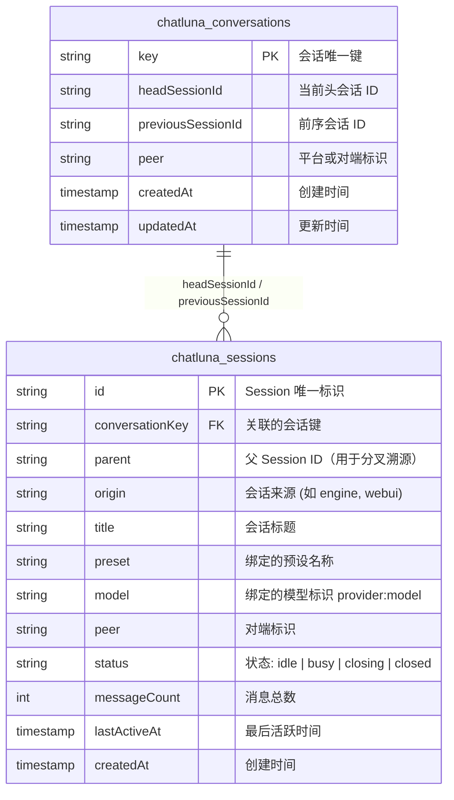
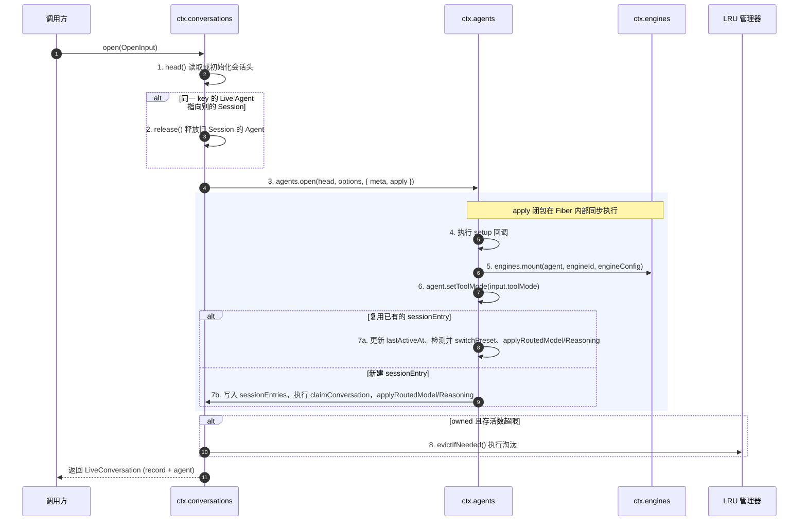
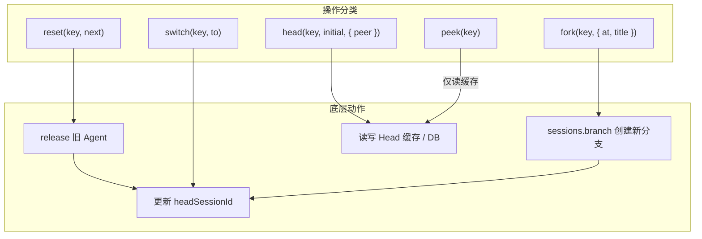

# 会话索引与活跃 Agent

在 ChatLuna v2 的运行时架构中，底层消息存储与上层交互状态彼此解耦：

- `ctx.sessions` 负责管理**会话日志与树状历史**（Session 实体与 Message 列表），充当不可变或追加式的消息账本；
- `ctx.conversations` 负责管理**「会话键（Conversation Key）→ 当前会话头（Head Session）」的映射索引**，维护正在运行的活跃 Agent 实例与会话路由生命周期。

在传统聊天机器人的交互中，用户或群聊通常感知为一个持续对话的「频道」。但在 ChatLuna v2 内部，一个会话键在任意时刻都严格对应一个 **Head Session**。当用户触发 `/new` 指令或显式重置会话时，底层原有的 Session 实体及其消息树依然完整保留，系统仅是将该会话键指向的 Head 指针切换到一个全新的 Session 节点上。

这种设计与 Git 的分支指针类似：底层数据由提交树完整保存，而会话键仅充当当前最新节点的游标。

```mermaid
graph LR
    subgraph 会话索引 ctx.conversations
        CK[会话键 Conversation Key] -->|当前指针| Head[Head Session: sess_03]
        CK -.->|历史溯源| Prev[Previous Session: sess_02]
    end

    subgraph 底层会话日志 ctx.sessions
        sess_01[Session sess_01] --> sess_02[Session sess_02]
        sess_02 --> sess_03[Session sess_03 (Head)]
    end

    Head === LiveAgent[活跃 Agent (Live Agent 实例)]
```

旧的 Session 不会被物理删除，调用方随时可以通过历史接口溯源、分叉（fork）或切换回先前的历史 Session。

---

## 会话键

会话键（`conversationKey`）是 ChatLuna 确定上下文隔离边界的唯一凭证。它以路由层的 `routeId` 起头，结合归属模式（ownership）与泳道（lane）计算得出。

### 归属模式（Ownership）

为了适应不同的聊天场景，ChatLuna 支持三种会话归属模式：

- **shared（共享模式）**：
  同一个频道或群组内所有成员共用同一个会话状态。
  - 公式：`routeId`
- **personal（个人独占模式）**：
  在群组或公共频道中，不同用户拥有彼此隔离的独立会话上下文。若计算时缺失 `userId`，系统将直接抛出异常。
  - 公式：`routeId:user:<userId>`
- **custom（自定义模式）**：
  适用于高度定制的跨平台会话共享或复杂业务绑定。若缺失 `customKey` 则抛出异常。系统对 `customKey` 的属性进行了严格限定，只允许包含 `platform`、`selfId`、`guildId`、`channelId`、`userId` 五个标准字段，将其展开规范化后取 SHA-256 哈希值。
  - 公式：`custom:<sha256(展开 customKey)>`

### 泳道（Lane）

为支持在同一个用户或群组下并行运行多种业务形态（如同时进行「日常闲聊」与「代码辅助」），系统引入了泳道机制：

- 当 `lane` 为默认值 `default` 时，不追加后缀；
- 当 `lane` 为非 `default`（如 `lane: 'code'`）时，在基础键后追加 `:lane:<lane>`。

### 完整公式与生成示例

会话键的完整生成规则如下：

```text
基础键 =
  case ownership of
    shared   => routeId
    personal => routeId + ":user:" + userId
    custom   => "custom:" + sha256(normalize(customKey))

最终会话键 = lane === 'default' ? 基础键 : 基础键 + ":lane:" + lane
```

常见场景下的生成示例如下：

| 场景 | 输入参数 | 生成的 Conversation Key |
| :--- | :--- | :--- |
| QQ 群共享闲聊 | `routeId: "onebot:group:12345"`, `shared`, `lane: "default"` | `onebot:group:12345` |
| Discord 个人会话 | `routeId: "discord:guild:678"`, `personal`, `userId: "u_99"`, `lane: "default"` | `discord:guild:678:user:u_99` |
| 独立工作泳道 | `routeId: "onebot:group:12345"`, `personal`, `userId: "u_99"`, `lane: "coding"` | `onebot:group:12345:user:u_99:lane:coding` |
| 自定义跨频道 | `customKey: { platform: 'qq', guildId: 'g1' }`, `lane: "default"` | `custom:8f4c...3e1a` |

---

## 会话头与历史

会话元数据通过两张核心数据表进行持久化与索引关联。



### 数据表定义

两张表分别承担不同职责：`chatluna_conversations` 记录「指针当前指向哪里」，而 `chatluna_sessions` 则记录「会话节点本身的实体数据」。

- **`chatluna_conversations` 表**
  - `key`：主键，会话键字符串。
  - `headSessionId`：当前会话指针所指向的 Session ID。
  - `previousSessionId`：上一次切换前的 head Session ID，仅用于溯源，不参与撤销或回退。
  - `peer`：对端标识（如群号、私聊通道）。
  - `createdAt`：索引初次建立时间。
  - `updatedAt`：最后切换头会话时间。

- **`chatluna_sessions` 表**
  - `id`：主键，Session 物理 ID。
  - `conversationKey`：所属会话键。
  - `parent`：父会话节点 ID（分叉衍生使用）。
  - `origin`：创建来源，默认为 `engine`，可由 WebUI 等覆写。
  - `title`：会话展示标题。
  - `preset`：持久化的预设 ID。
  - `model`：绑定的具体模型全称（`provider:model`）。
  - `peer`：关联对端标识。
  - `status`：运行状态，取值为 `idle`、`busy`、`closing`、`closed` 之一。
  - `messageCount`：累计消息总条数。
  - `lastActiveAt`：会话最后一次产生消息或交互的时间戳。
  - `createdAt`：会话创建时间戳。

---

## 打开一次会话

调用 `ctx.conversations.open(input: OpenInput)` 是进入会话交互的核心入口。该方法会自动串联会话头解析、Agent 实例创建或复用，并返回可直接交互的活跃句柄。

### OpenInput 输入字段

调用时传入的 `OpenInput` 支持以下字段：

- `key`：目标会话键。
- `initial`：若会话键不存在时初始会话的工厂配置。
- `peer`（可选）：对端网络标识。
- `engineId`：绑定的引擎名称。
- `engineConfig`（可选）：引擎初始化扩展参数。
- `title`（可选）：会话标题。
- `origin`（可选）：来源标识（默认回退到 `'engine'`）。
- `location`（可选）：地理或交互位置元数据。
- `config`：包含 `{ provider, model }` 的模型定义。
- `reasoningEffort`（可选）：显式推理档位要求。
- `toolMode`（可选）：工具启用模式。
- `presetId`（可选）：指定加载的预设 ID。
- `setup`（可选）：挂载时的额外初始化闭包。

### 详细执行时序

整个打开流程的时序图如下：



整个打开流程的执行步骤如下：

1. **解析会话头 `head()`**：读取当前 key 对应的 `headSessionId`；若不存在则自动插入并持久化新行。
2. **清理异位 Agent**：检查内存中是否已有该 key 的活跃 Agent，若其正附着在旧的 Session 上，则先行调用 `release` 释放。
3. **委托 Agent 开启**：调用 `agents.open(head, options, { meta: { origin: input.origin ?? 'engine', title: input.title ?? '会话 ' + key }, apply })`。
4. **执行 Apply 回调**：
   - 触发传入的 `setup` 闭包；
   - 执行 `engines.mount(agent, engineId, engineConfig)`，将指定引擎的状态与挂载点注入 Agent；
   - 设定工具调用模式 `agent.setToolMode(input.toolMode)`。
5. **Entry 生命周期判定**：
   - **复用已有 SessionEntry**：更新 `lastActiveAt`；比对 `presetId`，若改变则触发引擎切换预设；调用 `applyRoutedModel` 与 `applyRoutedReasoning` 应用动态路由结果；
   - **新建 SessionEntry**：注册到活跃会话表 `sessionEntries`，调用 `claimConversation` 建立所有权，同样应用 routed model 与 reasoning。
6. **LRU 淘汰回收**：若该会话由当前实例所拥有（owned），执行 `evictIfNeeded` 淘汰长期闲置或超出上限的 Agent。

---

## 活跃 Agent 与 LRU

ChatLuna 不会在内存中永久保留所有 Agent 实例，而是借助 LRU 淘汰策略与闲置超时监测实现资源收敛。

### 核心运行时对象

在运行时中，活跃状态主要由两个核心对象承载：

- **`LiveRecord`**：表示内存中登记的会话生命周期记录，包含以下字段：
  - `sessionId`：绑定的物理会话 ID；
  - `conversationKey?`：关联的会话键；
  - `peer?`：通信对端信息；
  - `engineId`：承载的引擎名；
  - `title?`：实时标题；
  - `createdAt`：登记时间戳；
  - `lastActiveAt`：最后一次交互时间戳。
- **`LiveConversation`**：向调用方返回的活跃句柄组合，包含 `record: LiveRecord` 与 `agent: Agent` 两个属性。

### 配置与限制参数

系统通过 `ConversationsConfig` 进行资源管控：

| 配置项 | 默认值 | 作用与后果 |
| :--- | :--- | :--- |
| `maxLiveSessions` | `200` | 内存中允许驻留的最大活跃 Agent 实例数量。 |
| `idleEvictMs` | `30 分钟` | Agent 闲置过期时间，超过该时长的实例优先被标记淘汰。 |
| `cacheSize` | `1000` | 会话头内存缓存大小。 |
| `flushMs` | `1000ms` | 脏会话头刷盘间隔。 |
| `pageSize` | `50` | 历史记录与分页查询的标准页容量。 |

### 互斥与回收策略

- **唯一性约束**：同一会话键在内存中同时**只允许存在一个活跃 Agent**。当新请求尝试在新的 Session 上打开同一会话键时，旧 Session 上的 Agent 会被立即强制 `release`。
- **主动释放 `release(sessionId)`**：显式调用会立即关闭该 Session 上的 Agent，卸载挂载引擎并从活跃表中注销。
- **LRU 淘汰流程（`evictIfNeeded`）**：
  当活跃 Agent 数量超过 `maxLiveSessions` 时，系统按 `lastActiveAt` 升序扫描当前实例自己打开的（owned）实例，只关闭「空闲且距上次活动已超过 `idleEvictMs`」的 Agent；处于 busy 状态或刚活动过的实例会被跳过，因此实例数量可能暂时高于上限。
- **状态查询接口**：
  - `live(key)`：查询指定会话键对应的实时运行记录；
  - `session(sessionId)`：按物理 Session ID 检索 LiveRecord；
  - `lives()`：列出当前节点承载的所有活跃 LiveRecord 列表。

---

## 会话操作

围绕会话索引，`ctx.conversations` 提供了一组标准管理方法：



- **`reset(key, next)`**
  重置会话。系统会先释放当前旧 head Session 上绑定的活跃 Agent，然后把该会话键的 head 指向 `next`。`next` 必须是调用方已经创建好的 Session——该方法本身不创建会话。返回 `{ previous, current }`。
- **`switch(key, to)`**
  直接将指定会话键的 headSessionId 切换至已存在的 `to` Session 上。**不创建新的分支节点**，也不破坏原有的两棵消息树。
- **`fork(key, { at?, title? })`**
  基于当前 head Session 进行分叉衍生。内部调用 `sessions.branch(head, at, { title })` 生成一个新的 Session 节点，并将其直接设为该会话键的新 head。
- **`history(key, page)`**
  按会话的 `createdAt` 倒序拉取历史 Session 列表。采用游标分页机制，游标编码格式为 `createdAt:id`。
- **`list(page)`**
  全局检索所有会话。按 `lastActiveAt` 倒序排布，游标格式为 `lastActiveAt:id`。支持传入 `origin`、`peer` 或搜索词 `q` 进行过滤。
- **`counts()`**
  聚合统计接口，返回按 `peer` 与 `origin` 组合分组下的会话数量。
- **`head(key, initial, { peer })`**
  获取会话头 ID。按 **内存缓存 → 数据库持久层 → 插入初始行** 的顺序回退并建立索引。
- **`peek(key)`**
  仅读取内存缓存中的 headSessionId。若缓存未命中则直接返回空，不会穿透至数据库。

---

## 模型与推理路由

会话在打开与复用时，会实时联动系统的模型路由层与推理分析机制。

### 模型路由与应用（`applyRoutedModel`）

ChatLuna 的模型路由层由路由规则与模型选择器共同决策。最终解析出的模型标识格式为 `provider:model`。

1. 系统比对解析出的目标模型与 Agent 当前挂载的模型；
2. 若二者不一致，调用底层模型切换接口尝试热重载；
3. **容错机制**：若切换失败，系统不会让当前对话中断，而是记录 warning 级别日志并平滑回退至原模型。

### 推理深度（Reasoning Effort）路由

针对具备深度思考（Reasoning / Thinking）能力的大语言模型，系统引入了推理档位决策。`chat.reasoning` 中配置的 effort 会先交由路由层解析，再结合目标模型支持的实际能力范围进行校验：

- **档位取值**：`high`、`medium`、`low`、`off`。
- **能力降级**：若目标模型声明不支持推理扩展，或不支持指定的档位，系统将自动降级或丢弃（fallback to off / default），并打印调试与告警日志。
- **优先级管线**：
  推理档位的最终取值由执行管线的多层拦截器覆盖计算，优先级从高到低为：
  $$\text{单次调用显式传参} > \text{路由层规则（order 10）} > \text{引擎层默认值} > \text{模型固有默认（prepareStep order -10）}$$
  `modelDefaultEffort` 在管线初始化阶段以 `-10` 优先级执行，路由层规则以 `10` 优先级执行并强制覆盖。
- **联动响应**：一旦会话中发生了模型切换，系统会自动触发推理档位的重新解析与二次校验。

---

## 预设与引擎

预设（Preset）与引擎（Engine）在会话生命周期中拥有不同的作用域与生效时机：

- **预设属于 Live 级生效**：
  修改或切换预设无需销毁会话与重建 Agent。调用 `engines.switchPreset(agent, presetId)` 即可在当前会话的下一个对话回合直接生效。
- **引擎属于 Session 级生命周期**：
  引擎决定了消息处理管线的核心编排方式。会话一旦绑定了特定引擎（如 Chat 引擎、Workflow 引擎），整个 Session 周期均由该引擎托管。若需更换引擎，必须通过 `/new` 创建新的 Session。
- **Mount 安全性保证**：
  `engines.mount(agent, engineId, engineConfig)` 必须在 Agent 内部的调度 Fiber 内完成。若引擎在 mount 阶段抛出异常（例如环境依赖缺失或初始参数校验失败），系统将判定为致命故障，**整个 `open()` 过程立即失败**，防止产生半挂载的损坏 Agent。

---

## 持久化与回收

为保证高并发交互下的数据一致性与数据库 I/O 吞吐量，系统设计了批量写回与串行化调度机制。

```mermaid
graph LR
    subgraph 内存区域
        Req1[Key A 修改 Head] --> KeyQueueA[Key A 串行队列]
        Req2[Key A 修改 Head] --> KeyQueueA
        Req3[Key B 修改 Head] --> KeyQueueB[Key B 串行队列]
        KeyQueueA --> DirtyCache[Dirty 会话头缓存 (上限 1000)]
        KeyQueueB --> DirtyCache
    end

    subgraph 持久化定时器
        DirtyCache -->|每 1000ms 批量 Flush| DB[(chatluna_conversations)]
    end

    subgraph 降级模式
        DB -.->|连接缺失或失败| MemFallback[退化为纯内存 Head 索引]
    end
```

### 串行队列与批量刷盘

1. **按 Key 串行化**：
   会话头是状态指向的核心关键点。为了防止并发请求竞态导致 Head 出现 ABA 错乱，所有针对同一个 `key` 的会话头写回操作均被压入**按 Key 隔离的串行任务队列**排队执行。
2. **缓冲池与定时 Flush**：
   系统内置容量为 `1000` 条的脏数据缓存池（`cacheSize: 1000`）。标记为 dirty 的会话头变更不会立即触发同步 SQL 写入，而是由定时器以 `1000ms`（`flushMs: 1000`）为周期批量刷入数据库。
3. **分页与查询保护**：
   所有与会话相关的列表及历史查询，单页大小强制限制为 `50` 条（`pageSize: 50`），防止单次拉取海量会话压垮传输链路。
4. **内存退化机制**：
   在测试环境或未配置持久化数据库的轻量部署场景中，数据访问层探知数据库缺失后，系统会自动退化为**纯内存 Head 索引**，保证平台依然可以正常执行对话，但重启后索引状态不予保留。

---

## 与 WebUI 的关系

`ctx.conversations` 暴露的索引与查询能力直接驱动了 ChatLuna Web 仪表盘的会话视图：

- **全局会话管理视图**：
  - WebUI 会话列表统一按 `lastActiveAt` 倒序排布，直观反映最近活跃程度；
  - 列表接口原生支持按来源端 `origin`（如 `engine`、`webui`）、通信对端 `peer` 以及关键词 `q` 进行组合检索与匹配；
  - 通过游标（`lastActiveAt:id`）实现前端无限滚动加载与高效分页。
- **会话详细面板展示**：
  通过匹配 `LiveRecord` 与 `chatluna_sessions` 记录，WebUI 能实时呈现当前会话的运行状态：
  - **消息统计**：展示当前会话累计的 `messageCount`；
  - **模型全称**：显示当前生效的 `provider:model` 及其推理档位；
  - **应用预设**：呈现当前绑定的预设模板名称；
  - **运行时状态**：呈现 `chatluna_sessions.status` 的运行相位（`idle` 空闲、`busy` 执行中、`closing` 关闭中、`closed` 已关闭）。

---

## 下一步

- 深入了解底层 Session 树状日志存储与消息分支机制，参见 [会话存储与历史记录](./sessions)。
- 探究 Agent 内部运行时、生命周期与上下文管理，参见 [Agent 架构与生命周期](./agents)。
- 了解输入消息从触发到响应的完整拦截过滤与执行链路，参见 [聊天处理管线](./chat-pipeline)。
- 查看多轮对话上下文缓存与 token 优化策略，参见 [上下文缓存机制](./context-cache)。
