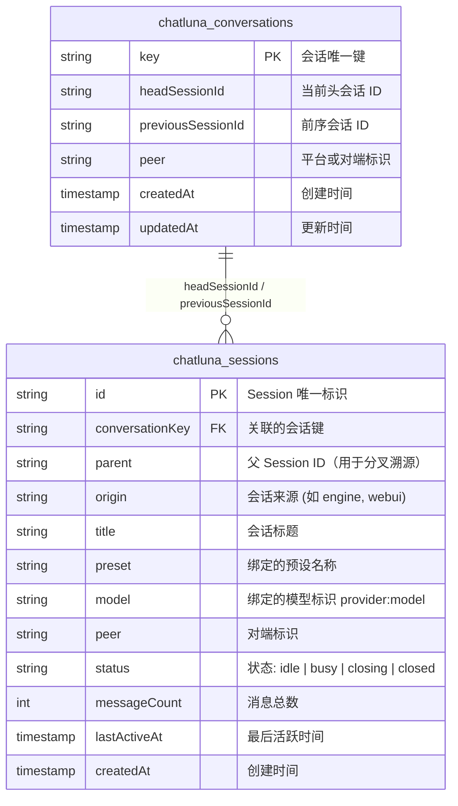
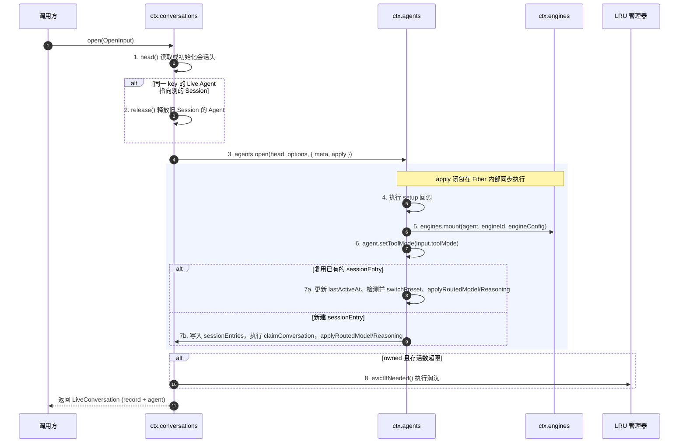
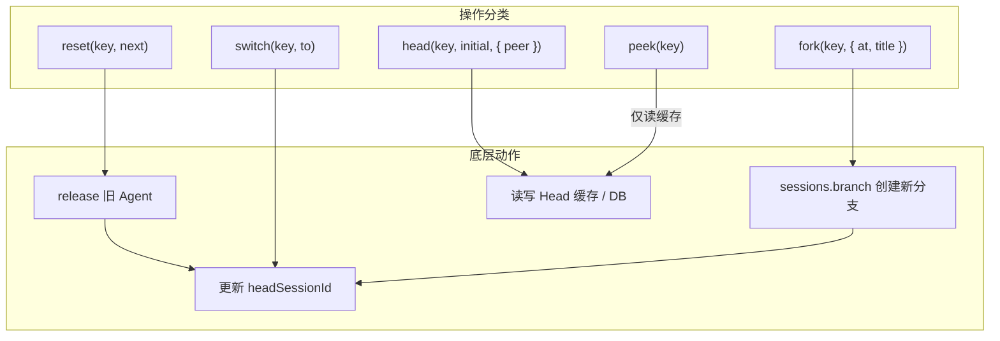

# 会话索引与活跃 Agent

::: tip
底层消息存储与上层交互状态是分开的：`ctx.sessions` 管理会话日志与历史树（追加式的消息账本），`ctx.conversations` 管理「会话键 → 当前 Head Session」的索引，以及正在运行的 Agent。
:::

一个会话键在任意时刻都只对应一个 Head Session。用户发送 `/new` 或重置会话时，旧的 Session 和消息树完整保留，只是会话键的 Head 指针切换到了新的 Session。这和 Git 的分支指针类似：数据都在提交树中，会话键只是指向最新节点的游标。

```mermaid
graph LR
    subgraph 会话索引 ctx.conversations
        CK[会话键 Conversation Key] -->|当前指针| Head[Head Session: sess_03]
        CK -.->|历史溯源| Prev[Previous Session: sess_02]
    end

    subgraph 底层会话日志 ctx.sessions
        sess_01[Session sess_01] --> sess_02[Session sess_02]
        sess_02 --> sess_03[Session sess_03 (Head)]
    end

    Head === LiveAgent[活跃 Agent (Live Agent 实例)]
```

旧的 Session 不会被删除，随时可以通过历史接口溯源、分叉或切换回去。

## 会话键

会话键（`conversationKey`）决定上下文的隔离边界，由路由的 `routeId`、归属模式（ownership）和泳道（lane）计算得出。

归属模式：

- **shared**：同一频道或群的所有成员共用一个会话。公式 `routeId`。
- **personal**：群中每个用户有独立的会话，缺少 `userId` 时抛出异常。公式 `routeId:user:<userId>`。
- **custom**：用于跨平台共享或特殊绑定，缺少 `customKey` 时抛出异常。`customKey` 只允许 `platform`、`selfId`、`guildId`、`channelId`、`userId` 五个字段，展开规范化后取 SHA-256。公式 `custom:<sha256(展开 customKey)>`。

泳道让同一个用户或群可以并行运行多种对话（如闲聊和写代码）：`lane` 为 `default` 时不加后缀，否则追加 `:lane:<lane>`。

```text
基础键 =
  case ownership of
    shared   => routeId
    personal => routeId + ":user:" + userId
    custom   => "custom:" + sha256(normalize(customKey))

最终会话键 = lane === 'default' ? 基础键 : 基础键 + ":lane:" + lane
```

| 场景 | 输入 | 会话键 |
| :--- | :--- | :--- |
| QQ 群共享闲聊 | `routeId: "onebot:group:12345"`, `shared`, `lane: "default"` | `onebot:group:12345` |
| Discord 个人会话 | `routeId: "discord:guild:678"`, `personal`, `userId: "u_99"`, `lane: "default"` | `discord:guild:678:user:u_99` |
| 独立工作泳道 | `routeId: "onebot:group:12345"`, `personal`, `userId: "u_99"`, `lane: "coding"` | `onebot:group:12345:user:u_99:lane:coding` |
| 自定义跨频道 | `customKey: { platform: 'qq', guildId: 'g1' }`, `lane: "default"` | `custom:8f4c...3e1a` |

## 数据表

`chatluna_conversations` 记录「指针指向哪里」，`chatluna_sessions` 记录 Session 本身。



几个需要说明的字段：

- `previousSessionId`：切换前的 Head，只用于溯源，不参与撤销或回退。
- `updatedAt`（conversations）：最后一次切换 Head 的时间。
- `parent`：分叉来源的 Session。
- `origin`：创建来源，默认 `engine`，WebUI 等可以覆写。
- `status`：`idle`、`busy`、`closing`、`closed` 之一。

## 打开会话

`ctx.conversations.open(input: OpenInput)` 是进入会话的入口，负责解析 Head、创建或复用 Agent，并返回活跃句柄。

`OpenInput` 字段：

- `key`：会话键。
- `initial`：会话键不存在时的初始会话工厂。
- `peer?`：对端标识。
- `engineId`：引擎名。
- `engineConfig?`：引擎配置。
- `title?`：标题。
- `origin?`：来源，默认 `'engine'`。
- `location?`：位置元数据。
- `config`：`{ provider, model }`。
- `reasoningEffort?`：推理档位。
- `toolMode?`：工具模式。
- `presetId?`：预设 ID。
- `setup?`：挂载时的额外初始化闭包。



1. **`head()`**：读取 `headSessionId`，不存在则插入新行。
2. **清理旧 Agent**：该 key 已有附着在旧 Session 上的 Agent 时，先 `release`。
3. **打开 Agent**：`agents.open(head, options, { meta: { origin: input.origin ?? 'engine', title: input.title ?? '会话 ' + key }, apply })`。
4. **apply**：执行 `setup`，`engines.mount(agent, engineId, engineConfig)` 挂载引擎，`agent.setToolMode(input.toolMode)`。
5. **SessionEntry**：复用时更新 `lastActiveAt`，`presetId` 变了就切换预设，再应用路由的模型与推理档位；新建时写入 `sessionEntries`、`claimConversation` 建立归属，同样应用模型与推理档位。
6. **LRU**：会话由当前实例拥有（owned）时执行 `evictIfNeeded`。

## 活跃 Agent 与 LRU

Agent 不会永久留在内存中，而是按 LRU 和空闲超时回收。

- **`LiveRecord`**：内存中的会话记录，字段为 `sessionId`、`conversationKey?`、`peer?`、`engineId`、`title?`、`createdAt`、`lastActiveAt`。
- **`LiveConversation`**：返回给调用方的句柄，包含 `record: LiveRecord` 与 `agent: Agent`。

| 配置项 | 默认值 | 作用 |
| :--- | :--- | :--- |
| `maxLiveSessions` | `200` | 内存中活跃 Agent 的上限 |
| `idleEvictMs` | `30 分钟` | 空闲超过此时间的 Agent 可被淘汰 |
| `cacheSize` | `1000` | 会话头缓存大小 |
| `flushMs` | `1000ms` | 脏会话头的刷盘间隔 |
| `pageSize` | `50` | 列表与历史查询的分页大小 |

- 同一会话键同时**只允许一个活跃 Agent**，在新 Session 上打开同一会话键时，旧 Agent 立即被 `release`。
- `release(sessionId)` 关闭 Agent、卸载引擎并从活跃表注销。
- `evictIfNeeded`：活跃数超过 `maxLiveSessions` 时，按 `lastActiveAt` 升序扫描本实例拥有的 Agent，只关闭空闲且超过 `idleEvictMs` 的。忙碌或刚活动过的会被跳过，所以数量可能暂时超过上限。
- 查询：`live(key)` 按会话键，`session(sessionId)` 按 Session ID，`lives()` 列出全部。

## 会话操作



- **`reset(key, next)`**：释放旧 Head 上的 Agent，把 Head 指向 `next`。`next` 必须是调用方已创建的 Session，此方法不创建会话。返回 `{ previous, current }`。
- **`switch(key, to)`**：把 Head 切换到已存在的 `to`，不创建分支。
- **`fork(key, { at?, title? })`**：调用 `sessions.branch(head, at, { title })` 分叉出新 Session 并设为 Head。
- **`history(key, page)`**：按 `createdAt` 倒序列出该会话键的历史 Session，游标格式 `createdAt:id`。
- **`list(page)`**：按 `lastActiveAt` 倒序列出所有会话，游标格式 `lastActiveAt:id`，可按 `origin`、`peer` 或关键词 `q` 过滤。
- **`counts()`**：按 `peer` 与 `origin` 分组统计会话数。
- **`head(key, initial, { peer })`**：按「内存缓存 → 数据库 → 插入初始行」的顺序获取 Head。
- **`peek(key)`**：只读内存缓存，未命中直接返回空，不查数据库。

## 模型与推理路由

**模型**：路由解析出 `provider:model`，与 Agent 当前模型不一致时尝试切换；切换失败不会中断对话，而是记录 warning 并保留原模型。

**推理档位**：`chat.reasoning` 的 effort（`high`、`medium`、`low`、`off`）先经路由解析，再按目标模型的能力校验。模型不支持推理或不支持该档位时，自动降级或丢弃，并输出日志。优先级从高到低：

$$\text{单次调用显式传参} > \text{路由层规则（order 10）} > \text{引擎层默认值} > \text{模型固有默认（prepareStep order -10）}$$

切换模型后会重新解析并校验推理档位。

## 预设与引擎

- **预设即时生效**：`engines.switchPreset(agent, presetId)` 在下一回合生效，不需要重建 Agent。
- **引擎跟随 Session**：Session 一旦绑定引擎，整个生命周期都由它托管，更换引擎需要 `/new`。
- **挂载失败即失败**：`engines.mount` 在 Agent 的 Fiber 内执行，抛出异常时整个 `open()` 失败，不会留下挂载了一半的 Agent。

## 持久化

```mermaid
graph LR
    subgraph 内存区域
        Req1[Key A 修改 Head] --> KeyQueueA[Key A 串行队列]
        Req2[Key A 修改 Head] --> KeyQueueA
        Req3[Key B 修改 Head] --> KeyQueueB[Key B 串行队列]
        KeyQueueA --> DirtyCache[Dirty 会话头缓存 (上限 1000)]
        KeyQueueB --> DirtyCache
    end

    subgraph 持久化定时器
        DirtyCache -->|每 1000ms 批量 Flush| DB[(chatluna_conversations)]
    end

    subgraph 降级模式
        DB -.->|连接缺失或失败| MemFallback[退化为纯内存 Head 索引]
    end
```

1. **按 key 串行**：同一 key 的 Head 写入进入独立的串行队列，避免并发导致指针错乱。
2. **批量刷盘**：脏会话头先进缓存（`cacheSize: 1000`），每 `1000ms`（`flushMs`）批量写入数据库。
3. **分页限制**：列表与历史查询每页最多 `50` 条（`pageSize`）。
4. **内存退化**：没有数据库时自动退化为纯内存索引，对话正常，但重启后索引丢失。

## 与 WebUI 的关系

WebUI 的会话列表按 `lastActiveAt` 倒序，支持按 `origin`、`peer` 和关键词 `q` 过滤，用 `lastActiveAt:id` 游标分页。会话详情结合 `LiveRecord` 与 `chatluna_sessions`，显示消息数 `messageCount`、当前的 `provider:model` 与推理档位、预设，以及运行状态（`idle`、`busy`、`closing`、`closed`）。

## 下一步

- [会话存储与历史记录](./sessions) — Session 日志与分支。
- [Agent 架构与生命周期](./agents) — Agent 运行时与上下文。
- [聊天处理管线](./chat-pipeline) — 消息从触发到响应的完整链路。
- [上下文缓存机制](./context-cache) — 提示词缓存与 Token 优化。
