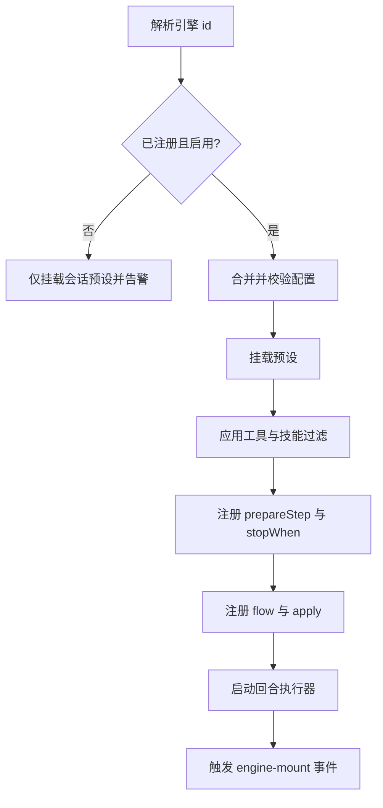

# 引擎

::: tip
模型只负责生成文本。决定机器人怎么说话、何时停止、是否先思考、给模型哪些工具的，是**引擎（Engine）**。它不是一个开关，而是一组可以挂载、覆盖和扩展的行为配置，也是路由规则中最常修改的一项。
:::

<!-- 架构页，可以使用代码与配置示意 -->

## 引擎组合了什么

| 声明 | 说明 |
| --- | --- |
| `id` / `label` / `description` | 界面标识、显示名称与描述 |
| `config` | 引擎专属的配置结构 |
| `preset` / `presets` | 默认预设，以及支持的预设列表 |
| `tools` / `skills` | 工具与技能过滤规则 |
| `toolMode` / `delegation` | 工具呈现方式，是否支持委派模式 |
| `activation` | 默认唤醒判定器 |
| `observe` / `merge` / `render` / `proactive` | 聊天记录监听、消息合并、渲染方式及主动性默认值 |
| `stopWhen` | 停止条件 |
| `prepareStep` | 每步执行前的调整钩子 |
| `apply` | 挂载时执行的扩展逻辑 |
| `flow` | 自定义回合执行流程 |

这些声明大多只是默认值，路由规则中的同名设置会覆盖它们。例如引擎默认只在被 @ 时唤醒，但某个群在场景规则中开启了气氛判定，就以规则为准。

## 内置引擎

| 引擎 | 名称 | 特点 |
| --- | --- | --- |
| `agent` | 对话 | 默认引擎：工具全开，人格与能力由路由决定 |
| `coding` | 编码 | 面向代码读写、搜索、命令执行与验证的工作流 |
| `character` | 伪装 | 具备角色状态、作息、主动性、记忆与表达的完整角色引擎 |
| `setup` | 人设配置 | 隐藏引擎，用于新人设引导访谈流程 |

隐藏引擎不出现在选择器中，但路由规则可以按名称指定，例如在特定私聊中用 `setup` 接管人设配置。

- **编码引擎**：挂载时加载全套编码工具。命令输出超过阈值时转存到本地文件，只给模型摘要，避免构建日志撑爆上下文。拒绝包含世界书（WorldBook）的预设。
- **伪装引擎**：提供角色状态（心情、精力、好感度）、作息、主动搭话与延时回复、专属动作与素材表达。这些能力都是挂在引擎上下文中的子插件，由引擎统一调度。

## 挂载

引擎通过挂载绑定到具体的 Agent，而不是全局生效：



**配置合并与修剪**：配置来自持久化存储和本次挂载传入的覆盖项。合并后先修剪不属于当前引擎的字段，再校验格式。这样从伪装引擎切回对话引擎时，旧引擎的专有字段会被丢弃而不是报错。被修剪的字段会记录在日志中。

::: warning
修剪发生在挂载时，而不是保存时。修改引擎的配置结构后，旧字段可能在下次挂载时被静默丢弃。升级插件后设置不生效，先看日志中的修剪记录。
:::

**配置缓存在 Agent 上**：生效的配置按引擎 `id` 缓存在 Agent 上，再切回该引擎时复用。不同引擎的配置相互独立。

**引擎不存在时**：引擎未注册或已停用时不会报错中断，而是记录警告并只挂载预设，对话照常进行，但引擎特有的行为不生效。

::: tip
日志中出现 `engine xxx is not registered or disabled`，说明路由指定的引擎名与注册的不符，通常是提供引擎的插件没启用，或升级后改了 `id`。
:::

## 挂载上下文

`apply` 接收挂载上下文，用来向当前 Agent 注册能力：

```ts
export const demoEngine = defineEngine({
  id: 'demo',
  label: { zh: '演示', en: 'Demo' },
  apply(ctx, config) {
    ctx.engine.prompt('demo:style', '回答尽量简短。', { order: 100 })
    ctx.engine.stopWhen(({ step }) => step >= 3)
    ctx.engine.state().set('greeted', true)
  },
})
```

- **prompt**：注册提示词片段。
- **stopWhen**：注册停止条件。
- **prepareStep**：每步执行前调整模型、工具与请求参数。
- **assemble**：定制提示词装配。
- **flow**：注册自定义回合流程。
- **output**：注册输出解析器，把模型文本转为结构化动作。
- **state**：访问当前会话的频道状态。

这些注册都绑定在本次挂载上，卸载时自动清理。

## 频道状态

频道状态按会话频道（`cid`）隔离，是每个会话独立的键值存储，用于流程阶段、中间标记、轮次计数等临时数据。变动时触发事件，供界面和调试实时展示。

它只在内存中，重启后清空；需要持久化时写入会话日志或数据库。

## 回合执行

挂载完成后，每个回合由回合执行器调度：

1. **预设切换与校验**：会话绑定了预设时，回合开始时切换并校验兼容性。不兼容时直接拒绝该轮并返回提示。
2. **广播回合事件**：插件可以监听回合事件，例如在生成前刷新角色数值、检查作息。监听器异步并行执行，不保证顺序。
3. **运行 flow**：注册的 `flow` 按优先级串成执行链，每个节点可以完全接管回合，也可以处理局部逻辑后交给下一个。没有 `flow` 时使用默认的 Agent 执行循环。

::: warning
`flow` 只在会话显式指定对应引擎时生效，子会话不会继承。未指定引擎的子 Agent 回退到全局默认引擎，避免父会话的特化流程干扰子任务。
:::

## 事件

| 事件 | 时机 | 载荷 |
| --- | --- | --- |
| `chatluna/engine-mount` | 引擎挂载完成 | agent、engine、挂载上下文、配置 |
| `chatluna/engine-unmount` | 引擎卸载 | agent、engine |
| `chatluna/engine-turn` | 回合开始 | agent、engine、回合号、输入、配置 |
| `chatluna/engine-action` | 引擎产生动作 | 会话 id、动作 |
| `chatluna/engine-state` | 频道状态变更 | 会话 id、键、新值、旧值 |
| `chatluna/engines-change` | 引擎列表变更 | 无 |

`chatluna/engine-turn` 是并行广播，适合通用切面。需要串行拦截或改写流程时，用 `flow` 或 Agent 中间件。

## 与路由的关系

- **引擎参与规则匹配**：引擎标识也是匹配维度之一，切换引擎可能让会话命中另一条规则。
- **只在挂载时生效**：引擎只在创建 Agent 或显式重新挂载时生效，现有会话会一直沿用初始引擎，直到会话重建。

::: tip
后台把引擎改成「伪装」后群聊没变化，先新建对话验证。新对话正常就说明配置已生效，旧会话需要重建。
:::

## 常见问题

**选择器中找不到某个引擎**：检查提供它的插件是否启用，或它是否是隐藏引擎（只能在路由规则中指定）。

**切换引擎后行为没变**：当前会话还在用旧引擎，新建对话验证，并确认场景规则改的确实是引擎。

**引擎配置不生效**：挂载时未知字段会被修剪。保存时提示字段非法，确认该字段属于当前引擎的配置声明。

**挂载后工具缺失**：引擎可以收窄可用工具，检查其工具与技能过滤规则。

**自定义 flow 没执行**：确认 Agent 绑定的引擎 `id` 与注册 `flow` 的一致，并检查上游 `flow` 是否提前中断了链路。

## 下一步

- [提示词装配](./prompts) — 引擎如何贡献系统提示词。
- [角色与预设](./character) — 伪装引擎的能力全景。
- [路由与场景规则](./routing) — 引擎如何被选中。
- [Agent 与执行循环](./agents) — flow 之外的默认执行逻辑。
