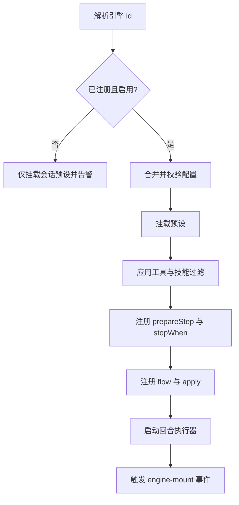

# 引擎

::: tip
本节将介绍引擎的概念、内置引擎类型、挂载机制及生命周期。
:::

在 ChatLuna 中，底层模型只负责根据输入生成文本。真正决定机器人「怎么说话、何时停止、是否先思考、提供哪些工具给模型」的核心，是**引擎 (Engine)**。

在日常配置路由规则时，最常修改的一项就是引擎。引擎不是一个简单的功能开关，而是一组可以被挂载、覆盖和扩展的行为配置。

<!-- 架构页，可以使用代码与配置示意 -->

## 引擎组合了什么

引擎是对会话行为的集中声明。一个完整的引擎通常包含以下要素：

| 声明 | 说明 |
| --- | --- |
| `id` / `label` / `description` | 界面标识、显示名称与描述 |
| `config` | 引擎专属的配置结构 |
| `preset` / `presets` | 默认预设，以及支持的预设列表 |
| `tools` / `skills` | 工具与技能过滤规则 |
| `toolMode` / `delegation` | 工具呈现方式，是否支持委派模式 |
| `activation` | 默认唤醒判定器 |
| `observe` / `merge` / `render` / `proactive` | 聊天记录监听、消息合并、渲染方式及主动性默认值 |
| `stopWhen` | 停止条件 |
| `prepareStep` | 每步执行前的调整钩子 |
| `apply` | 挂载时执行的扩展逻辑 |
| `flow` | 自定义回合执行流程 |

上述声明大多仅作为「默认值」使用。路由规则中的同名设置拥有更高优先级，会覆盖引擎的默认行为。

例如，即便引擎声明了「默认仅在被提及（@）时直接唤醒」，若某个群聊在场景规则中开启了气氛判定，该群仍会以规则中的设置为准。

## 四种内置引擎

ChatLuna 内置了四种面向不同场景的引擎：

| 引擎 | 名称 | 特点 |
| --- | --- | --- |
| `agent` | 对话 | 默认引擎：工具全开，人格与能力由路由决定 |
| `coding` | 编码 | 面向代码读写、搜索、命令执行与验证的工作流 |
| `character` | 伪装 | 具备角色状态、作息、主动性、记忆与表达的完整角色引擎 |
| `setup` | 人设配置 | 隐藏引擎，用于新人设引导访谈流程 |

隐藏引擎（如 `setup`）不会出现在前端选择器中，但路由规则仍可通过名称直接指定。例如在特定私聊场景下，正是通过路由规则指定该引擎来接管人设配置的。

### 编码引擎

编码引擎适用于代码协作与工程任务。

它会在挂载时加载全套编码工具。当命令输出超过设定阈值时，引擎会自动将内容转存至本地文件，仅向模型提供摘要片段，避免单次构建日志超出上下文长度限制。

此外，编码引擎内置了预设兼容性检查：明确拒绝包含世界书 (WorldBook) 的预设，避免发散的角色设定干扰代码开发。

### 伪装引擎

伪装引擎不仅为模型注入提示词，还提供了一套完整的拟真生态：

- **角色状态**：包含心情、精力与好感度等状态维度。
- **日常作息**：区分睡眠期与活跃期。
- **主动性机制**：支持主动搭话与延时回复。
- **表达系统**：提供专属动作与素材表达能力。

在实现上，这些能力均以子插件形式挂载在引擎上下文中，伪装引擎负责整体的组织与调度。

## 挂载

引擎通过「挂载」绑定到具体的 Agent 实例，而非作为全局静态开关生效。

标准挂载流程如下：



### 配置合并与修剪

引擎配置来自两部分：已持久化的存储配置，以及本次挂载传入的覆盖项。

合并后，系统会先修剪掉不属于当前引擎的冗余字段，再执行格式校验。

这种机制可以保证引擎切换平滑进行：当会话从伪装引擎切回对话引擎时，旧引擎专有的配置项会被自动丢弃，不会因未识别字段而报错中断。所有被修剪的字段均会记录在日志中。

::: warning
配置修剪发生在引擎「挂载时」，而非「保存时」。

在代码中修改引擎配置结构后，旧字段可能在下次挂载时被静默丢弃。升级插件后若发现设置未生效，请先检查日志中是否有被修剪的字段。
:::

### 配置缓存在 Agent 上

挂载校验完成后，最终生效的配置会按引擎 `id` 缓存在当前 Agent 实例中。

当同一个 Agent 再次切回该引擎时，系统会优先复用已缓存的配置。

不同引擎在 Agent 上的配置相互独立，因此在切到编码引擎调整参数后，切回伪装引擎时原有的运行参数依然保留。

### 引擎不存在时

若路由指定的引擎未注册或已停用，挂载流程不会抛错中断。

系统会记录一条警告日志，并降级为仅挂载预设部分。此时对话仍可正常进行，但该引擎特有的扩展行为不会生效。

::: tip
若在日志中看到 `engine xxx is not registered or disabled`，说明路由指定的引擎名与实际注册的标识不符。

常见原因是提供该引擎的插件未启用，或插件升级后变更了内部引擎 `id`。
:::

## 挂载上下文

引擎的 `apply` 函数在执行时会接收挂载上下文，用于向当前 Agent 实例注册能力：

```ts
export const demoEngine = defineEngine({
  id: 'demo',
  label: { zh: '演示', en: 'Demo' },
  apply(ctx, config) {
    ctx.engine.prompt('demo:style', '回答尽量简短。', { order: 100 })
    ctx.engine.stopWhen(({ step }) => step >= 3)
    ctx.engine.state().set('greeted', true)
  },
})
```

挂载上下文主要包含以下方法：

- **prompt**：注册局部提示词片段与系统指令。
- **stopWhen**：注册单步或轮次的停止条件。
- **prepareStep**：在每步执行前动态调整模型、工具与请求参数。
- **assemble**：拦截并定制提示词装配流程。
- **flow**：注册自定义回合流程。
- **output**：注册输出解析器，将模型文本转为结构化动作。
- **state**：访问并管理当前会话的频道状态。

上述注册项的生命周期均绑定在当前挂载上。引擎卸载时会自动清理，无需手动释放。

## 频道状态

频道状态按会话频道 (`cid`) 相互隔离，为每个会话提供独立的键值存储。

它用于存放仅在当前会话生命周期内有效的临时数据，例如流程阶段、中间标记或发言轮次计数。

频道状态发生变动时会触发相应事件，供前端界面与调试监控实时展示。

频道状态仅在内存中维护，不会写入数据库。主进程重启后状态将被清空；如需持久保存，请写入会话日志或数据库中。

## 回合执行

引擎挂载完成后，会话的每个交互回合 (Turn) 均由回合执行器负责调度。

执行器在一个回合内主要处理三件事：

### 1. 预设切换与校验

若会话显式绑定了预设，执行器会在回合开始时切换预设并校验兼容性。

若预设与当前引擎不兼容，该轮交互将被直接拒绝并返回提示，避免在错误预设下继续运行。

### 2. 广播回合事件

插件可通过监听回合事件介入交互流程，例如在生成前刷新角色数值、检查作息状态等。

所有回合事件监听器均以异步并行方式执行，执行顺序不作保证。

### 3. 运行 flow

若上下文中注册了 `flow`，执行器会按优先级将其串联为执行链。

执行链中的每个 `flow` 可以完全接管当前回合，也可以在处理局部逻辑后交由下一节点。若未注册任何 `flow`，则使用默认的 Agent 执行循环。

::: warning
`flow` 仅在会话显式指定对应引擎时生效，不会自动被子会话继承。

派生的子 Agent 若未指定引擎，将回退至全局默认引擎，以防止父会话特化的执行流程干扰子任务。
:::

## 事件

引擎生命周期与回合事件均在 `chatluna/` 命名空间下派发：

| 事件 | 时机 | 载荷 |
| --- | --- | --- |
| `chatluna/engine-mount` | 引擎挂载完成 | agent、engine、挂载上下文、配置 |
| `chatluna/engine-unmount` | 引擎卸载 | agent、engine |
| `chatluna/engine-turn` | 回合开始 | agent、engine、回合号、输入、配置 |
| `chatluna/engine-action` | 引擎产生动作 | 会话 id、动作 |
| `chatluna/engine-state` | 频道状态变更 | 会话 id、键、新值、旧值 |
| `chatluna/engines-change` | 引擎列表变更 | 无 |

`chatluna/engine-turn` 为并行广播事件，适用于通用切面逻辑。若需要串行拦截或重构交互流程，请使用 `flow` 或 Agent 中间件。

## 与路由的关系

路由规则匹配与执行时，引擎的选择包含以下特性：

- **引擎参与规则匹配**：判定会话命中哪条路由规则时，引擎标识本身也会作为匹配维度。切换引擎可能使会话匹配至另一条规则。
- **挂载生效时机**：引擎仅在创建 Agent 实例或显式重新挂载时生效。

因此在路由规则中修改引擎设置后，通常需要开启新会话才能生效。现有会话会继续沿用初始挂载的引擎，直到会话被销毁重建。

::: tip
如果在后台将引擎修改为「伪装」后群聊未发生变化，可以先新建对话进行验证。若新对话表现正常，说明配置已生效，原有会话需重新建立。
:::

## 排查

遇到引擎相关问题时，可参考以下排查方向：

**引擎选择器中找不到某个引擎**

检查提供该引擎的插件是否已启用，或者该引擎是否被声明为隐藏引擎。隐藏引擎不会出现在前端选择列表中，仅能通过路由规则直接指定。

**切换引擎后行为未改变**

当前会话仍在沿用初始化时的旧引擎。可以新建对话进行验证，并确认场景规则中修改的确实是引擎配置项。

**修改引擎配置后未生效**

引擎配置在挂载时会进行校验，未知字段会被自动修剪。若保存时提示字段非法，请确认该字段是否包含在当前引擎的配置声明中。

**挂载引擎后可用工具缺失**

检查引擎声明中的工具与技能过滤规则。引擎支持收窄可用工具列表，部分工具被屏蔽属于正常现象。

**自定义 flow 未执行**

确认当前 Agent 绑定的引擎 `id` 与注册 `flow` 时的引擎 `id` 一致；并检查各 `flow` 的优先级，确认上游 `flow` 未提前中断链路。

## 下一步

- [提示词装配](./prompts) — 引擎如何贡献系统提示词。
- [角色与预设](./character) — 伪装引擎的能力全景。
- [路由与场景规则](./routing) — 引擎如何被选中。
- [Agent 与执行循环](./agents) — flow 之外的默认执行逻辑。
