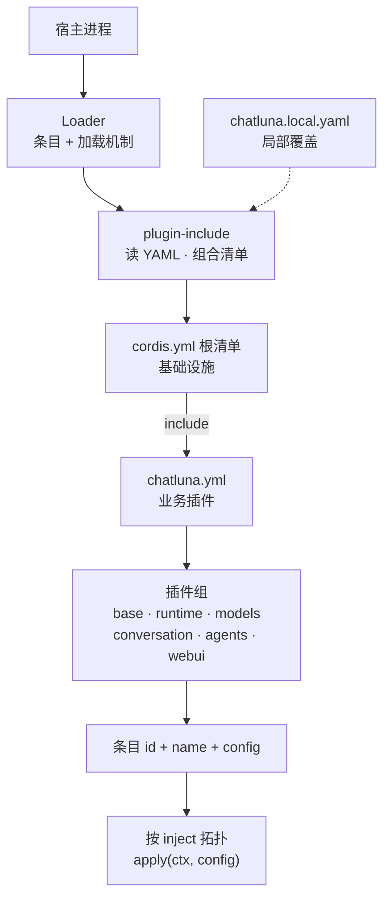

# 插件、运行时与数据

Cordis 管理插件 (Plugin) 与服务 (Service) 的生命周期；配置、安装、会话持久化和业务索引各有其所有者。理解这些边界，可以帮助你准确评估热重载 (HMR)、卸载、备份和故障恢复的实际保证范围。

## 理解清单如何装配服务

ChatLuna 的服务装配流程从宿主进程启动开始，由 Cordis Loader 和清单组合插件协同完成。



装配过程遵循以下加载顺序与规则：

1. **宿主引导 Loader**：宿主进程首先加载 Loader，再加载 `plugin-include` 等组合插件。Loader 本身只提供条目与加载机制，不会主动扫描业务 YAML 文件。
2. **选择根清单**：根清单由宿主指定。仓库默认将 `cordis.yml` 作为基础设施的入口清单，通过 `plugin-include` 引入组合业务插件的 `chatluna.yml`。开发入口由 launcher 选择。
3. **加载局部覆盖**：`chatluna.local.yaml` 用于提供局部配置覆盖。

::: warning
切勿将 `chatluna.local.yaml` 直接当作根清单运行。局部覆盖文件缺少基础设施声明，会导致宿主缺失必要的基础服务而无法启动。
:::

### 清单条目结构

清单中的条目包含以下核心字段：

- `id`：条目的稳定唯一标识。
- `name`：要加载的 npm 包名。
- `config`：传递给插件内部 Config schema 的配置对象。
- `disabled`：布尔值，用于控制是否禁用该条目。
- `group: true`：声明该条目为分组条目。此时其 `config` 必须是子条目列表，不能配置为表示“所属分组”的字符串。

### 依赖声明与可用性边界

插件通过 `inject` 属性声明必需服务，Cordis 会按照拓扑顺序等待依赖服务挂载后再调用 `apply(ctx, config)`。

::: tip
服务存在并不代表底层实现已就绪。
:::

在设计插件逻辑时，请注意以下边界：
- `computer` 服务存在，不保证 Docker kind 运行时在场。
- MCP (Model Context Protocol) 插件已挂载，不保证外部连接已成功建立。
- 模型运行时已加载，不保证对应的三方 SDK 已正确安装。

## 管理生命周期与上下文所有权

在 Cordis 体系中，资源所有权由调用方 fiber 严格约束。

- **自动清理**：通过上下文 `ctx` 注册的工具、提示词块、事件监听器、路由、前端入口和定时器，均归属于创建它的调用方 fiber。当插件被卸载或停用时，Cordis 会自动注销并清理这些资源。
- **级联停用**：如果一个基础服务被卸载，所有通过 `inject` 依赖该服务的下游插件也可能随之停用。因此，热重载 (HMR) 仅保证局部的资源置换，不保证“其他运行中的插件一律不受影响”。
- **作用域隔离**：在 Agent scoped context 中注册的工具和提示词，只会合并到对应的 Agent 实例中，不会泄漏至全局。

编写扩展或辅助函数时，必须遵循以下上下文规则：
- 辅助函数应当接收调用方的 `ctx` 参数进行操作。
- 不得创建脱离树结构的替代根 Context。
- 不得跨 fiber 长期持有已经失效的上下文引用。
- 不得为了清理自身资源而擅自调用并销毁属于其他插件的 fiber。

## 识别关键系统依赖

在 ChatLuna 架构中，独立拆分的 npm 包并不意味着它可以被随意移除。下表列出了系统各层的分工：

| 系统层 | 职责 |
| --- | --- |
| agents / sessions / tools / prompt | 运行时执行与记录 |
| conversations / chat / engines | 身份识别、业务 head 管理与引擎装配 |
| provider 注册与 SDK | 远端服务连接与协议转换 |
| persistence / storage | 会话记录与附件二进制保存 |
| memory / schedule / computer / subagent | 各垂直领域能力扩展 |
| ui-server 与域 webui | 管理界面服务与实时数据流 |

::: danger
在当前默认的 Agent 实现中，启动依赖链明确包含 `trace`、`presets` 和 `tool_search`。如果从清单中移除这些包，将导致 Agent 执行循环完全无法挂载，其后果不仅是管理控制台丢失对应页面。请务必以插件声明的 `inject` 列表和实际组合清单为准。
:::

## 通过配置服务执行事务性修改

若要动态读取或修改配置条目，请使用 `ctx.chatluna_config` 服务。该服务向业务代码暴露普通条目视图，隔离了 Loader 内部的 Entry 和 fiber 实例。

### 支持的方法

| 方法 | 作用 |
| --- | --- |
| `entries()` / `entry(id)` | 读取所有条目的配置视图，或其中一个 |
| `save(input)` | 保存单个条目的完整选项（名称、配置、启用状态） |
| `change(input)` / `changeMany(inputs, batch)` | 局部更新一个或多个条目；成功后返回，失败时按逆序撤回 |
| `create(input)` / `group(input)` / `label(id, label, { by })` | 新建条目、新建分组、改标签 |
| `move(input)` / `erase(id, { by })` | 移动与删除条目 |
| `reset(id, { by })` | 停用条目并清空它的配置 |
| `reload({ by })` | 重新读取清单并让运行中的树与文件对齐 |
| `transact({ by, apply, ... })` | 自定义事务：由调用方在 `apply` 里执行成批的树操作，同样带快照与审计 |
| `configFor(id, engine)` | 取某个条目在指定引擎下的合并配置 |
| `fileStamp()` / `describe()` | 清单修订戳（用于乐观锁）与文件路径 |

所有写入都走同一条串行队列：同一时刻只有一个事务在写文件。

### 修改配置示例

通过 `ctx.chatluna_config.change` 更新指定条目：

```ts
import type { Context } from '@chatluna/cordis'

export async function enableExamplePlugin(ctx: Context) {
  // 提交条目修改，传入审计字段
  await ctx.chatluna_config.change({
    id: 'example-plugin',
    options: { config: { enabled: true } },
    by: 'settings',
    reason: 'enable example plugin',
  })
}
```

### 事务流程与保证边界

每次配置写入均经历三阶段管线：

1. **Snapshot**：捕获当前涉及配置文件的快照。
2. **Apply**：将新配置应用至 Loader。
3. **Audit**：记录审计日志。

如果在此过程中发生错误，系统会自动恢复受影响的文件，并反向撤回当前批次的 Loader 操作。当返回的 Promise 成功结算时，代表新配置已经完全应用。

::: warning
该机制属于配置层事务。它不会自动撤回外部 API 调用、云端资源变更等异步副作用，不提供跨系统的全局分布式事务原子性。
:::

## 配置快照与运行时安装

配置快照机制与包安装器提供了插件热更和版本回滚的基础能力。

### 快照存储机制

当通过 Config schema 正常加载运行时配置服务时：
- `snapshotsDir` 默认路径为 `data/chatluna/config-snapshots`（该路径随环境变量 `CHATLUNA_DATA` 的指向动态调整）。
- 内置 writer 默认保留最新的 10 份快照。
- 在应用任何变更前，系统会复制涉及的原始文件，并在快照元数据 (meta) 中记录其初始绝对路径。
- 当 Loader 完整启动并验证无误后，可以生成带有 `good: true` 标记的已知可用快照，守护进程 (daemon) 会将其作为异常崩溃时的回滚恢复候选。

::: warning
如果你在代码中直接构造配置服务且未传入具体的目录路径，系统将不会向磁盘写入快照。这与使用清单文件加载时的默认行为不同。
:::

### 包安装与运行时边界

`ctx.chatluna_installer` 服务位于 `runtime-packages` 包中，与可选的 Web UI 插件市场解耦。使用安装器时请注意以下限制：

- **安装不等于挂载**：安装包成功只说明文件已下载到本地环境。插件要正常运行，依然需要在清单中配置条目、补齐 `inject` 依赖并校验 Schema。
- **无进程内沙箱**：SDK 和插件均作为宿主 Node.js/Bun 进程内的可执行代码运行，动态按需安装不提供进程级沙箱。
- **模块重载限制**：对于已经通过 `import` 加载到运行时的底层 SDK，若通过安装器变更版本，必须重启宿主进程才能使新版依赖生效。
- **能力边界**：安装器只负责把依赖落盘并接入清单，它本身不限制模型能做什么。约束来自权限等级与工具策略，而不是安装器；这些约束同样不能替代操作系统文件权限、反向代理和容器部署隔离。

## 识别数据归属并执行备份

在制定数据备份与灾难恢复策略时，必须根据数据所有权针对性处理，不能简单假设配置快照包含了全部系统状态。

### 数据所有权与存储分布

| 数据资产 | 所有者 / 典型位置 | 备份关注点 |
| --- | --- | --- |
| 配置树与覆盖清单 | Loader / runtime-config | 必须完整备份所有 `include` 关联的清单和局部覆盖文件。 |
| 会话条目 (entries) 与元数据 (header) | sessions + persistence | 包含业务数据库表和附件二进制 blobs。 |
| 当前 head 指针与列表索引 | conversations | 仅维护运行时快速检索视图，不可替代 persistence 中的 Session 真相。 |
| 预设 (Presets) | presets 托管目录 | 包含原始文件、版本修订记录 (revision) 及审计数据。 |
| 长期记忆 (Memory) | memory 后端 | 包含默认 Markdown 主题、向量索引、历史记录与提取任务。 |
| Token 用量与实验追踪 | billing / trace 数据表 | 重点关注保留周期策略及敏感执行载荷。 |
| 机器与技能凭据 | computer / skill | 密文存储；必须同时备份 SecretBox 加密密钥。 |
| 临时后台输出 | background 内存缓冲区 | 纯内存暂存，重启宿主即丢失，不承诺持久化。 |

::: danger
ChatLuna 默认的配置基准路径 `CHATLUNA_DATA` 指向 `./data/chatluna`，但 SQLite 主数据库文件通常存放在 `./data/chatluna.db`（位于该子目录之外）。

如果你的自动化备份脚本只复制了 `CHATLUNA_DATA` 目录，将会彻底遗漏核心数据库。备份前请务必核对实际配置文件与工作目录路径。
:::

### 安全恢复步骤

在恢复生产实例时，请按顺序执行以下步骤：

1. **终止活动写入**：在停机状态下拷贝文件，或利用底层数据库机制获取事务一致性快照。
2. **隔离恢复验证**：将备份导入到运行相同 ChatLuna 版本的隔离环境中。
3. **分项核验数据**：
   - 检查配置文件树与局部覆盖是否完好。
   - 验证 SecretBox 解密密钥能否成功解密 `computer` 与 `skill` 凭据。
   - 确认核心 Session 数据与预设加载无异常。
   - 检查向量索引与长期记忆 Markdown 结构。
4. **切流上线**：确认恢复实例完全正常后，再接入即时通信平台凭据并启用自动化定时任务。

::: danger
严禁让新旧两份运行相同凭据的实例同时在线。这会导致双向重复消费平台消息、产生机器人应答竞态，甚至引发定时日程的并发冲突写入。
:::

## 下一步

- 阅读[插件开发](/guide/develop/first-plugin)，了解如何使用 `apply(ctx)` 和 `inject` 声明扩展能力。
- 阅读[会话与分支](/architecture/sessions)，深入理解 sessions 的 entries 与 head 指针管理。
- 查看 [CLI 参考](/api/cli)，获取运行时启动与清单指定的命令行参数。
- 查阅[安全与权限](/manual/usage/permissions)，配置生产环境的 SecretBox 密钥管理与运行边界。
