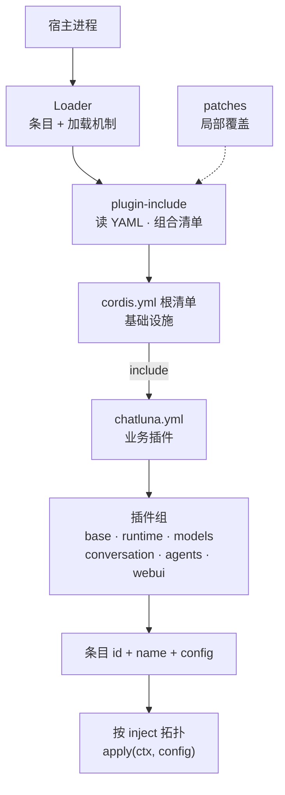

# 插件、运行时与数据

::: tip
插件与服务的生命周期统一由 Cordis 管理，配置、动态安装、会话持久化和业务索引各有明确的归属边界。理解这些边界，才能准确判断热重载、卸载、备份和故障恢复实际保证了什么。
:::

## 清单如何装配服务



1. **宿主引导 Loader**：宿主先加载 Loader，再加载 `plugin-include` 等组合插件。Loader 只提供条目定义与加载机制，不会主动扫描 YAML。
2. **根清单**：由宿主指定。仓库默认以 `cordis.yml` 为基础设施入口，通过 `plugin-include` 引入业务清单 `chatluna.yml`。开发入口由 launcher 决定。
3. **局部覆盖**：`plugin-include` 的 `config.patches` 提供条目级覆盖：`{ id, ...overrides }` 按字段合并，`{ id, insert: [...] }` 向分组追加条目，`{ id, move: { parent, position } }` 调整位置。`chatluna dev` 和 `CHATLUNA_HOST` / `CHATLUNA_ALLOW_REMOTE` 等环境变量就是这样注入的，不修改清单文件。

条目字段：

- `id`：稳定唯一标识。
- `name`：要加载的 npm 包名。
- `config`：传给插件 Config schema 的配置。
- `disabled`：是否禁用。
- `group: true`：分组条目，此时 `config` 必须是子条目列表，不能是表示「所属分组」的字符串。

插件通过 `inject` 声明必需的服务，Cordis 按拓扑顺序等依赖全部挂载后才调用 `apply(ctx, config)`。

::: tip
服务存在不代表底层实现已就绪：`computer` 服务存在不保证有 Docker kind 运行时；MCP 插件已挂载不保证外部连接已建立；模型运行时已加载不保证第三方 SDK 已安装。
:::

## 生命周期与上下文所有权

- **自动清理**：通过 `ctx` 注册的工具、提示词块、监听器、路由、前端入口和定时器都归属于创建它的 fiber，插件卸载或停用时自动清理。
- **级联停用**：基础服务被卸载时，通过 `inject` 依赖它的插件也可能停用。热重载只保证局部的资源置换，不保证其他插件不受影响。
- **作用域隔离**：在 Agent 作用域上下文中注册的工具和提示词只合并到对应的 Agent，不会泄漏到全局。

编写扩展时：

- 辅助函数接收调用方的 `ctx`。
- 不要创建脱离树结构的替代根 Context。
- 不要跨 fiber 长期持有已失效的上下文引用。
- 不要为清理自己的资源去销毁其他插件的 fiber。

## 关键系统依赖

拆成独立的 npm 包不代表可以随意移除：

| 系统层 | 职责 |
| --- | --- |
| agents / sessions / tools / prompt | 运行时执行与记录 |
| conversations / chat / engines | 身份识别、业务 head 管理与引擎装配 |
| provider 注册与 SDK | 远端服务连接与协议转换 |
| persistence / storage | 会话记录与附件二进制保存 |
| memory / schedule / computer / subagent | 各垂直领域能力扩展 |
| ui-server 与域 webui | 管理界面服务与实时数据流 |

::: danger
默认 Agent 的启动依赖包含 `trace`、`presets` 和 `tool_search`。从清单中移除它们会让 Agent 循环完全无法挂载，而不只是控制台少了页面。以插件的 `inject` 声明和实际清单为准。
:::

## 配置服务

`ctx.chatluna_config` 向业务代码暴露普通的条目视图，隔离 Loader 内部的 Entry 和 fiber：

| 方法 | 作用 |
| --- | --- |
| `entries()` / `entry(id)` | 读取所有条目的配置视图，或其中一个 |
| `save(input)` | 保存单个条目的完整选项（名称、配置、启用状态） |
| `change(input)` / `changeMany(inputs, batch)` | 局部更新一个或多个条目；成功后返回，失败时按逆序撤回 |
| `create(input)` / `group(input)` / `label(id, label, { by })` | 新建条目、新建分组、修改标签 |
| `move(input)` / `erase(id, { by })` | 移动与删除条目 |
| `reset(id, { by })` | 停用条目并清空它的配置 |
| `reload({ by })` | 重新读取清单，使运行中的树与文件对齐 |
| `transact({ by, apply, ... })` | 自定义事务：由调用方在 `apply` 中执行成批的树操作，同样带快照与审计 |
| `configFor(id, engine)` | 获取某个条目在指定引擎下的合并配置 |
| `fileStamp()` / `describe()` | 清单修订戳（用于乐观锁）与文件路径 |

所有写入走同一条串行队列，同一时刻只有一个事务在写文件。

```ts
import type { Context } from 'cordis'

export async function enableExamplePlugin(ctx: Context) {
  // 提交条目修改，传入审计字段
  await ctx.chatluna_config.change({
    id: 'example-plugin',
    options: { config: { enabled: true } },
    by: 'settings',
    reason: 'enable example plugin',
  })
}
```

每次写入经过三个阶段：**Snapshot**（快照涉及的文件）→ **Apply**（应用到 Loader）→ **Audit**（记录审计）。出错时恢复受影响的文件并反向撤回本批 Loader 操作。Promise 成功结算即表示新配置已生效。

::: warning
这是配置层事务，不会撤回外部 API 调用、云端资源变更等副作用，不提供跨系统的分布式原子性。
:::

## 快照与运行时安装

通过 Config schema 正常加载配置服务时：

- `snapshotsDir` 默认 `data/chatluna/config-snapshots`（随 `CHATLUNA_DATA` 变化）。
- 默认保留最新 10 份快照。
- 变更前复制涉及的原始文件，并在快照 meta 中记录原始绝对路径。
- Loader 完整启动并验证后，可以生成带 `good: true` 的已知可用快照，守护进程（daemon）在崩溃时把它作为回滚候选。

::: warning
在代码中直接构造配置服务且不传目录时，不会写快照，与清单加载时的默认行为不同。
:::

`ctx.chatluna_installer`（`runtime-packages` 包）与可选的插件市场解耦：

- **安装不等于挂载**：安装只是把文件下载到本地，还需要在清单中配置条目、满足 `inject` 并通过 Schema 校验。
- **没有进程内沙箱**：SDK 和插件都在宿主 Node.js/Bun 进程内运行。
- **模块重载限制**：已经 `import` 的 SDK 换版本后必须重启进程。
- **不限制模型能力**：约束来自权限等级与工具策略，而它们也不能替代操作系统文件权限、反向代理和容器隔离。

## 数据归属与备份

不要以为配置快照包含了全部状态：

| 数据资产 | 所有者 / 典型位置 | 备份关注点 |
| --- | --- | --- |
| 配置树与覆盖清单 | Loader / runtime-config | 必须完整备份 `include` 关联的所有清单文件；由补丁注入的运行时覆盖不会落盘，不需要备份。 |
| 会话条目 (entries) 与元数据 (header) | sessions + persistence | 包含业务数据库表和附件二进制 blobs。 |
| 当前 head 指针与列表索引 | conversations | 仅维护运行时快速检索视图，不可替代 persistence 中的 Session 真相。 |
| 预设 (Presets) | presets 托管目录 | 包含原始文件、版本修订记录 (revision) 及审计数据。 |
| 长期记忆 (Memory) | memory 后端 | 包含默认 Markdown 主题、向量索引、历史记录与提取任务。 |
| Token 用量与实验追踪 | billing / trace 数据表 | 重点关注保留周期策略及敏感执行载荷。 |
| 机器与技能凭据 | computer / skill | 密文存储；必须同时备份 SecretBox 加密密钥。 |
| 临时后台输出 | background 内存缓冲区 | 纯内存暂存，重启宿主即丢失，不承诺持久化。 |

::: danger
`CHATLUNA_DATA` 默认指向 `./data/chatluna`，但 SQLite 主数据库通常在 `./data/chatluna.db`，不在这个目录里。只备份 `CHATLUNA_DATA` 会漏掉核心数据库，配置备份前务必核对实际路径。
:::

恢复步骤：

1. **停止写入**：停机后拷贝文件，或用数据库机制获取事务一致的快照。
2. **隔离验证**：把备份导入运行相同版本的隔离环境。
3. **逐项核验**：配置树与覆盖是否完好；SecretBox 密钥能否解密 `computer` 与 `skill` 凭据；Session 和预设能否正常加载；向量索引与记忆 Markdown 结构是否正常。
4. **切换上线**：确认无误后再接入平台凭据并启用定时任务。

::: danger
不要让新旧两个使用相同凭据的实例同时在线，否则会重复消费平台消息、产生应答竞态，定时任务也会并发写冲突。
:::

## 下一步

- [插件开发](/guide/develop/first-plugin) — 用 `apply(ctx)` 和 `inject` 声明扩展能力。
- [会话与分支](/architecture/sessions) — sessions 的 entries 与 head 指针。
- [CLI 参考](/api/cli) — 启动与清单相关的命令行参数。
- [安全与权限](/manual/usage/permissions) — 生产环境的 SecretBox 密钥管理与运行边界。
