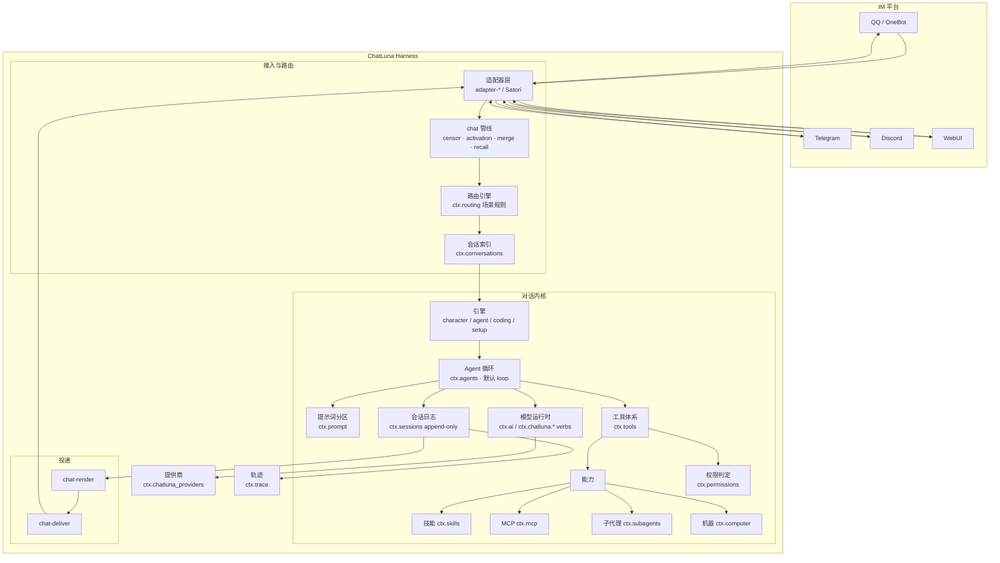
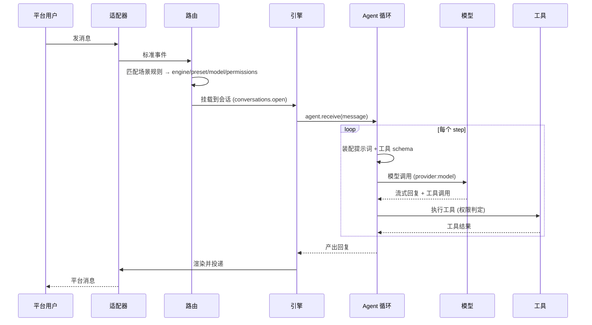

# 架构总览

ChatLuna v2 是为即时通信（IM）平台深度设计的智能体装备层（Agent Harness），构建于 Cordis 4 控制反转容器之上。整个运行实例表现为一棵由清单（Manifest）装配而成的插件树（Plugin Tree）。消息内核、路由引擎、Agent 执行循环、模型运行时与工具生态等所有核心子系统，均以可替换插件的形式存在。

本篇首先给出 ChatLuna v2 的运行时全景架构，随后跟踪一条消息在系统内的生命周期，最后梳理支撑整套体系的核心设计原则。

::: tip
ChatLuna v2 的每个核心服务都挂载在 Cordis 的上下文对象（`ctx`）上。在开发或排查系统行为时，你可以直接通过对应的命名空间（如 `ctx.routing`、`ctx.sessions`）定位其底层状态。
:::

## 认识运行时架构

ChatLuna v2 的运行时可划分为接入与路由、对话内核以及投递管道三个部分：

各层职责划分如下：

1. **接入与路由 (Inbound & Routing)**：
   - 适配器层（`adapter-*` 或 Satori）接收来自平台的原始消息并抽象为标准事件。
   - `chat` 基础管线负责审查（censor）、激活判断（activation）、消息合并（merge）与撤回处理（recall）。
   - 路由引擎（`ctx.routing`）依据预设的场景规则匹配目标配置，并通过 `ctx.conversations` 定位具体的会话上下文。
2. **对话内核 (Kernel)**：
   - 包含多种特定引擎（如 `character`、`agent`、`coding`、`setup`）。
   - 由 `ctx.agents` 驱动执行循环（Loop），集成提示词分区管理（`ctx.prompt`）、统一模型运行时（`ctx.ai` / `ctx.chatluna.*` verbs）与工具调用体系（`ctx.tools`）。
   - 工具体系汇总技能（`ctx.skills`）、MCP 协议（`ctx.mcp`）、子代理（`ctx.subagents`）及机器控制（`ctx.computer`）等能力，所有调用必须经过权限判定（`ctx.permissions`）。
   - 所有执行状态写入追加式（append-only）的会话日志服务（`ctx.sessions`），并同步记录到轨迹追踪（`ctx.trace`）。
3. **输出与投递 (Outbound & Delivery)**：
   - 响应从 `ctx.sessions` 产出后，经由 `chat-render` 进行排版与富文本渲染，最后由 `chat-deliver` 调用对应适配器推回 IM 平台。

## 理解一次对话的处理流程

在 ChatLuna v2 中，平台发起的每轮交互均遵循标准的执行生命周期。以下时序图展示了一条消息从接入到投递的完整旅程：

你可以分步骤观察其处理逻辑：

1. **场景解析与会话挂载**：适配器捕获事件后，路由引擎解析出当前会话对应的执行引擎、预设角色（Preset）、模型定位与执行权限，调用 `conversations.open` 挂载实例。
2. **循环驱动 (Agent Loop)**：引擎调用 `agent.receive(message)` 触发循环。每一个单步（Step）中，循环体组装当前的提示词和工具的 JSON Schema，向指定提供商发起调用（格式如 `provider:model`）。
3. **工具验证与执行**：模型返回流式回复或工具调用指令。当产生工具调用请求时，循环将其提交至 `ctx.tools`，经 `ctx.permissions` 校验合法性后执行，并将工具执行结果重新写回上下文。
4. **日志持久化与投递**：每一个单步的「模型请求 → 工具调用 → 工具结果」都会直接追加至 `ctx.sessions`。循环结束后，产出最终内容交由渲染层分发。

::: warning
`ctx.sessions` 维护的是只允许追加（Append-Only）的操作日志。严禁绕过服务接口直接篡改底层持久化存储，否则会导致历史回放和上下文投影失败。
:::

## 核心设计原则

在扩展或定制 ChatLuna v2 时，请遵循以下核心原则：

- **一切皆是插件 (Everything as a Plugin)**：消息内核、路由分配、Agent 执行器与模型接入层完全建立在插件机制上。你可以通过清单整体替换任何一个系统，而无需侵入底层代码。
- **日志是唯一事实源 (Single Source of Truth in Logs)**：模型所消费的上下文仅由 `ctx.sessions` 内的会话日志按规则投影计算而来，不存在独立维护的临时上下文字段。
- **能力与权限解耦 (Capabilities Decoupled from Permissions)**：无论是内置技能、MCP 还是子代理，都仅作为能力提供者（Capability Provider）。任何具体工具的调用权限，均统一交由 `ctx.permissions` 进行独立策略断言。
- **过程可重建 (Deterministic Reconstruction)**：任意历史轮次的上下文均可通过会话日志推导复现。在重建或审查请求时，无需重复调用模型接口或重放外部工具。

## 下一步

你可以继续阅读以下章节，深入了解各子系统的技术细节：

- [会话、消息与分支](./sessions) — 了解追加式日志、cut/mark 机制与会话分支处理
- [Agent 与执行循环](./agents) — 深入了解 step 与 turn 概念、收件箱（Inbox）与 receive 模式
- [模型与模态运行时](./models) — 掌握提供商配置、7 模态支持与模型地址别名机制
- [上下文与缓存](./context-cache) — 了解动态提示词分区、上下文变量与 KV 缓存体系
- [插件、服务与数据](./extensions) — 掌握基于清单的装配机制、Cordis 服务依赖与持久化实践
