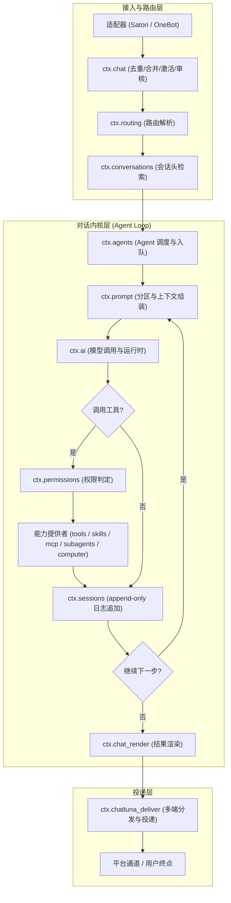
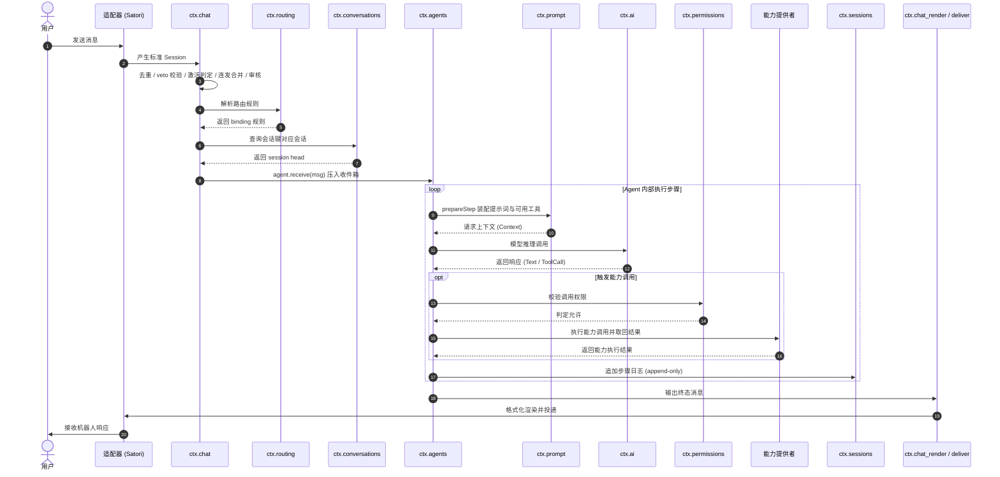

# 架构总览

ChatLuna v2 是运行在 Cordis 4 上的聊天机器人框架。系统接入 Satori 平台（兼容 QQ、OneBot 等协议实现），并自带开箱即用的独立 WebUI。

整个运行时实例是一棵由声明式清单装配的插件树。默认入口配置为 `cordis.yml`，通过 include 引入 `chatluna.yml`；在 `chatluna.yml` 内部，使用 `isolate: { server: chatluna }` 将所有业务插件隔离在专属服务器实例（端口 5028）中运行，而官方 Cordis 控制台则独立驻留在 6140 端口。

本文档所有架构定义均严格以源码实现为准，涵盖从消息接入、路由计算、核心循环到多端投递的完整链路。

## 运行时全景

ChatLuna v2 的运行时架构清晰划分为三层：接入与路由层、对话内核层、渲染与投递层。

各层级核心职责与协作服务如下：

- **接入与路由层**：由平台适配器捕获 Satori 事件并生成标准 Session。`ctx.chat` 执行消息去重、veto 拦截、激活判定与连发合并；`ctx.routing` 根据平台、机器人标识、群组与用户层级解析出对应的规则 binding；随后 `ctx.conversations` 基于会话键查找到活跃的会话头（session head）。
- **对话内核层**：`ctx.agents` 将消息推入收件箱并驱动主循环。在每一步（step）中，`ctx.prompt` 组装提示词分区与环境状态；`ctx.ai` 直接按「提供商:模型」地址发起推理，`ctx.chatluna_providers` 负责安装与配置这些提供商，而不是参与每一次派发。若模型触发工具调用，必须先通过 `ctx.permissions` 裁定权限，随后分发至 `ctx.tools`、`ctx.skills`、`ctx.mcp`、`ctx.subagents` 或 `ctx.computer` 执行。每一步决策均由 `ctx.sessions` 实时追加日志并驱动下一轮迭代。
- **渲染与投递层**：对话循环终结后，输出结果交给 `ctx.chat_render` 转换为目标格式，最后经由 `ctx.chatluna_deliver` 投递回原平台通道或流式推送到 WebUI。

## 一次消息的完整生命周期

一次标准的用户消息处理过程分为 14 个确定性步骤：

1. **事件捕获**：适配器（Satori 或 koishi-plugin-adapter-onebot）接收底层协议事件，封装为标准 Session。
2. **去重与 veto**：`ctx.chat` 检查消息指纹，剔除重放事件，并允许上游插件通过 veto 钩子静默丢弃特定消息。
3. **激活判定**：判定当前上下文是否命中响应条件（如 @机器人、特定前缀或私聊配置）。
4. **连发合并**：缓冲队列在极短的时间窗口内合并同用户的连续输入，防止碎片化触发多次完整调用。
5. **内容审核**：对最终合流的输入执行合规与敏感词校验。
6. **路由解析**：`ctx.routing` 计算环境标签，匹配出最终生效的 binding 配置。
7. **定位会话头**：`ctx.conversations` 通过会话键找到当前的 session head，并挂载或唤醒 live agent 实例。
8. **入收件箱**：调用 `agent.receive` 将消息投入对应的 Agent 处理队列。
9. **装配提示词与能力**：Agent 进入 `prepareStep`，`ctx.prompt` 装配各分区提示词、系统变量及 `ctx.tools` 暴露的可见工具描述。
10. **模型调用**：`ctx.ai` 携带装配后的请求上下文向目标 provider 发起推理。
11. **权限判定与工具执行**：模型若产生工具调用，执行流程被 `ctx.permissions` 拦截裁定，鉴权通过后由对应能力模块执行并收集输出。
12. **日志追加**：每一步的模型输出、工具输入输出、mark 标记与快照均作为只追加事件记入 `ctx.sessions`。
13. **判定终止**：检查是否达成结束条件（无进一步工具调用或达到最大步数），未达成则循环返回第 9 步继续执行。
14. **渲染与投递**：`ctx.chat_render` 将最终回复内容排版，交由 `ctx.chatluna_deliver` 投递回用户。

## 服务地图

ChatLuna v2 核心逻辑完全解耦为独立注册的 Cordis 服务，主要服务分布如下：

| 服务名 | 所属包 | 核心职责 |
| :--- | :--- | :--- |
| `routing` | `@chatluna/routing` | 管理规则、谓词、目录、peers，执行路由解析与决策解释 |
| `chat` | `@chatluna/chat` | 激活判定、收件、dispatch、会话绑定与基础命令分发 |
| `conversations` | `@chatluna/conversations` | 维护会话键到 session head 的映射索引，维护 live agent 实例缓存 |
| `sessions` | `@chatluna/session` | append-only 会话日志存储、分支追踪、切点管理 |
| `agents` | `@chatluna/agent` | Agent 注册表、默认执行 loop 调度、中间件链与 prepareStep 编排 |
| `engines` | `@chatluna/engine` | 引擎实现注册表与生命周期挂载 |
| `prompt` | `@chatluna/prompt` | 提示词分区构建、动态模板变量插值与环境注入 |
| `ai` | `@chatluna/ai-runtime` | 模型 provider 注册表、请求参数校验与模型调用流转发 |
| `chatluna_providers` | `@chatluna/provider-registry` | provider 的安装、启停与配置（请求由 `ctx.ai` 直接按地址派发） |
| `tools` | `@chatluna/tool` | 工具定义管理、五阶管线过滤与上下文可见性判定 |
| `skills` | `@chatluna/skill` | 结构化技能目录管理与动态加载 |
| `mcp` | `@chatluna/mcp` | Model Context Protocol 协议连接维护与外部工具桥接 |
| `subagents` | `@chatluna/subagent` | 子代理 profile 与执行 backend 隔离调度 |
| `computer` | `@chatluna/computer` | 执行机器实例注册与上下文安全绑定 |
| `memory` | `@chatluna/memory` | 长期记忆存储后端管理、记忆检索与沉淀提取 |
| `permissions` | `@chatluna/permission` | 细粒度权限等级划定、模式判定与敏感操作审批 |
| `presets` | `@chatluna/preset` | 预设文件解析、kind 类型识别与 loader 实现 |
| `trace` | `@chatluna/trace` | 请求因果 span 树构建与链路监控 |
| `usage` | `@chatluna/trace-billing` | 令牌消耗与用量账本记账 |
| `schedule` | `@chatluna/schedule` | 自动化定时触发任务调度器 |
| `background` | `@chatluna/background` | 异步后台任务队列与脱机工作流托管 |
| `schemas` | `@chatluna/ui-schema-registry` | 设置页与规则页表单的 UI Schema 注册中心 |
| `chatluna_config` | `@chatluna/runtime-config` | 运行时配置读写事务与版本追踪 |
| `chatluna_credentials` | `@chatluna/runtime-credentials` | 认证密钥与凭据的安全隔离存储 |

## 核心设计原则

### 1. 日志唯一事实源
在 ChatLuna v2 中，`ctx.sessions` 是严格只允许追加（append-only）的不可变日志。系统不存在物理删除逻辑，`cut` 操作属于软截断，仅通过生成 summary 替换 before 之前的历史消息，原始数据依旧完好留存；所有的提示词快照（prompt 快照）、预设选定（preset/selected）、请求上下文（request/context）、消息队列吞吐（input 入队/接纳/丢弃）及跳步行为（turn-skip）均作为不可变 `mark` 记录写入日志。

### 2. 前缀缓存一等公民
系统对模型调用成本做前置治理，系统提示词、全局工具声明列表与模型核心参数共同构成一个强约束的 epoch 缓存块。通过这种静态与稳定动态隔离的机制最大化提升前缀缓存命中率；开发者可直接在终端执行 `chatluna doctor cache` 命令，即时查看当前会话的 epoch 状态与历史作废原因。

### 3. 一切皆插件
系统自身无任何硬编码的专有模型或固化能力。工具（tools）、技能（skills）、MCP 连接器、平台协议适配器以及底层模型提供者（providers）均为符合 Cordis 标准的插拔式插件；所有 provider 均支持在运行时按需下载与动态热加载，杜绝框架级体积膨胀。

### 4. 能力与权限解耦
所有扩展组件仅需专注声明与提供能力，能力模块自身禁止内联授权逻辑。外部所有针对工具或系统调用的触发，必须统一由 `ctx.permissions` 服务在执行前完成权限等级、当前策略与会话模式的集中校验与审批。

### 5. 可重建
因为全链路执行状态与输入输出均持久化在 append-only 日志中，系统支持对任意历史 step 重新发起逆向构造。系统提供 `reconstructRequest` 机制，可以在不破坏当前会话树结构的前提下，完美重建任意历史节点的输入快照用于复现问题、分叉讨论或基准回归测试。

## 文档地图

深入了解各子系统的内部细节，请参阅：

- [路由与解析规则](./routing) — 深入了解 `ctx.routing` 的规则目录、条件谓词与 peer 继承机制。
- [对话流水线与中间件](./chat-pipeline) — 查看消息去重、合并、审核与 dispatch 的详细管线。
- [日志与分支模型](./sessions) — 详细了解 append-only 日志存储结构、分支切换与软截断 `cut`。
- [会话索引与状态管理](./conversations) — 探究会话键解析算法与 live agent 实例缓存机制。
- [Agent 架构与执行循环](./agents) — 剖析 Agent 注册表、默认 loop 调度与 prepareStep 生命周期。
- [模型接入与 Provider 机制](./models) — 掌握模型 provider 注册、运行时调度与热装卸管理。
- [前缀缓存与诊断](./context-cache) — 掌握 prompt 结构对前缀缓存的影响及 doctor 命令排障实战。
- [能力扩展体系](./extensions) — 学习如何为系统开发自定义工具、加载 MCP 协议或扩展技能。

## 下一步

- **初次接入平台**：先阅读 [路由与解析规则](./routing)，理解消息进入框架后如何根据平台与群聊映射到具体的绑定配置。
- **排查交互异常**：若发现消息未响应或激活异常，阅读 [对话流水线与中间件](./chat-pipeline) 排查 veto 拦截或连发合并逻辑。
- **定制业务能力**：如果需要接入自有 API，直接进入 [能力扩展体系](./extensions) 了解工具与 MCP 接入规范。
- **优化 API 消耗**：如果模型调用消耗超预期，阅读 [前缀缓存与诊断](./context-cache) 优化提示词结构以提高缓存命中率。
