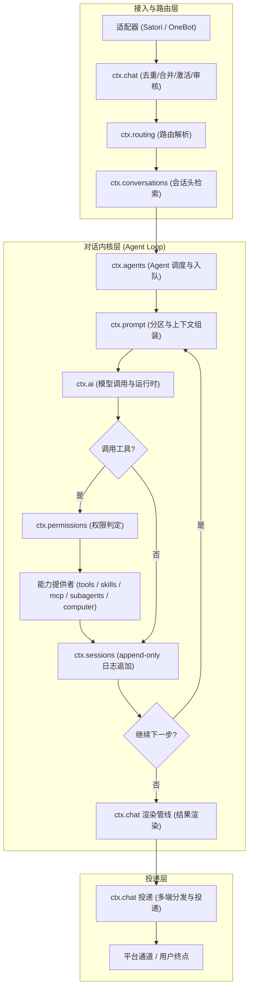
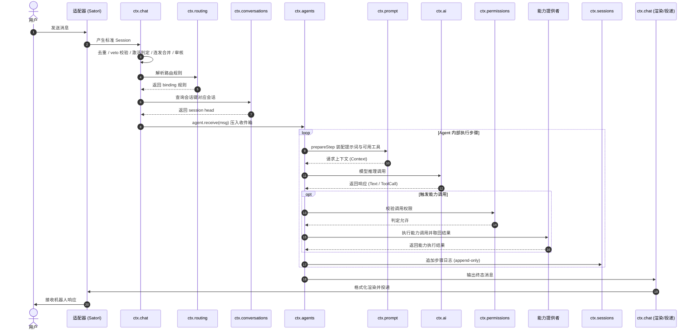

# 架构总览

::: tip
ChatLuna v2 是运行在 Cordis 上的 Agent Harness 框架。它通过 Satori 平台接入各类聊天软件（原生兼容 QQ、Telegram 等协议实现），并自带开箱即用的独立 WebUI。
:::

整个运行时是一棵由声明式清单装配的插件树：引导文件 `cordis.yml` 指向插件树 `chatluna.yml`，后者通过 `isolate: { server: chatluna }` 把业务插件隔离在 `5028` 端口的专属服务器实例中，官方 Cordis 控制台挂载在同一端口的 `/cordis` 路径下。详见[启动与插件树](./boot)。

架构说明均以源码实现为准。

## 运行时全景

运行时分三层：接入与路由、对话内核、渲染与投递。

- **接入与路由**：适配器把 Satori 事件包装为标准 Session；`ctx.chat` 负责去重、veto、激活判定与连发合并；`ctx.routing` 按平台、机器人、群组、用户等维度解析出 binding 规则；`ctx.conversations` 按会话键找到当前的会话头（session head）。
- **对话内核**：`ctx.agents` 把消息放入收件箱并推进主循环。每一步由 `ctx.prompt` 组装提示词分区与环境，`ctx.ai` 按「提供商:模型」地址发起推理（`ctx.chatluna_providers` 只负责安装和配置提供商，不参与派发）。工具调用先经 `ctx.permissions` 鉴权，再分发给 `ctx.tools`、`ctx.skills`、`ctx.mcp`、`ctx.subagents` 或 `ctx.computer`。每一步都追加到 `ctx.sessions`。
- **渲染与投递**：循环结束后，`ctx.chat` 的渲染管线把输出转换为目标格式，投递回原平台，或流式推送到 WebUI。

## 一条消息的生命周期

1. **事件捕获**：适配器（Satori 或 `koishi-plugin-adapter-onebot`）把协议事件封装为标准 Session。
2. **去重与 veto**：`ctx.chat` 剔除重放事件，上游插件可以通过 veto 钩子丢弃消息。
3. **激活判定**：判断是否命中响应条件（@机器人、前缀、私聊等）。
4. **连发合并**：在短时间窗口内合并同一用户的连续输入。
5. **内容审核**：合规与敏感词校验。
6. **路由解析**：`ctx.routing` 匹配出生效的 binding 配置。
7. **定位会话头**：`ctx.conversations` 找到 session head，挂载或唤醒 live agent。
8. **入收件箱**：`agent.receive` 把消息放入 Agent 队列。
9. **装配提示词与能力**：`prepareStep` 中由 `ctx.prompt` 装配提示词、变量和 `ctx.tools` 的可见工具。
10. **模型调用**：`ctx.ai` 向目标 provider 发起推理。
11. **权限判定与工具执行**：工具调用经 `ctx.permissions` 鉴权后由对应模块执行。
12. **日志追加**：模型输出、工具输入输出、mark 与快照都追加到 `ctx.sessions`。
13. **判定终止**：未满足结束条件（无需继续调用工具或达到最大步数）则回到第 9 步。
14. **渲染与投递**：`ctx.chat` 排版并投递给用户。

## 服务地图

| 服务名 | 所属包 | 核心职责 |
| :--- | :--- | :--- |
| `routing` | `@chatluna/routing` | 管理规则、谓词、目录、peers，执行路由解析与决策解释 |
| `chat` | `@chatluna/chat` | 激活判定、收件、dispatch、会话绑定与基础命令分发 |
| `conversations` | `@chatluna/conversations` | 维护会话键到 session head 的映射索引，维护 live agent 实例缓存 |
| `sessions` | `@chatluna/session` | append-only 会话日志存储、分支追踪、切点管理 |
| `agents` | `@chatluna/agent` | Agent 注册表、默认执行 loop 调度、中间件链与 prepareStep 编排 |
| `engines` | `@chatluna/engine` | 引擎实现注册表与生命周期挂载 |
| `prompt` | `@chatluna/prompt` | 提示词分区构建、动态模板变量插值与环境注入 |
| `ai` | `@chatluna/ai-runtime` | 模型 provider 注册表、请求参数校验与模型调用流转发 |
| `chatluna_providers` | `@chatluna/provider-registry` | provider 的安装、启停与配置（请求由 `ctx.ai` 直接按地址派发） |
| `tools` | `@chatluna/tool` | 工具定义管理、五阶管线过滤与上下文可见性判定 |
| `skills` | `@chatluna/skill` | 结构化技能目录管理与动态加载 |
| `mcp` | `@chatluna/mcp` | Model Context Protocol 协议连接维护与外部工具桥接 |
| `subagents` | `@chatluna/subagent` | 子代理 profile 与执行 backend 隔离调度 |
| `computer` | `@chatluna/computer` | 执行机器实例注册与上下文安全绑定 |
| `memory` | `@chatluna/memory` | 长期记忆存储后端管理、记忆检索与沉淀提取 |
| `permissions` | `@chatluna/permission` | 细粒度权限等级划定、模式判定与敏感操作审批 |
| `presets` | `@chatluna/preset` | 预设文件解析、kind 类型识别与 loader 实现 |
| `trace` | `@chatluna/trace` | 请求因果 span 树构建与链路监控 |
| `usage` | `@chatluna/trace-billing` | 令牌消耗与用量账本记账 |
| `telemetry` | `@chatluna/telemetry` | 运行指标计数与上报快照 |
| —（censor） | `@chatluna/chat` 子插件 | 输入审核：命中规则时拦截消息；不是独立服务，第三方匹配器通过 `ctx.chat.censor()` 注册 |
| `compaction` | `@chatluna/compaction-default` | 历史压缩执行与多级降级（契约在 `@chatluna/compaction`） |
| `schedule` | `@chatluna/schedule` | 自动化定时触发任务调度器 |
| `background` | `@chatluna/background` | 异步后台任务队列与脱机工作流托管 |
| `schemas` | `@chatluna/ui-schema-registry` | 设置页与规则页表单的 UI Schema 注册中心 |
| `chatluna_config` | `@chatluna/runtime-config` | 运行时配置读写事务与版本追踪 |
| `chatluna_credentials` | `@chatluna/runtime-credentials` | 认证密钥与凭据的安全隔离存储 |

## 设计原则

1. **日志是唯一事实源**：`ctx.sessions` 只追加，条目不会被就地改写，删除会话也是整条移除。`cut` 是软截断，只用 summary 替换 before 之前的历史，原始数据保留。提示词快照、预设选择（preset/selected）、请求上下文（request/context）、输入入队/接纳/丢弃和跳步（turn-skip）都作为不可变 `mark` 写入。
2. **前缀缓存是一等公民**：系统提示词、工具声明和模型参数构成 epoch 缓存块，静态内容与动态内容分开以提高命中率。`chatluna doctor cache <会话id>` 可以查看某个会话的缓存块构成与变化，定位导致前缀失效的改动。
3. **一切皆插件**：没有硬编码的模型或能力。工具、技能、MCP、平台适配器和 provider 都是 Cordis 插件，provider 按需下载并热加载。
4. **能力与权限解耦**：能力模块只声明和提供能力，不含鉴权逻辑。所有调用在执行前统一由 `ctx.permissions` 校验等级、策略与会话模式。
5. **可重建**：执行状态和输入输出都在日志中，`reconstructRequest` 可以在不破坏会话树的前提下重建任意历史步骤的请求，便于复现问题、分叉讨论或回归测试。

## 下一步

- [路由与场景规则](./routing) — 消息如何映射到 binding 配置。
- [消息管线](./chat-pipeline) — 去重、合并、审核与 dispatch；排查不响应时先看这里。
- [会话、消息与分支](./sessions) — append-only 日志、分支与软截断 `cut`。
- [会话索引与活跃 Agent](./conversations) — 会话键与 live agent 缓存。
- [Agent 与执行循环](./agents) — 注册表、默认 loop 与 prepareStep。
- [模型接入](./models) — provider 注册、运行时调度与热装卸。
- [上下文、缓存与压缩](./context-cache) — 提示词结构对缓存的影响与 doctor 排障。
- [插件、服务与数据](./extensions) — 自定义工具、MCP 与技能。
