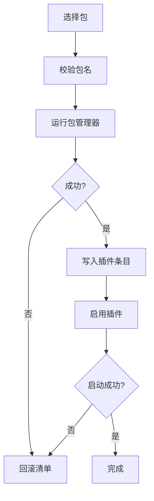

# 市场与运行时

::: tip
这一页讲「在控制台里装一个插件」背后发生了什么：解析、安装、注册、启用、失败回滚，以及出问题时的安全模式。
:::

ChatLuna 的能力大部分来自插件。

聊天平台是插件，模型提供商是插件，工具、技能、记忆、轨迹也都是插件。

所以「怎么安全地安装、升级、卸载插件」不是配角，而是整个系统能不能长期稳定运行的关键。

<!-- 架构页，可以使用代码与配置示意 -->

## 市场

市场是一个索引：把「有哪些插件可用」整理成可以搜索的条目。

### 来源

市场可以聚合多个源，每个源有自己的优先级。

同名包以高优先级源的信息为准，但会记录所有提供过它的源。

### 缓存

索引会缓存到本地文件，默认十分钟刷新一次。

网络不可用时，用上次的缓存继续展示——只是看不到新内容。

### 兼容性

每个条目会检查它与当前运行时版本是否兼容。

不兼容的包可以展示，但不建议安装。

::: tip
「市场里有，但装不上」通常不是网络问题，而是版本不兼容或者包被标记为废弃。
:::

## 安装

安装不是「下载一个文件」，而是一次事务：

### 串行队列

安装、升级、卸载都排在一个队列里执行。

同一时刻只允许一个包管理操作，避免两个进程同时改进度文件。

### 事务

安装前记录清单与依赖的当前状态。

失败时恢复到安装前：删掉新条目、恢复依赖版本。

这保证「装坏了」不会留下一个半成品配置。

### 启用

安装成功只是「包在了」，还需要写入插件条目并启用。

启用失败同样会回滚。

## 卸载

卸载比安装更危险：别的插件可能依赖它。

所以卸载前会先列出「会受影响的插件」。

流程是：

1. 停止依赖它的插件。
2. 等待这些插件释放服务。
3. 卸载包。
4. 清理条目。

如果中间失败，恢复到卸载前。

::: warning
卸载一个提供核心服务的插件，可能让一大片功能同时失效。

确认列表为空，或者你清楚后果，再继续。
:::

## 热加载

插件条目可以动态启用与停用，不需要重启进程。

### 监听

文件监控会监听清单变化。

手动改文件、控制台改配置，都会触发重新加载。

### 边界

不是所有改动都能热生效：

- 新增插件：通常可以。
- 停用插件：可以，前提是没有硬依赖它的插件还在运行。
- 修改配置：取决于插件是否支持热更新。
- 修改分组或隔离：通常需要重启。

热加载失败时，插件停留在不可用状态，并记录原因。

## 守护

运行时里有一个守护插件，它不自己重启进程，而是把请求转给外层的 supervisor：

- **重启**：请求 supervisor 重启当前实例。
- **更新**：请求 supervisor 执行更新流程。

为什么要转交？

因为进程自己重启自己并不可靠：中途状态、日志、健康检查都需要外部观察者。

### 不受监管时

如果进程不是通过命令行启动的（例如直接跑 worker），守护会明确返回「不受监管」。

这时需要手动重启。

## 安全模式

实例反复启动失败时，supervisor 会进入安全模式。

安全模式只加载最小集合：运行时检查与平台适配器。

目的是让你能进控制台，把问题插件关掉。

::: tip
安全模式不是「降级运行」，而是「抢救模式」。

不要把它当成正常状态使用。
:::

## 创作模式

运行时提供了一种「让模型自己改配置」的模式。

进入之后，模型可以通过专用工具：

- 查看当前运行时状态。
- 安装或启用插件。
- 修改提供商与预设。

它的前提是模型有足够的权限，并且操作会经过正常的权限判定。

::: warning
创作模式等于把控制台的一部分能力交给模型。

只在你信任当前对话与模型时开启，用完及时退出。
:::

## 安全

### 安装即为执行

安装一个 npm 包，意味着在服务器上执行它的安装脚本与运行时代码。

这是市场功能最大的风险来源。

建议：

- 只从可信来源安装。
- 固定版本，不用「永远最新」。
- 公开实例不要开放市场入口。

### 权限

控制台的安装能力等价于代码执行。

这也是为什么控制台默认只允许本机访问、并且必须有强令牌。

## 离线与镜像

没有外网时：

- 市场索引可以用缓存。
- 包管理器需要本地缓存或私有镜像。

内网部署通常需要提前准备好镜像源。

## 排查

**市场是空的。**

检查网络与源配置；检查缓存是否损坏；检查时间是否正确（TLS 校验依赖时间）。

**安装失败。**

看包管理器输出：版本不存在、网络失败、镜像源不可达、安装脚本报错。

**装上了但页面没有。**

条目没启用，或者插件启动失败。看插件状态与日志。

**卸载后一片功能消失。**

卸载了提供核心服务的插件。从备份恢复，或者重新安装。

**热重载没生效。**

改动需要重启。用命令行重启一次，确认问题是否消失。

**反复进入安全模式。**

有插件在启动时崩溃。安全模式下逐个停用，定位问题插件。

## 下一步

- [启动与插件树](./boot) — supervisor 与安全模式。
- [插件、服务与数据](./extensions) — 插件模型。
- [控制台](./webui) — 安装入口的界面。
- [多实例与多机器人](/manual/recipe/instances) — 实例级隔离。
