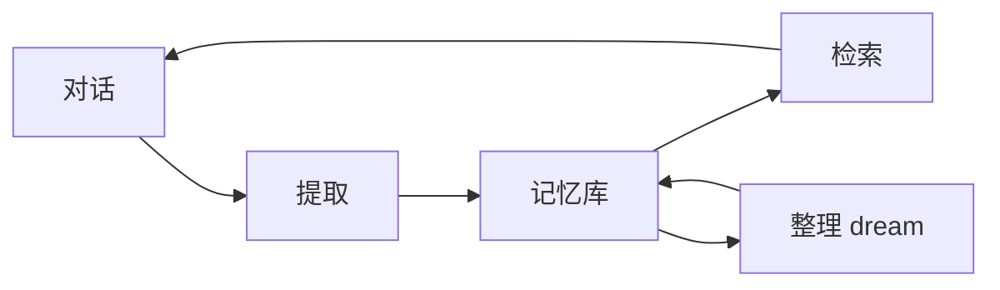

# 记忆系统

::: tip
会话记录记住的是「这次聊了什么」，长期记忆记住的是「这个人是谁、说过什么重要的事」。前者按会话独立存在，后者则能够跨会话、跨群乃至跨平台持续积累。
:::

大语言模型的上下文窗口是有限的。

当对话推进到上百轮后，早期的上下文会被裁剪或挤出窗口。但有些信息不应该随着对话推进而被遗忘，例如用户的称呼、项目的约定或是上次承诺过的事项。

长期记忆机制正是为此而设计的。它将对话中值得留存的信息提炼为结构化条目并持久化存储，在后续对话需要时检索并回填到上下文当中。

<!-- 架构页，可以使用代码与配置示意 -->

## 数据模型

### 条目

在底层表示中，一条具体的记忆条目包含以下核心字段：

| 字段 | 说明 |
| --- | --- |
| 类型 | 身份、偏好、事实、计划、上下文、其他 |
| 内容 | 一句可独立阅读的陈述 |
| 状态 | 活跃或归档 |
| 来源 | 用户、模型、提取、整理、导入、角色 |
| 作用域 | 属于谁、哪个预设、哪个会话 |
| 时间 | 创建与更新时间 |
| 版本 | 修改历史 |

记忆条目的表述越具体，后续检索与利用的价值就越高。

例如，「用户喜欢简洁的回答」显然比模糊的「用户有一些偏好」对模型更具指导意义。

### 作用域

为了满足不同场景下的数据隔离需求，记忆系统支持两种隔离方式：

- **按预设**：在同一个预设下共享记忆，不同预设之间互相隔离。
- **按会话**：每个会话独立维护记忆，切换群聊或私聊后互不相通。

在默认配置下，系统采用**按预设**隔离。这意味着同一个角色在不同群聊中面对同一个用户时，能够共享相同的认知背景。

::: warning
隔离方式属于全局配置。如果特定群聊需要维持完全独立的记忆空间，应当为其分配独立的预设，无法直接针对单个群聊单独覆盖该设置。
:::

## 存储

记忆系统的底层存储后端采用可插拔设计。

系统默认提供的存储后端是 Markdown：条目会被保存为人可读的纯文本文件，并按作用域存放在对应的目录结构中。这种设计有以下优势：

- 可以直接使用任意文本编辑器查看和编辑
- 天然契合 Git 等版本控制系统，易于协同与回溯
- 排查故障时一目了然，方便核对底层存储的内容

存储后端需要实现一组标准的存储能力：搜索、列表、写入、归档、删除以及导出。

在数据写入与清理上，系统遵循一个重要原则：**优先归档而非直接删除**。这确保了记忆生命周期的演变过程可追溯，让「这条记忆为什么消失了」有据可查。

## 三个动作

长期记忆并不是静态的一次性写入，而是由「提取」「检索」与「整理」三个持续运行的核心流程组成：

### 提取

当对话持续推进时，系统会定期截取最近的一段对话交给小模型，由其判断当前上下文中是否存在值得长期沉淀的关键信息。如果有，则提炼为规范条目；反之则直接跳过。

提取流程遵循以下规则：

- **滑动窗口**：仅审视最近的若干条消息，默认窗口大小为 30 条。
- **先判定后提取**：在提取前先进行轻量评估，确认有新信息后再执行完整提炼，避免不必要的模型调用消耗。
- **去重与合并**：若提炼出的新条目与记忆库中的已有内容重复，系统会执行合并更新，而非无休止追加新记录。

提取成功后的条目会写入记忆库，其来源字段被标记为「提取」。

### 检索

将记忆重新带入模型上下文通常有两条路径：

- **主动查询**：模型在规划执行时，主动调用记忆工具按需检索。
- **自动注入**：在系统提示词的上下文区域注入记忆索引摘要，让模型提前感知当前存在哪些可供查阅的记忆背景。

自动注入的索引内容受 Token 预算限制，默认上限为 1500 个 token。

不论记忆库规模多大，初始注入提示词的也仅是一份高精炼度的索引目录；只有当模型判定需要细节时，才会触发主动查询读取完整正文。

### 整理

随着交互轮次增多，记忆库难免会逐渐膨胀，并出现过时、矛盾或语义重叠的条目。为此，系统引入了类似生物「睡眠整理」的 dream 机制：

- **空闲触发**：在会话持续空闲达到一定时间后触发（默认 30 分钟）。
- **定期触发**：固定在每晚低峰期执行一次全量维护（默认凌晨 4 点）。
- **批次上限**：单次整理任务最多处理指定数量的条目（默认 300 条）。

在整理过程中，系统会自动合并重复内容、归档过时事实，并改写存在冲突的陈述，确保记忆库始终精炼有效。

::: tip
整理并不等同于物理删除。被归档的条目依然保存在存储中，只是在后续检索中不再默认参与。如果需要重新启用，随时可以在记忆管理页面将其状态改回活跃。
:::

## 记忆任务

在内部实现上，提取、检索、整理以及建索引均被封装为独立的后台异步任务。每个任务都具备完整的状态跟踪、触发条件与执行记录：

| 任务 | 触发 |
| --- | --- |
| 提取 | 窗口到期、空闲、手动 |
| 检索 | 定时（可关闭） |
| 整理 | 空闲、夜间、体积、手动 |
| 建索引 | 预算或内容变化 |

后台任务即使执行失败也不会阻塞常规对话流程，系统仅会记录一条失败原因以供排查。

## 变量

长期记忆主要通过预置的提示词变量动态装配进模型上下文：

- **记忆索引**：当前相关的记忆标题与摘要列表，受 Token 预算严格限制。
- **记忆读取**：根据特定主题或键值按需获取的具体条目正文。
- **用户画像**：按用户维度聚合读取的结构化画像数据。

需要特别说明的是，这些变量在生命周期上均归属于上下文区（Context）。由于它们的内容会随着记忆更新而动态改变，因此绝不能写入系统前缀（System）中。

::: warning
切忌将记忆索引等易变变量写入系统前缀区。若将其置于系统区，每一轮记忆更新都会导致底层的上下文缓存（Prompt Cache）彻底失效，导致费用与响应延迟明显上升。
:::

## 写入路径

记忆条目具有清晰的来源标识，主要支持以下几种写入路径：

- **提取**：后台系统自动从对话消息流中提炼生成。
- **模型写**：模型在执行循环中通过调用记忆写入工具直接添加。
- **用户写**：用户或管理员在控制台记忆页面中手动录入。
- **导入**：从外部文件或历史旧数据中批量导入。
- **角色写**：角色系统在交互回合结束时，依据情感与关系变化自动追加记录。
- **整理**：dream 整理流程在对旧条目进行合并、修正或归纳后重写产出。

不同来源的条目在界面上均会清晰标明来源元数据，方便判断其可信度与权属。

## 与角色的关系

在整体架构中，角色系统自身也维护了一套「近期记忆」，容易与长期记忆混淆。两者的区别如下：

| | 近期记忆 | 长期记忆 |
| --- | --- | --- |
| 范围 | 当前会话的近期对话 | 跨会话的长期条目 |
| 写入 | 每轮自动 | 提取与整理 |
| 生命周期 | 随会话滚动 | 长期保留 |
| 用途 | 接上刚才的话题 | 记住这个人和他的事 |

在实际运作中，两者相辅相成：近期记忆提供对话的临场感与连续语境，长期记忆则提供跨越周期的稳定认知。

## 隐私

长期记忆中往往沉淀了真实用户的行为习惯与个人信息，因此在设计与落地时需要审慎考虑隐私与权限边界：

- **谁能看**：记忆管理页面应当配置严格的访问权限与鉴权策略。
- **谁能删**：当用户提出删除要求时，必须具备明确清晰的处理与注销路径。
- **导出**：在进行系统迁移与备份时，存储的记忆数据会一并导出支持流转。
- **发给模型**：默认注入上下文的仅为精炼索引，模型在显式发起查询时才会获取正文。

::: warning
切勿将密码、证件号、支付信息等高度敏感数据交给模型，更不要依赖「记忆系统会妥善保护它」。长期记忆机制旨在提供对话的认知连续性，它绝不是加密保险箱。
:::

## 性能与成本

引入长期记忆的运行代价主要集中在模型调用本身：

- 提取：每个滑动窗口触发一次轻量小模型调用。
- 整理：批次整理阶段通常同样交由小模型执行。
- 检索：为可选操作；若将其关闭，则系统仅依赖索引进行被动提供。

在模型选型上，推荐使用便宜的小模型来承载提取与整理任务，产生的调用成本通常可以忽略不计。反之，如果将高规格的主模型直接配置为提取模型，费用账单很快就会不堪重负。

## 排查

在实际运行与配置记忆系统时，如果遇到异常表现，可以参照以下方案排查：

**记忆里什么都没有**

1. 确认长期记忆功能是否已经开启。
2. 检查对话累积的消息数是否达到提取窗口阈值。
3. 确认在当前预设作用域下，近期对话是否本来就没有可提取的内容。

**记错了或记重复了**

可以在管理页面中手动编辑或归档错误条目，同时检查系统是否同时开启了多个并行的提取来源导致冲突。

**模型从不引用记忆**

1. 检查索引 Token 预算是否过小，导致摘要未能有效注入。
2. 确认记忆索引变量是否已正确挂载到上下文。
3. 排查提供给模型的检索工具是否可见且可用。

**记忆越来越多、越来越慢**

可以适当调大整理任务的触发频率，或者调低提取机制的判定积极性。在日常维护中，归档条目比直接删除更为安全。

**换了群之后记忆断了**

核对当前系统的隔离方式配置。如果当前设置为按会话隔离，换群后记忆无法继承属于预期的设计行为。

## 下一步

- [长期记忆](/manual/usage/memory) — 面向使用者的配置与操作。
- [会话与消息](./sessions) — 会话记录与记忆的区别。
- [角色系统](./character) — 角色状态与近期记忆。
- [上下文与缓存](./context-cache) — 记忆如何进入提示词。
