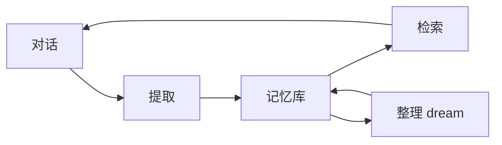

# 记忆系统

::: tip
会话记录记住「这次聊了什么」，长期记忆记住「这个人是谁、说过什么重要的事」。上百轮之后早期上下文会被挤出窗口，但用户的称呼、项目约定、上次的承诺不该被忘掉。长期记忆把值得留存的信息提炼为条目持久化，在需要时检索回填，可以跨会话、跨群乃至跨平台积累。
:::

<!-- 架构页，可以使用代码与配置示意 -->

## 数据模型

| 字段 | 说明 |
| --- | --- |
| 类型 | 身份、偏好、事实、计划、上下文、其他 |
| 内容 | 一句可独立阅读的陈述 |
| 状态 | 活跃或归档 |
| 来源 | 用户、模型、提取、整理、导入、角色 |
| 作用域 | 属于谁、哪个预设、哪个会话 |
| 时间 | 创建与更新时间 |
| 版本 | 修改历史 |

条目越具体越有用：「用户喜欢简洁的回答」比「用户有一些偏好」有用得多。

**作用域**：

- **按预设**（默认）：同一预设下共享记忆，不同预设隔离。同一个角色在不同群面对同一个用户时有相同的认知。
- **按会话**：每个会话独立，换群或私聊后不相通。

::: warning
隔离方式是全局配置，不能单独覆盖某个群。需要完全独立的记忆时，给那个群分配独立的预设。
:::

## 存储

存储后端可插拔，默认是 Markdown：条目存为人可读的文本文件，按作用域分目录。可以直接用编辑器查看修改、用 Git 管理，排查时一目了然。

后端需要实现搜索、列表、写入、归档、删除和导出。原则是**优先归档而非删除**，让「这条记忆为什么没了」有据可查。

## 三个动作

### 提取

系统定期把最近一段对话交给小模型，判断是否有值得长期保存的信息，有就提炼为条目，否则跳过。

- **滑动窗口**：只看最近的消息，默认 30 条。
- **先判定后提取**：先做轻量评估，确认有新信息再完整提炼，减少模型调用。
- **去重合并**：与已有条目重复时合并更新，而不是追加。

提取的条目来源标记为「提取」。

### 检索

- **主动查询**：模型调用记忆工具按需检索。
- **自动注入**：在上下文区注入记忆索引摘要，让模型知道有哪些记忆可查，默认上限 1500 token。

无论记忆库多大，注入的只是一份精炼索引；模型需要细节时才主动读取正文。

### 整理

记忆库会逐渐出现过时、矛盾或重叠的条目，dream 机制像睡眠一样定期整理：

- **空闲触发**：会话空闲达到一定时间（默认 30 分钟）。
- **定期触发**：每晚低峰期全量维护一次（默认凌晨 4 点）。
- **批次上限**：单次最多处理 300 条。

整理会合并重复、归档过时事实、改写冲突的陈述。

::: tip
整理不是删除。归档的条目仍在存储中，只是不再默认参与检索，可以在记忆管理页面改回活跃。
:::

## 记忆任务

提取、检索、整理和建索引都是独立的后台任务，有状态跟踪和执行记录：

| 任务 | 触发 |
| --- | --- |
| 提取 | 窗口到期、空闲、手动 |
| 检索 | 定时（可关闭） |
| 整理 | 空闲、夜间、体积、手动 |
| 建索引 | 预算或内容变化 |

任务失败不会阻塞对话，只记录失败原因。

## 变量

- **记忆索引**：相关记忆的标题与摘要，受 Token 预算限制。
- **记忆读取**：按主题或键获取的条目正文。
- **用户画像**：按用户聚合的结构化画像。

这些变量都属于上下文区，内容随记忆更新而变化。

::: warning
不要把记忆索引写进系统区，否则每次记忆更新都会让前缀缓存失效，费用和延迟明显上升。
:::

## 写入路径

- **提取**：后台从对话中自动提炼。
- **模型写**：模型调用记忆写入工具。
- **用户写**：用户或管理员在记忆页面手动录入。
- **导入**：从外部文件或旧数据批量导入。
- **角色写**：角色系统在回合结束时根据情感与关系变化追加。
- **整理**：dream 合并、修正或归纳后重写。

界面上会标明每条的来源，便于判断可信度。

## 与角色的关系

角色系统自己也有「近期记忆」，容易混淆：

| | 近期记忆 | 长期记忆 |
| --- | --- | --- |
| 范围 | 当前会话的近期对话 | 跨会话的长期条目 |
| 写入 | 每轮自动 | 提取与整理 |
| 生命周期 | 随会话滚动 | 长期保留 |
| 用途 | 接上刚才的话题 | 记住这个人和他的事 |

近期记忆提供连续的语境，长期记忆提供稳定的认知。

## 隐私

- **谁能看**：记忆页面应配置严格的访问权限。
- **谁能删**：用户要求删除时要有明确的处理路径。
- **导出**：迁移和备份时记忆数据会一并导出。
- **发给模型**：默认只注入索引，模型显式查询时才拿到正文。

::: warning
不要把密码、证件号、支付信息交给模型，也不要指望记忆系统保护它们。长期记忆是为了对话连续性，不是加密保险箱。
:::

## 成本

主要成本是模型调用：每个提取窗口一次小模型调用，整理通常也用小模型，检索可以关闭（只依赖索引）。用便宜的小模型承担提取和整理，成本基本可以忽略；用主模型做提取，账单很快就会失控。

## 常见问题

**记忆里什么都没有**：确认功能已开启、消息数达到提取窗口，以及当前预设下的对话确实有可提取的内容。

**记错或记重复**：在管理页面编辑或归档，并检查是否开了多个并行的提取来源。

**模型从不引用记忆**：检查索引预算是否过小、索引变量是否已挂到上下文、检索工具是否可见。

**记忆越来越多、越来越慢**：提高整理频率，或降低提取的积极性。日常维护中归档比删除安全。

**换群后记忆断了**：检查隔离方式，按会话隔离时这是预期行为。

## 下一步

- [长期记忆](/manual/usage/memory) — 面向使用者的配置与操作。
- [会话与消息](./sessions) — 会话记录与记忆的区别。
- [角色系统](./character) — 角色状态与近期记忆。
- [上下文与缓存](./context-cache) — 记忆如何进入提示词。
