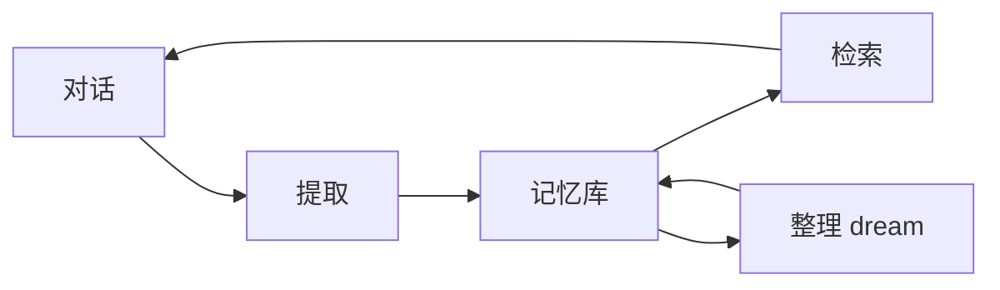

# 长期记忆

::: tip
会话记录记住的是「这次聊了什么」，长期记忆记住的是「这个人是谁、说过什么重要的事」。前者按会话存在，后者跨会话、跨群、跨平台积累。
:::

模型的上下文窗口有限。

聊到第一百轮，第一轮说过的话早就被压缩、切掉、或者挤出了窗口。但有些事情不该忘：主人的名字、项目的约定、上次答应过什么。

长期记忆就是为此存在的。

它把对话里值得留下的内容提炼成条目存起来，在需要的时候检索回上下文。

<!-- 架构页，可以使用代码与配置示意 -->

## 数据模型

### 条目

一条记忆包含：

| 字段 | 说明 |
| --- | --- |
| 类型 | 身份、偏好、事实、计划、上下文、其他 |
| 内容 | 一句可独立阅读的陈述 |
| 状态 | 活跃或归档 |
| 来源 | 用户、模型、提取、整理、导入、角色 |
| 作用域 | 属于谁、哪个预设、哪个会话 |
| 时间 | 创建与更新时间 |
| 版本 | 修改历史 |

内容写得越具体，检索出来就越有用。

「主人喜欢简洁的回答」比「主人有一些偏好」有价值得多。

### 作用域

记忆有两种隔离方式：

- **按预设**：同一个预设下共享记忆，不同预设之间互不可见。
- **按会话**：每个会话独立，换一个群就记不住。

默认是按预设。这意味着同一个角色在不同群里知道的是同一批事——通常这才是你想要的。

::: warning
隔离方式是全局设置。

如果某个群需要完全独立的记忆，应该用不同的预设，而不是指望隔离设置能按群生效。
:::

## 存储

记忆后端是可替换的。

默认后端是 Markdown：条目写成人可读的文件，目录结构按作用域组织。

这样做的好处很直接：

- 能直接用文本编辑器查看和修改。
- 能放进版本控制。
- 出问题时能看懂到底存了什么。

后端需要实现一组基本能力：搜索、列表、写入、归档、删除、导出。

写入有一个特别的约束：**归档而不是删除**。

这样做是为了让「这条记忆为什么消失了」有据可查。

## 三个动作

长期记忆不是一次性写入，而是一套持续运转的流程：提取、检索、整理。

### 提取

对话进行到一定阶段后，系统会把最近的一段消息交给小模型，让它判断「这里面有没有值得记的事」。

有，就提取成条目；没有，就跳过。

几个约束：

- **窗口**：只看最近若干条消息，默认 30 条。
- **先判断再提取**：不是每次窗口都值得提取，先问「有没有」，避免徒增模型调用。
- **去重与合并**：新条目如果和已有条目重复，会合并而不是各存一条。

提取的结果会写入记忆库，来源标记为「提取」。

### 检索

检索有两条路径：

- **主动查询**：模型通过工具查记忆。
- **自动注入**：在系统提示的上下文区放入记忆索引，让模型知道「有这些事可查」。

注入的内容受预算限制，默认 1500 个 token。

这意味着记忆再多，进入提示词的也只是一份索引，模型需要细节时会再查。

### 整理

记忆会越积越多，也会过时、矛盾、重复。

所以有一个类似「睡眠整理」的过程：

- 在会话空闲一段时间后触发（默认 30 分钟）。
- 每晚固定时间跑一次（默认凌晨 4 点）。
- 单次最多处理一定数量的条目（默认 300）。

整理会合并重复、归档过时、改写冲突的条目，让记忆库保持可用。

::: tip
整理不是删除。

被归档的条目仍然保留，只是不再参与检索。想恢复的话，可以在记忆页里改回活跃状态。
:::

## 记忆任务

提取、检索、整理、建索引都是独立的后台任务。

每个任务有状态、触发方式、执行记录：

| 任务 | 触发 |
| --- | --- |
| 提取 | 窗口到期、空闲、手动 |
| 检索 | 定时（可关闭） |
| 整理 | 空闲、夜间、体积、手动 |
| 建索引 | 预算或内容变化 |

任务失败不会影响对话本身，只会在记录里留一条失败原因。

## 变量

记忆通过提示词变量进入上下文：

- **记忆索引**：标题列表，受预算限制。
- **记忆读取**：按主题读取正文。
- **用户画像**：按用户读取画像。

它们都属于上下文区——内容会变，不应该进入系统前缀。

::: warning
记忆索引放错位置是个常见错误。

如果把它写进系统区，每一轮记忆更新都会让缓存前缀失效，费用会明显上升。
:::

## 写入路径

记忆条目有几种来源：

- **提取**：系统自动从对话里提炼。
- **模型写**：模型调用记忆工具直接写入。
- **用户写**：用户在记忆页手动添加。
- **导入**：从文件或旧数据导入。
- **角色写**：角色系统在回合结束时记录关系变化。
- **整理**：dream 过程重写条目。

不同来源的条目在界面上会标出来源，方便判断可信度。

## 与角色的关系

角色系统有自己的「近期记忆」，它和长期记忆是两回事：

| | 近期记忆 | 长期记忆 |
| --- | --- | --- |
| 范围 | 当前会话的近期对话 | 跨会话的长期条目 |
| 写入 | 每轮自动 | 提取与整理 |
| 生命周期 | 随会话滚动 | 长期保留 |
| 用途 | 接上刚才的话题 | 记住这个人和他的事 |

两者会互相补充：近期记忆提供临场感，长期记忆提供连续性。

## 隐私

记忆里可能包含个人信息。

几件事需要提前想清楚：

- **谁能看**：记忆页的访问权限。
- **谁能删**：用户要求删除时，要有明确的处理路径。
- **导出**：备份与迁移时，记忆会跟着走。
- **发给模型**：注入的只是索引，但模型查询时会拿到正文。

::: warning
不要把敏感信息（密码、证件号、支付信息）交给模型，也不要依赖「记忆系统会保护它」。

记忆是为了连续性，不是加密保险箱。
:::

## 性能与成本

长期记忆的代价主要在模型调用上：

- 提取：每个窗口一次小模型调用。
- 整理：每次整理一批，通常也是小模型。
- 检索：可选，关闭后只靠索引。

用便宜的小模型做这些事，成本通常可以忽略。

但如果把提取模型配成主模型，费用会很快变成负数。

## 排查

**记忆里什么都没有。**

先确认功能是否开启；再看提取窗口是否达到；最后确认预设作用域下是否本来就没有可提取的内容。

**记错了或记重复了。**

手动编辑或归档错误条目；检查是否同时开了多个提取来源。

**模型从不引用记忆。**

检查索引预算是否太小、索引是否被注入、检索工具是否可见。

**记忆越来越多、越来越慢。**

调大整理频率，或降低提取的积极性。归档比删除更安全。

**换了群之后记忆断了。**

检查隔离方式。按会话隔离时这是预期行为。

## 下一步

- [长期记忆](/manual/usage/memory) — 面向使用者的配置与操作。
- [会话与消息](./sessions) — 会话记录与记忆的区别。
- [角色系统](./character) — 角色状态与近期记忆。
- [上下文与缓存](./context-cache) — 记忆如何进入提示词。
