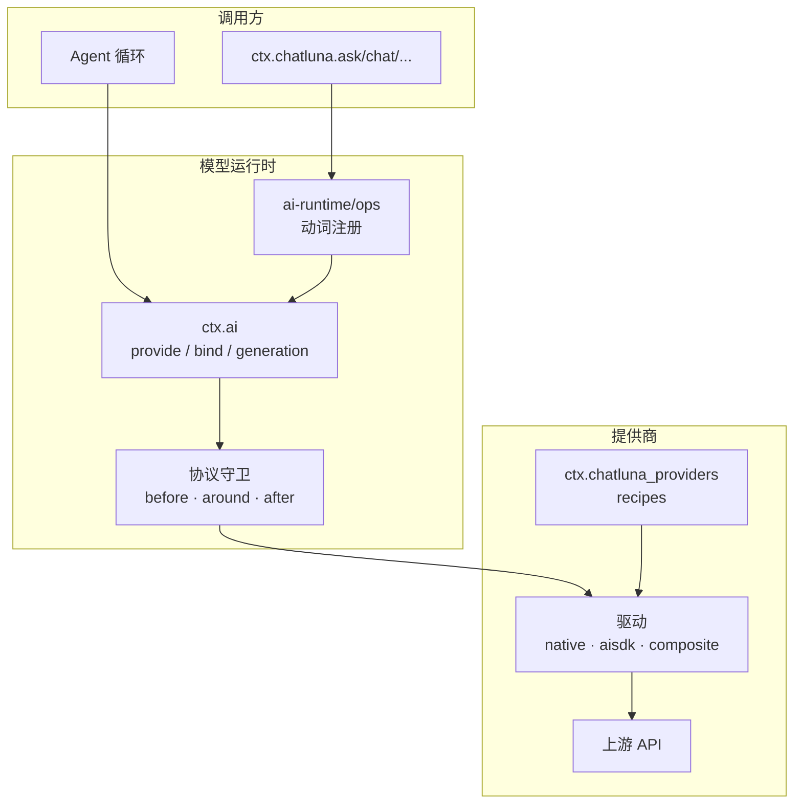

# 模型与请求运行时

在接入模型时，我们需要先确认提供商 (Provider) 登记、模型地址、协议支持与模型能力，再进一步排查上层 Agent 的逻辑。需要注意的是，模型列表中出现了某个名称，并不代表对应的 API 密钥、调用额度与工具调用能力已经顺利通过远端验证。

模型运行时的核心调用链路如下：



## 理解三层接口与七种模态

为了兼顾灵活性与易用性，ChatLuna 将模型操作划分为三个层次，自底向上逐层提供能力：

| 层次 | 对应包 / 服务 (Service) | 职责 |
| --- | --- | --- |
| 模型契约 | `@chatluna/ai` | 定义与 Cordis 无关的消息结构、分片、能力集合和模型接口 |
| 模型运行时 | `@chatluna/ai-runtime` / `ctx.ai` | 注册提供方、解析模型地址、绑定代次、管理拦截器与协议守卫 |
| 易用动词 | `@chatluna/ai-runtime/ops` / `ctx.chatluna` | 提供 `ask`、`chat`、`extract` 及其他模态的便捷调用方法 |

::: tip
`@chatluna/core` 仅提供了高阶动词的类型挂载点，实际执行逻辑是由 `@chatluna/ai-runtime/ops` 插件在加载时注入的。因此，上下文中存在 `ctx.chatluna` 对象并不意味着所有高阶动词均已就绪。
:::

在此基础上，运行时一共支持以下七种模态 (Modality)。不同提供商支持的模态各有不同，调用前请务必确认驱动能力：

| 模态 | 适用场景 | 常用动词 |
| --- | --- | --- |
| `chat` | 文本对话、多模态输入交互及工具调用声明 | `ask`、`chat`、`extract` |
| `embed` | 文本向量表示计算 | `embed` |
| `rerank` | 检索文档的相关性重排 | `rerank` |
| `draw` | 图像生成 | `draw` |
| `speak` | 语音合成 (TTS) | `speak` |
| `listen` | 语音识别 (STT) | `listen` |
| `decide` | 针对当前上下文状态执行结构化判定 | `decide`、`decideOne`、`judge` |

::: warning
`decide` 是具备独立契约的结构化判定模态，不能将其直接作为常规 `chat` 模型的别名使用。
:::

## 解析模型地址与角色

在 ChatLuna 中定位一个模型，采用的是统一的模型地址格式与角色 (Role) 映射机制：

- **精确地址**：采用 `provider:model` 格式定位。其中 `provider` 为系统内的实例登记名，不一定等同于远端厂商名称。
- **角色解析**：形如 `@chat`、`@small`、`@medium`、`@large`、`@decide` 的标识符由角色解析器解析为具体的精确地址。解析器支持链式解析，并内置了循环引用检查。
- **无前缀别名**：未声明 `provider:` 前缀的名称会按别名 (Alias) 处理，或在当前仅存在唯一提供商时由解析器自动推断。当存在命名歧义时，必须显式提供完整精确地址。

::: warning
`@small`、`@medium`、`@large` 和 `@decide` 是记忆提取、路由判定与子代理等模块可能引用的内置角色，它们并不是系统安装后自动配置好的模型。请在管理界面或配置中检查这些角色的实际解析目标与回退策略；仅登记新的提供商不会自动切换已有会话的模型归属。
:::

## 注册提供商与绑定代次

当我们需要向运行时注入模型驱动时，可以通过 `ctx.ai.provide()` 完成注册：

```ts
import { Context } from 'cordis'

export function apply(ctx: Context) {
  // 注册自定义提供商实例
  const handle = ctx.ai.provide('custom-provider', myProviderInstance)

  // 如需在运行时更新或主动注销，可使用 handle
  // handle.replace(newProviderInstance)
  // handle.dispose()
}
```

在生命周期方面，注册操作直接归属于调用方的上下文纤程 (Fiber)。当插件卸载或触发热重载 (HMR) 时，系统会自动清理该上下文所注册的提供商实例，无需手动编写清理逻辑。

### 晚绑定与固定代次

在底层机制上，`Model` 本质是一个晚绑定 (Late Binding) 句柄。只有在调用 `bind({ signal, scope })` 时，系统才会解析当前的提供方与对应能力，并将其锁定在当前代次：

- **单次执行**：`Bound.call` 只能执行一次。在同一个绑定对象上重复调用会直接抛出 `ProtocolError`。
- **配置隔离**：已绑定的调用在执行过程中不会被中途变更的提供商配置打断；只有新发起的 `bind()` 才会读取最新的注册表配置。
- **代次计数**：`ctx.ai.generation` 会随着全局注册表的变动而递增。它表示运行时内部的拓扑版本，而不是提示词缓存周期 (Epoch)，也不是远端模型的版本号。

## 执行单次模型调用 (Run)

在日常开发中，我们可以直接使用 `ctx.chatluna` 提供的动词发起直接模型调用。单次调用会返回一个 `Run` 对象：

```ts
import { Context } from 'cordis'

export async function askQuestion(ctx: Context) {
  // 发起单次问答调用
  const run = ctx.chatluna.ask({
    model: 'example:example-chat', // 使用精确地址（example 为占位登记名）
    prompt: '解释会话日志与消息视图的区别。',
    maxOutputTokens: 800,
  })

  // Run 实例支持直接 await，也可以异步迭代流式读取 run.stream
  const result = await run

  console.log('回复文本：', result.text)
  console.log('结束原因：', result.finish)

  // 如需中断调用，可调用 run.abort()
}
```

值得一提的是，`Run` 对象内部带有广播缓冲机制，不同消费者订阅流输出时不会竞争夺取分片，大家都能完整读取到流内容。

::: warning 单次调用不等于 Agent
`ask`、`chat` 与 `extract` 均为底层的单次调用：
1. **工具不自动循环**：底层调用不会自动执行工具循环。若在参数中仅传入 `tools: ['toolName']`，该层无法读取上层工具注册表，只会生成最小化的 `ToolSpec` 并返回 `tool-spec-unresolved` 警告。如需传递完整模式，请显式提供 `toolSpecs`。
2. **多步执行依赖 Agent**：`ChatOptions.stopWhen` 只能由 Agent 循环消费，不会使底层的单次 `chat` 调用自动扩展为多步执行。
3. **缺少会话上下文**：底层调用不会自动继承路由机制、预设模板 (Preset)、权限校验主体或持久化会话。需要自动执行工具和多轮决策时，请使用 Agent。
:::

## 处理调用生命周期与失败边界

每次请求在运行时内部都会经历一条清晰的执行管道：

```text
resolve / bind → before 拦截器 → around 拦截器 → 协议守卫与提供方 → after 拦截器
```

各阶段的具体职责与错误边界规定如下：

- **`before` 阶段**：用于动态修正请求参数或向下兼容能力降级。若 `resolve`、`bind` 或 `before` 执行失败，错误将直接向调用方抛出。
- **`around` 阶段**：用于承载重试策略、缓存查找或用量计费账本。
- **提供方执行阶段**：由协议守卫 (Protocol Guard) 监控底层的流闭合、终态唯一性、用量 (Usage) 报告顺序以及空闲超时。
  - `idleTimeoutMs` 默认配置为 `180000`（毫秒）。若设为 `0` 则表示关闭空闲超时检查。注意：该参数仅约束流传输中数据块之间的空闲间隔，而非整个请求的总耗时上限。
  - 流式 `chat` 的异常会被归一化为 `finish` 数据分片输出，其终态原因字段为 `reason.kind = 'error'`；调用方主动取消时为 `'aborted'`。
  - 非 `chat` 模态的底层错误会直接以 `ModelError` 形式 Reject。
- **`after` 阶段**：用于指标采集、结果归一化与链路观测。`after` 内部的执行失败会被隔离并触发警告日志，不会破坏已经返回的结果。

::: danger
在消费流式数据时，流正常闭合并不代表业务执行成功。请始终检查分片中 `finish.reason.kind` 的值，不能仅依赖 `on('end')` 判断调用状态。拦截器自身的代码异常也不会被提供商守卫静默忽略。
:::

## 配置 AI SDK 与复合提供商

`@chatluna/provider-aisdk` 统一适配了 Vercel AI SDK 驱动生态。系统采用按需加载机制，只载入特定的提供商包，并不会在安装时引入所有厂商的冗余依赖。

### 基础驱动配置

在配置 AI SDK 提供商时，通常需要填写以下核心属性：

- `id`：提供商在当前运行时的唯一登记名
- `packageName`：对应的驱动包名
- `factoryName`：工厂函数名称
- `apiKey`：访问凭据
- `baseURL`：上游接口基础地址
- `settings`：传递给底层 SDK 实例的附加设置项

::: warning
当在配置中通过 `$credential` 引用凭据时，该引用仅在配置加载边界 (Loader) 完成解密与取值注入。这并不意味着系统在所有链路中都会自动对所有数据做全密态处理。
:::

### 协议差异与复合模式 (Composite Recipe)

常见的上游通信协议包括 `Responses`、`Chat Completions`、`Anthropic` 与 `Gemini`。服务的基础 URL 可连通，并不说明协议匹配正确。原生工具调用延迟、响应压缩、思考推理内容以及媒体 URL 解析，均需以驱动实际声明的能力为准。

如果你需要更灵活地组织接口，可以使用复合模式 (`composite recipe`)，在单个登记名下聚合不同的协议端点：

- 可以在同一提供商实例下分别配置 `chat`、`responses`、`anthropic`、`gemini` 与 `decide` 等不同子端点。
- 支持按模型名称粒度覆盖请求格式与参数。
- 手动维护的模型列表优先级高于上游接口的目录动态刷新，手动配置项不会被目录拉取操作覆盖。

::: danger
当在复合模式或 SDK 配置中显式提供了模型列表时，初始化安装流程 (Setup) 会跳过上游连通性与模型探测。因此，界面提示「保存成功」仅代表配置项结构合法，并不代表密钥或网络已经通过验证。必须通过发起实际模型调用来完成最终验证。模型目录中展示的单价与上下文窗口亦不作为连通性检测依据。
:::

当安装依赖失败时，回滚范围仅限于本次安装过程涉及的新增配置项和当前包，不会逆向撤销此前的外部操作。此外，当更新已载入内存的 SDK 依赖后，必须重启应用实例，不能依赖 Node.js 模块缓存的热重载。

## 核对用量与排查故障

### 用量 (Usage) 归一化口径

系统将 Token 划分为五类：未缓存输入、缓存读取、缓存写入、输出 Token 与推理 Token。

在归一化 AI SDK v3/v4 的 Usage 数据时，系统按照以下口径进行计算：
- `inputTokens` 仅代表**未缓存输入**：计算时优先读取上游明确返回的 `noCache` 字段；若无该字段，则从上游的 `total` 中减去缓存读取与写入量。这并不表示上游原始给出的 Total 计数不包含缓存。
- `outputTokens` 的统计值在归一化后可能已包含推理部分。请勿将返回的 `reasoningTokens` 再次与 `outputTokens` 叠加。
- 上游未返回的缺失字段在运行时中保持缺失状态，系统不会将其虚构为数字 `0`。用量计价估算基于预设目录，最终花费请以提供商后台账单为准。

### 排查故障的标准路径

当模型调用未达预期时，建议按照以下顺序由浅入深逐层排查：

1. **检查精确地址**：确认解析后的 `provider:model` 格式是否准确无误。
2. **核对登记状态**：在控制台中确认对应的 `provider` 是否已正确注册且上下文仍处于激活状态。
3. **确认通信协议**：检查提供商配置中的协议类型是否与上游端点真实协议匹配（例如不要把 Responses 协议端点配置为 Chat Completions）。
4. **验证凭据与额度**：确认 API 密钥有效且账户未欠费。认证失败 (`AUTH`) 不等于模型不存在，重试机制无法修复欠费导致的调用中断。
5. **核查模型能力声明**：确认所调用的模型是否支持当前模态（如是否支持嵌入、结构化提取或视觉解析）。
6. **检查警告信息**：排查返回结果中的 `warning` 列表（例如是否存在 `tool-spec-unresolved`）。
7. **检查终态状态**：检查流结果的 `finish.reason.kind` 是否为 `error` 或 `aborted`。
8. **排查 Agent 循环**：若底层单次调用正常，检查上层 Agent 的工具编排逻辑、`stopWhen` 条件与上下文截断规则。

## 下一步

到这里，你已经掌握了模型运行时与底层调用的核心工作机制。接下来可以继续阅读：

- [配置模型](/manual/usage/models)：在图形界面中添加模型提供商并映射基础角色。
- [上下文管理](/architecture/context-cache)：了解多轮对话上下文缓存与修剪策略。
- [Agent 架构](/architecture/agents)：基于运行时单次调用构建可自动调度工具的多步 Agent 循环。
