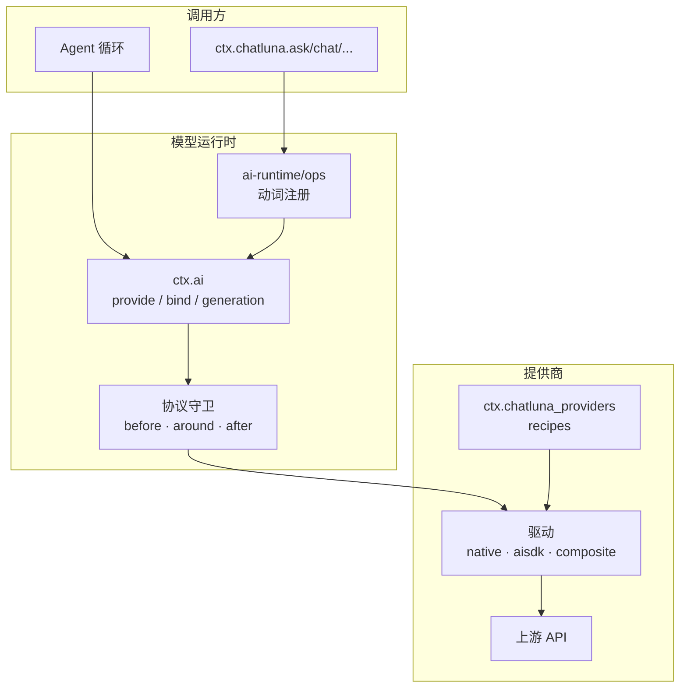

# 模型与请求运行时

::: tip
接入模型出问题时，先确认提供商（Provider）登记、模型地址、协议和模型能力，再去查上层 Agent。模型列表里显示了某个名称，不代表密钥、额度和工具调用能力已经通过远端验证。
:::



## 三层接口与七种模态

| 层次 | 对应包 / 服务 (Service) | 职责 |
| --- | --- | --- |
| 模型契约 | `@chatluna/ai` | 定义与 Cordis 无关的消息结构、分片、能力集合和模型接口 |
| 模型运行时 | `@chatluna/ai-runtime` / `ctx.ai` | 注册提供商、解析模型地址、绑定代次、管理拦截器与协议守卫 |
| 易用动词 | `@chatluna/ai-runtime/ops` / `ctx.chatluna` | 提供 `ask`、`chat`、`extract` 等高频调用的便捷封装 |

::: tip
`@chatluna/core` 只提供动词的类型挂载点，实际逻辑由 `@chatluna/ai-runtime/ops` 加载时注入。有 `ctx.chatluna` 不代表所有动词都已就绪。
:::

不同提供商支持的模态不同，调用前确认驱动能力：

| 模态 | 适用场景 | 常用动词 |
| --- | --- | --- |
| `chat` | 文本对话、多模态输入交互及工具调用声明 | `ask`、`chat`、`extract` |
| `embed` | 文本向量表示计算 | `embed` |
| `rerank` | 检索文档的相关性重排 | `rerank` |
| `draw` | 图像生成 | `draw` |
| `speak` | 语音合成 (TTS) | `speak` |
| `listen` | 语音识别 (STT) | `listen` |
| `decide` | 针对当前上下文状态执行结构化判定 | `decide`、`decideOne`、`judge` |

::: warning
`decide` 是有独立契约的结构化判定模态，不是 `chat` 模型的别名。
:::

## 模型地址与角色

- **精确地址**：`provider:model`。`provider` 是系统内的登记名，不一定等于厂商名。
- **角色**：`@chat`、`@small`、`@medium`、`@large`、`@decide` 由角色解析器解析为精确地址，支持链式解析并检查循环引用。
- **无前缀别名**：没有 `provider:` 前缀的名称按别名处理；只有一个提供商时自动推断，有歧义时必须写完整地址。

::: warning
`@small`、`@medium`、`@large`、`@decide` 会被记忆提取、路由判定、子代理等模块引用，但安装后并不会自动配置好。在管理界面检查它们的解析目标和回退策略。登记新提供商不会自动改变已有会话的模型。
:::

## 注册提供商与绑定代次

```ts
import { Context } from 'cordis'

export function apply(ctx: Context) {
  // 注册自定义提供商实例
  const handle = ctx.ai.provide('custom-provider', myProviderInstance)

  // 如需在运行时更新或主动注销，可使用 handle
  // handle.replace(newProviderInstance)
  // handle.dispose()
}
```

注册归属于调用方的纤程（Fiber），插件卸载或热重载时自动清理。

`Model` 是晚绑定（Late Binding）句柄，调用 `bind({ signal, scope })` 时才解析当前的提供商和能力，并锁定在当前代次：

- **单次执行**：`Bound.call` 只能调用一次，重复调用抛出 `ProtocolError`。
- **配置隔离**：执行中的调用不受中途的提供商配置变更影响，只有新的 `bind()` 读取最新配置。
- **代次计数**：`ctx.ai.generation` 随注册表变动递增，表示运行时内部的拓扑版本，不是提示词缓存的 Epoch，也不是远端模型版本。

## 单次调用（Run）

```ts
import { Context } from 'cordis'

export async function askQuestion(ctx: Context) {
  // 发起单次问答调用
  const run = ctx.chatluna.ask({
    model: 'example:example-chat', // 使用精确地址（example 为占位登记名）
    prompt: '解释会话日志与消息视图的区别。',
    maxOutputTokens: 800,
  })

  // Run 实例支持直接 await，也可以异步迭代流式读取 run.stream
  const result = await run

  console.log('回复文本：', result.text)
  console.log('结束原因：', result.finish)

  // 如需中断调用，可调用 run.abort()
}
```

`Run` 内部有广播缓冲，多个消费者订阅流时不会争抢分片，都能读到完整内容。

::: warning 单次调用不等于 Agent
1. **工具不自动循环**：只传 `tools: ['toolName']` 时，这一层读不到工具注册表，只生成最小化的 `ToolSpec` 并返回 `tool-spec-unresolved` 警告。需要完整结构就显式传 `toolSpecs`。
2. **多步依赖 Agent**：`ChatOptions.stopWhen` 只由 Agent 循环消费，不会让单次 `chat` 变成多步执行。
3. **没有会话上下文**：不继承路由、预设、权限主体或持久化会话。需要自动执行工具和多轮决策时用 Agent。
:::

## 调用生命周期

```text
resolve / bind → before 拦截器 → around 拦截器 → 协议守卫与提供方 → after 拦截器
```

- **`before`**：修正参数或做能力降级。`resolve`、`bind` 或 `before` 失败时直接抛给调用方。
- **`around`**：承载重试、缓存或用量计费。
- **提供方执行**：协议守卫（Protocol Guard）监控流闭合、终态唯一性、用量报告顺序和空闲超时。
  - `idleTimeoutMs` 默认 `180000` 毫秒，`0` 表示关闭。它约束的是数据块之间的空闲间隔，不是请求总时长。
  - 流式 `chat` 的异常归一化为 `finish` 分片，`reason.kind = 'error'`；调用方取消时为 `'aborted'`。
  - 非 `chat` 模态的错误直接以 `ModelError` reject。
- **`after`**：指标采集、结果归一化和观测。失败只记警告，不影响已返回的结果。

::: danger
流正常闭合不代表成功，始终检查 `finish.reason.kind`，不要只靠 `on('end')`。拦截器自身的异常也不会被守卫静默吞掉。
:::

## AI SDK 与复合提供商

`@chatluna/provider-aisdk` 适配 Vercel AI SDK 驱动生态，按需加载单个提供商包，不会一次装上所有厂商的依赖。

基础配置：

- `id`：运行时中的唯一登记名
- `packageName`：驱动包名
- `factoryName`：工厂函数名
- `apiKey`：访问凭据
- `baseURL`：上游基础地址
- `settings`：传给底层 SDK 的附加设置

::: warning
`$credential` 引用只在配置加载边界（Loader）解密注入，不代表系统在所有链路中都做全密态处理。
:::

**协议差异**：常见协议有 `Responses`、`Chat Completions`、`Anthropic`、`Gemini`。URL 能连通不代表协议配对正确。原生工具调用延迟、响应压缩、思考内容和媒体 URL 解析，都以驱动实际声明的能力为准。

**复合模式**（`composite recipe`）在一个登记名下聚合不同协议的端点：

- 同一实例下分别配置 `chat`、`responses`、`anthropic`、`gemini`、`decide` 等子端点。
- 可以按模型名覆盖请求格式和参数。
- 手动维护的模型列表优先于上游目录刷新，不会被覆盖。

::: danger
显式提供模型列表时，安装流程（Setup）会跳过连通性与模型探测，「保存成功」只代表配置结构合法，不代表密钥或网络可用，必须实际调用一次来验证。目录中的单价和上下文窗口也不能作为连通性依据。
:::

依赖安装失败时，只回滚本次新增的配置项和当前包，不撤销之前的外部操作。更新已加载的 SDK 依赖后必须重启实例，Node.js 模块缓存无法热重载。

## 用量与排查

Token 分为五类：未缓存输入、缓存读取、缓存写入、输出、推理。归一化 AI SDK v3/v4 的 Usage 时：

- `inputTokens` 只表示**未缓存输入**：优先读上游的 `noCache`；没有时从上游 `total` 中减去缓存读写量。这不代表上游原始 total 不含缓存。
- `outputTokens` 归一化后可能已经包含推理部分，不要再与 `reasoningTokens` 相加。
- 上游没给的字段保持缺失，不会补成 `0`。计价估算基于预设目录，实际花费以厂商账单为准。

排查顺序：

1. **精确地址**：解析后的 `provider:model` 是否正确。
2. **登记状态**：`provider` 是否已注册且上下文仍然激活。
3. **通信协议**：配置的协议是否与上游一致（不要把 Responses 端点配成 Chat Completions）。
4. **凭据与额度**：密钥有效、账户没欠费。`AUTH` 失败不等于模型不存在，重试修不好欠费。
5. **能力声明**：模型是否支持当前模态（嵌入、结构化提取、视觉等）。
6. **警告**：结果中的 `warning`，例如 `tool-spec-unresolved`。
7. **终态**：`finish.reason.kind` 是否为 `error` 或 `aborted`。
8. **Agent 循环**：单次调用正常时，再查 Agent 的工具编排、`stopWhen` 和上下文截断。

## 下一步

- [配置模型](/manual/usage/models) — 在界面中添加提供商并分配角色。
- [上下文管理](/architecture/context-cache) — 多轮上下文缓存与修剪。
- [Agent 架构](/architecture/agents) — 基于单次调用构建多步 Agent 循环。
