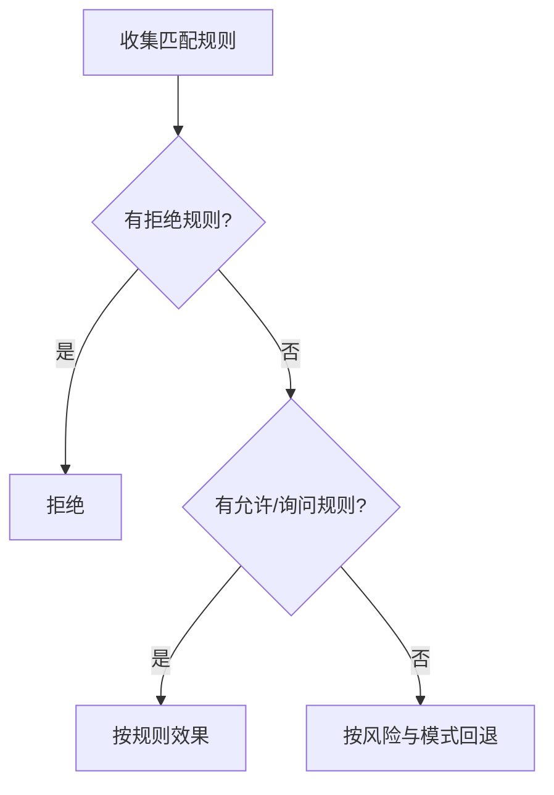

# 权限与审批

::: tip
权限系统回答一个问题：**这次动作凭什么让它发生？** 它不是一个布尔开关，而是由用户等级、权限模式、显式规则、风险评级和人工审批五层共同裁决。每次操作都拆成几个维度分别评估：谁在请求、做什么、作用于什么目标、有多大风险。
:::

<!-- 架构页，可以使用代码与配置示意 -->

## 判定输入

| 字段 | 含义 |
| --- | --- |
| `subject` | 谁在请求：平台、用户、群、频道、路由 |
| `name` | 动作名，例如读文件、写文件、执行命令 |
| `target` | 作用目标，例如路径、命令、机器名 |
| `parts` | 复合动作的分解，例如脚本里的多条命令 |
| `risk` | 调用方声明的风险等级 |
| `mode` | 当前会话的权限模式 |
| `turn` / `session` | 用于「只记住一轮」或「只记住这个会话」的授权 |

`subject` 不是单独的用户 ID，而是「平台 + 用户 + 群 + 频道 + 路由」的组合：同一个用户在群聊和私聊、面对不同机器人时，权限都可能不同。

## 等级

等级是 0 到 5 的整数，描述用户大致能做什么。取以下来源中的**最高值**：

- **主人列表**：5 级。
- **平台身份**：群主 4 级，管理员 3 级，普通成员 1 级。
- **自定义角色**：角色声明等级，可以继承其他角色。
- **手动指定**：在权限管理页面单独设置。

等级不是免检凭据，而是裁决的基线：它决定会话的默认模式，也决定能否申请高危动作。

::: tip
0 级表示被明确限制，和「没配置过」不同：显式标记为 0 级的用户，即使命中放行规则也不会被提权。
:::

## 模式

| 模式 | 读 | 写 | 执行 |
| --- | --- | --- | --- |
| 只读 | 允许 | 拒绝 | 1 级询问，其余拒绝 |
| 文件 | 允许 | 允许（越界或带风险时询问） | 拒绝 |
| 自动 | 询问 | 询问 | 询问，安全时由审查器放行 |
| 放行 | 允许 | 允许 | 允许，危险动作仍询问 |

模式来自多个层级，合并时**取更严格者**：

1. 路由规则中的模式。
2. 调用方传入的模式（如引擎或预设的默认值）。
3. 插件配置的默认模式。
4. 用户等级对应的模式：

| 等级 | 默认模式 |
| --- | --- |
| 0 ~ 2 | 只读 |
| 3 ~ 4 | 自动 |
| 5 | 放行 |

「放行」只对 5 级真正生效。低于 5 级的用户因配置被分到放行模式时，运行时按「自动」处理，防止配置失误让普通用户获得全放行。

## 风险

风险是调用方根据运行参数动态声明的，而不是按工具名写死。例如读取普通配置文件是普通操作，删除系统目录则是高危。

- **review**：读写的快速判断不适用，交给模式决定。
- **dangerous**：即使在放行模式下也要审查。
- **critical**：只有 3 级及以上才能申请，始终需要人工确认，允许规则无效。

## 规则

规则是对默认行为的显式覆盖：

- **动作**：精确动作名，或带通配符的模式。
- **目标**：可选的参数匹配，例如路径前缀。
- **谁**：用户、角色、等级、群、会话、路由、Agent、平台。
- **效果**：允许、询问、拒绝。
- **有效期**：本次回合、本会话、指定时间点，或永久。
- **final**：是否短路后续规则。

- **拒绝优先**：任何拒绝规则命中，立即失败。
- **规则先于模式**：显式规则高于模式回退。
- **critical 忽略允许规则**：只能人工确认。
- **复合动作逐个判定**：任一部分被拒绝则整体拒绝，全部允许才算允许。

::: warning
一个脚本里有三条命令，前两条无害、第三条有风险，整体结论就是需要审批，不会按最宽松的那条放行。
:::

## 审批

判定为需要人工确认时，系统生成一个审批问题，包含动作名与目标、请求者、需要的授权等级、原因与上下文。

**谁来回答**：系统在当前环境中找一位等级足够的用户。所需等级取自动作声明的 `grant`，未声明时为 4 级。没有合适人选就轮询下一位候选人，都联系不上则按未批准处理。

| 回答 | 含义 |
| --- | --- |
| 这一次 | 只允许本次调用 |
| 本轮 | 本轮对话内允许同类调用 |
| 本会话 | 当前会话内允许 |
| 始终 | 记住这个选择 |
| 拒绝这一次 | 本次失败 |
| 永远不要 | 记住拒绝 |

「始终」和「永远不要」会固化为持久规则。

::: warning
「始终允许」只对相同的动作与目标生效，高危动作永远不受持久允许规则影响。
:::

### 审查器

「自动」模式下，低风险动作先交给审查模型（Reviewer）评估。它接收动作名、目标、风险、用户等级和最近的相关调用，给出「允许」或「需要人看」及置信度；置信度不足时升级为人工审批。默认使用决策角色模型，可以在路由规则中为特定场景指定。

::: tip
审查器能减少日常低风险操作的打扰，但不是安全边界。真正的边界是规则、等级门槛和高危操作的人工确认。
:::

## 内置动作

| 动作 | 描述 | 默认等级 | 授权等级 |
| --- | --- | --- | --- |
| `fs:read` | 读取文件 | 1 | 4 |
| `fs:write` | 写入文件 | 3 | 4 |
| `exec` | 执行命令 | 3 | 4 |
| `net:fetch` | 访问网络资源 | 1 | 4 |
| `skill:read` | 读取技能 | 1 | 4 |
| `skill:secrets` | 启用技能密钥 | 4 | 4（危险） |

插件可以注册自定义动作；机器、子代理后端等能力接入时也会带上各自的基线等级。

## 审计

每次判定都生成审计记录：动作、请求者、目标、效果、等级、由谁决定、会话信息。排查「为什么执行了这个操作」时先看审计记录，再结合调用轨迹。

## 与其他子系统的关系

- **工具**：只声明动作和风险，不自己判定。
- **场景规则**：为模式和规则提供作用域。
- **子代理**：不继承父会话的提权，每次调用重新判定，模式只会更严格。
- **定时任务**：无人值守时审批照常生效，无人响应按拒绝处理。
- **MCP**：外部工具与内置工具走完全相同的鉴权，没有特殊豁免。

## 常见问题

**明明有权限却被拒绝**：检查是否命中了拒绝规则、模式是否被路由规则或插件默认值收紧、动作是否被声明为高危。

**审批消息无人收到**：确认有等级足够的用户在线、审批通道已启用、审批超时不过短。

**点了「始终允许」还在询问**：持久规则严格按目标匹配，目标每次变化（如路径带时间戳）就无法命中。

**低等级用户执行了受限命令**：核对动作的基础等级，检查是否命中了宽松的允许规则，以及调用方是否低估了风险。

**子代理越权**：子代理不会继承提权，问题通常是动作等级声明偏低，或命中了不恰当的规则。

## 下一步

- [工具系统](./tools) — 了解动作是怎么声明的。
- [路由与场景规则](./routing) — 掌握模式与规则的作用域边界。
- [子代理](./subagent) — 了解子代理的独立权限与执行边界。
- [权限与安全](/manual/usage/permissions) — 面向管理员的配置方式。
