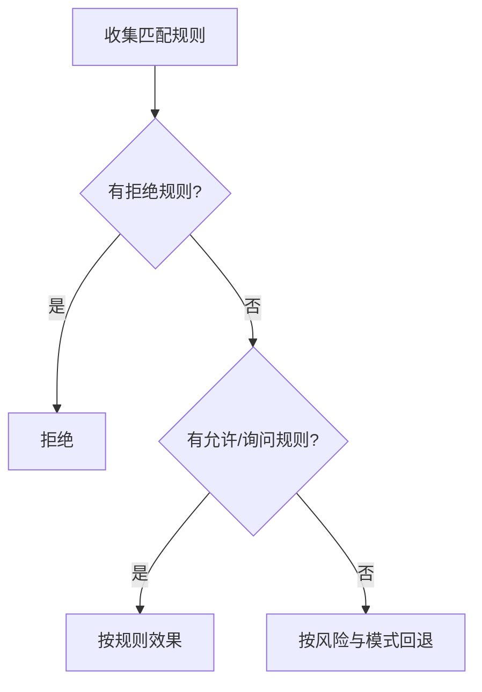

# 权限与审批

::: tip
权限系统回答一个问题：这次动作，凭什么让它发生？答案不是一个开关，而是等级、模式、规则、风险、审批五层叠加的结果。
:::

工具能读文件、能执行命令、能改配置。这些能力一旦放开，模型的一个幻觉就可能变成一次真实的破坏。

所以 ChatLuna 没有把「能不能做」简化成一个布尔值。

它把问题拆成了几个独立的部分：谁在请求、要做什么、作用在哪、有多危险，然后分别判定，最后汇成一个结论。

<!-- 架构页，可以使用代码与配置示意 -->

## 判定输入

一次权限判定的输入包含：

| 字段 | 含义 |
| --- | --- |
| `subject` | 谁在请求：平台、用户、群、频道、路由 |
| `name` | 动作名，例如读文件、写文件、执行命令 |
| `target` | 作用目标，例如路径、命令、机器名 |
| `parts` | 复合动作的分解，例如脚本里的多条命令 |
| `risk` | 调用方声明的风险等级 |
| `mode` | 当前会话的权限模式 |
| `turn` / `session` | 用于「只记住一轮」或「只记住这个会话」的授权 |

### subject 从哪来

它不是一个用户 ID，而是一组坐标。

同一个人，在群里和在私聊里可以有不同的等级；同一个群，不同的机器人账号也可能不同。所以判定时用的是「平台 + 用户 + 群 + 频道 + 路由」这套组合。

## 等级

等级是 0 到 5 的整数，表示「这个人大概能做什么」。

等级的来源有几种，取其中最高值：

- **主人列表**：直接是 5 级。
- **平台身份**：群主映射为 4，管理员映射为 3，普通成员映射为 1。
- **自定义角色**：角色自己声明等级，可以继承其他角色。
- **手动指定**：在权限页给某个用户单独设等级。

等级不是「通行证」，而是「默认值」。它决定默认模式，也决定某些高危动作能不能被申请。

::: tip
0 级是被明确限制的用户。

它和「没配置过的默认等级」不是一回事：配置过 0 级的用户，即使匹配到允许规则，也不会被提权。
:::

## 模式

等级之上有一层模式，决定这个会话的基础行为边界。

| 模式 | 读 | 写 | 执行 |
| --- | --- | --- | --- |
| 只读 | 允许 | 拒绝 | 1 级询问，其余拒绝 |
| 文件 | 允许 | 允许（越界或带风险时询问） | 拒绝 |
| 自动 | 询问 | 询问 | 询问，安全时由审查器放行 |
| 放行 | 允许 | 允许 | 允许，危险动作仍询问 |

模式有多个来源，按「取更严格者」合并：

1. 路由规则里配置的模式。
2. 调用方传入的模式（例如引擎或预设的默认）。
3. 插件配置的默认模式。
4. 用户等级对应的模式。

### 等级对应的默认模式

| 等级 | 默认模式 |
| --- | --- |
| 0 ~ 2 | 只读 |
| 3 ~ 4 | 自动 |
| 5 | 放行 |

### 放行的保留条款

「放行」只对 5 级用户真正生效。

低于 5 级的用户，即使被配置成放行，实际也会按「自动」处理。这是为了防止一次配置失误把所有用户都变成管理员。

## 风险

风险是调用方对「这个动作有多危险」的声明，分三档：

- **review**：读写的快速判断不适用，交给模式决定。
- **dangerous**：即使在放行模式下也要审查。
- **critical**：只有 3 级及以上能申请，而且永远需要人工确认，允许规则无效。

风险不是按工具名写死的，而是工具根据参数动态声明。

同一个文件工具，读配置文件可能只是普通操作，删系统目录就是高危。

## 规则

规则是对默认行为的显式覆盖。

一条规则包含：

- **动作**：精确动作名，或带通配符的模式。
- **目标**：可选的参数匹配，例如路径前缀。
- **谁**：用户、角色、等级、群、会话、路由、Agent、平台。
- **效果**：允许、询问、拒绝。
- **有效期**：本次回合、本会话、指定时间点，或永久。
- **final**：是否短路后续规则。

### 判定顺序

几条固定约束：

- 拒绝优先。任何一条拒绝规则命中，请求立即失败。
- 规则先于模式。显式规则压过模式回退。
- 高危动作忽略允许规则。critical 只能走到人工确认。
- 复合动作逐个判定。任何一个部分被拒绝，整体拒绝；全部允许才算允许。

::: warning
「全部允许才算允许」这条很容易被忽略。

一个脚本里三条命令，前两条无害、第三条危险，整体结论仍然是需要审批——而不是按最宽松的那条放行。
:::

## 审批

当结论是「需要人工确认」时，系统会生成一个问题。

问题里包含：

- 动作名与目标。
- 请求者。
- 需要的授权等级。
- 原因与上下文。

### 谁来回答

系统会找一位等级足够的人来回答。

默认需要的授权等级是动作声明里的 grant（没有声明时是 4 级）。

如果当前没有合适的人，问题会依次转给下一位候选人；都联系不上，就按未批准处理。

### 答案

| 回答 | 含义 |
| --- | --- |
| 这一次 | 只允许本次调用 |
| 本轮 | 本轮对话内允许同类调用 |
| 本会话 | 当前会话内允许 |
| 始终 | 记住这个选择 |
| 拒绝这一次 | 本次失败 |
| 永远不要 | 记住拒绝 |

「始终」和「永远不要」会变成持久规则，参与后续判定。

::: warning
「始终允许」不等于无限制。

它只对同等的动作与目标生效，而且高危动作永远不受它影响。
:::

### 审查器

「自动」模式不是直接放行，而是由一个审查模型判断。

审查器看到一个结构化描述：动作、目标、风险、等级、最近的相关调用。它回答「允许」或「需要人看」，并给出置信度。

置信度不够时，仍然升级为人工审批。

审查器的模型默认是决策角色；可以在路由里为某个场景单独指定。

::: tip
审查器能显著减少低风险操作的打扰，但它不是安全边界。

真正的边界是规则、等级与高危动作的人工确认。不要把「审查器说可以」当成免检证明。
:::

## 内置动作

系统预置了一些动作定义：

| 动作 | 描述 | 默认等级 | 授权等级 |
| --- | --- | --- | --- |
| `fs:read` | 读取文件 | 1 | 4 |
| `fs:write` | 写入文件 | 3 | 4 |
| `exec` | 执行命令 | 3 | 4 |
| `net:fetch` | 访问网络资源 | 1 | 4 |
| `memory:read` | 读取记忆 | 1 | 4 |
| `memory:write` | 写入记忆 | 3 | 4 |
| `skill:secrets` | 启用技能密钥 | 4 | 4（危险） |

插件可以注册自己的动作。机器、子代理后端这类能力注册时也会带上自己的等级。

## 审计

每次判定都会留下一条记录：动作、请求者、目标、效果、等级、由谁决定、会话。

记录是排错和复盘的基础。出现「为什么它做了这件事」时，先看审计记录，再看轨迹。

## 与其他子系统的关系

**工具**声明动作，不自己判定。

**场景规则**提供模式与规则的作用域。

**子代理**不继承父会话的权限提升，每次调用重新判定，而且模式只会更严格，不会更宽松。

**定时任务**在无人值守时执行，审批同样生效；没人回答就按拒绝处理。

**MCP** 工具与内置工具走同一套流程，不因为来自外部而获得豁免。

## 排查

**明明有权限却被拒绝。**

检查是否有明确的拒绝规则；检查模式是否被更严格的来源覆盖；检查动作是否被声明为高危。

**审批没人收到。**

确认有等级足够的用户在线；确认审批通道（聊天、控制台）已启用；确认超时时间合理。

**点了「始终允许」还是问。**

检查动作目标是否每次都不同（例如带时间戳的路径）。记住的规则按目标匹配，目标变了就不匹配。

**低等级用户能执行命令。**

先确认该动作的等级要求；再确认是否匹配到了允许规则；最后确认调用方声明的风险等级是否被低估。

**子代理绕过了限制。**

子代理不会继承父会话的权限提升。它用自己的模式，且只会更严格。如果它确实执行了不该执行的动作，问题多半在动作声明或规则匹配上。

## 下一步

- [工具系统](./tools) — 动作是怎么声明的。
- [路由与场景规则](./routing) — 模式与规则的作用域。
- [子代理](./subagent) — 子代理的权限边界。
- [权限与安全](/manual/usage/permissions) — 面向管理员的配置方式。
