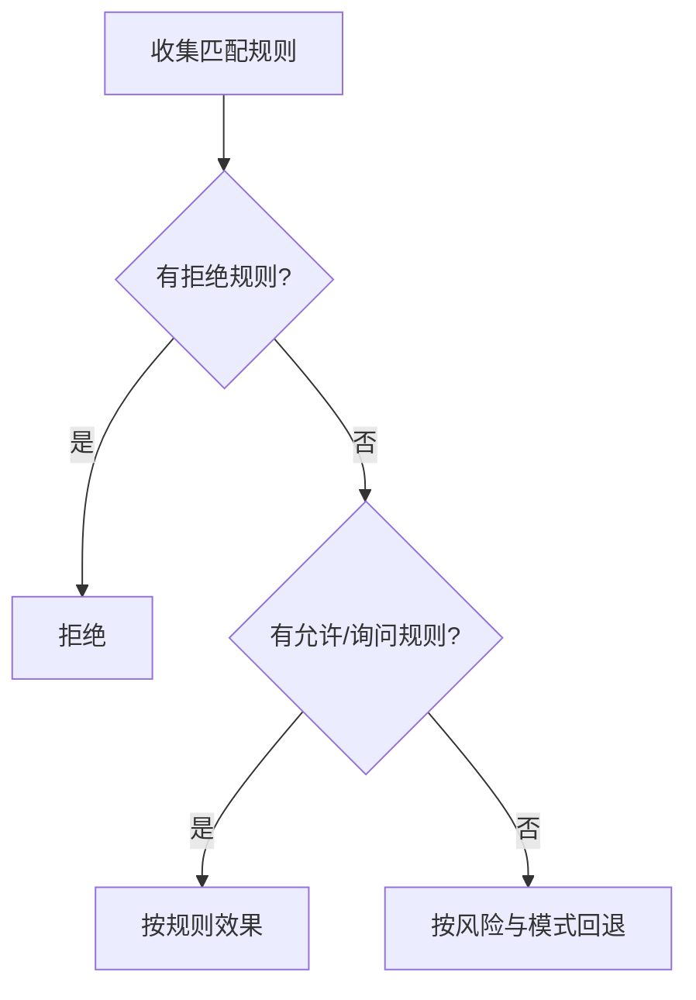

# 权限与审批

::: tip
权限系统回答的核心问题是：**这次动作，凭什么让它发生？** 在 ChatLuna 中，鉴权并非一个简单的布尔值开关，而是用户等级、权限模式、显式规则、风险评级与人工审批五层机制共同裁决的结果。
:::

读写文件、执行 Shell 命令、修改系统配置——当大语言模型接入各类外部工具后，能力的边界被极大拓宽。然而，一旦缺乏严密的安全兜底，模型的一次轻微「幻觉」就可能转变为不可逆的破坏。

为了解决这一问题，ChatLuna 没有将「能不能做」简化为一个简单的权限开关。

系统将每次操作请求拆分为多个独立的判定维度：谁在发起请求、要做什么动作、作用于什么目标，以及该动作蕴含多大的风险。运行时对这些维度分别进行评估，最终综合决策出执行结论。

<!-- 架构页，可以使用代码与配置示意 -->

## 判定输入

一次完整的权限判定，依赖于以下几项核心输入：

| 字段 | 含义 |
| --- | --- |
| `subject` | 谁在请求：平台、用户、群、频道、路由 |
| `name` | 动作名，例如读文件、写文件、执行命令 |
| `target` | 作用目标，例如路径、命令、机器名 |
| `parts` | 复合动作的分解，例如脚本里的多条命令 |
| `risk` | 调用方声明的风险等级 |
| `mode` | 当前会话的权限模式 |
| `turn` / `session` | 用于「只记住一轮」或「只记住这个会话」的授权 |

### subject 从哪来

`subject` 并不是一个孤立的用户 ID，而是一组由环境上下文构成的「复合坐标」。

同一个人在群聊和私聊中可能具备完全不同的权限；同一个群聊面对不同的机器人账号，权限策略也可能不同。因此，系统在鉴权时会综合「平台 + 用户 + 群 + 频道 + 路由」这套多维组合，精确锁定调用主体。

## 等级

等级是一个取值范围在 0 到 5 之间的整数，用于描述「当前用户大致能做哪些事」。

用户的等级可以从以下几个来源获取，在计算时**取其中的最高值**：

- **主人列表**：直接赋予 5 级。
- **平台身份**：群主映射为 4，管理员映射为 3，普通成员映射为 1。
- **自定义角色**：角色自身声明等级，可以继承其他角色。
- **手动指定**：在权限管理页面单独为某个用户指派等级。

需要注意的是，等级并不是一票通行的「通行证」，而是权限裁决时的「基线默认值」。它不仅决定了会话的默认模式，也划定了申请高危动作的门槛。

::: tip
0 级是被明确限制权限的用户。

它与「未曾配置过的默认等级」有着本质区别：一旦用户被显式标记为 0 级，即使后续匹配到了允许放行的规则，系统也不会对其提权。
:::

## 模式

等级之上是会话级的权限模式，它划定了当前会话最基础的行为边界。

| 模式 | 读 | 写 | 执行 |
| --- | --- | --- | --- |
| 只读 | 允许 | 拒绝 | 1 级询问，其余拒绝 |
| 文件 | 允许 | 允许（越界或带风险时询问） | 拒绝 |
| 自动 | 询问 | 询问 | 询问，安全时由审查器放行 |
| 放行 | 允许 | 允许 | 允许，危险动作仍询问 |

权限模式可能来自多个层级，系统按**取更严格者**的原则进行合并：

1. 路由规则里配置的模式。
2. 调用方传入的模式（例如特定引擎或预设自带的默认值）。
3. 插件配置项中指定的默认模式。
4. 当前用户等级所对应的模式。

### 等级对应的默认模式

不同等级用户进入会话时，对应的默认权限模式如下：

| 等级 | 默认模式 |
| --- | --- |
| 0 ~ 2 | 只读 |
| 3 ~ 4 | 自动 |
| 5 | 放行 |

### 放行的保留条款

细心的小伙伴可能会注意到，「放行」模式实际上只对 5 级用户真正生效。

当低于 5 级的用户由于配置原因被分配到放行模式时，系统在运行时会自动按「自动」模式处理。这项保留条款旨在建立安全底线，防止因一次配置失误，导致普通用户误获全放行的超级管理权限。

## 风险

风险是调用方对「本次操作有多危险」的主动声明，共分为三档：

- **review**：读写的快速判断不适用，交给模式决定。
- **dangerous**：高危操作，即使在放行模式下也要经过审查。
- **critical**：最高风险等级。只有 3 级及以上能申请，而且永远需要人工确认，允许规则无效。

动作的风险等级并非按工具名写死，而是由工具根据传入的运行参数动态声明。

例如同为文件工具，读取常规配置文件属于普通操作，而删除系统目录则会被标记为高危行为。

## 规则

规则是对默认行为的显式覆盖，能够针对特定上下文定制放行或拦截策略。

一条完整的规则包含以下属性：

- **动作**：精确动作名，或带通配符的模式。
- **目标**：可选的参数匹配，例如路径前缀。
- **谁**：规则的作用主体，包括用户、角色、等级、群、会话、路由、Agent、平台。
- **效果**：允许、询问、拒绝。
- **有效期**：本次回合、本会话、指定时间点，或永久。
- **final**：是否短路后续规则判定。

### 判定顺序

当发起权限鉴权时，系统的决策流转过程如下：

在执行决策时，系统遵守以下几条固定约束：

- **拒绝优先**：任何一条拒绝规则命中，请求立即失败。
- **规则先于模式**：显式规则的效力高于模式回退逻辑。
- **高危动作忽略允许规则**：被声明为 `critical` 的动作只能交由人工确认，允许规则对其无效。
- **复合动作逐个判定**：复合操作中的每一个部分都会单独判定，任何一个部分被拒绝则整体拒绝；全部允许才算允许。

::: warning
「全部允许才算允许」在复合动作中是一条很容易被忽视的约束。

如果在单个脚本任务中包含三条命令，即使前两条完全无害，只要第三条存在风险，整体结论依然是需要审批——而绝不会按最宽松的那条指令放行。
:::

## 审批

当权限系统的判定结论为「需要人工确认」时，系统会生成一个交互式审批问题。

审批问题中会包含以下诊断上下文：

- 动作名与目标。
- 请求者。
- 需要的授权等级。
- 原因与上下文。

### 谁来回答

系统会在当前环境中寻找一位**等级足够**的用户来回答审批问题。

默认需要的授权等级取自对应动作声明中的 `grant` 字段（若未显式声明，则默认为 4 级）。

如果当前没有合适的人选，问题会依次轮询转交给下一位候选人；若所有候选人都联系不上，则默认按未批准处理。

### 答案

审批人可以给出以下几种裁决回答：

| 回答 | 含义 |
| --- | --- |
| 这一次 | 只允许本次调用 |
| 本轮 | 本轮对话内允许同类调用 |
| 本会话 | 当前会话内允许 |
| 始终 | 记住这个选择 |
| 拒绝这一次 | 本次失败 |
| 永远不要 | 记住拒绝 |

选择「始终」或「永远不要」后，系统会将其固化为持久规则，直接参与后续判定的匹配流程。

::: warning
「始终允许」并不等同于授予无限制的免检权限。

它仅对同等的动作与目标生效，而且高危动作永远不受持久允许规则的影响。
:::

### 审查器

在「自动」模式下，低风险动作并非无条件直接放行，而是先交由内置的审查模型（Reviewer）进行评估。

审查器会接收一份结构化的上下文描述，包含动作名、目标、风险级别、用户等级以及最近的相关调用历史。随后它会给出「允许」或「需要人看」的评估，并附带置信度。一旦置信度不足，系统仍会主动升级为人工审批。

审查器所使用的模型默认绑定为决策角色，你也可以在路由规则中为某个特定场景单独指定专用模型。

::: tip
审查器能显著减少低风险日常操作对用户的打扰，但它并不是绝对的安全边界。

真正的安全边界依然由规则、等级门槛与高危操作人工确认共同构成，请勿将「审查器放行」视为万能的免检凭证。
:::

## 内置动作

系统预置了以下基础动作定义：

| 动作 | 描述 | 默认等级 | 授权等级 |
| --- | --- | --- | --- |
| `fs:read` | 读取文件 | 1 | 4 |
| `fs:write` | 写入文件 | 3 | 4 |
| `exec` | 执行命令 | 3 | 4 |
| `net:fetch` | 访问网络资源 | 1 | 4 |
| `memory:read` | 读取记忆 | 1 | 4 |
| `memory:write` | 写入记忆 | 3 | 4 |
| `skill:secrets` | 启用技能密钥 | 4 | 4（危险） |

第三方插件也可以通过接口注册自定义动作；当机器、子代理后端等能力接入系统时，同样会携带各自所需的基线等级。

## 审计

系统内的每一次权限判定都会生成一条审计记录，包含：动作、请求者、目标、效果、等级、由谁决定以及会话信息。

审计记录是排错和复盘的核心依据。当排查「为什么它会执行这项操作」时，应当优先查阅审计记录，再结合调用轨迹展开分析。

## 与其他子系统的关系

权限系统在整个架构中与其他模块紧密协同：

- **工具**：仅负责声明自身动作与风险，不自行执行判定。
- **场景规则**：为权限模式与具体规则提供限定的作用域边界。
- **子代理**：绝不继承父会话的权限提升。子代理在每次调用时均重新判定，且其模式只会更严格，绝不会更宽松。
- **定时任务**：在无人值守的离线执行场景下，审批机制依然生效；若无人响应审批，默认按拒绝处理。
- **MCP**：通过 MCP 接入的外部工具与内置工具遵循完全一致的鉴权流程，不会因来自外部而获得任何特殊豁免。

## 排查

在开发与调试过程中遇到权限异常时，可以按照以下思路快速排查：

**明明有权限却被拒绝**

- 检查是否存在命中且优先级更高的显式拒绝规则；
- 检查当前会话的权限模式是否被更高优先级的来源（如路由规则或插件默认值）覆盖为更严格的模式；
- 检查该动作是否被动态声明为了高危动作。

**审批消息无人收到**

- 确认当前环境中存在授权等级足够的用户在线；
- 确认审批通道（如聊天会话、控制台通知）已处于启用状态；
- 检查审批超时时间设置是否合理，避免过早超时被当作未批准处理。

**点击「始终允许」后后续调用依然弹出询问**

- 检查动作的目标参数是否在每次调用时发生变化（例如目标路径中带有时间戳）；
- 记住的持久规则是严格按目标匹配的，目标发生变化便无法继续命中。

**低等级用户成功执行了受限命令**

- 首先核对该动作在系统中的基础等级要求；
- 其次排查当前会话是否匹配到了宽松的显式允许规则；
- 最后确认调用方在声明动作时，是否存在低估风险等级的情况。

**子代理绕过了既有权限限制**

- 子代理绝不会继承父会话的临时提权，它始终运行在独立的鉴权上下文中，且权限模式只严不宽；
- 若子代理执行了不该执行的动作，问题通常出在动作自身的等级声明偏低，或是匹配到了不恰当的显式规则。

## 下一步

- [工具系统](./tools) — 了解动作是怎么声明的。
- [路由与场景规则](./routing) — 掌握模式与规则的作用域边界。
- [子代理](./subagent) — 了解子代理的独立权限与执行边界。
- [权限与安全](/manual/usage/permissions) — 面向管理员的配置方式。
