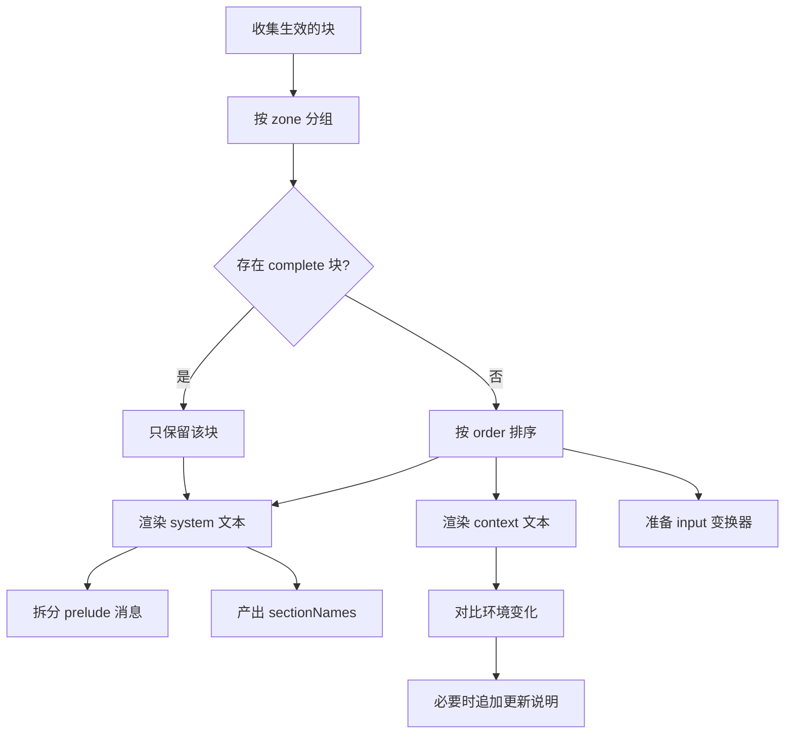

# 提示词装配

::: tip
这一页讲每一次模型请求里那段「系统提示」是怎么拼出来的。提示词不是一段写死的文本，而是由许多插件贡献的片段，在请求发生的那一刻按顺序装配。
:::

如果你只把 ChatLuna 当成「套一层 API 的聊天脚本」，提示词就是一段字符串。

但 ChatLuna 要同时满足很多互相冲突的需求：角色要有稳定的人设、平台能力要能自我描述、工具说明要跟着当前可用工具变化、群聊环境（谁在说话、几点、哪个群）要实时更新、而这一切还不能把模型的缓存前缀打碎。

所以提示词被设计成一套装配管线。

<!-- 架构页，可以使用代码与配置示意 -->

## 三个区

提示词被分成三个区，每个区最终变成不同位置的消息：

| 区 | 变成什么 | 特点 |
| --- | --- | --- |
| `system` | 系统消息，或前置的 user/assistant 消息 | 相对稳定，参与缓存前缀 |
| `context` | 一条或多条上下文消息 | 跟随当前请求变化 |
| `input` | 对用户输入做一次变换 | 每条输入都会经过 |

三者的区别不是「重要程度」，而是「变化频率」和「在消息序列里的位置」。

### system

系统区的片段默认合成为一条系统消息。

它是一轮对话里最稳定的部分：角色设定、安全约束、工具使用说明、平台能力描述，都放这里。

稳定是有意为之——大多数模型服务会把相同的前缀缓存起来，前缀越稳定，命中率越高、费用越低。

如果某个片段需要以「用户说过的话」或「助手说过的话」的形式出现（比如示例对话），可以在系统区里指定 `role: 'user'` 或 `role: 'assistant'`。这些片段不会进入系统消息，而是作为前置消息排在系统消息之后、真实对话之前。

### context

上下文区的片段渲染成独立的消息，位置在系统消息和历史消息附近。

它适合放「这一轮才知道」的信息：当前时间、群名、谁在说话、最近的话题、召回的长期记忆。

这些内容每次请求都会变，所以不能混进系统区，否则缓存前缀会一直失效。

### input

输入区不是一段文本，而是一个变换器：用户消息进来，经过它处理后再交给模型。

它常用于给用户消息加包装——比如标上发送者名字、附上图片引用、标注这是群聊还是私聊。

输入区的模板必须包含 `{prompt}` 占位符，表示「原始输入放在这里」。

## 片段与顺序

插件通过注册「块」(block) 往提示词里加内容。每个块至少包含：

```ts
ctx.prompt.block({
  id: 'my-plugin:rules',
  zone: 'system',
  order: 120,
  content: '回答时优先给出结论，再解释原因。',
})
```

块有几个关键属性：

- **id**：在同一层里必须唯一。重复注册会直接报错，方便定位冲突。
- **zone**：属于哪个区。
- **order**：排序权重，越小越靠前。
- **role**：系统区里可以是 system、user、assistant。
- **content**：字符串，或者一个根据环境实时计算的函数。
- **template**：是否按模板语法渲染。
- **complete**：是否独占系统区。

### 顺序分带

系统区的 `order` 被限制在 -300 到 299 之间，并且按用途划分了推荐区间。这不是强制约束，而是给所有插件一个共同的「语境」：

| 区间 | 用途 | 典型内容 |
| --- | --- | --- |
| -300 | 身份 | 这个 Agent 是谁 |
| -200 ~ -101 | 部署约束 | 部署者写死的规则 |
| -100 | 安全 | 安全策略 |
| 0 | 人设 | 预设里的 persona |
| 1 ~ 49 | 设定与场景 | 预设描述、场景说明 |
| 50 ~ 79 | 常驻世界书 | 始终生效的世界观条目 |
| 80 ~ 99 | 示例对话 | 预设里的示例 |
| 100 ~ 199 | 工具指引 | 各工具的用法说明 |
| 200 ~ 249 | 能力说明 | 技能目录、子代理列表、机器列表 |
| 250 ~ 299 | 平台约束 | 平台侧限制 |

上下文区的 `order` 不受这个范围限制，按需使用。

::: tip
自己写插件时，尽量落进已有的分带，而不是随手填一个 0。

顺序冲突往往不会报错，只会表现为「提示词里两段话的先后有点怪」，很难排查。
:::

### 独占块

如果一个系统块标记为 `complete`，它会**取代**其他所有系统块，只保留自己。

这适用于「完全接管提示词」的场景：某个引擎或调试插件想自己控制全部系统内容。

同一时刻只允许存在一个生效的独占块。出现两个会直接抛错。

## 模板语法

内容标记为模板时，会经过一套轻量语法：

```text
你是 {character_name}。
现在是 {time}，你在 {guild_name} 群里。
{if is_direct}
对方正在私聊你。
{else}
群里还有其他人，说话要简短。
{/if}
```

几个要点：

- `{变量名}` 求值；变量可以带参数，写成 `{变量名 参数1 参数2}`。
- 连续写两个左花括号、两个右花括号，会输出字面的花括号，用来写 JSON 示例。
- 支持 `{if}`、`{else}`、`{elseif}`、`{for x in list}`、`{while}`、`{repeat}` 等块。
- 比较运算支持 `==`、`!=`、`<`、`>`、`<=`、`>=`。

模板解析不会抛异常：解析不了的标签会原样保留为文本，并给出一条诊断信息。这让「提示词里写了 JSON 示例」这种常见情况不会误伤。

## 变量

变量由插件声明并注册。声明里可以指定：

```ts
ctx.prompt.variable(
  {
    name: 'time',
    description: '当前本地时间',
    mutable: true,
    zones: ['context'],
  },
  () => new Date().toLocaleString('zh-CN'),
)
```

- **mutable**：这个值会不会变。
- **zones**：允许出现在哪些区。
- **args**：支持哪些参数。
- **example**：给编辑器的示例。

### 可变变量不能进系统区

这是一条硬规则：如果变量被标记为「可变」，或者它在某些环境下可变，就不能出现在系统区。

原因很直接：系统区要参与缓存，一个每次都变的变量会让整个前缀失效。

所以时间、群名、发言人这类信息必须放在上下文区。

::: warning
声明 `mutable` 时如果写成函数，就要保证它能根据环境准确回答。

系统在无法判断（没有环境信息）时，会直接给出诊断错误，而不是放行。
:::

### 声明区与使用区的检查

渲染前可以做一次静态检查：某个模板在某个区里用了哪个变量，是否符合声明。

这份检查会返回诊断列表，常见问题包括：

- 变量不存在。
- 变量不允许出现在这个区。
- 可变变量出现在系统区。
- 参数数量不对。

编辑器/界面上的提示就来自这里。

## 环境

环境是一份描述「当前这次请求发生在哪」的数据：平台、群、频道、用户、模型、预设、时间、最近消息等。

插件可以注册贡献者，往环境里补字段：

```ts
ctx.prompt.environment((env) => ({
  extra: { ...env.extra, weather: 'sunny' },
}))
```

装配时，所有贡献者会按注册顺序执行，结果合并成最终环境。

贡献者抛出的错误不会中断装配，只会记录一条警告——提示词装配不应该因为一个可选字段失败而导致整轮对话失败。

### 环境变化通知

系统区在装配时会把当时用到的变量值「钉住」。

如果后续某一轮环境变了（比如群名改了、时间跨了天），而系统区还沿用旧值，系统会在上下文区补一条「环境已更新」的说明，列出变化的值。

这样模型不会拿着过期的群名或时间继续回答，同时又不用每轮重写系统提示。

## 装配结果

一次渲染最终产出：

- **system**：系统消息文本。
- **prelude**：系统区里以 user/assistant 角色出现的消息。
- **contexts**：上下文区的若干段文本。
- **input**：一个把用户消息变成最终消息的异步变换器。
- **values**：本次用到的变量值。
- **sectionNames**：生效的系统块 id 与顺序。

`sectionNames` 不只是调试信息。它参与提示词摘要的计算，决定了「这一轮的系统前缀是否和上一轮一致」。

如果两次请求的 sectionNames 与内容都相同，缓存可以复用；任何一段变了，前缀就要重算。

::: tip
这解释了为什么「在角色设定里加一句话」比「在群名里加一句」代价高得多。

前者改变系统前缀，后者只影响上下文。
:::

## 一次装配的顺序



## 诊断

装配阶段的错误会尽量提前暴露，而不是等到请求发出去才失败：

- 重复的块 id。
- 排序值越界（系统区的 order 必须在 -300 到 299 之间）。
- 输入模板缺少 `{prompt}`。
- 多个独占块。
- 变量使用不合法。

这些错误通常会带上块的 id 和来源插件，方便你找到是谁写错了。

## 一个完整的例子

```ts
export function apply(ctx: Context) {
  ctx.prompt.variable(
    { name: 'mood', description: '当前情绪', mutable: true, zones: ['context'] },
    () => '平静',
  )

  ctx.prompt.block({
    id: 'example:style',
    zone: 'system',
    order: 30,
    template: true,
    content: '说话简短，不要使用列表。',
  })

  ctx.prompt.block({
    id: 'example:env',
    zone: 'context',
    order: 1000,
    template: true,
    content: '当前情绪：{mood}',
  })

  ctx.prompt.block({
    id: 'example:input',
    zone: 'input',
    template: true,
    content: '[来自 {user_name}] {prompt}',
  })
}
```

这段代码分别往三个区里加了内容：一段稳定的风格要求、一段每轮可能变化的状态、一个给用户输入加前缀的变换器。

## 设计约束与建议

**系统区尽量稳定。**
不要把时间、随机数、每次请求都变的状态放进去。

**上下文区尽量精简。**
它不参与缓存，每一轮都要重新计费。

**输入区只做包装。**
不要在这里做业务判断；输入变换发生在很靠后的位置，出错会影响整条消息。

**变量按需注册。**
变量目录会进入工具与编辑器，注册太多没人用的变量只会增加噪音。

**块 id 带上插件前缀。**
冲突时这条信息能直接告诉你是哪个插件的问题。

## 排查

**提示词里少了一段内容。**
先确认块是否注册成功、是否 zone 写错、是否被独占块覆盖。

**模型看到的顺序不对。**
检查 order 是否落在预期分带，以及有没有多个块用了同一个值。

**每轮请求都很慢、缓存命中很低。**
大概率是系统区里混进了可变变量。检查诊断里的 mutable 报错。

**变量渲染成了字面量花括号。**
模板没开启，或者变量名拼错导致被当成文本。检查块是否设置了模板标志。

**环境更新消息反复出现。**
某个贡献者每次返回不同的值（比如时间精确到毫秒），导致系统认为环境一直在变。把这类字段移到上下文区，或降低精度。

## 下一步

- [上下文与缓存](./context-cache) — 前缀、缓存与压缩。
- [角色与预设](./character) — 人设块是怎么贡献进来的。
- [引擎](./engine) — 引擎如何在装配阶段插入自己的逻辑。
- [扩展提示词](/guide/extend/prompts) — 面向插件的写法。
