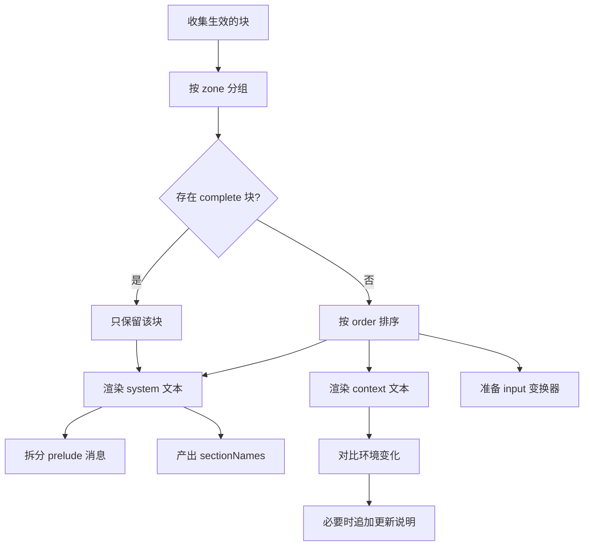

# 提示词装配

::: tip
提示词不是一段写死的文本，而是由各插件提供片段，在每次模型请求时按规则拼装。这样既能保持稳定的人设、随工具更新说明、按需补充群聊环境，又不破坏模型的前缀缓存（Prompt Cache）。
:::

## 三个区

| 区 | 变成什么 | 特点 |
| --- | --- | --- |
| `system` | 系统消息，或前置的 user / assistant 消息 | 相对稳定，参与缓存前缀 |
| `context` | 一条或多条上下文消息 | 跟随当前请求变化 |
| `input` | 对用户输入做一次变换 | 每条输入都会经过 |

三个区的区别在于**变化频率**和在消息序列中的**位置**，而不是重要程度。

- **system**：片段默认合并为一条系统消息，放角色设定、安全约束、工具规范和平台能力。前缀越稳定，缓存命中率越高、成本越低。片段指定 `role: 'user'` 或 `role: 'assistant'` 时（如示例对话），作为前置消息排在系统消息之后、真实历史之前。
- **context**：渲染为独立消息，放当前轮才能确定的信息，如时间、群名、发言人、近期话题、召回的记忆。这些内容混进系统区会让缓存前缀每次失效。
- **input**：对用户输入的变换器，常用来附上发送者昵称、补充图片引用、标记群聊或私聊。模板必须包含 `{prompt}` 占位符，代表原始输入。

## 片段与顺序

```ts
ctx.prompt.block({
  id: 'my-plugin:rules',
  zone: 'system',
  order: 120,
  content: '回答时优先给出结论，再解释原因。',
})
```

- `id`：唯一标识，重复注册会抛出异常。
- `zone`：`system`、`context` 或 `input`。
- `order`：排序权重，越小越靠前。
- `role`：系统区支持 `system`、`user`、`assistant`。
- `content`：字符串，或接收环境参数、实时计算文本的函数。
- `template`：是否启用模板语法。
- `complete`：是否作为独占块接管整个系统区。

### 顺序分带

系统区的 `order` 限制在 -300 到 299，按用途分带：

| 区间 | 用途 | 典型内容 |
| --- | --- | --- |
| -300 | 身份 | 这个 Agent 是谁 |
| -200 ~ -101 | 部署约束 | 部署者写死的规则 |
| -100 | 安全 | 安全策略 |
| 0 | 人设 | 预设里的 persona |
| 1 ~ 49 | 设定与场景 | 预设描述、场景说明 |
| 50 ~ 79 | 常驻世界书 | 始终生效的世界观条目 |
| 80 ~ 99 | 示例对话 | 预设里的示例 |
| 100 ~ 199 | 工具指引 | 各工具的用法说明 |
| 200 ~ 249 | 能力说明 | 技能目录、子代理列表、机器列表 |
| 250 ~ 299 | 平台约束 | 平台侧限制 |

上下文区的 `order` 不受范围限制。

::: tip
插件应尽量对齐已有分带，不要随手填 `0`。顺序冲突不会报错，但会让两段内容的先后颠倒，很难排查。
:::

### 独占块

标记 `complete: true` 的系统块会**完全取代**系统区的其余块，用于工作流引擎或调试插件完全接管系统提示词。一次装配只允许一个独占块，匹配到多个时直接报错。

## 模板语法

`template: true` 时，文本交给内置的轻量模板引擎：

```text
你是 {character_name}。
现在是 {time}，你在 {guild_name} 群里。
{if is_direct}
对方正在私聊你。
{else}
群里还有其他人，说话要简短。
{/if}
```

- 变量写作 `{变量名}`，带参数写作 `{变量名 参数1 参数2}`。
- 输出花括号本身时，把左花括号或右花括号连写两遍转义。
- 控制结构：`{if}`、`{else}`、`{elseif}`、`{for x in list}`、`{while}`、`{repeat}`。
- 比较运算：`==`、`!=`、`<`、`>`、`<=`、`>=`。

未知或无法解析的标签原样保留为文本，并输出一条诊断，所以直接嵌入未转义的 JSON 也不会中断解析。

## 变量

```ts
ctx.prompt.variable(
  {
    name: 'time',
    description: '当前本地时间',
    mutable: true,
    zones: ['context'],
  },
  () => new Date().toLocaleString('zh-CN'),
)
```

- `mutable`：值是否会在会话中变化。
- `zones`：允许引用该变量的区。
- `args`：参数列表。
- `example`：给配置界面和编辑器展示的示例值。

**可变变量不能进系统区**：标记为可变（`mutable: true`）或随环境变化的变量，一律不得出现在 `system` 中，否则前缀缓存会失效。时间、群名、发言人等只能在 `context` 中引用。

::: warning
`mutable` 是判断函数时，必须能基于当前环境准确判断。缺少环境而无法判定时，会直接报诊断错误，而不是放行。
:::

渲染前会静态检查所有模板，拦截：

- 变量不存在或未注册
- 使用区超出声明的 `zones`
- 可变变量出现在系统区
- 参数数量不匹配

编辑界面的语法高亮和错误波浪线也基于这套诊断。

## 环境

环境描述「这次请求发生在哪」：平台、群、频道、用户、模型、预设、当前时间、最近消息等。插件可以注册环境贡献者补充字段：

```ts
ctx.prompt.environment((env) => ({
  extra: { ...env.extra, weather: 'sunny' },
}))
```

装配时所有贡献者依序执行，结果合并为最终环境。贡献者抛出异常只记录警告，不会中断装配。

**环境变化通知**：装配系统区时会固定（Pin）变量快照。之后环境变了（如群名修改、时间跨天），系统在上下文区追加一条「环境已更新」说明，列出变更的变量和新值，无需重写系统提示词。

## 装配结果

- `system`：合并后的系统提示词。
- `prelude`：从系统区拆出的 `user` / `assistant` 前置消息。
- `contexts`：上下文区渲染出的多段文本。
- `input`：接收原始输入、返回最终消息的异步变换器。
- `values`：本次实际用到的变量值。
- `sectionNames`：生效的系统块 `id` 及顺序。

`sectionNames` 参与提示词摘要（Digest）的哈希计算，用于判断系统前缀是否与上一轮相同。任何块增删、移位或内容变化，前缀都要重算。

::: tip
所以「在角色设定里加一句话」比「改群名」代价高得多：前者改变了系统前缀的摘要，后者只影响上下文消息。
:::



## 诊断

装配阶段尽早报错，而不是等请求发给模型后才失败：

- 块 `id` 重复
- 系统区 `order` 超出 -300 到 299
- 输入模板缺少 `{prompt}`
- 同时匹配到多个独占块
- 变量用法不符合声明（作用区或参数数量）

诊断会附带块 `id` 和来源插件。

## 完整示例

```ts
export function apply(ctx: Context) {
  ctx.prompt.variable(
    { name: 'mood', description: '当前情绪', mutable: true, zones: ['context'] },
    () => '平静',
  )

  ctx.prompt.block({
    id: 'example:style',
    zone: 'system',
    order: 30,
    template: true,
    content: '说话简短，不要使用列表。',
  })

  ctx.prompt.block({
    id: 'example:env',
    zone: 'context',
    order: 1000,
    template: true,
    content: '当前情绪：{mood}',
  })

  ctx.prompt.block({
    id: 'example:input',
    zone: 'input',
    template: true,
    content: '[来自 {user_name}] {prompt}',
  })
}
```

三个块分别是稳定的系统风格、每轮变化的状态，以及给用户输入加发言者前缀的变换器。

## 建议

- **系统区保持稳定**：不要放时间戳、随机数和每次都变的状态。
- **上下文区保持精简**：它不参与缓存，每轮都消耗 Token。
- **输入区只做包装**：它在管线末端，出错会影响整条消息。
- **变量按需注册**：所有变量都会进入编辑器目录，无用变量只是噪音。
- **块 id 带插件前缀**：冲突时便于定位来源。

## 常见问题

**提示词缺少内容**：确认块已注册、`zone` 正确，且没有被独占块覆盖。

**模型看到的顺序不对**：检查 `order` 是否在预期分带内，以及是否有多个块使用相同数值。

**每轮都很慢、缓存命中率低**：多半是系统区混入了可变变量，查看诊断日志中的 `mutable` 报错。

**变量渲染成了字面量花括号**：没有开启 `template`，或变量名拼写错误。

**环境更新说明反复出现**：某个贡献者每次返回不同的值（如高精度时间戳）。把字段移到上下文区，或降低精度。

## 下一步

- [上下文与缓存](./context-cache) — 前缀、缓存与压缩。
- [角色与预设](./character) — 人设块是怎么贡献进来的。
- [引擎](./engine) — 引擎如何在装配阶段插入自己的逻辑。
- [扩展提示词](/guide/extend/prompts) — 面向插件的写法。
