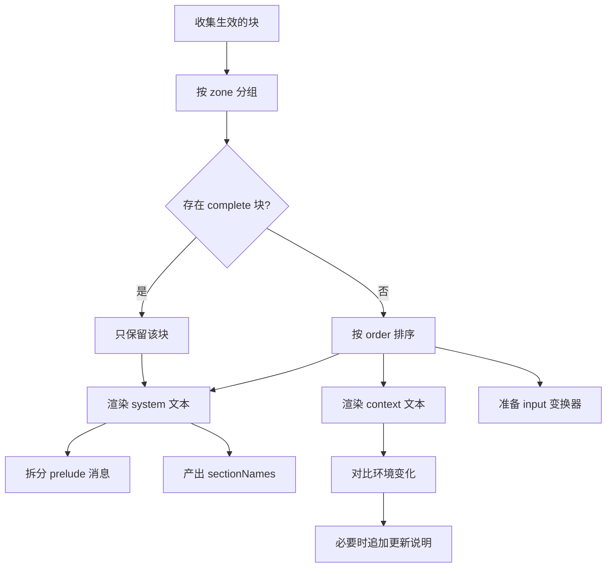

# 提示词装配

::: tip
这一页将介绍 ChatLuna 在每一次模型请求中，是如何动态拼装「系统提示词」与相关消息的。提示词并不是一段预先写死的静态文本，而是由各个插件贡献的片段，在发起调用的那一刻按既定规则动态组装而成的。
:::

如果仅仅把 ChatLuna 当成「套了一层 API 的聊天脚本」，那么提示词确实可以只是一段简单的字符串。

但在实际复杂的会话场景中，ChatLuna 往往需要同时兼顾多项互斥的诉求：角色需要保持稳定的人设、平台能力需要自我描述、工具说明需要跟随当前可用工具实时变化、群聊环境（发言人、当前时间、群组信息）需要按需更新，而这一切又绝不能破坏大语言模型的上下文缓存前缀（Prompt Cache）。

为了同时满足这些需求，ChatLuna 将提示词抽象成了一套高度解耦的装配管线。

## 三个区

在 ChatLuna 中，提示词被划分为三个明确的区域。不同区域的片段最终会转化为消息序列中不同位置的消息：

| 区 | 变成什么 | 特点 |
| --- | --- | --- |
| `system` | 系统消息，或前置的 user/assistant 消息 | 相对稳定，参与缓存前缀 |
| `context` | 一条或多条上下文消息 | 跟随当前请求变化 |
| `input` | 对用户输入做一次变换 | 每条输入都会经过 |

细心的小伙伴可能会发现，这三个区域的核心区别并不是「重要程度」，而是它们在运行时的「变化频率」以及「在消息序列中的插入位置」。

### system

系统区（system）中的片段在默认情况下会合并为一条完整的系统消息。

它是整轮对话中最为稳定的基础部分：角色的核心设定、安全约束、工具使用规范以及平台能力描述等，通常都会放置在这里。

保持该区域的稳定是经过深思熟虑的——现代大多数模型服务都支持对相同的前缀进行提示词缓存（Prefix Caching）。前缀内容越稳定，缓存命中率就越高，响应速度越快，调用成本也越低。

如果你希望某些设定以「用户说过的话」或「助手示范的回答」的形式出现（例如示例对话），也可以在系统区中显式指定 `role: 'user'` 或 `role: 'assistant'`。这些片段不会进入系统消息，而是作为前置消息排在系统消息之后、真实历史对话之前。

### context

上下文区（context）中的片段会被渲染为独立的消息，紧跟在系统消息和历史消息附近。

这里专门用于存放「直到当前这一轮才确定」的动态信息：比如当前时间戳、所在群聊名称、当前发言人身份、近期讨论的话题，或是通过向量检索召回的长期记忆条目。

由于这些内容每次请求都可能发生改变，因此绝不能混入系统区中，否则会导致每次请求的缓存前缀全部失效。

### input

输入区（input）并不是一段静态的文本内容，而是一个针对用户输入的变换器：当用户消息进入管线后，会先经过输入区的处理，然后再提交给模型。

它最常见的用途是为用户消息添加格式包装——例如在文本前附上发送者的昵称、补充图片引用信息，或是标记当前会话属于群聊还是私聊。

需要注意的是，输入区的模板中必须包含 `{prompt}` 占位符，用于指代「原始的用户输入内容」。

## 片段与顺序

插件可以通过调用 API 向提示词管线中注册「块」(block)。一个最基本的块定义如下：

```ts
ctx.prompt.block({
  id: 'my-plugin:rules',
  zone: 'system',
  order: 120,
  content: '回答时优先给出结论，再解释原因。',
})
```

一个提示词块包含以下几个核心属性：

- **id**：块的唯一标识符。在同层上下文中必须全局唯一，重复注册同名块会直接抛出异常，方便及早定位插件冲突。
- **zone**：所属的提示词区域，可取 `system`、`context` 或 `input`。
- **order**：排序权重数值，数值越小越靠前。
- **role**：消息角色。在系统区中支持 `system`、`user` 或 `assistant`。
- **content**：块的内容，可以是一个纯文本字符串，也可以是一个接收环境参数并实时计算文本的函数。
- **template**：是否启用轻量模板语法进行插值渲染。
- **complete**：是否作为独占块接管整个系统区。

### 顺序分带

系统区的 `order` 权重被严格限制在 -300 到 299 的范围内，并按业务用途划分了推荐的分带区间。这并非生硬的强制约束，而是为所有插件提供一个约定俗成的协作语境：

| 区间 | 用途 | 典型内容 |
| --- | --- | --- |
| -300 | 身份 | 这个 Agent 是谁 |
| -200 ~ -101 | 部署约束 | 部署者写死的规则 |
| -100 | 安全 | 安全策略 |
| 0 | 人设 | 预设里的 persona |
| 1 ~ 49 | 设定与场景 | 预设描述、场景说明 |
| 50 ~ 79 | 常驻世界书 | 始终生效的世界观条目 |
| 80 ~ 99 | 示例对话 | 预设里的示例 |
| 100 ~ 199 | 工具指引 | 各工具的用法说明 |
| 200 ~ 249 | 能力说明 | 技能目录、子代理列表、机器列表 |
| 250 ~ 299 | 平台约束 | 平台侧限制 |

上下文区的 `order` 则不受上述数值范围的限制，开发者可按需自由配置。

::: tip
在编写插件时，建议尽量将你的内容对齐到已有的分带区间中，而不是随手填一个 `0`。

顺序冲突通常不会导致报错，但可能让提示词中两段提示的先后逻辑出现微妙的颠倒，排查起来往往十分费时。
:::

### 独占块

如果某个系统块被显式标记为 `complete: true`，它将会**完全取代**同处于系统区的其余所有块，仅保留其自身内容。

这种设计通常用于「完全接管提示词」的高级场景：例如某个特定的工作流引擎或调试插件，需要绕过所有既有插件，自主控制最终提交给模型的完整系统内容。

在同一次装配流程中，系统仅允许存在一个生效的独占块；如果同时匹配到两个以上的独占块，装配管线会直接抛出错误并终止。

## 模板语法

当提示词块将 `template` 属性设为 `true` 时，文本会经过内置的轻量模板引擎进行解析与求值：

```text
你是 {character_name}。
现在是 {time}，你在 {guild_name} 群里。
{if is_direct}
对方正在私聊你。
{else}
群里还有其他人，说话要简短。
{/if}
```

在使用模板语法时，请留意以下几项规则：

- 变量通过 `{变量名}` 进行求值；变量还支持传入参数，写作 `{变量名 参数1 参数2}`。
- 如果需要输出花括号字符本身（例如编写 JSON 示例时），可以连续输入两个左花括号 `{{` 或右花括号 `}}` 进行转义。
- 流程控制支持 `{if}`、`{else}`、`{elseif}`、`{for x in list}`、`{while}` 以及 `{repeat}` 等块级结构。
- 逻辑与比较表达式支持常用的操作符，包括 `==`、`!=`、`<`、`>`、`<=` 和 `>=`。

模板解析器在面对未知或无法解析的标签时，采取了宽容容错策略：它不会中断执行并抛出异常，而是将其原样保留为纯文本并给出一条诊断信息。这样即使用户在提示词中直接嵌入了未转义的 JSON 片段，也不会误伤整段逻辑。

## 变量

提示词中的变量是由插件主动声明并注册的。在声明变量时，你可以指定其作用范围与可变性：

```ts
ctx.prompt.variable(
  {
    name: 'time',
    description: '当前本地时间',
    mutable: true,
    zones: ['context'],
  },
  () => new Date().toLocaleString('zh-CN'),
)
```

变量的元数据包含以下属性：

- **mutable**：标识该变量的值在会话过程中是否具有可变性。
- **zones**：数组，限制该变量允许被哪些提示词区域所引用。
- **args**：支持传入的参数列表定义。
- **example**：提供给可视化配置界面或编辑器的示例取值。

### 可变变量不能进系统区

ChatLuna 对此设定了一项硬性规则：任何被标记为可变（`mutable: true`）或在特定环境下表现为动态变化的变量，均**不得**出现在 `system` 系统区中。

这样约束的根源同样是为了维护上下文缓存：系统区的内容需要长期保持确定性，一旦混入每次调用都可能变动的变量，整段前缀缓存都将失效。

因此，像当前时间、群组名称、发言人这类高频变化的字段，必须严格限定在上下文区（context）中引用。

::: warning
当变量的 `mutable` 属性被声明为一个动态判断函数时，必须确保它能基于当前环境准确判断。

若装配系统在无完整环境上下文的情况下无法判定可变性，将会直接报告诊断错误，而不会隐式放行。
:::

### 声明区与使用区的检查

在正式渲染提示词之前，系统可以对所有模板进行一次静态检查，核对各个区域所使用的变量是否完全符合声明约定。

静态检查会输出一份详细的诊断报告，常见的拦截问题包括：

- 变量不存在或尚未在系统中注册。
- 变量所在的使用区域超出了其声明的 `zones` 许可列表。
- 带有动态可变性的变量违规出现在了系统区。
- 模板调用该变量时传入的参数数量不匹配。

管理控制台与提示词编辑界面中的实时语法高亮与错误波浪线，也正是基于这套诊断接口构建的。

## 环境

环境（Environment）是一份描述「当前这一次请求发生在哪」的数据集合：包含当前平台、群聊、频道、用户、模型、预设、当前时间以及最近的消息等。

插件可以向系统注册环境贡献者（Environment Contributor），以动态补充或修饰环境字段：

```ts
ctx.prompt.environment((env) => ({
  extra: { ...env.extra, weather: 'sunny' },
}))
```

在发起提示词装配时，所有已注册的环境贡献者会依序执行，并将返回的结果合并为本次请求的最终环境对象。

需要注意的是，环境贡献者执行时即便抛出异常，也不会打断整个装配流程，系统只会记录一条警告日志——提示词装配不应因为一个可选扩展字段的读取失败，而直接导致整轮对话不可用。

### 环境变化通知

在装配系统区提示词时，系统会将当前读取到的各变量快照值进行「钉住」（Pin）。

细心的小伙伴可能会想到：如果后续某一轮对话中环境发生改变（例如群名修改或时间跨天），而系统区仍沿用旧值，模型会不会产生认知偏差？答案是肯定的。为此，系统会在上下文区（context）自动追加一条「环境已更新」的补充说明，明确列出发生变更的变量与新值。

这样既能确保模型不会拿着过期的群名或时间继续回答，又无需每轮重新改写系统提示词。

## 装配结果

每次装配渲染完成后，管线最终会产出一个结构化的结果对象：

- **system**：合并后的系统提示词纯文本。
- **prelude**：从系统区中拆分出的前置消息列表（带有 `user` 或 `assistant` 角色）。
- **contexts**：上下文区渲染出的多段独立上下文文本。
- **input**：一个接收原始用户输入并返回最终处理后消息的异步变换器函数。
- **values**：本次装配实际解析并消耗的变量键值映射表。
- **sectionNames**：最终生效的各个系统块的 `id` 列表及其排列顺序。

这里的 `sectionNames` 绝非单纯的调试日志。它会直接参与提示词摘要（Digest）的哈希计算，用于决定「当前这一轮的系统前缀是否与上一轮完全一致」。

如果两次请求中的 `sectionNames` 顺序与内容完全相同，底层缓存即可直接复用；一旦任何一个块发生增删、移位或内容变更，整段前缀就必须重新计算。

::: tip
这也清晰地解释了为什么「在角色设定里加一句话」比「在群名里加一句」代价要高得多。

前者直接改变了系统前缀的哈希摘要，导致前缀缓存重建；而后者仅影响上下文消息，并不破坏系统前缀。
:::

## 一次装配的顺序

提示词装配从收集生效块到最终输出的完整流程如下所示：



## 诊断

装配管线贯彻了「尽早暴露问题」的设计原则，会在装配阶段完成严格校验，避免等到请求真正发给模型后才遭遇失败：

- 重复注册了同名的块 `id`。
- 排序值越界（系统区的 `order` 必须在 -300 到 299 之间）。
- 输入模板缺少必选的 `{prompt}` 占位符。
- 当前上下文同时匹配到了多个独占块。
- 变量的使用方式不符合声明约束（例如作用域不匹配或参数数量错误）。

抛出诊断信息时，系统通常会附带对应块的 `id` 与来源插件，方便开发者快速定位是谁写错了。

## 一个完整的例子

下面是一个在单个插件中同时注册变量、系统规则、动态状态与用户输入包装的完整示例：

```ts
export function apply(ctx: Context) {
  ctx.prompt.variable(
    { name: 'mood', description: '当前情绪', mutable: true, zones: ['context'] },
    () => '平静',
  )

  ctx.prompt.block({
    id: 'example:style',
    zone: 'system',
    order: 30,
    template: true,
    content: '说话简短，不要使用列表。',
  })

  ctx.prompt.block({
    id: 'example:env',
    zone: 'context',
    order: 1000,
    template: true,
    content: '当前情绪：{mood}',
  })

  ctx.prompt.block({
    id: 'example:input',
    zone: 'input',
    template: true,
    content: '[来自 {user_name}] {prompt}',
  })
}
```

在这段代码中，插件清晰地向三个区域分别注入了对应的能力：一段稳定的系统风格要求、一段每轮可能动态变化的状态说明，以及一个为用户输入添加发言者前缀的变换器。

## 设计约束与建议

在利用提示词管线开发功能时，建议遵循以下最佳实践：

- **系统区尽量稳定**：避免将时间戳、随机数或每次请求都变的状态放进去，尽可能提高前缀缓存的命中率。
- **上下文区尽量精简**：上下文区不参与缓存，每一轮请求都会重新计费并消耗 Token。
- **输入区只做包装**：不要在输入变换器中编写复杂的业务判断；输入变换处于管线很靠后的位置，出错会影响整条消息的递送。
- **变量按需注册**：所有注册的变量都会进入工具与编辑器目录，注册过多无用变量只会增加配置噪音。
- **块 id 带上插件前缀**：推荐使用带有命名空间的 `id`，出现冲突时能直接帮助排查是哪个插件的问题。

## 排查

遇到提示词装配异常时，可以按照以下思路逐步排查：

- **提示词里少了一段内容**：先确认对应的块是否注册成功、检查 `zone` 是否配置正确，以及是否被某个独占块（`complete`）覆盖。
- **模型看到的顺序不对**：检查 `order` 是否落在预期的分带区间内，以及是否有多个块使用了相同的数值导致相对顺序不稳定。
- **每轮请求都很慢、缓存命中率极低**：大概率是系统区里混入了动态可变变量，请检查诊断日志中的 `mutable` 报错。
- **变量渲染成了字面量花括号**：说明模板未开启（`template` 未设为 `true`），或者变量名拼写错误导致被直接当成普通文本处理。
- **环境更新说明反复出现**：说明某个环境贡献者每次调用都返回了动态变化的值（例如精度过高的时间戳），导致系统判定环境持续变更。可将此类字段移至上下文区，或降低其数值精度。

## 下一步

- [上下文与缓存](./context-cache) — 前缀、缓存与压缩。
- [角色与预设](./character) — 人设块是怎么贡献进来的。
- [引擎](./engine) — 引擎如何在装配阶段插入自己的逻辑。
- [扩展提示词](/guide/extend/prompts) — 面向插件的写法。
