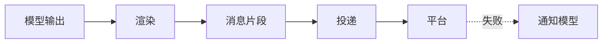

# 渲染与投递

::: tip
模型写出来的是一段字符串，而用户在聊天软件里看到的则是一条条有模有样的消息。从模型输出到用户终端，中间还经历了解析、拆分、格式化、选择机器人、消息引用以及失败处理——这整套流程就是 ChatLuna 的渲染与投递系统。
:::

表面上看这只是「把回复发出去」，但要想在多聊天平台下优雅地完成投递，其实并不简单。

不同平台支持的消息元素千差万别，单条消息也有字数上限；长回复需要妥善拆分，模型可能还想发表情、发图片、引用前文或者连珠炮似地分好几条发送，中途甚至还会遭遇网络波动或平台风控拦截。

面对这些繁复的平台细节，模型本身显然不该关心。它的职责只是专注把想说的话写出来，剩下的格式转换与落地派发，全部交由下层的渲染与投递链路来处理。

<!-- 架构页，可以使用代码与配置示意 -->

## 两个阶段

在 ChatLuna 内部，模型输出到达聊天平台需要经过清晰的两个阶段：

### 渲染

渲染阶段的核心任务，是将模型输出的原始文本解析为结构化的消息片段：例如纯文本、图片、@提问者、引用回复、表情乃至动作描述等。

这一层同时负责给模型「立规矩」：在提示词和规范中约束模型能使用哪些元素标签、如何进行换行分条以及如何标记引用。

### 投递

投递阶段则把排版好的片段真正转换成平台原生消息：挑选合适的机器人账号、附加消息引用、匹配目标平台的元素发送能力，并捕获一切潜在的发送异常。

这一层完全不关心内容的业务语义，它只专注于一件事——「如何安全、准确地将这段内容送达用户」。

## 输出格式

渲染层支持三种主要输出格式，用于平衡表达能力与跨平台兼容性：

| 格式 | 行为 |
| --- | --- |
| 纯文字 | 模型输出就是消息文本 |
| 富消息 | 模型用元素标签描述图片、表情、@ 等 |
| Markdown | 整条回复写完后按 Markdown 排版 |

默认配置下使用纯文字模式：它的容错率最高，也是全平台兼容性最好的基石。

富消息模式则适合需要图文混排、发送表情包或 @特定用户的场景。模型在生成文本时使用约定的标签表达特定元素，渲染层解析后会将其转换成对应的平台消息元素。

Markdown 模式适合展示结构化文档或代码片段，但并非所有聊天平台都能直接渲染排版效果，通常需要配合图片渲染插件或平台原生富文本能力。

### 元素

在富消息模式下，开发者可以通过配置严格限定「允许使用的元素」白名单：

- **基础消息**：消息、引用、@。
- **媒体资源**：图片、音频、视频、文件。
- **互动表达**：表情。

如果模型意外输出了未被允许的元素标签，渲染层会安全地将其降级为普通文字发出去，而不是抛出异常打断对话。

值得一提的是，有些特殊元素本来就无需展示给最终用户，例如模型的思考过程与运行状态。这些内部元素由渲染层识别并自动转入安静通道或做隐藏处理，因为渲染层清楚知晓它们的实际用途。

::: tip
允许的元素越少，模型输出产生格式错乱的概率就越低。

如果你部署的机器人并不需要发图，不妨直接在配置里关闭图片元素支持，这样可以一劳永逸地避免模型胡乱生成图片标签的问题。
:::

## 分条

一条模型回复可能非常冗长，又或者模型希望模仿真人打字，分几句话接连发送。

配置项 `split` 决定了消息的切分策略：

- **按消息**：模型每输出一个消息标签，系统就立即向平台发送一条独立消息。
- **不分**：等待模型整轮输出全部写完后，一次性打包发送。

按消息分条的交流体验更为自然生动，但这要求底层模型具备较好的指令遵循能力，能够正确理解何时换行分条。

除了逻辑分条，系统还提供了底层消息长度保护机制：

- **每条最多字数**：默认为 1500 字，单段超出限制时会被平滑拆分到下一条。
- **最多几条**：默认为 6 条，超出上限的所有剩余内容将被强制合并到最后一条发出。

这两个硬性阈值兜底保障了长回复最终的展示形态，避免无休止地刷屏。

## 引用

开启引用配置后，机器人的回复会自动带上对原消息的引用。

在群聊消息频繁刷屏的高并发场景下，开启引用可以让大家一眼看出机器人究竟「在回复谁」。

不过需要注意的是，并不是所有聊天平台都支持引用功能，而且引用消息体本身也会占用平台单条消息的字数上限。

::: warning
部分聊天平台的引用协议在实现上会把被引用的原文字句完整地重新发送一遍。

如果测试时发现机器人每次回复前都复读了一遍用户的话，请先检查引用配置或对应平台的适配器特性。
:::

## 工具前后的发言

当模型需要调用外部工具时，它往往会在调用前先说一句「我查一下」，待工具返回数据后再总结输出最终结论。

针对这两句夹杂在工具调用之间的发言，系统提供了两个维度的控制选项：

- **前一句发不发**：是直接发送给用户，还是静默丢弃。
- **历史里怎么记**：是作为独立消息完整记录、与后续回复合并成一条，还是仅保留最后一条。

从人机交互的角度看，让用户及时看到「我查一下」能显著降低等待焦虑；但在多轮对话历史中堆满零碎短句，又会浪费宝贵的时间线与上下文空间。

框架默认采用「发送 + 都记」策略。如果你追求更为精炼安静的对话体验，也可以随时调整为「合成一条」或「只记最后一条」。

## 回复工具

部分轻量模型直接在文本中拼接富消息标签时容易产生语法错误，尤其在面临精确控制分条和元素混排时更显吃力。

针对这一痛点，ChatLuna 提供了另一种可靠的回复方式——「通过回复工具」：

在此模式下，模型不再直接输出正文流，而是被要求调用系统预置的回复工具，将拟回复的消息内容作为参数传递进来。

这种做法的最大好处在于，输出格式能够受到工具参数校验的强力约束；当然代价则是会多占用一次工具调用的往返，并且对模型的指令遵循能力提出了更高要求。

::: tip
如果发现你所接入的模型总是把元素标签写错，不妨先尝试切换为回复工具模式。

这相当于把「保持格式正确」从依赖模型自觉的软约束，变成了由程序接口强行拦截的硬契约。
:::

## 工具说明

模型在后台执行工具调用时，普通用户在聊天窗口中是看不到内部过程的。

配置项 `toolTalk` 决定了系统是否在提示词中引导模型「说明自己调用了什么工具」：

- **从不**：不在提示词中提示，模型默认静默调用。
- **一般**：仅在工具执行结果重要时主动向用户交代一句。
- **完整**：无论使用何种工具，每次调用都向用户明确说明。

在公开群聊中，适度的说明有助于减少「它怎么突然知道这个的」困惑；而在内部使用或自动化场景下，则可以完全省略提示以保持简短。

## 投递细节

当消息片段准备完毕后，投递模块将处理具体的平台落地细节。

### 选择机器人

一个路由节点可能会关联或配置多个机器人账号。

系统在投递时遵循清晰的选择逻辑：优先挑选「当前会话绑定的机器人实例」；若当前会话未做独立绑定，则退而使用路由自身默认配置的机器人。

如果机器人选择错误，最直观的故障现象通常是「消息发到了另一个号」或者「权限不匹配导致根本发不出去」。

### 引用与回复

当投递路由绑定了原始的入站会话时，系统能够直接追踪并引用用户的原消息。

但如果当前只能「直接发送」，引用请求将被安全忽略，同时投递层会记录一条调试日志——绝不会假装发送成功。

### 平台能力

不同聊天平台的底层功能支持各有千秋，例如是否支持消息再次编辑、是否支持发信后撤回等。

投递层会动态读取平台所声明的能力元数据。遇到平台不支持的特性时，系统会采取静默降级策略，而不是抛出致命错误中断业务。

## 失败

在实际生产环境中，消息投递失败可能源于多种客观因素：内容被平台拒绝拦截、网络超时闪断、触发调用频率限制，或是消息体积过长。

当投递遇挫时，系统会按序执行以下动作：

1. 记录详细的失败原因。
2. 尽量不影响当前批次中其他消息片段的正常投递。
3. 向会话中追加一条安静的通知，明确告知模型「该条消息用户没看到」。

这条反向通知机制至关重要：倘若模型对投递失败毫不知情，在后续对话中就会误以为用户早已获悉该内容，从而产生上下文认知偏差。

::: warning
千万不要对系统上报的「投递失败」这类通知置之不理。

它往往意味着模型生成了平台不接受的内容，比如消息超长、使用了不支持的格式，或是触发了平台的安全拦截策略。
:::

## 撤回与编辑

当用户或管理员在聊天平台上撤回或重新编辑消息时，系统会实时同步上下文状态：

- 自动向当前会话追加一条安静的通知，说明谁撤回了什么内容。
- 及时将被撤回的待处理输入从队列中移除，避免模型跟空气对话、去回复一条已经不存在的消息。

这些通知均以安静模式写入，它们不会主动唤醒休眠中的 Agent，只负责维护历史上下文的客观与准确。

## 投递事件

每当一条消息成功送达目标平台后，投递系统都会发出一个标准的投递事件，事件载荷中包含所属路由、平台消息 ID、消息内容以及是否为机器人自身发出等元信息。

第三方插件可以监听这些投递事件，轻松实现消息审计、用量统计、聊天记录归档或是触发下游自定义业务流。

## 与角色的关系

角色系统在表现上往往比普通问答更具拟人感。这是因为角色引擎默认基于富消息格式构建，并自带了一套贴合角色扮演习惯的预设：

- 默认采用按消息分条。
- 过程消息正常发送，并在写回历史时自动合并。
- 模型的思考、状态与沉默元素会被自动隐藏。

这也是为什么在完全相同的输入下，角色引擎与普通对话引擎输出的消息形态可能会有所差异。

## 排查

遇到渲染或投递相关的异常时，可以按照以下清单迅速定位：

**发出去的内容格式错乱。**

模型输出了不被允许的元素，或者标签未闭合。建议缩减允许使用的元素白名单，或者改用回复工具模式。

**长回复被截断。**

检查每条字数与最多几条的阈值设置。超出限制的内容会被合并到最后一条，但若依然超出平台限制则会被截断。

**回复里重复了用户的话。**

这是由于引用设置与部分平台适配器的实现差异导致的。可以在配置中关闭引用功能进行排查。

**消息发到了错误的号。**

请检查路由分配规则以及会话与机器人的绑定关系。

**模型说已经发了，但用户没看到。**

查看投递失败通知与调试日志。常见原因包括平台拒绝拦截、网络请求超时以及 API 频率超限。

**撤回后模型还在讨论那条消息。**

确认撤回通知是否正常写入会话，并确认该条消息在被撤回前是否已经被模型消费进执行流程中。

## 下一步

- [消息处理链路](./chat-pipeline) — 渲染发生在链路的哪个位置。
- [角色系统](./character) — 角色引擎的渲染默认值。
- [适配器](./adapters) — 平台能力的来源。
- [工具系统](./tools) — 回复工具与普通输出的区别。
