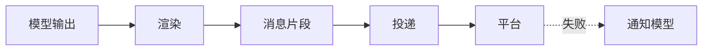

# 渲染与投递

::: tip
模型输出的是一段字符串，用户看到的是一条条格式完整的消息。中间要经过解析、拆分、格式化、选择机器人、引用原消息和失败处理。不同平台支持的元素和字数上限各不相同，发送中还可能超时或被风控拦截——这些都由渲染与投递处理，模型只管生成内容。
:::

<!-- 架构页，可以使用代码与配置示意 -->

## 两个阶段

- **渲染**：把模型输出解析为结构化片段（文本、图片、@、引用、表情、动作等），并通过提示词约束模型能用哪些元素、如何分条、如何标记引用。
- **投递**：把片段转换为平台原生消息，选择机器人、附加引用、匹配平台能力、捕获发送异常。它不关心内容语义。

## 输出格式

| 格式 | 行为 |
| --- | --- |
| 纯文字 | 模型输出直接作为消息文本 |
| 富消息 | 模型通过元素标签描述图片、表情、@ 等 |
| Markdown | 整条回复生成完毕后按 Markdown 排版 |

默认纯文字，容错和兼容性最好。富消息适合图文混排、表情和 @。Markdown 适合结构化文档和代码，但很多平台不能直接渲染，通常要配合图片渲染插件或平台的富文本能力。

**元素白名单**：富消息模式下可以限定允许的元素：

- **基础消息**：消息、引用、@
- **媒体资源**：图片、音频、视频、文件
- **互动表达**：表情

未允许的元素降级为普通文字，不会中断对话。思考过程、运行状态等内部元素会自动隐藏或转入后台处理。

::: tip
允许的元素越少，格式错乱的概率越低。不需要发图就关掉图片元素。
:::

## 分条

`split` 决定切分策略：

- **按消息**：模型每输出一个消息标签就发送一条。体验更像真人，但要求模型指令遵循较好。
- **不分**：整轮输出完后一次性发送。

长度保护：每条最多 1500 字，超出拆到下一条；最多 6 条，超出部分合并到最后一条。

## 引用

开启后回复会引用用户的原消息，群聊中能看清在回复哪一条。不是所有平台都支持引用，引用内容也计入字数限制。

::: warning
部分平台实现引用时会把原消息文本重发一遍。如果每次回复都重复了用户的话，先检查引用配置或平台适配器。
:::

## 工具前后的发言

模型调用工具前常会说「我查一下」，工具返回后再总结。两个配置维度：

- **前一句发不发**：发送给用户，或静默丢弃。
- **历史里怎么记**：各自独立记录、与后续回复合并为一条，或只保留最后一条。

默认「发送 + 都记」。及时回应能减少等待焦虑，但历史中短句太多会占上下文，想更紧凑可以改为合并或只记最后一条。

## 回复工具

轻量模型直接拼接元素标签时容易出错。回复工具模式下，模型不再直接输出文本，而是调用回复工具，把内容作为参数传入，格式由参数校验约束。代价是多一次工具调用的往返，且要求模型会用工具。

::: tip
模型频繁出现标签格式错误时，可以试试回复工具模式。
:::

## 工具说明

`toolTalk` 决定是否在提示词中引导模型说明工具调用：

- **从不**：静默调用。
- **一般**：结果重要时向用户说明。
- **完整**：每次调用都说明。

公开群聊中适度说明有助于用户了解信息来源，自动化场景可以省略。

## 投递细节

- **选择机器人**：优先用当前会话绑定的机器人，没有则用路由默认的机器人。选错时表现为发到了别的账号，或因权限不匹配而失败。
- **引用**：投递路由绑定了原始入站会话时才能引用原消息。只能直接发送时忽略引用并记一条调试日志，不会虚报发送状态。
- **平台能力**：动态读取平台声明的能力（如编辑、撤回），不支持的功能自动降级，不抛出错误。

## 失败处理

常见原因：风控拦截、网络超时、频率限制、消息超长。失败时：

1. 记录失败日志。
2. 继续投递同批次的其余片段。
3. 向会话追加一条静默通知，告诉模型这条消息没有送达。

否则模型会以为用户已经看到了回复，后续理解产生偏差。

::: warning
出现投递失败通知时要及时排查，通常是模型输出了平台不支持的内容：超长、格式不兼容，或触发了内容审查。
:::

## 撤回与编辑

用户撤回或编辑消息时，系统向会话追加一条静默通知，并把已撤回但未处理的输入移出队列。这些通知不会触发回复，只用于保持历史准确。

## 投递事件

消息发送成功后触发投递事件，载荷包含路由、平台消息 ID、内容和发送者，可用于审计、用量统计、归档或自定义逻辑。

## 与角色的关系

角色引擎默认使用富消息格式，并且：

- 按消息分条。
- 过程消息正常发送，写入历史时合并。
- 隐藏思考、状态和沉默标记。

所以同样的输入，角色引擎和普通对话引擎的输出形式可能不同。

## 常见问题

**消息格式错乱**：模型输出了未允许的元素或标签没闭合。缩减元素白名单，或切换为回复工具模式。

**长回复被截断**：检查「每条最多字数」和「最多几条」。合并到最后一条后仍超出平台限制，就会被平台截断。

**回复重复了用户的话**：引用设置与平台适配器实现差异导致，关掉引用确认。

**发到了错误的账号**：检查路由规则和会话与机器人的绑定。

**模型说发了，聊天软件没收到**：看控制台的投递失败通知和调试日志，常见是风控、超时或频率超限。

**撤回后模型还在回复那条消息**：检查撤回通知是否写入，以及消息是否在撤回前已被读取处理。

## 下一步

- [消息处理链路](./chat-pipeline) — 渲染在链路中的位置。
- [角色系统](./character) — 角色引擎的默认渲染配置。
- [适配器](./adapters) — 各平台支持的能力。
- [工具系统](./tools) — 回复工具与常规输出的区别。
