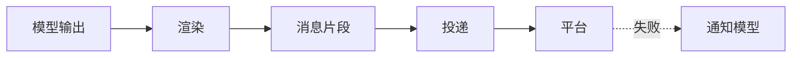

# 渲染与投递

::: tip
模型写出来的是一段文本，用户看到的是聊天软件里的一条消息。中间还隔着解析、拆分、格式化、选择机器人、引用、失败处理——这一整套就是渲染与投递。
:::

看起来只是「把回复发出去」，但真正做对并不容易。

不同平台支持的消息元素不同，单条长度有上限，长回复要拆，模型可能想发表情、想引用、想分几条说，发送还可能失败。

模型不该关心这些。它只负责把想说的写出来。

<!-- 架构页，可以使用代码与配置示意 -->

## 两个阶段

### 渲染

把模型的输出解析成结构化片段：文本、图片、@、引用、表情、动作。

这一层同时负责给模型「立规矩」：告诉它能用哪些元素、怎么分条、怎么引用。

### 投递

把片段变成平台消息：选择机器人、设置引用、按平台能力发送、处理失败。

这一层不关心语义，只关心「怎么把这段内容送达」。

## 输出格式

| 格式 | 行为 |
| --- | --- |
| 纯文字 | 模型输出就是消息文本 |
| 富消息 | 模型用元素标签描述图片、表情、@ 等 |
| Markdown | 整条回复写完后按 Markdown 排版 |

默认是纯文字：最稳定，兼容性最好。

富消息适合需要发图、发表情、@ 人的场景。模型通过标签表达元素，渲染层解析后转成平台消息元素。

Markdown 适合结构化内容，但并非所有平台都能渲染。

### 元素

富消息模式下可以限定「允许哪些元素」：

- 消息、引用、@。
- 图片、音频、视频、文件。
- 表情。

没被允许的元素会当作普通文字发出去，而不是报错。

有些元素本来就不会发给用户，比如思考与状态。它们可以不出现在隐藏列表里，因为渲染层知道它们的用途。

::: tip
允许的元素越少，模型越不容易输出格式错误。

如果你不需要发图，就把图片元素关掉，能省掉一类故障。
:::

## 分条

一条回复可能很长，或者模型想分几句说。

`split` 决定分条方式：

- **按消息**：模型每写一个消息标签，就发一条。
- **不分**：写完一次性发出。

按消息更自然，但需要模型理解分条规则。

长度限制是另一层保护：

- **每条最多字数**：默认 1500，超出拆到下一段。
- **最多几条**：默认 6，超出的内容合并到最后一个。

这两个值决定了长回复的最终形态。

## 引用

开启引用后，回复会带上原消息的引用。

群聊里消息多时，这让「它在回谁」一目了然。

但引用不是所有平台都支持，而且会占用一部分消息体。

::: warning
部分平台的引用实现会把原文再发一遍。

如果发现回复里重复了用户的话，先检查引用设置。
:::

## 工具前后的发言

模型可能在调用工具之前先说一句「我查一下」，工具之后再说结论。

这两句怎么处理，由两个设置决定：

- **前一句发不发**：发送、或者丢弃。
- **历史里怎么记**：都记、合成一条、只记最后一条。

对用户来说，及时看到「我查一下」体验更好；但历史里堆满零碎短句会浪费时间线。

默认是「发送 + 都记」，需要更安静的体验时改成「合成一条」或「只记最后一条」。

## 回复工具

有些模型直接按格式输出容易出错，尤其是需要精确控制分条和元素时。

这时可以把回复方式改成「通过回复工具」：

模型不再直接输出正文，而是调用一个回复工具，把内容作为参数传进来。

好处是格式受工具参数校验，坏处是多一次工具调用，并且对模型的指令遵循能力有要求。

::: tip
如果你的模型总是把元素标签写错，先试试回复工具模式。

它把「格式正确」从模型的自觉变成了接口的约束。
:::

## 工具说明

模型调用工具时，用户看不到过程。

`toolTalk` 决定要不要在提示词里提醒模型「说明你用了什么工具」：

- **从不**：不提示。
- **一般**：结果重要时说一句。
- **完整**：每次用工具都说。

公开群里，适度的说明能减少「它怎么知道这个的」的困惑；内部使用则可以完全省略。

## 投递细节

### 选择机器人

一个路由可能对应多个机器人账号。

投递时会选择「这个会话绑定的机器人」；没有绑定时，用路由自己的机器人。

选择错了的表现是「消息发到了另一个号」或者「发不出去」。

### 引用与回复

如果路由绑定了入站会话，可以直接引用原消息。

如果只能「直接发送」，引用会被忽略，并记录一条调试日志——不会假装成功。

### 平台能力

平台是否支持编辑、撤回，要从平台声明的能力里读。

不支持时，功能静默降级，而不是报错。

## 失败

投递失败有几种情况：内容被平台拒绝、网络错误、频率限制、消息太长。

系统会：

1. 记录失败原因。
2. 尽量不影响其他片段。
3. 给模型一条安静的通知，说明「用户没看到」。

这条通知很重要：模型不知道失败的话，会以为用户已经看到了。

::: warning
不要忽略「投递失败」这类通知。

它往往意味着模型生成了平台不接受的内容，比如超长消息、不支持的格式、或者被安全策略拦截。
:::

## 撤回与编辑

平台上的消息被撤回或编辑时，系统会：

- 追加一条安静的通知到会话，说明谁撤回了什么。
- 把被撤回的待处理输入移除，避免模型回复一条已经不存在的消息。

这些通知不会唤醒 Agent，只是让上下文保持准确。

## 投递事件

每次成功发送都会发出一个投递事件，带路由、消息 id、内容、是否自己发出的。

插件可以据此做统计、审计、或者触发后续动作。

## 与角色的关系

角色引擎用的是富消息格式，并且有自己的默认设置：

- 按消息分条。
- 过程消息发送并在历史里合并。
- 思考、状态、沉默元素隐藏。

这也是为什么同样一句话，角色引擎和普通对话引擎发出来的形态可能不一样。

## 排查

**发出去的内容格式错乱。**

模型输出了不被允许的元素，或者标签没闭合。减少允许的元素，或改用回复工具模式。

**长回复被截断。**

检查每条字数与最多几条。超出的内容会合并到最后一个，而不是丢弃。

**回复里重复了用户的话。**

引用设置与平台实现导致的。关掉引用试试。

**消息发到了错误的号。**

检查路由与机器人绑定。

**模型说已经发了，但用户没看到。**

看投递失败通知与日志。常见原因是平台拒绝、超时、频率限制。

**撤回后模型还在讨论那条消息。**

确认撤回通知是否正常写入；确认那条消息是否已经被模型消费。

## 下一步

- [消息处理链路](./chat-pipeline) — 渲染发生在链路的哪个位置。
- [角色系统](./character) — 角色引擎的渲染默认值。
- [适配器](./adapters) — 平台能力的来源。
- [工具系统](./tools) — 回复工具与普通输出的区别。
