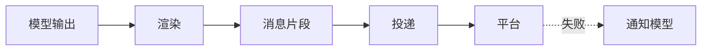

# 渲染与投递

::: tip
模型输出的是一段原始字符串，而用户在聊天软件中看到的则是一条条格式完整的消息。从模型输出到最终送达，中间需要经历解析、拆分、格式化、选择机器人账号、引用原消息以及失败处理——这整套流程就是 ChatLuna 的渲染与投递系统。
:::

表面上看，这只是「把回复发出去」，但要在多个聊天平台下稳定完成投递，需要处理不少细节：

不同平台支持的消息元素各不相同，单条消息也有字数上限；长回复需要合理拆分；模型可能会输出表情、图片、引用前文，甚至连续发送多条消息；发送过程中还可能遭遇网络超时或平台风控拦截。

模型本身无需关心这些平台特性。它的职责只是生成回复内容，后续的格式转换与落地派发，全部交由下层的渲染与投递链路处理。

<!-- 架构页，可以使用代码与配置示意 -->

## 两个阶段

在 ChatLuna 内部，模型输出到达聊天平台需要经过两个阶段：

### 渲染

渲染阶段的核心任务，是将模型输出的原始文本解析为结构化的消息片段，例如纯文本、图片、@提问者、引用回复、表情以及动作描述等。

这一层同时负责约束模型输出：通过提示词和规范，限制模型可以使用哪些元素标签、如何换行分条以及如何标记引用。

### 投递

投递阶段负责将解析好的消息片段转换为平台原生消息：选择合适的机器人账号、附加消息引用、匹配目标平台的元素能力，并捕获发送过程中的异常。

这一层不关心内容的具体语义，只专注于一件事：如何安全、准确地将内容送达用户。

## 输出格式

渲染层支持三种输出格式，用于平衡表达能力与跨平台兼容性：

| 格式 | 行为 |
| --- | --- |
| 纯文字 | 模型输出直接作为消息文本 |
| 富消息 | 模型通过元素标签描述图片、表情、@ 等 |
| Markdown | 整条回复生成完毕后按 Markdown 排版 |

默认配置下使用纯文字模式。这种模式容错率最高，兼容性也最好。

富消息模式适合需要图文混排、发送表情或 @特定用户的场景。模型在生成文本时使用约定的标签表示特定元素，渲染层解析后会将其转换为对应的平台消息元素。

Markdown 模式适合展示结构化文档或代码片段。由于并非所有聊天平台都能直接渲染 Markdown，通常需要配合图片渲染插件或平台原生的富文本能力。

### 元素

在富消息模式下，你可以通过配置限定允许使用的元素白名单：

- **基础消息**：消息、引用、@
- **媒体资源**：图片、音频、视频、文件
- **互动表达**：表情

如果模型输出了未允许的元素标签，渲染层会将其自动降级为普通文字发送，而不会抛出异常中断对话。

此外，部分内部元素无需展示给最终用户，例如模型的思考过程与运行状态。渲染层识别到这些元素后，会自动转入后台静默处理或直接隐藏。

::: tip
允许的元素越少，模型输出产生格式错乱的概率就越低。

如果你不需要机器人发送图片，可以在配置中关闭图片元素。这样可以有效避免模型误生成图片标签。
:::

## 分条

模型的回复可能较长，或者模型希望模仿真人打字分段发送。

配置项 `split` 决定了消息的切分策略：

- **按消息**：模型每输出一个消息标签，系统就立即向平台发送一条独立消息。
- **不分**：等待模型整轮输出完毕后，一次性发送整条消息。

按消息分条的体验更加自然，但这要求底层模型具备较好的指令遵循能力，能够准确理解分条时机。

除逻辑分条外，系统还提供了底层消息长度保护机制：

- **每条最多字数**：默认为 1500 字，单段超出限制时会被拆分到下一条。
- **最多几条**：默认为 6 条，超出上限的剩余内容会被合并到最后一条发出。

这两个阈值可以防止模型长回复过度刷屏。

## 引用

开启引用配置后，机器人的回复会自动引用用户的原消息。

在群聊等消息频繁的场景下，开启引用可以让用户清楚看到机器人在回复哪一条消息。

需要注意的是，并非所有聊天平台都支持引用功能，且引用内容本身也会计入平台单条消息的字数限制。

::: warning
部分聊天平台在实现引用时，会将原消息的文本重新发送一遍。

如果测试时发现机器人每次回复都会重复一遍用户发送的内容，请先检查引用配置或对应平台的适配器特性。
:::

## 工具前后的发言

当模型调用外部工具时，通常会在调用前输出「我查一下」，并在工具返回数据后总结输出最终结论。

针对工具调用前后的发言，系统提供了两个维度的配置项：

- **前一句发不发**：直接发送给用户，还是静默丢弃。
- **历史里怎么记**：作为独立消息完整记录、与后续回复合并为一条，还是仅保留最后一条。

及时向用户发送「我查一下」可以减少等待焦虑；但在多轮对话历史中记录过多短句，会占用上下文空间。

系统默认采用「发送 + 都记」策略。如果你希望对话更简短，也可以调整为「合成一条」或「只记最后一条」。

## 回复工具

部分轻量模型直接在文本中拼接富消息标签时容易出现语法错误，尤其在精确控制分条和元素混排时更不稳定。

针对这种情况，ChatLuna 提供了另一种回复方式——通过回复工具：

在此模式下，模型不再直接输出文本流，而是调用系统预置的回复工具，将回复内容作为参数传入。

这种方式的优势在于输出格式由工具参数校验强行约束；缺点是会增加一次工具调用的往返耗时，且对模型的指令遵循能力有一定要求。

::: tip
如果所接入的模型频繁出现元素标签格式错误，可以尝试切换为回复工具模式。
:::

## 工具说明

模型在后台调用工具时，用户在聊天界面中默认看不到执行过程。

配置项 `toolTalk` 决定了系统是否在提示词中引导模型说明工具调用过程：

- **从不**：不在提示词中提示，模型静默调用。
- **一般**：仅在工具执行结果重要时向用户说明。
- **完整**：每次调用工具都向用户明确说明。

在公开群聊中，适度说明有助于让用户了解信息来源；而在自动化场景下，可以省略说明以保持输出简短。

## 投递细节

消息片段解析完成后，投递模块将处理具体的平台发送逻辑。

### 选择机器人

一个路由节点可能会配置多个机器人账号。

系统在投递时遵循以下选择逻辑：优先使用当前会话绑定的机器人实例；如果当前会话未绑定机器人，则使用路由默认配置的机器人。

如果机器人选择错误，通常表现为消息发送到了其他账号，或者因权限不匹配导致发送失败。

### 引用与回复

当投递路由绑定了原始入站会话时，系统能够直接关联并引用用户的原消息。

如果当前场景仅支持直接发送，引用请求会被忽略，投递层会记录一条调试日志，不会虚标发送状态。

### 平台能力

不同聊天平台支持的功能有所差异，例如是否支持消息二次编辑、是否支持发送后撤回等。

投递层会动态读取平台声明的能力元数据。遇到平台不支持的功能时，系统会自动降级处理，而不是抛出错误中断流程。

## 失败处理

在实际运行中，消息投递失败通常由以下原因引起：内容被平台风控拦截、网络请求超时、触发频率限制或单条消息超长。

当投递失败时，系统会执行以下操作：

1. 记录详细的失败日志。
2. 尽可能继续投递当前批次中的其余消息片段。
3. 向会话中追加一条静默通知，告知模型该条消息未能送达用户。

通知模型非常必要：如果模型对发送失败不知情，在后续对话中就会默认用户已经看到了该回复，从而导致上下文理解产生偏差。

::: warning
如果系统出现投递失败的通知，请及时排查原因。

这通常意味着模型输出了平台不支持的内容，例如消息超长、格式不兼容，或触发了平台的内容审查。
:::

## 撤回与编辑

当用户在聊天平台中撤回或重新编辑消息时，系统会同步更新上下文：

- 自动向当前会话追加一条静默通知，记录撤回操作。
- 将已撤回且尚未处理的输入从队列中移除，避免模型继续回复已删除的消息。

这些通知均以静默方式写入，不会触发模型生成回复，仅用于保持对话历史的准确性。

## 投递事件

消息成功发送到目标平台后，投递系统会触发一个标准投递事件。事件载荷中包含所属路由、平台消息 ID、消息内容以及发送者标识等信息。

你可以通过编写插件监听这些事件，实现消息审计、用量统计、聊天记录归档或触发自定义业务逻辑。

## 与角色的关系

角色扮演场景通常对消息的呈现形式有更高要求。ChatLuna 的角色引擎默认基于富消息格式运行，并预设了以下行为：

- 默认采用按消息分条。
- 过程消息正常发送，写入历史记录时自动合并。
- 自动隐藏模型的思考过程、状态说明与沉默标记。

因此，在相同的输入下，角色引擎与普通对话引擎输出的消息形式可能会有所不同。

## 常见问题排查

遇到渲染或投递相关的问题时，可以参考以下清单进行排查：

**发出的消息格式错乱**

通常是模型输出了未允许的元素或标签未正确闭合。可以尝试缩减允许使用的元素白名单，或切换为回复工具模式。

**长回复被截断**

检查「每条最多字数」与「最多几条」的配置。超出限制的内容会被合并到最后一条，如果仍超出平台本身的限制，则会被平台截断。

**回复中重复了用户发送的内容**

这是由引用设置与部分平台适配器的实现差异导致的。可以在配置中关闭引用功能进行确认。

**消息发送到了错误的账号**

检查路由分配规则，以及当前会话与机器人账号的绑定关系。

**模型提示已发送，但聊天软件中未收到消息**

查看控制台中的投递失败通知与调试日志。常见原因包括平台风控拦截、网络请求超时或 API 调用频率超限。

**消息撤回后模型仍针对该消息回复**

检查撤回通知是否已正常写入会话，并确认该消息在撤回前是否已经被模型读取并开始处理。

## 下一步

- [消息处理链路](./chat-pipeline) — 了解渲染在链路中所处的位置
- [角色系统](./character) — 查看角色引擎的默认渲染配置
- [适配器](./adapters) — 了解各平台支持的能力与特性
- [工具系统](./tools) — 查看回复工具与常规输出的区别
