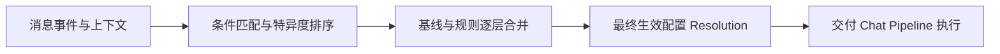
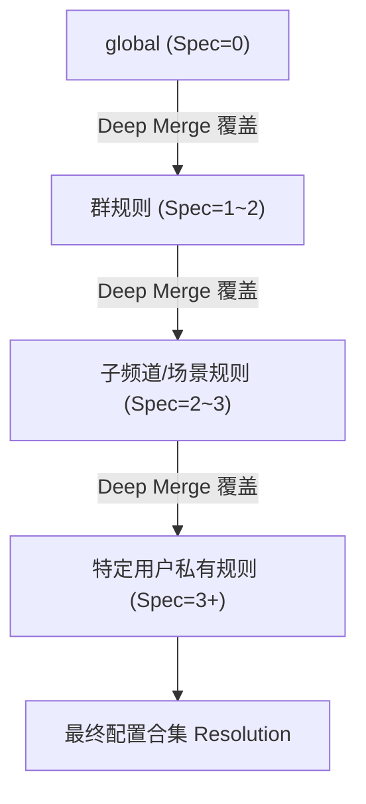
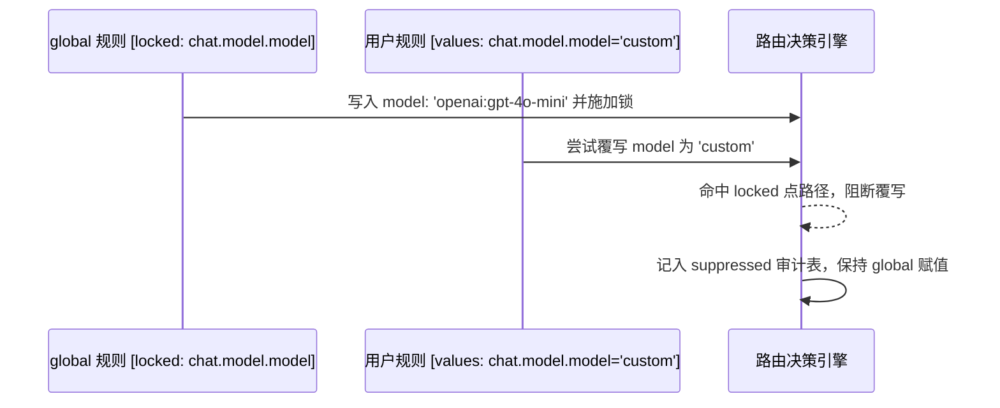
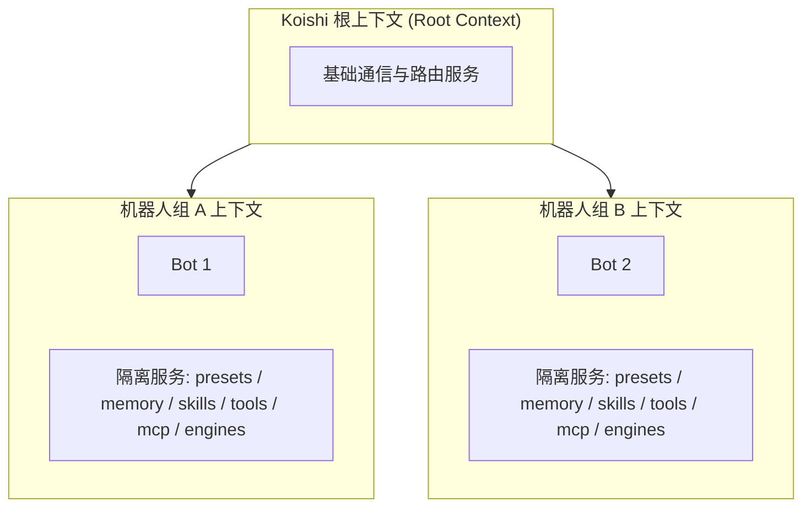

# 路由与场景规则

在复杂的多平台即时通讯环境中，同一个机器人往往同时服务于多个群组、频道与私聊会话。现实场景对机器人的行为要求极为分化：在技术交流群中需要严谨的代码助手与 Agent 工具支持；在玩家闲聊群中需要活泼的角色预设；在管理员私聊中需要放开高危指令与文件权限；而在某些特定频道内甚至需要对不同成员采用隔离的记忆与上下文。

ChatLuna v2 并没有为每个功能插件单独设计一整套过滤与匹配逻辑，而是引入了统一的**路由与场景规则系统（Routing）**。路由系统的核心理念是**「按条件覆盖默认值」**：每个功能模块将其配置项注册为一个命名空间（Namespace），系统默认维护一组基底设定，开发者或管理员则通过声明一系列规则（RoutingRule），在匹配到特定平台、群组、用户或消息内容时，对各命名空间的字段进行定向覆盖。



---

## 规则、条件与取值

一条路由规则（`RoutingRule`）由唯一标识、匹配条件（Predicate）、生效取值（Values）及元数据构成。

### 规则对象结构

| 字段 | 类型 / 默认值 | 说明 |
| :--- | :--- | :--- |
| `id` | `string`（必填） | 规则唯一标识符；其中 `global` 为保留规则 |
| `name` | `string` | 规则的可读显示名称 |
| `filter` | `Predicate`（必填） | 决定规则是否命中的条件谓词 |
| `values` | `Record<string, JsonValue>`（默认 `{}`） | 命名空间到局部配置对象的键值映射 |
| `enabled` | `boolean`（默认 `true`） | 规则启用状态；停用后完全退出匹配链 |
| `priority` | `number`（默认 `0`） | 人工调整的优先级；当特异度相同时越大越靠后（后覆盖先） |
| `locked` | `string[]`（默认 `[]`） | 点路径锁列表；锁定的字段禁止被更具体的规则改写 |
| `by` | `string` | 写入者标识或来源标签（例如 `customize`） |
| `revision` | `natural`（默认 `1`） | 用于并发控制与乐观锁的版本号 |
| `createdAt` | `natural`（默认 `0`） | 规则创建时间戳，用于排序打架决策 |
| `updatedAt` | `natural`（默认 `0`） | 规则最近更新时间戳 |

::: warning 保留规则 `global`
系统中必须存在标识为 `global` 的规则，其 `enabled` 必须始终为 `true`，`filter` 恒定为 `{ kind: 'true' }`。系统禁止删除 `global` 规则，它作为整套路由树的最顶层默认回退保障。
:::

---

## 条件谓词

条件谓词（`Predicate`）定义了触发规则所必需的上下文特征。系统内置了多种原语，并支持逻辑组合与插件扩展。

### 谓词类型一览

| `kind` | 专属字段 | 匹配逻辑与语义 |
| :--- | :--- | :--- |
| `true` | 无 | 无条件命中。特异度为 `0` |
| `scope` | `field`: `'platform'` \| `'self'` \| `'guild'` \| `'channel'` \| `'user'` \| `'route'`<br>`values`: `string[]` | 作用域检查。当 `values` 非空时，要求上下文对应字段值落在列表中；**当 `values` 为空数组 `[]` 时，表示仅判断该字段是否存在** |
| `direct` | 无 | 匹配私聊 / 私信环境 |
| `group` | 无 | 匹配群组 / 频道环境 |
| `at-me` | 无 | 匹配消息中提及（@）了当前机器人的场景 |
| `quote-me` | 无 | 匹配回复 / 引用了当前机器人历史消息的场景 |
| `content` | `match`: `'contains'` \| `'startsWith'` \| `'exact'` \| `'regex'`<br>`text`: `string` | 匹配消息文本。<br>• `exact`：自动 trim 两端空白后比对；<br>• `regex`：仅在文本前 20,000 字符内检索 |
| `not` | `operand`: `Predicate` | 取反操作。特异度继承自操作数 |
| `and` | `operands`: `Predicate[]` | 逻辑与。所有子条件必须同时满足 |
| `or` | `operands`: `Predicate[]` | 逻辑或。满足任一子条件即命中 |
| `custom` | `id`: `string`<br>`args?`: `Record<string, unknown>` | 插件扩展谓词。若对应 id 未注册，执行时直接求值为 `false` |

### 特异度计算（Specificity）

当多条规则被触发时，匹配更精准、条件更严苛的规则应该具有更高的裁量权。ChatLuna 按以下原则计算特异度权重：
- `kind: 'true'`：特异度计为 `0`；
- `kind: 'not'`：特异度等于其操作数 `operand` 的特异度；
- `kind: 'and'` / `kind: 'or'`：特异度等于所有子项特异度的绝对数值之和；
- 其余基础谓词（`scope`、`direct`、`group`、`at-me`、`quote-me`、`content`、`custom`）：特异度恒计为 `1`。

---

## 匹配顺序与覆盖

当一个输入事件到达时，路由引擎首先筛选出所有 `enabled: true` 且其 `filter` 计算为 `true` 的规则，随后通过严格排序器生成决议链。

### 排序算法与比较键

排序函数 `compareRules` 遵循固定层级：

1. **Global 最先**：`global` 规则始终固定在解析序列的第 0 位；
2. **Specificity 升序**：特异度越低越靠前，特异度越高越靠后；
3. **Priority 升序**：特异度相同时，人为指定的 `priority` 越小越靠前，越大越靠后；
4. **CreatedAt 升序**：前面均相同时，创建早的规则排在前面；
5. **ID 字典序**：兜底打破平局。

后出现的规则拥有更高的覆盖权重，其字段值将逐层覆盖先出现的值。



### 合并策略与路径锁（locked）

- **默认深度合并（Deep Merge）**：对普通对象属性递归合并，同名标量类型由后出现的规则直接覆写。
- **整块替换声明**：命名空间在其定义中若声明了 `merge: 'replace'`，则不再执行递归合并，后出现的规则将整个替换该命名空间的对象值。
- **点路径锁（locked）机制**：
  - 上游宽泛规则（如全局规则）如果将某些字段加入 `locked`（如 `locked: ['chat.model.model']`），更具体的下游规则对该点路径的写入将被彻底拦截；
  - 拦截机制双向生效：当父路径被锁，子路径写入进入 `suppressed` 被压制；当下级子路径被锁，父级标量对象的整体重写也会被阻断；
  - 最终被锁挡下的写入行为均完整记录在 `suppressed` 诊断列表中。



- **解析与故障隔离**：合并完成后按各命名空间的 Schema 逐项校验。如果校验失败，系统不会崩溃，而是隔离该故障命名空间，按「最新规则优先」的原则反向逐条剔除涉及该命名空间的规则，同时写入 `invalid-namespace` 诊断码；若全部剔除后依然不合法，则直接退回该命名空间 Schema 的原始默认值。

---

## 引擎优先

在所有命名空间中，`chat.engine` 具有特殊的最高引导优先级。

1. **提前解析**：在 `resolveMatched` 流程中，`chat.engine` 会被排在最前列先行解析。
2. **Schema Gate 与条件分支**：后续其他命名空间的 Schema 可以通过 `vary(engine)` 随当前生效的引擎动态改变；命名空间内的特定字段也可配置 `engines` 门禁，非目标引擎下相关字段将被过滤或忽略。
3. **禁用回退与诊断**：解析出的引擎如果未启用（即引擎配置中的 `engines.isEnabled` 返回 `false`），系统将自后向前剔除设置了该引擎的最新规则，并触发重新解析，同时产生 `engine-disabled` 诊断。当引擎最终解析为 `off` 时，代表在此场景下彻底不产生回复。
4. **引擎专属配置管理**：`chat.engine.config` 严格由各个引擎自身注册的 Config Schema 进行独立校验。在 WebUI 中，每一个引擎拥有独立的规则编辑 Tab（View），仅在当前规则选定了该引擎时才予以展示。

---

## 命名空间一览

系统中各核心插件注册的路由命名空间及其核心控制字段如下表所示：

| 命名空间 | 关键字段与类型要点 | 默认值 | 作用时机 |
| :--- | :--- | :--- | :--- |
| `chat.engine` | `id`: string, `config?`: record | `{ id: 'agent' }` | session |
| `chat.model` | `model`: string, `small?`, `medium?`, `large?`, `decide?` | `{ model: 'openai:gpt-4o-mini' }` | session |
| `chat.reasoning` | `effort?`: string（如 `high` / `medium` / `low` / `off`） | `{}` | session |
| `chat.preset` | `preset?`: string | `{}` | live |
| `chat.session` | `ownership`: `'shared'` \| `'personal'` \| `'custom'`, `customKey?`, `lane`: string | `{ ownership: 'shared', lane: 'default' }` | session |
| `chat.tools` | `mode?`: `'delegate'` \| `'native'` \| `'search'` \| `'code'`<br>`tools`: `{ allow?: string[], deny: string[] }` | `{ tools: { deny: [] } }`（allow 未填表示不限，填空数组表示全禁用，重叠按 deny 优先） | session |
| `chat.outbound` | `capture`: boolean | `{ capture: true }` | session |
| `chat.commands` | `allow`: string[] | `{ allow: ['help'] }`（执行未允许指令需向主人发起审核请求） | session |
| `chat.activation` | `use`: string[], 附带各 decider 参数配置 | `{ use: ['rule'], botNames: [], isNickname: true, isNickNameWithContent: false, allowPrivate: true, allowAtReply: true, allowQuoteReply: false, privateChatWithoutCommand: true, randomReplyFrequency: 0, msgCooldown: 0, ignoreSelf: true }` | live |
| `chat.observe` | `mode`: `'off'` \| `'quiet'`, `self`: boolean, `backfill.limit`: number, `midTurn`: `'step'` \| `'turn'`, `store`: `'message'` \| `'turn'`, `media.perMessage`: number, `media.attach`: number | `{ mode: 'off', self: true, backfill: { limit: 30 }, midTurn: 'step', store: 'message', media: { perMessage: 9, attach: 4 } }` | live |
| `chat.proactive` | `silence`: boolean, `followUp`: boolean, `topic`: boolean, `rhythm`: boolean | 四项开关均默认 `false` | live |
| `chat.merge` | `mode`: `'immediate'` \| `'settle'`, `quiet`: number, `max`: number, `interrupt`: boolean, `directMode?` | `{ mode: 'immediate', quiet: 2500, max: 15000, interrupt: false }` | live |
| `render` | `format`: `'text'` \| `'elements'` \| `'markdown'`, `elements`: string[], `split`: `'message'` \| `'none'`, `hidden`: string[], `toolTalk`: `'never'` \| `'sometimes'` \| `'always'`, `reply`: `'text'` \| `'tool'`, `interim.deliver`: `'send'` \| `'drop'`, `interim.history`: `'keep'` \| `'merge'` \| `'drop'`, `quote`: boolean, `maxChunkLength`: number, `maxSegments`: number | `{ format: 'text', split: 'message', hidden: [], toolTalk: 'never', reply: 'text', interim: { deliver: 'send', history: 'keep' }, quote: false, maxChunkLength: 1500, maxSegments: 6 }` | live |
| `censor` | `blockWords`: string[], `flagWords`: string[], `replaceRules`: Array<{ pattern: string, replacement: string }> | `{ blockWords: [], flagWords: [], replaceRules: [] }` | live |
| `memory` | `backend`: string, `enabled`: boolean, `gate`: boolean, `indexBudget`: number, `extractWindow`: number, `recall`: { enabled, interval }, `dream`: { enabled, idleAfter, nightly, cron, maxActive }, `isolation`: `'preset'` \| `'conversation'` | `{ backend: 'md', enabled: false, gate: false, indexBudget: 1500, extractWindow: 30, recall: { enabled: false, interval: 10 }, dream: { enabled: true, idleAfter: 1800000, nightly: true, cron: '0 4 * * *', maxActive: 300 }, isolation: 'preset' }` | live |
| `skills` | `allow?`: string[], `deny`: string[], `secrets`: boolean | `{ deny: [], secrets: true }` | live |
| `subagents` | `defaultModel`: string, `maxLevel?`: number, `depthLimit`: number, `profiles?`, `backends?` | `{ defaultModel: '@medium', depthLimit: 4 }` | live |
| `machines` | `default`: string, `allowed`: string[] | `{ default: 'local', allowed: ['local'] }` | live |
| `permissions` | `mode`: `'read-only'` \| `'files'` \| `'auto'` \| `'allow'`, `reviewer?`: string, `askTimeout?`: number | 无默认值；未设置时按用户等级与插件配置 | live |
| `compaction` | `threshold`: number, `remote`: boolean | `{ threshold: 0.8, remote: true }` | live |

::: tip 模型角色配置
`chat.model` 中的 `small`、`medium`、`large`、`decide` 等角色定义，不在基础规则中反复硬编码，而是在提供商页面的「模型角色」Tab 中进行统一分配与关联。
:::

---

## 作用时机：live 与 session

每个命名空间在声明时会带一个 `applies` 标记。它不是运行时的强制规则，而是给界面与文档的提示：这个值「大概什么时候」会被读取。

真正决定生效时机的是**读取它的子系统**，所以要按字段分类看：

| 字段 | 谁在读 | 什么时候生效 |
| --- | --- | --- |
| `chat.engine` | Agent 打开时挂载 | 需要新会话（或重新挂载） |
| `chat.model` / `chat.reasoning` | 每次 prepare step 重新解析 | 下一次模型请求 |
| `chat.preset` | 回合开始时切换 | 下一回合 |
| `chat.tools` / `chat.commands` | 每次组装工具可见性 | 下一回合 |
| `chat.activation` / `chat.observe` / `chat.merge` | 消息进入管线时读取 | 下一条消息 |
| `render` / `censor` | 渲染与审核时读取 | 下一次投递 |
| `memory` / `skills` / `subagents` / `machines` | 各服务按需读取 | 下一次调用 |

所以实际经验是：

- **引擎是例外**。改引擎后，已经打开的会话仍跑在旧引擎上，直到会话被重建。
- **其余大多数字段下一回合就生效**，不需要清上下文。
- **预设切换**尤其快：它只影响提示词装配，不重建历史。

::: tip
看到「规则改了但没反应」，先判断这个字段属于哪一类。

如果是引擎，换个新会话验证；如果是模型或工具，等下一轮再看；如果还不对，检查是否被更具体的规则覆盖。
:::

---

## 保存、版本与冲突

路由规则的变更需要保证多客户端与并发管理下的数据一致性。

### 乐观并发锁机制

- 调用 `save(input, { revision })` 保存规则时，入参中的 `revision` 必须精确等于当前规则对象的最新 `revision`（新建规则时传入 `0`）。
- 若版本号不吻合，系统立即拒绝并抛出 `CONFLICT` 错误，避免因多个管理员在 WebUI 同时修改造成脏写。
- 对保留规则 `global` 执行删除操作，系统直接抛出 `INVALID_ARGUMENT`。

### 字段裁剪与演进

随着插件更新，部分历史字段可能被废弃。保存前，系统会参照最新的命名空间 Schema 自动剔除未知或退役字段，被移除的属性将汇总在返回值中的 `migrated` 结构告知调用方，同时在日志中记录 dropped 跟踪项。

### 事务持久化与降级

持久化严格依赖底层配置事务：
```typescript
chatluna_config.change({
  id: entryId,
  options: { config: { rules } },
  by,
  reason,
})
```
写入成功后，系统通过 `internal/update` 事件重新提交（commit）。若当前运行环境中未提供 `runtime-config` 或找不到加载器 entry，系统将仅在内存中提交本次变更，并在日志中输出警告。

每当成功 commit，系统会自增 `revision`、全量清除匹配结果缓存，并广播通知事件：
- 广播 `chatluna/rules-change`；
- 监听外部的 `schemas/changed`（`section:routing`）和 `chatluna/config-change` 事件，在命名空间扩展或外部变动时同样自动清空解析缓存。

---

## 解释一次解析

为了排查不同规则覆盖冲突，路由模块提供了一组清晰的解析与诊断 API。

### 核心 API 矩阵

- **`resolve(input)`**：主入口。计算并返回被 `Object.freeze` 冻结的 `Resolution` 结果（含 `ruleIds`、`values`、`sources`、`suppressed`、`diagnostics`、`revision`）。当规则库中不包含任何 `content` 与 `custom` 谓词时，系统会基于发送方身份键对结果实施缓存（容量上限 256 条）；一旦含有内容/自定义谓词，则跳过缓存以确保实时匹配。
- **`explain(input)`**：面向诊断面板与调试工具。在 `Resolution` 基础上附加命中规则列表（`matched`）以及 `decidedBy` 字典，精准标示每个命名空间的生效值最终是由哪一条特异度最高的规则决定的。
- **`valuesAt(subject, ns)`**：面向 WebUI 与外部 API。查询指定实体主体（群/用户）在某命名空间下的最终计算值。若查询主体未绑定机器人生态，默认以空的 `platform` / `selfId` 进行沙盒求值。
- **`matchInput(session)`**：将 Satori 原生 Session 及当前 `routeId` 提取并规格化为路由输入对象。优先提取剔除了指令前缀与 @ 机器人的 stripped 纯文本；`isAtMe` 综合判断 `stripped.atSelf` 和原始消息段中的真实 at 元素；`isQuotingMe` 校验 `quote.user.id`；`isSelf` 检查 `userId === selfId`。

### 诊断码（PublicDiagnostic）

解析过程产生的所有诊断均具有 `warning` 级别，错误码形如 `routing.<code>`：

- **`routing.predicate-error`**：计算条件谓词时抛出异常；
- **`routing.unknown-namespace`**：规则中包含了未经注册的未知命名空间；
- **`routing.invalid-namespace`**：命名空间未能通过 Schema 校验并触发规则剔除回退；
- **`routing.engine-disabled`**：规则指定的底层引擎处于停用状态并触发自动降级回退。

### 追踪字段：sources 与 suppressed

- **`sources`**：映射表结构，精确记录最终生成的每一个字段是来自于哪一条规则的 ID；
- **`suppressed`**：记录所有由于匹配到了祖先或自身路径的 `locked` 锁，导致写入被丢弃的属性路径、来源规则 ID 与丢弃的值。

---

## 给每个群单独配置

以下是展示真实业务场景的完整 YAML 示例，演示了如何通过多种谓词、路径锁、独立会话所有权以及正则匹配来组合出复杂的业务逻辑：

```yaml
- id: routing
  name: '@chatluna/routing'
  config:
    rules:
      # 1. 全局基准规则：统一锁定全局默认模型，禁止普通群聊覆写模型
      - id: global
        filter: { kind: 'true' }
        locked:
          - chat.model.model
        values:
          chat.engine:
            id: agent
          chat.model:
            model: openai:gpt-4o-mini
          chat.session:
            ownership: shared
            lane: default

      # 2. 技术支持群（群号 10001）：启用指定预设与代码工具，使用群共享上下文
      - id: guild-tech-support
        name: 技术支持群定制
        filter:
          kind: 'and'
          operands:
            - { kind: 'scope', field: 'platform', values: ['onebot'] }
            - { kind: 'scope', field: 'guild', values: ['10001'] }
        values:
          chat.preset:
            preset: code-helper
          chat.tools:
            mode: code
            tools:
              allow: ['bash', 'filesystem']
              deny: []

      # 3. 娱乐摸鱼群（群号 20002）：设置私人所有权（每个群成员拥有独立上下文记忆）
      - id: guild-personal-chat
        name: 娱乐闲聊独立上下文
        filter:
          kind: 'scope'
          field: 'guild'
          values: ['20002']
        values:
          chat.engine:
            id: character
          chat.preset:
            preset: sakura
          chat.session:
            ownership: personal

      # 4. 尝试在群聊中非法修改被锁定的模型（将被 suppressed 拦截）
      - id: guild-override-model-fail
        name: 违规覆写模型尝试
        filter:
          kind: 'scope'
          field: 'guild'
          values: ['30003']
        values:
          chat.model:
            model: anthropic:claude-3-5-sonnet

      # 5. 特定 VIP 用户的私聊配置：拥有专属自定义上下文键
      - id: vip-direct-user
        name: VIP私聊定制
        filter:
          kind: 'and'
          operands:
            - { kind: 'direct' }
            - { kind: 'scope', field: 'user', values: ['99999'] }
        values:
          chat.session:
            ownership: custom
            customKey: 'vip-{platform}-{userId}'
          render:
            format: markdown
            reply: tool

      # 6. 正则指令路由：当消息以「#深度研讨」开头时触发特定高级推理配置
      - id: regex-deep-research
        name: 触发深度研讨
        filter:
          kind: 'content'
          match: 'regex'
          text: '^#深度研讨\s+'
        values:
          chat.reasoning:
            effort: high
          render:
            split: none
```

---

## 目录与 peers

在配置路由规则时，管理后台需要对历史对话涉及的群组、频道和用户进行定位与自动补全。路由模块为此提供了 `Directory` 与 `Peers` 支撑组件。

### 实体目录（Entity Directory）

`Directory` 服务负责直接向接入的 Bot 实例发起拉取请求，检索 `guild`（群组）、`channel`（频道）与 `user`（用户）实体列表：
- **调用超时**：每次调用 Bot 实例底层接口受 5 秒超时保护；
- **分页与时间预算**：内部 `EntityPages` 分页处理机制为单页运算分配 8 秒最大时间预算，避免拉取超大群列表造成主线程停滞；
- **游标生命周期**：生成的检索 cursor 最多保留 256 个，具备 5 分钟超时自动注销机制；
- **检索逻辑**：`query` 过滤针对实体的 `id`、`name` 以及 `platform` 进行全小写子串包含匹配。

### 对话实体记录表（Peers）

除了主动拉取，系统还通过事件流监听记录最近活跃的实体关系并存入 `chatluna_peers` 数据库表：
- **自动记录范围**：实时登记会话中出现的 `user`、`guild`、`channel` 及绑定的 `bot` 关联；
- **节流与批量更新**：单实体触发记录施加 10 分钟写入节流，并通过 1 秒防抖（Debounce）合并后批量执行 upsert；
- **容量与驱逐策略**：`chatluna_peers` 表设定硬上限 20,000 条，超出容量时按 `updatedAt` 升序由早到晚剔除淘汰；
- **缓存策略**：内存中维护容量为 5,000 条的实体 Profile 缓存，有效生命周期（TTL）为 10 分钟。

---

## 机器人组隔离

在企业或大型团队场景中，同一个宿主框架可能接入归属于不同部门或业务线的多个机器人（Bot Group）。为了防止商业人设、敏感技能或私有记忆在不同机器人之间穿透，系统引入了机器人组服务隔离架构。



### 人格与能力服务集（PERSONA_SERVICES）

系统将以下服务定义为核心人格服务集合：
- `presets`（预设与提示词模板）
- `memory`（长期与短期记忆存储）
- `skills`（高层能力组合）
- `tools`（模型工具函数）
- `mcp`（Model Context Protocol 接入服务）
- `engines`（会话驱动引擎）
- `preset_snippets`（人设微调片段）
- `schedule`（定时场景规划）

### 严格上下文隔离机制

- **禁止隐式回退**：声明为隔离的服务在解析时，**仅从当前 Bot 归属的 Bot Group 局部 Scoped 上下文中检索**。如果在该 Group 的上下文中未提供对应的服务实例，系统会显式判定为服务缺失，**绝不会回退到根上下文（Root Context）中查找**。这一机制从根本上杜绝了将全局敏感的人格预设或私有知识库意外暴露给第三方机器人的安全隐患。
- **独占归属**：一个具体的 Bot 实例在生命周期内只能归属于一个 Bot Group，试图跨组重复 Claim 机器人实例将直接抛出异常。

---

## 下一步

- 阅读 [会话执行管道](./chat-pipeline) 了解一条匹配完成的规则如何驱动整条消息流水线。
- 阅读 [会话通道与状态](./conversations) 了解会话的所有权隔离与 Lane 设计。
- 阅读 [智能体架构与多代理](./agents) 了解不同引擎在 Agent 模式下的协同流程。
- 阅读 [会话状态管理](./sessions) 探索分布式环境下的上下文持久化。
