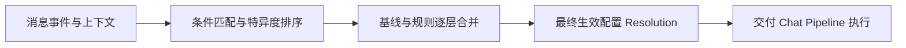
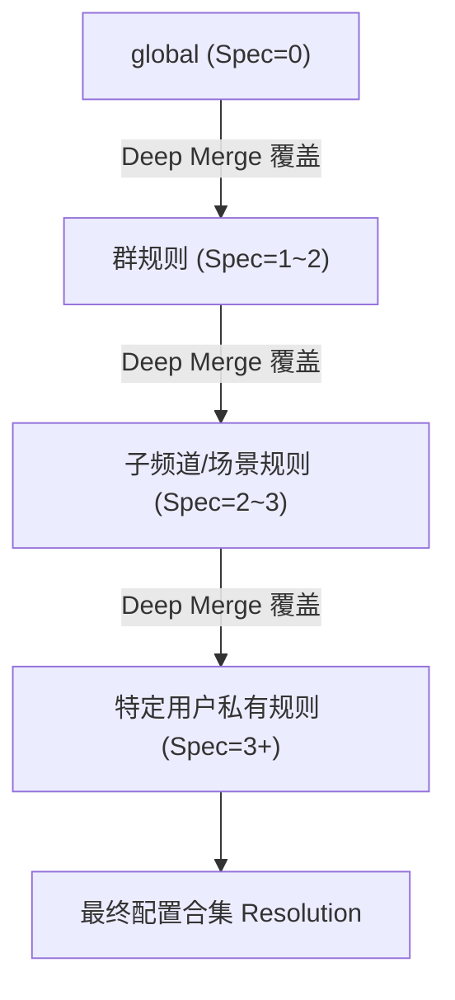
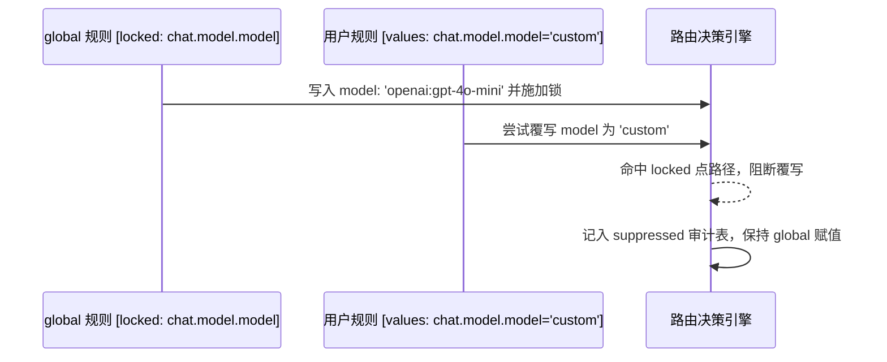
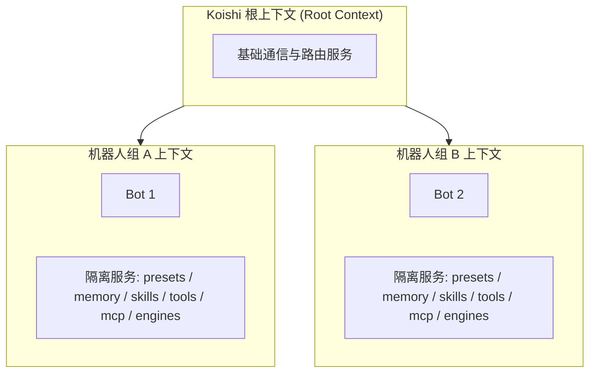

# 路由与场景规则

::: tip
同一个机器人往往同时服务技术群、闲聊群和管理员私聊，各自需要不同的模型、人设、权限和上下文隔离。路由系统统一处理这类差异：每个功能把配置注册为一个命名空间，平时使用全局基准值，需要针对平台、群、用户或消息内容定制时，用路由规则（`RoutingRule`）覆盖指定命名空间的字段。
:::



## 规则

| 字段 | 类型 / 默认值 | 说明 |
| :--- | :--- | :--- |
| `id` | `string`（必填） | 规则标识；`global` 为保留规则 |
| `name` | `string` | 显示名称 |
| `filter` | `Predicate`（必填） | 决定规则是否命中 |
| `values` | `Record<string, JsonValue>`（默认 `{}`） | 命名空间到局部配置的映射 |
| `enabled` | `boolean`（默认 `true`） | 停用后完全退出匹配 |
| `priority` | `number`（默认 `0`） | 特异度相同时，数值越大越靠后（后覆盖先） |
| `locked` | `string[]`（默认 `[]`） | 点路径锁，锁定的字段不能被更具体的规则改写 |
| `by` | `string` | 写入者或来源标签（如 `customize`） |
| `revision` | `natural`（默认 `1`） | 乐观锁版本号 |
| `createdAt` | `natural`（默认 `0`） | 创建时间，参与排序 |
| `updatedAt` | `natural`（默认 `0`） | 最近更新时间 |

::: warning
必须存在且始终启用 `id` 为 `global` 的规则，其 `filter` 恒为 `{ kind: 'true' }`，作为兜底基准，不能删除。
:::

## 条件谓词

| `kind` | 字段 | 语义 |
| :--- | :--- | :--- |
| `true` | — | 无条件命中，特异度 `0` |
| `scope` | `field`: `'platform'` \| `'self'` \| `'guild'` \| `'channel'` \| `'user'` \| `'route'`<br>`values`: `string[]` | `values` 非空时要求字段值在列表中；**为空数组时只判断字段是否存在** |
| `direct` | — | 私聊 |
| `group` | — | 群组 / 频道 |
| `at-me` | — | 消息 @ 了机器人 |
| `quote-me` | — | 引用了机器人的消息 |
| `content` | `match`: `'contains'` \| `'startsWith'` \| `'exact'` \| `'regex'`<br>`text`: `string` | 匹配消息文本。`exact` 先去掉两端空白；`regex` 只检索前 20,000 字符 |
| `not` | `operand`: `Predicate` | 取反，特异度继承操作数 |
| `and` | `operands`: `Predicate[]` | 全部满足 |
| `or` | `operands`: `Predicate[]` | 任一满足 |
| `custom` | `id`: `string`<br>`args?`: `Record<string, unknown>` | 插件扩展谓词，`id` 未注册时求值为 `false` |

多条规则同时命中时，条件越精确的规则特异度越高：

- `true` 为 `0`。
- `not` 继承操作数的特异度。
- `and` / `or` 为所有子项特异度之和。
- 其余基础谓词（`scope`、`direct`、`group`、`at-me`、`quote-me`、`content`、`custom`）各为 `1`。

## 匹配顺序与覆盖

路由先选出所有 `enabled: true` 且 `filter` 命中的规则，再由 `compareRules` 排序：

1. `global` 固定在第 0 位。
2. 特异度升序。
3. `priority` 升序。
4. `createdAt` 升序。
5. ID 字典序。

排在后面的规则覆盖前面的值。



合并策略：

- **深度合并**：对象递归合并，同名标量由后面的规则覆盖。
- **整块替换**：命名空间声明了 `merge: 'replace'` 时，后面的规则整体替换该命名空间的值。
- **点路径锁**：宽泛规则把字段加入 `locked`（如 `locked: ['chat.model.model']`）后，更具体规则对该路径的写入被拦截。双向生效：父路径被锁时子路径写入被压制，子路径被锁时父级对象的整体重写也被阻止。被拦下的写入记录在 `suppressed` 中。



合并完成后按各命名空间的 Schema 校验。校验失败不会崩溃：系统按「最新规则优先」逐条剔除涉及该命名空间的规则，并写入 `invalid-namespace` 诊断；全部剔除后仍不合法时，退回 Schema 默认值。

## 引擎优先

`chat.engine` 最先解析，因为很多配置的校验和展示取决于当前引擎：

1. 在 `resolveMatched` 中排在最前。
2. 其他命名空间的 Schema 可以通过 `vary(engine)` 随引擎变化；字段也可以配置 `engines` 门禁，非目标引擎下被过滤。
3. 解析出的引擎未启用（`engines.isEnabled` 返回 `false`）时，从后往前剔除设置了该引擎的规则并重新解析，产生 `engine-disabled` 诊断。最终为 `off` 表示该场景不回复。
4. `chat.engine.config` 由引擎自己注册的 Config Schema 校验。控制台中每个引擎有独立的标签页，只在规则选中该引擎时显示。

## 命名空间一览

| 命名空间 | 关键字段 | 默认值 | 作用时机 |
| :--- | :--- | :--- | :--- |
| `chat.engine` | `id`: string, `config?`: record | `{ id: 'agent' }` | session |
| `chat.model` | `model`: string, `small?`, `medium?`, `large?`, `decide?` | `{ model: 'openai:gpt-4o-mini' }` | session |
| `chat.reasoning` | `effort?`: string（如 `high` / `medium` / `low` / `off`） | `{}` | session |
| `chat.preset` | `preset?`: string | `{}` | live |
| `chat.session` | `ownership`: `'shared'` \| `'personal'` \| `'custom'`, `customKey?`, `lane`: string | `{ ownership: 'shared', lane: 'default' }` | session |
| `chat.tools` | `mode?`: `'delegate'` \| `'native'` \| `'search'` \| `'code'`<br>`tools`: `{ allow?: string[], deny: string[] }` | `{ tools: { deny: [] } }`（allow 不填表示不限，空数组表示全禁，重叠时 deny 优先） | session |
| `chat.outbound` | `capture`: boolean | `{ capture: true }` | session |
| `chat.activation` | `use`: string[] 及各 decider 参数 | `{ use: ['rule'], botNames: [], isNickname: true, isNickNameWithContent: false, allowPrivate: true, allowAtReply: true, allowQuoteReply: true, privateChatWithoutCommand: true, randomReplyFrequency: 0, msgCooldown: 0, ignoreSelf: true }` | live |
| `chat.observe` | `mode`: `'off'` \| `'quiet'`, `self`: boolean, `backfill.limit`: number, `midTurn`: `'step'` \| `'turn'`, `store`: `'message'` \| `'turn'`, `media.perMessage`: number, `media.attach`: number | `{ mode: 'off', self: true, backfill: { limit: 30 }, midTurn: 'step', store: 'message', media: { perMessage: 9, attach: 4 } }` | live |
| `chat.proactive` | `silence`, `followUp`, `topic`, `rhythm`: boolean | 均为 `false` | live |
| `chat.merge` | `mode`: `'immediate'` \| `'settle'`, `quiet`: number, `max`: number, `interrupt`: boolean, `directMode?` | `{ mode: 'immediate', quiet: 2500, max: 15000, interrupt: false }` | live |
| `render` | `format`: `'text'` \| `'elements'` \| `'markdown'`, `elements`: string[], `split`: `'message'` \| `'none'`, `hidden`: string[], `toolTalk`: `'never'` \| `'sometimes'` \| `'always'`, `reply`: `'text'` \| `'tool'`, `interim.deliver`: `'send'` \| `'drop'`, `interim.history`: `'keep'` \| `'merge'` \| `'drop'`, `quote`: boolean, `maxChunkLength`: number, `maxSegments`: number | `{ format: 'text', split: 'message', hidden: [], toolTalk: 'never', reply: 'text', interim: { deliver: 'send', history: 'keep' }, quote: false, maxChunkLength: 1500, maxSegments: 6 }` | live |
| `censor` | `blockWords`: string[], `flagWords`: string[], `replaceRules`: Array<{ pattern: string, replacement: string }> | `{ blockWords: [], flagWords: [], replaceRules: [] }` | live |
| `memory` | `backends`: string[], `enabled`, `gate`: boolean, `indexBudget`, `extractWindow`: number, `recall`: { enabled, interval }, `dream`: { enabled, idleAfter, nightly, cron, maxActive }, `isolation`: `'preset'` \| `'conversation'` | `{ backends: ['md'], enabled: false, gate: false, indexBudget: 1500, extractWindow: 30, recall: { enabled: false, interval: 10 }, dream: { enabled: true, idleAfter: 1800000, nightly: true, cron: '0 4 * * *', maxActive: 300 }, isolation: 'preset' }` | live |
| `skills` | `allow?`: string[], `deny`: string[], `secrets`: boolean | `{ deny: [], secrets: true }` | live |
| `subagents` | `defaultModel`: string, `maxLevel?`: number, `depthLimit`: number, `profiles?`, `backends?` | `{ defaultModel: '@medium', depthLimit: 4 }` | live |
| `machines` | `default`: string, `allowed`: string[] | `{ default: 'local', allowed: ['local'] }` | live |
| `permissions` | `mode`: `'read-only'` \| `'files'` \| `'auto'` \| `'allow'`, `reviewer?`: string, `askTimeout?`: number | 无；未设置时按用户等级与插件配置 | live |
| `compaction` | `threshold`: number, `remote`: boolean | `{ threshold: 0.8, remote: true }` | live |

::: tip
`chat.model` 中的 `small`、`medium`、`large`、`decide` 角色在提供商页面的「模型角色」标签页中统一分配，不需要在规则中反复填写。
:::

## 作用时机

命名空间声明的 `applies`（`live` / `session`）只是界面提示，真正决定何时生效的是读取它的子系统：

| 字段 | 谁在读 | 何时生效 |
| --- | --- | --- |
| `chat.engine` | Agent 打开时挂载 | 新会话（或重新挂载） |
| `chat.model` / `chat.reasoning` | 每次 prepare step 重新解析 | 下一次模型请求 |
| `chat.preset` | 回合开始时切换 | 下一回合 |
| `chat.tools` | 每次组装工具可见性 | 下一回合 |
| `chat.activation` / `chat.observe` / `chat.merge` | 消息进入管线时 | 下一条消息 |
| `render` / `censor` | 渲染与审核时 | 下一次投递 |
| `memory` / `skills` / `subagents` / `machines` | 各服务按需读取 | 下一次调用 |

只有引擎是例外：活跃会话会一直使用旧引擎，直到会话重建。其他字段大多下一回合生效，不需要清除上下文；切换预设只影响提示词组装，不会重建历史。规则改了没生效时，先确认字段属于哪类时机，再检查是否被更具体的规则或路径锁覆盖。

## 保存、版本与冲突

- `save(input, { revision })` 的 `revision` 必须等于当前最新值（新建传 `0`），否则抛出 `CONFLICT`。
- 删除 `global` 抛出 `INVALID_ARGUMENT`。
- 保存前按最新 Schema 剔除未知或退役字段，被移除的属性汇总在返回值的 `migrated` 中，并记录 dropped 日志。

规则通过配置事务持久化：

```typescript
chatluna_config.change({
  id: entryId,
  options: { config: { rules } },
  by,
  reason,
})
```

写入成功后通过 `internal/update` 事件提交。没有 `runtime-config` 或找不到加载器 entry 时，只在内存中提交并输出警告。每次提交都会自增 `revision`、清空匹配缓存、广播 `chatluna/rules-change`；收到 `schemas/changed`（`section:routing`）或 `chatluna/config-change` 时也会清空缓存。

## 解析与诊断 API

- **`resolve(input)`**：主入口，返回冻结的 `Resolution`（`ruleIds`、`values`、`sources`、`suppressed`、`diagnostics`、`revision`）。规则中没有 `content` 和 `custom` 谓词时，按发送方身份缓存结果（上限 256 条）；有则跳过缓存。
- **`explain(input)`**：在 `Resolution` 基础上附加命中规则 `matched` 和 `decidedBy`，标明每个命名空间的值由哪条规则决定。
- **`valuesAt(subject, ns)`**：查询指定主体在某命名空间下的最终值。主体没有绑定机器人时，以空的 `platform` / `selfId` 求值。
- **`matchInput(session)`**：把 Satori Session 和当前 `routeId` 规格化为路由输入。优先使用去掉指令前缀与 @ 的文本；`isAtMe` 综合 `stripped.atSelf` 和消息中的 at 元素；`isQuotingMe` 检查 `quote.user.id`；`isSelf` 检查 `userId === selfId`。

诊断均为 `warning` 级别：

- `routing.predicate-error`：谓词求值抛出异常。
- `routing.unknown-namespace`：规则包含未注册的命名空间。
- `routing.invalid-namespace`：命名空间校验失败并触发剔除回退。
- `routing.engine-disabled`：指定的引擎已停用并触发回退。

`sources` 记录每个字段来自哪条规则；`suppressed` 记录被路径锁拦下的路径、来源规则和被丢弃的值。

## 示例

```yaml
- id: routing
  name: '@chatluna/routing'
  config:
    rules:
      # 全局基准：锁定默认模型，禁止其他规则覆写
      - id: global
        filter: { kind: 'true' }
        locked:
          - chat.model.model
        values:
          chat.engine:
            id: agent
          chat.model:
            model: openai:gpt-4o-mini
          chat.session:
            ownership: shared
            lane: default

      # 技术支持群：指定预设与代码工具
      - id: guild-tech-support
        name: 技术支持群定制
        filter:
          kind: 'and'
          operands:
            - { kind: 'scope', field: 'platform', values: ['onebot'] }
            - { kind: 'scope', field: 'guild', values: ['10001'] }
        values:
          chat.preset:
            preset: code-helper
          chat.tools:
            mode: code
            tools:
              allow: ['bash', 'filesystem']
              deny: []

      # 闲聊群：每个成员独立上下文
      - id: guild-personal-chat
        name: 娱乐闲聊独立上下文
        filter:
          kind: 'scope'
          field: 'guild'
          values: ['20002']
        values:
          chat.engine:
            id: character
          chat.preset:
            preset: sakura
          chat.session:
            ownership: personal

      # 试图覆写被锁定的模型，会被记入 suppressed
      - id: guild-override-model-fail
        name: 违规覆写模型尝试
        filter:
          kind: 'scope'
          field: 'guild'
          values: ['30003']
        values:
          chat.model:
            model: anthropic:claude-3-5-sonnet

      # VIP 私聊：自定义上下文键
      - id: vip-direct-user
        name: VIP私聊定制
        filter:
          kind: 'and'
          operands:
            - { kind: 'direct' }
            - { kind: 'scope', field: 'user', values: ['99999'] }
        values:
          chat.session:
            ownership: custom
            customKey: 'vip-{platform}-{userId}'
          render:
            format: markdown
            reply: tool

      # 以「#深度研讨」开头的消息使用高推理档位
      - id: regex-deep-research
        name: 触发深度研讨
        filter:
          kind: 'content'
          match: 'regex'
          text: '^#深度研讨\s+'
        values:
          chat.reasoning:
            effort: high
          render:
            split: none
```

## 目录与 peers

规则编辑器需要定位和补全群、频道和用户，路由模块为此提供 `Directory` 与 `Peers`。

`Directory` 直接向 Bot 拉取 `guild`、`channel`、`user` 列表：

- 每次调用 Bot 接口有 5 秒超时。
- `EntityPages` 分页每页最多 8 秒，避免超大群列表卡住主线程。
- 检索 cursor 最多保留 256 个，5 分钟后失效。
- `query` 对 `id`、`name`、`platform` 做小写子串匹配。

`Peers` 监听事件记录最近活跃的实体，存入 `chatluna_peers` 表：

- 记录会话中出现的 `user`、`guild`、`channel` 及关联的 `bot`。
- 同一实体 10 分钟内只记录一次，1 秒防抖后批量 upsert。
- 表上限 20,000 条，超出时按 `updatedAt` 从早到晚淘汰。
- 内存中有 5,000 条的 Profile 缓存，TTL 10 分钟。

## 机器人组隔离

同一个实例可能接入归属于不同业务线的多个机器人。为防止人设、技能或私有记忆在机器人之间泄漏，系统按机器人组（Bot Group）隔离服务。



隔离的服务集合（`PERSONA_SERVICES`）：`presets`、`memory`、`skills`、`tools`、`mcp`、`engines`、`preset_snippets`、`schedule`。

- **不回退**：这些服务只在 Bot 所属组的上下文中查找，组内没有就判定为缺失，**不会回退到根上下文**，从而避免全局的人设或知识库暴露给其他机器人。
- **独占归属**：一个 Bot 只能属于一个组，重复认领会抛出异常。

## 下一步

- [会话执行管道](./chat-pipeline) — 匹配后的规则如何驱动消息流水线。
- [会话通道与状态](./conversations) — 会话所有权与 lane。
- [智能体架构与多代理](./agents) — 不同引擎在 Agent 模式下的协作。
- [会话状态管理](./sessions) — 上下文持久化。
