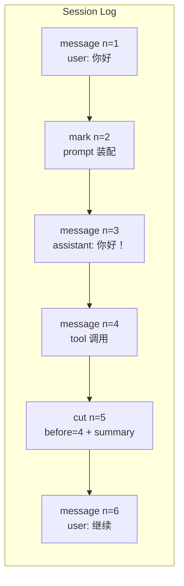
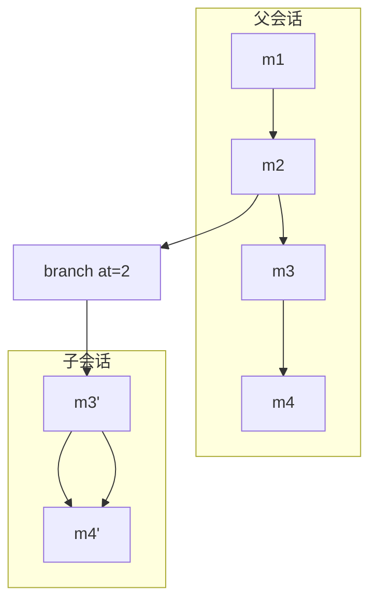

# 会话、消息与分支

在 ChatLuna 中，`ctx.sessions` 提供只追加（Append-Only）的会话日志，`ctx.conversations` 则在日志之上维护「会话键（Key）→ 活跃会话」的索引映射。

模型实际读取的上下文并非单独存储，而是直接从日志投影计算而来：**会话日志是系统的唯一事实源（Source of Truth）**。

## 日志条目模型

会话日志由三类条目按序追加构成，每条条目都分配有单调递增的序号 `n`：

条目类型包含：

- **`message`**：角色消息，包含 `user`、`assistant`、`tool`、`system` 等角色。
- **`mark`**：命名标记（如 `prompt`、`preset/selected`、`request/context`），用于记录系统决策上下文，但不会直接注入模型对话历史。
- **`cut`**：上下文压缩切点。通过声明 `before` 指定生效序号，该序号及之前的消息会被条目中的 `summary[]` 替代遮蔽。

投影函数遵循以下重放规则：

- `messagesOfEntries`：从最后一条 `cut` 记录的 `summary` 出发，拼接其后追加的全部 `message` 条目，投影出模型可见的上下文窗口。
- `reconstructRequestFromEntries`：结合日志中的 `prompt` 等 `mark` 条目，完整还原历史中发起过的单次模型请求配置。

::: tip
`cut` 操作属于软截断。`before` 之前的消息虽然不再进入模型的活跃重放窗口，但仍完整保存在底层的 append-only 日志中，不会被物理删除。
:::

## 并发写入与冲突处理

日志的追加写入采用乐观并发控制（Optimistic Concurrency Control）：

写入时调用方需提供 `expectedN`，声明当前操作所预期的下一条序号。若底层实际序号与 `expectedN` 不符，系统将抛出 `SessionConflictError`。

::: warning
当捕获到 `SessionConflictError` 时，表明其他调用已在此期间追加了新条目。调用方必须重新读取最新日志状态，并基于新的 `n` 重新尝试写入，以保证日志序列严格线性。
:::

## 会话分支与分叉

你可以从历史的任意点分叉出会话链路。分叉后，子会话将继承分叉点之前的全部历史，并在该分叉点之后拥有独立的追加序列：

针对不同层级的操作：

- **日志层**：调用 `Session.branch(at)` 从指定位置 `at` 截出子会话。子会话头部会持久记录其 `parent` 标识与分叉位点 `at`。
- **索引层**：调用 `ctx.conversations.fork(key)`，系统将在会话层为指定的 Key 执行分叉，并建立新的活跃映射。

## 消息接收模式

向 Agent 投递新消息时，调用 `agent.receive(message, { when })`，并通过 `when` 选项控制消息进入会话与调度执行的时机：

- **`next`**：将消息排入收件箱（Inbox），等待当前正在执行的轮次或步骤（Step）结束后，在下一轮中处理。
- **`now`**：中断当前正在运行的 step，立即切入处理该消息。
- **`quiet`**：仅将消息作为条目追加到会话日志中，不触发任何 Agent 执行循环。

## 会话持久化

`ctx.sessions` 在核心运行时中是一个纯内存数据模型。

如果需要实现跨进程或停机持久化，需加载提供 `ctx.session_store` 扩展能力的服务。系统默认提供 SQLite 实现：

- **元数据与日志条目**：存储于 `chatluna_session_header` 与 `chatluna_session_entry` 数据表。
- **二进制数据**：超大附件与 Blob 资源写入配置的 `blobDir` 目录下。

## 下一步

- [Agent 与执行循环](./agents)
